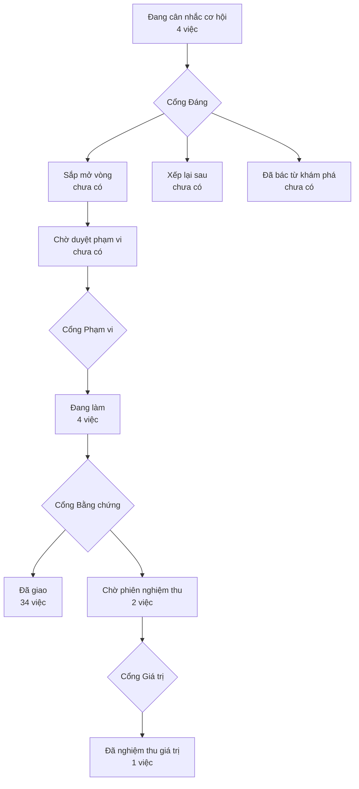

# Bản đồ sản phẩm

> Bản đồ vẽ lại từ hồ sơ của xưởng mỗi lần một người ký một cổng — đừng sửa tay.
> (đọc từ thư mục `_acceptance/` và `.out-of-scope/`)

> **Bốn cổng người** — mỗi cổng là một câu hỏi chỉ người trả lời được:
> **Cổng Đáng** việc này có đáng làm không · **Cổng Phạm vi** bộ tiêu chí
> đã đủ và đúng chưa · **Cổng Bằng chứng** đã làm đúng thứ đã hứa chưa ·
> **Cổng Giá trị** thứ đã giao có ăn thua không.

## Đang cân nhắc cơ hội

- Bộ cào nói ra khi hỏng MỘT PHẦN — hiện nó chỉ nói khi hỏng trọn vẹn (`bo-cao-noi-khi-hong-mot-phan`)
- Người quyết mở rộng biết nhắm địa bàn nào — giao dịch và độ tập trung theo quận (`mo-o-dau`)
- Phân tích cấu hình bộ cào ở biên, thay vì chuyền dict thô từ TOML xuống chỗ dùng (`phan-tich-cau-hinh-bo-cao`)
- Ô tìm trong trang thành viên chiến dịch phải tìm TRONG phân khúc, không thay thế phân khúc (`tim-trong-phan-khuc`)

## Đang làm

- Cửa vào nói tiếng Việt — màn đăng nhập và màn khai báo đọc đúng tiếng của nhân viên, ngay lần đầu họ mở CRM (`cua-vao-noi-tieng-viet`)
- Nhãn ứng dụng nói tiếng Việt trên ba luồng của ngưỡng — thêm công ty, ghi hoạt động, cập nhật thoả thuận (`nhan-ung-dung-noi-tieng-viet`)
- Thước của lát ③a có răng — mỗi phép đo nghiệm thu của vòng ③a phải đỏ được, và chứng minh lại điều đó mỗi lượt chạy (`thuoc-cua-lat-3a-co-rang`)
- Xương sống ngôn ngữ — nhân viên chọn tiếng Việt một lần, màn công ty hiện trọn tiếng Việt (`tieng-viet-cho-crm`)

## Đã giao — chờ phiên nghiệm thu

- Đội tiếp thị chạy trọn một chiến dịch tuyển đối tác trong CRM — phân khúc, làm giàu, nhắm, tiếp cận, đo (`tiep-thi-tuyen-doi-tac`)
- Người quản trị tìm thấy trường tự tạo ở Cài đặt và được gợi ý bộ trường của môi giới Việt (`truong-tu-tao-o-cai-dat`)

## Đã giao

- Lát dựng tác nhân nói tiếng Việt — đợt một: khung điều hướng, cụm Tác nhân của đội, và bảng kết quả/mã đọc đúng tiếng của người quản trị (`agent-builder-noi-tieng-viet`)
- Khoá workflow auto-pr về kho hãng — ở bản rẽ nó chết hai lần mỗi lượt đẩy và bôi đỏ mọi commit (`auto-pr-thoi-do-o-ban-re`)
- Bộ dựng chung nhận chuỗi từ ngoài — một component hiện đúng tiếng người đọc mà chỗ gọi không phải truyền gì (`bo-dung-chung-nhan-chuoi`)
- Cài đặt còn lại nói tiếng Việt — năm cụm Theo dõi, Kết nối, Khoá API, SSO, Thành viên đọc đúng tiếng của người quản trị, và mọi đoạn mã người chép giữ nguyên từng byte (`cai-dat-con-lai-noi-tieng-viet`)
- Chân lái từng component ra màn — đo lớp chữ tiếng Anh nằm ở giá trị mặc định của tham số, và giải toả bảng mười dòng của vòng trước bằng đo thay vì khai (`chan-lai-component-ra-man`)
- Chặn uỷ thác agent_builder ở lượt không mang CREATE_AGENT — hiện tại chốt quyền ném exception, con không có cửa ra, và hội thoại treo "đang chạy nền" vĩnh viễn không một thẻ lỗi (`chan-uy-thac-sai-luot`)
- Đưa danh sách ai-được-vào CRM từ biến môi trường vào bảng lời cho phép, quản trên màn Members với hai khối tách bạch — gỡ thành viên là cắt quyền thật, rút lời cho phép chỉ chặn người chưa có tài khoản (`cho-phep-ai-vao-o-man-hinh`)
- Chữ mặc định của thư viện ngoài — dựng thước cho lớp chữ mà mọi bộ quét tĩnh đều mù, rồi vá cái nó tìm ra (`chu-mac-dinh-thu-vien-ngoai`)
- Lịch chạy nền của API phải theo bản khai apps/api/vercel.json, không theo một dòng ghim cứng trong script dựng — bốn trong năm việc nền hiện không bao giờ chạy (`cron-theo-ban-khai`)
- Cửa sổ trò chuyện của lát dựng tác nhân nói tiếng Việt — đợt hai, và tháo ba mối nối với hồ sơ đợt một đã ký (`cua-so-tro-chuyen-noi-tieng-viet`)
- Đo quyền của lượt bằng hành vi — thay bộ dò regex theo dòng của AC-5 cũ bằng phép đo đi trọn đường sản phẩm, siết mệnh đề về đúng thứ máy chủ và agent giữ được, và đổi sàn dân số sang bất biến nguồn ghi đọc bằng AST (`do-quyen-luot-bang-hanh-vi`)
- Bộ gieo rải mẫu đều qua các trang danh bạ, thay vì cắt 200 người đầu bảng (`gieo-rai-deu-danh-ba`)
- Gỡ khoá góc nhìn — góc nhìn đang được chiến dịch dùng thì nói ra trước, và có lối trỏ chiến dịch sang góc nhìn khác (`go-khoa-goc-nhin`) — đã giao — máy thông, cửa veto còn mở
- Gỡ một thành viên thì phải giữ được — ba chỗ chưa ai canh sau lượt gỡ (`go-thanh-vien-phai-giu-duoc`)
- Tham số hd của Google phải theo hình dạng danh sách cho phép, không theo domain đầu tiên — để vế «cộng một người ngoài» mà tài liệu và test đã công bố chạy được thật (`hd-theo-danh-sach`)
- Lưới tự đối chiếu với bản khai hình của nó, thay vì chờ người nghĩ ra đòn tấn công kế tiếp (`hinh-cua-luoi`)
- Cho khẳng định về đăng nhập Microsoft có răng, thay vì tự tính kỳ vọng từ chính môi trường nó đo (`khang-dinh-microsoft-co-rang`)
- Khoá lô hàng agentTask trong CTE MATERIALIZED để LIMIT giữ đúng trần dưới thống kê cũ (`khoa-lo-giu-tran`)
- Lệnh chứng không được ăn cache dối — bắt bốn lệnh chứng của cổng nói thật, và bắt khoá cache của bộ vẽ khai đủ file nó đọc ngoài gói (`lenh-chung-khong-an-cache-doi`)
- Lệnh dựng của kho đang đỏ vì 19 màn đọc dữ liệu lượt truy cập ngoài Suspense — vá 19 màn, và đưa lệnh dựng vào bộ lệnh chứng để lớp lỗi này không còn vô hình với bốn cổng (`lenh-dung-do-khong-ai-thay`)
- Lời mời đã huỷ hoặc từ chối thì thôi cho vào — phép kiểm cho phép theo danh sách trắng, không theo một chuỗi cấm (`loi-moi-da-huy-van-cho-vao`)
- Lưới chặn trước khi đẩy phải chạy thật, và hồ sơ đã ký phải trỏ đúng chân răng (`luoi-day-do-that`)
- Ma trận phải có chiều sống — đổi lời tuyên quét lớp của phép đo AC-1 cũ thành một bất biến đo được, và cắm chiều đỏ vào đúng chỗ hai sàn AST mù (`ma-tran-phai-co-chieu-song`)
- Màn Cài đặt nói tiếng Việt — cụm General và Currencies đọc đúng tiếng của người quản trị, kể cả ở những trạng thái màn hình không tự mở ra (`man-cai-dat-noi-tieng-viet`)
- Màn xin quyền có răng — /grant-access được đo trên trình duyệt thật, không chỉ bằng quét cú pháp (`man-xin-quyen-co-rang`)
- Nền chat AI Elements — dọn 19 component mồ côi, dựng lớp chuyển kiểu eve→AI SDK, chuẩn hoá phần còn lại, đặt răng chống tái phát (`nen-chat-ai-elements`)
- Mọi ổ cắm trong _acceptance/config.yaml phải giải ra một lệnh chạy được — hiện 16 ổ cắm giải ra lệnh lỗi cú pháp bash, và hai dòng làm cả file không parse được bằng YAML (`o-cam-chay-duoc-that`)
- Trả ổ cắm buổi khai thác về trạng thái trung tính, và thu phép đo ổ cắm về đúng hai ổ thiết kế (`o-cam-khai-thac-trung-tinh`)
- Quyền của lượt builder mang theo tường minh — bỏ luật suy commandType từ hình dạng tin nhắn, câu trả lời kế thừa đúng quyền của lượt đã hỏi, và dạy con agent_builder cửa ra not_authorized (`quyen-luot-mang-theo`) — đã giao — máy thông, cửa veto còn mở
- Sửa hai lỗi môi trường làm suite test đỏ, và nối dây cổng nghiệm thu vào bản kit đang cài (`sua-test-do-thu-tu-nap`)
- Thước cache hết đối tượng — gỡ hai tiêu chí không còn vật để đo, gỡ một bản khai vô tác dụng, và thay bằng một bất biến sống sót cả hai cách vá (`thuoc-cache-het-doi-tuong`)
- Màn Tổng quan và khung điều hướng nói tiếng Việt — màn đầu tiên sau đăng nhập, thanh bên, thanh đầu, hộp tìm nhanh đọc đúng tiếng nhân viên chọn; và bộ thước màn nhìn thấy cả khung chứ không chỉ khung nội dung (`tong-quan-va-khung-noi-tieng-viet`)
- Trần một-lần-uỷ-thác agent_builder áp cho cả lượt KHÔNG có quyền — hook builder-delegation đang return sớm khi commandType khác CREATE_AGENT, nên chốt cứng duy nhất không chạy trên nhánh not_authorized và chỉ còn câu chữ trong prompt giữ trần (`tran-mot-lan-uy-thac`)
- Bộ đo của trần một-lần-uỷ-thác bắt được khi chốt chết, và kiểu tham số neo vào type công khai của eve — CỘNG bằng chứng từ mã eve cho biết vì sao ca «step chạy lại bị giết oan» KHÔNG vá được ở lớp actions.requested, ghi thành giới hạn đã khai và ghim bằng một phép đo có tên (`tran-uy-thac-chiu-chay-lai`)

## Đã nghiệm thu giá trị

- Bộ gieo đọc danh bạ tới khi cạn thay vì tới một trần đoán, và lộ số điện thoại theo danh sách tầng khai trong cấu hình (`nang-tran-trang-danh-ba`) — giao rộng (release)
