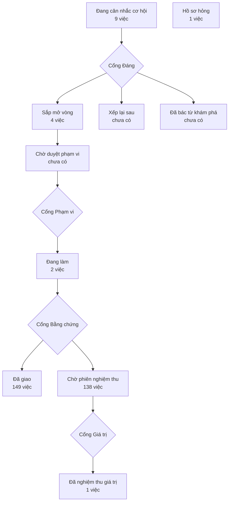

# Bản đồ sản phẩm

> Bản đồ vẽ lại từ hồ sơ của xưởng mỗi lần một người ký một cổng — đừng sửa tay.
> (đọc từ thư mục `_acceptance/` và `.out-of-scope/`)
> Lộ trình: [LO-TRINH.html](LO-TRINH.html)

> **Bốn cổng người** — mỗi cổng là một câu hỏi chỉ người trả lời được:
> **Cổng Đáng** việc này có đáng làm không · **Cổng Phạm vi** bộ tiêu chí
> đã đủ và đúng chưa · **Cổng Bằng chứng** đã làm đúng thứ đã hứa chưa ·
> **Cổng Giá trị** thứ đã giao có ăn thua không.

## Đang cân nhắc cơ hội

- Trợ lý AI chỉ đổi trường của cả đội khi người yêu cầu là quản trị hoặc chủ — hôm nay thành viên thường nhờ trợ lý là thêm hay sửa được trường (`agent-doi-truong-theo-quyen`)
- Bộ cào nói ra khi hỏng MỘT PHẦN — hiện nó chỉ nói khi hỏng trọn vẹn (`bo-cao-noi-khi-hong-mot-phan`)
- Phép đo «bấm trong cột góp ý không đóng hộp» dựa trên ma trận trạng thái thẻ × đích bấm viết trước, không đếm ca bằng ngưỡng và không lặng lẽ bỏ đích thiếu (`ma-tran-bam-khong-dong-hop`)
- Người quyết mở rộng biết nhắm địa bàn nào — giao dịch và độ tập trung theo quận (`mo-o-dau`)
- Phân tích cấu hình bộ cào ở biên, thay vì chuyền dict thô từ TOML xuống chỗ dùng (`phan-tich-cau-hinh-bo-cao`)
- Cột góp ý của Trợ lý OKR cuộn riêng với form trong hộp sửa rộng, bỏ số đề xuất lặp hai lần, và hộp mở rộng không làm bố cục nhảy (`the-gop-y-cot-cuon-rieng`)
- Thẻ góp ý của Trợ lý OKR thôi để viền «ô được chỉ» kẹt sau khi thoát sửa, trả focus về thẻ, bỏ lời nhắc sai trong hộp Sửa KR, và làm dòng đã quyết đọc được (`the-gop-y-sua-nhanh`)
- Gợi ý thông tin của tác tử ở tab Tổng quan của Cá nhân trải hết hàng, nói rõ là tác tử đề xuất và độ tin, và đặt giá trị cũ cạnh giá trị mới (`the-thong-tin-ca-nhan`)
- Ô tìm trong trang thành viên chiến dịch phải tìm TRONG phân khúc, không thay thế phân khúc (`tim-trong-phan-khuc`)

## Sắp mở vòng

- Không đường tạo thoả thuận nào dựa vào giai đoạn mặc định: cột giai đoạn bỏ mặc định ở cơ sở dữ liệu (`giai-doan-bo-mac-dinh`)
- Hai phép kiểm luồng tự động của kho (gpct_luot_that, gpct_nen_gop) chạy thật trong bàn đo, không bị tính «đỏ sẵn» ở cả hai cây (`khong-do-them-chay-gh`)
- Danh sách góp ý đã gom được sửa trong một lượt (`sua-sau-chay-that`)
- Phép đo thẻ «Việc của bạn» (E7b của DA0a) tự đỏ khi câu ghim sai, không chỉ khi màn sai (`thuoc-viec-cua-ban-do-duoc`)

## Đang làm

- Trưởng phòng ban mở trang Lộ trình và thấy mỗi việc, mỗi mốc có ngày dự kiến xong do máy tính — ghi rõ là dự kiến, có cờ khi số đo chưa đủ (`lo-trinh-hien-ngay-du-kien`)
- Thước của lát ③a có răng — mỗi phép đo nghiệm thu của vòng ③a phải đỏ được, và chứng minh lại điều đó mỗi lượt chạy (`thuoc-cua-lat-3a-co-rang`)

## Đã giao — chờ phiên nghiệm thu

- «Test của agent không nhập mã của app; danh sách thoả thuận Kara trả có một schema dùng chung» (`agent-test-khong-nhap-app`)
- Hồ sơ đã ký không còn đỏ sẵn trên onehub: mỗi thước chết được sửa hoặc ghi lại có lý do (`ba-ho-so-do-san`)
- Bàn gieo góp ý dùng chung chạy lại được sau khi công cụ nộp của Trợ lý OKR tự đóng việc, để ba bàn đo màn OKR đo được lại (`ban-gieo-gop-y-sau-nop`)
- Góp ý của Kara được đo trên khoảng 30 ca mẫu dựng theo khuôn OKR quý 4 — cấp OneHub và phòng ban — nằm trong bộ OKR mẫu, không chờ phòng ban công bố (`bo-ca-mau-quy-4`)
- Bộ 50 câu hỏi mẫu viết theo tám trang mẫu của kho đo — câu trả lời được, câu phải nói không biết, câu gõ như tin Zalo — kèm lệnh kiểm bộ và lệnh đo trợ lý kho trên bộ bằng script chấm sẵn có (`bo-cau-hoi-mau`)
- Ngăn bản ghi và Kanban thoả thuận không vỡ bố cục ở khổ hẹp (`bo-cuc-hep-ngan-va-kanban`)
- Bộ xương Kara trong packages/ui — sáu khối KaraTranscript, KaraComposer, KaraSteps, KaraState, KaraProposal, KaraArtifact, một nút «Thử lại», và ba điểm cắm cho K2: co giãn trong thanh kéo, khoá đề xuất khi Kara đang soạn, nhận theo nhóm (`bo-xuong-kara`)
- Ca kiểm chập chờn theo máy thôi làm đỏ lượt dài — dọn eve mồ côi của lượt bị ngắt, chờ route thật có trần, trần hook dựng Nest có tên, công tắc bỏ ca tới được test (`ca-chap-chon-cach-ly`)
- Ba ca chập chờn còn lại chạy tất định — hai đối chứng «the fixture bites» của tasks.integration giữ thống kê đứng yên và gọi tên khi kế hoạch đổi; ma() của bộ gieo agent-okr không sinh chữ số (`ca-chap-chon-con-lai`)
- Việc, sáng kiến, ghi nhận và mẫu nằm cạnh KR — việc tự gõ và sáng kiến (chiến dịch hay kế hoạch 30 ngày có sẵn) gắn vào KR, bằng chứng cho KR mốc, ghi nhận đồng nghiệp trên mục tiêu, mẫu OKR theo cấp và đơn vị (lượt 8a — SK-01, SK-02, CI-05, CI-06, MT-07) (`canh-kr-okr`)
- Cập nhật tuần OKR — màn «Cập nhật tuần của tôi» gom mọi KR tôi phụ trách, điền sẵn số tuần trước, ghi giá trị · mức tự tin · một dòng ghi chú; nhắc buổi sáng và thẻ «việc của tôi» dẫn thẳng vào màn; bình luận và nhắc tên trên mục tiêu và KR; chuyển KR khi người nghỉ (`cap-nhat-tuan-okr`)
- Cây tổ chức hai cấp dưới gốc OneHub — bộ phận chứa phòng ban — có người, có trưởng, dựng và nhập hàng loạt ở Cài đặt › Tổ chức (`cau-truc-to-chuc`)
- Cây căn chỉnh hiện lý do và mức tin của từng chỗ nối, lọc được các nhánh «Chưa có lý do» và «Đặt cược» (`cay-can-chinh-co-ly-do`)
- «Thành viên thường không nhờ chat sửa trường của cả đội; model bị gỡ thì chat lùi về mặc định và báo quản trị» (`chat-an-toan-truoc-r1`)
- Chỉ onehub đẩy được bản chụp lộ trình lên CRM; đường REST khác giữ trần thân 100 KB (`chat-duong-day-ban-chup`)
- Việc cần làm cũ trên dòng thời gian thành Việc; Tác nhân giao việc bằng Việc (`chep-viec-can-lam-cu`)
- Chỉ quản trị và chủ đổi được định nghĩa trường của cả đội — thành viên thường vẫn xem được, nhưng mọi đường đổi đều khoá, cả trên màn lẫn khi gọi thẳng máy chủ (`chi-quan-tri-sua-duoc-truong`)
- Chờ Tác nhân lâu: thẻ «Đang dựng» có thời gian đã trôi, lời hứa thật và dòng quá ngưỡng; Kara báo trong hộp thông báo khi bộ dựng xong, cần trả lời hay hỏng (`cho-tac-nhan-lau`)
- Breadcrumb đọc tiếng Việt với trình đọc màn hình; mô tả kiểu trường ở Cài đặt › Trường không tràn ở khổ 360 (`chu-man-tieng-viet-khong-tran`)
- CI của kho chạy test thành ma trận ba ô song song trên ba máy, và ci.yml do OneHub tự giữ thay vì là tệp cấm sửa của hãng (`ci-ma-tran-ba-o`)
- Của tôi ba phần — KR cần cập nhật tuần này (gửi ngay tại chỗ), đơn vị bạn dẫn, KR bạn phụ trách; bỏ thẻ «Cập nhật tuần», đường cũ chuyển về Của tôi; người không dẫn đơn vị nào không được mời tạo mục tiêu (`cua-toi-ba-phan`)
- Cửa vào đăng nhập cho người mới — trang /sign-in nói cách vào ở khối «Lần đầu vào?» (bước tính theo nút đang bật), báo lỗi khi better-auth trả về vì địa chỉ chưa được cho phép, theo giao diện máy thay vì ép tối; bốn trang AuthShell khác giữ bố cục (`cua-vao-dang-nhap`)
- Cửa vào vá — Quên mật khẩu giữ logo, đăng xuất lỗi báo tiếng Việt, API không đọc được phiên thì không đá người còn phiên về đăng nhập mà hiện trang lỗi có «Thử lại»; trả nợ thước cua-vao-dang-nhap (`cua-vao-va`)
- «Đã lưu trữ» ở Cài đặt › Giai đoạn báo lỗi tải và cho thử lại thay vì biến mất (`da-luu-tru-tai-loi`)
- Dải báo «Đã lưu trữ» và vùng khoá chỉ đọc là một mảnh dùng chung trong packages/ui (`dai-luu-tru-dung-chung`)
- «Kéo để sắp xếp ở Tổ chức và Giai đoạn chạy giống nhau; giai đoạn thoả thuận lưu trữ và khôi phục được» (`danh-sach-keo-chung`)
- Khu OKR trong CRM — quản trị mở chu kỳ năm và quý; mỗi cấp đặt mục tiêu với KR đủ sáu kiểu, căn chỉnh vào cấp trên, công bố; nhập bộ OKR quý 4 từ bảng tính có xem trước; mọi sửa đổi để lại vết (`dat-okr-trong-crm`)
- «Bảng rỗng vì đang lọc thì nói rõ, nút bỏ lọc đúng tên, lựa chọn có số 0 vẫn hiện» (`datatable-loc-ro`)
- Khung chờ đầu trang OKR cao bằng đầu trang thật, vùng nội dung Toàn cảnh không tụt khi tải xong (`dau-trang-okr-cho-nut-hoi-kara`)
- «Danh sách thoả thuận Kara trả có chấm màu giai đoạn; số liệu ẩn danh theo giai đoạn có tập khoá đóng» (`deal-va`)
- «Số điện thoại là trường chính của cá nhân: nhập được lúc tạo, thấy ở bảng, tìm được theo số, không trùng» (`dien-thoai-ca-nhan`)
- «Số điện thoại hiện ở thoả thuận và ở tab Cá nhân của công ty» (`dien-thoai-o-deal-cong-ty`)
- Điều hướng khu Mục tiêu — một đầu trang «Mục tiêu» cho cả khu, nút «Thêm mục tiêu» ở góc phải như Thoả thuận, đổi thẻ giữ đơn vị và chu kỳ, Sức khoẻ chương trình khớp tên, nút tạo bị khoá kèm một dòng lý do thay vì biến mất; chỉ giao diện (`dieu-huong-khu-muc-tieu`)
- «Mã đối tác không khớp vẫn có người xử lý; kế hoạch rỗng thêm được bước; thẻ quá hạn báo còn sót» (`dieu-phoi-va`)
- Đổi tên sản phẩm trên mọi chữ người đọc từ «CRM» sang «OneHub Center» (trùng tên miền onehub.center), và làm lại cột trái /sign-in theo hướng A — nền lưới chấm bằng token cho năm trang AuthShell, dòng neo cỡ lớn, ba bước nối bằng đường dọc, không Card (`doi-ten-onehub-center`)
- «Dòng thời gian giữ các hoạt động đã tải khi «Xem cũ hơn» hay làm mới ngầm bị lỗi» — lỗi sau khi đã có dữ liệu không thay danh sách bằng khung lỗi; thông báo tại chỗ kèm «Thử lại» tải đúng phần hỏng (`dong-thoi-gian-giu-khi-loi`)
- «Thông báo lỗi của dòng thời gian theo đúng lượt tải đã hỏng, không theo lượt đang chạy» — khi lỗi «Xem cũ hơn» và lỗi làm mới chồng nhau, thông báo chỉ đổi khi một lượt tải đã xong (`dong-thoi-gian-loi-dung-luot`)
- Hỏi ý mục tiêu — trước mỗi kỳ đặt OKR cả công ty góp ý cho mục tiêu công ty, người gom xếp ý thành chủ đề, người chọn (CEO) viết trước rồi kết luận từng chủ đề bằng lý do tự viết, chủ đề chọn thành bản nháp mục tiêu cấp OneHub, ai góp cũng thấy ý mình đi đâu và vì sao (bước 1–2 chu kỳ OKR, hạng mục 11 lộ trình OKR) (`dot-hoi-y-tuong-okr`)
- Sheet mục tiêu hiện lý do căn chỉnh, căn cứ và mức tin của từng chỗ nối lên mục tiêu cha, kèm dấu Kara khi Kara viết lý do; bộ OKR mẫu gieo đủ ba mức tin (`duong-ly-do-muc-tieu`)
- Eval model thật của Kho tài liệu (E15) chỉ gọi model khi đầu vào đổi, tách lỗi hạ tầng khỏi lỗi model, giữ nhật ký theo lượt, và hỏi lại một lần khi sát ngưỡng thay vì đỏ cứng (`eval-model-that-dung-luc`)
- Căn chỉnh gắn bằng tay và căn chỉnh Kara đề xuất đều mang lý do — hộp thoại gắn có ô lý do và căn cứ, sửa được lý do sau khi gắn, đề xuất căn chỉnh của Kara mang lý do và căn cứ khi nhận (`gan-tay-va-kara-co-ly-do`)
- Thước «mọi lời đọc OKR có điều kiện xem» xanh lại và chạy ở CI trên từng PR (`ghim-thuoc-soi-xem-okr`)
- «Thoả thuận mới không rơi vào giai đoạn đã lưu trữ» (`giai-doan-mac-dinh`)
- Workflow Acceptance thôi chạy test tác nhân OKR khi push lên onehub, huỷ lượt cũ khi PR đẩy chồng, và gộp ba job nhỏ thành một — giảm phút GitHub Actions mà không bỏ phép kiểm nào ở PR (`giam-phut-acceptance`)
- PR nháp và PR chỉ chạm tệp T1 không chạy job nặng của ci.yml và acceptance.yml; ci-ok xanh khi bỏ qua hợp lệ; push giữ nguyên; luật PR nháp trong CLAUDE.md (`giam-phut-ci-nhap-t1`)
- Mục tiêu có mức hiển thị giới hạn, có bước duyệt nhẹ tuỳ chọn, và tái cơ cấu giữa kỳ không làm OKR mồ côi — mức công khai hay giới hạn áp trên mọi đường đọc OKR, ô «Công bố cần duyệt» của Chương trình OKR với một người duyệt suy từ cây, cây tổ chức không lưu trữ hay xoá được đơn vị còn OKR, chuyển OKR sang đơn vị khác, danh sách OKR mồ côi (lượt 8c — MT-06, QT-02, TC-06) (`gioi-han-duyet-cay-okr`)
- Deal thắng thì máy gợi ý mở kế hoạch onboard; người phụ trách mở hay bỏ qua ngay trên deal (`goi-y-mo-ke-hoach`)
- Góp ý của Kara ở khu OKR đặt đúng chỗ — «Kara · N góp ý» trên thẻ Mục tiêu, đề xuất neo ngay dưới từng KR ở khung chi tiết với biên nhận có Hoàn tác, hộp Sửa chỉ còn một dòng dẫn sang (`gop-y-dung-cho`)
- «Tôi bấm Gửi tín hiệu ở bất kỳ màn nào, kể điều mình gặp, rồi thấy nó đã vào nhóm nào, thành việc nào, đã giao chưa» (`gui-tin-hieu-trong-crm`)
- Job «lệnh dựng» của acceptance.yml nới heap Node cho bước bun run build, để next build không đổ ở trần 2 GB mặc định (`heap-lenh-dung`)
- Lưu trữ và hoàn tác hàng loạt báo đúng — lỗi máy chủ không hiện thành «bị bỏ qua», hoàn tác khi mọi bản đã về không báo lỗi, lỗi từng bản ghi có dòng log (`hoan-tac-loat-bao-dung`)
- «Hoàn tác hàng loạt đúng bản đã cất» — lưu trữ và khôi phục hàng loạt trả danh sách id thật sự đã đổi trạng thái; Hoàn tác chỉ khôi phục những bản đó, báo thật số bản không về được, toast không in câu lỗi máy chủ thô (`hoan-tac-loat-dung-id`)
- Người đã nối Zalo nhắn một câu hỏi cho bot thì trợ lý AI của CRM trả lời bằng chữ, chỉ đọc, theo đúng cổng vai của người hỏi và trong ranh giới dữ liệu A; có trần theo người và theo xưởng (`hoi-crm-qua-zalo`)
- Hỏi đáp OKR theo quyền — người dùng hỏi Kara về OKR trên web và nhận câu trả lời chỉ từ những Mục tiêu, KR mình xem được, mỗi câu có trích dẫn và con số do mã kiểm; vai «chỉ OKR» hỏi được OKR mà không chạm được dữ liệu đối tác (`hoi-dap-okr`)
- Người dùng CRM thấy mọi điều CRM muốn báo ở chuông trên đầu trang, biết số chưa đọc và bấm vào là tới đúng chỗ cần làm (`hop-thong-bao-tren-web`)
- Tôi kéo việc giữa các cột Chưa làm, Đang làm, Chờ đánh giá, Xong, và tách một việc to thành việc con (`kanban-viec`)
- Kara góp ý OKR lượt 2: vùng Kara dùng khung chung và không biến mất khi lỗi, không chờ mãi, Căn chỉnh có Hoàn tác, người phụ trách nhiều KR nhờ được Kara, chữ và ngày giờ nhất quán (`kara-gop-y-luot-2`)
- Mọi chỗ AI nói đều mang tên Kara: tab bản ghi, tóm tắt tuần, Soạn OKR, Cài đặt, Tài liệu, Zalo (`kara-mot-ten`)
- «Ở mọi nơi, lỗi tải không còn hiện như chưa có gì; lưu trữ bản ghi có Hoàn tác» — dòng thời gian, hoạt động trên website và 30 ngày đầu của ngăn bản ghi có khung «không tải được» kèm «Thử lại» thay vì rỗng hay biến mất; tóm tắt tuần nói «Kara đang…» và lỗi theo ai-ux; lưu trữ cá nhân, công ty, thoả thuận có Hoàn tác ngay trên toast; bước Kara không lưu được hiện khác bước đã lưu; ba việc chữ (`kara-trang-thai-toan-crm`)
- Kế hoạch 30 ngày là một bản ghi làm việc được — mở như thoả thuận, giao bước, đánh dấu xong, đổi cầm trịch, ghi chú, và mọi thay đổi để lại vết (`ke-hoach-la-mot-ban-ghi`)
- Tạo kế hoạch onboard từ khuôn là có sẵn việc cho từng phòng ban; deal thắng thì máy gợi ý mở kế hoạch (`ke-hoach-sinh-viec`)
- Khép kỳ OKR — quản trị mở cửa sổ rà giữa kỳ; cuối kỳ máy gợi ý điểm từ số chốt, người chỉnh được kèm lý do; mỗi mục tiêu có ô điều học được; kỳ chỉ đóng khi mọi KR đã chấm; mục tiêu dở mang sang kỳ sau; số kỳ đã đóng bị khoá và xuất được; kiểm chất lượng khi đặt bằng luật (`khep-ky-okr`)
- «Nguồn không kẹt mãi ở «đang đọc» khi máy soạn lỗi; «Soạn lại» chạy được; hộp chèn liên kết báo lỗi thay vì «không trang nào khớp»» (`kho-nguon-khong-ket`)
- Khoá eve của bài thử không tranh nhau — chu.json ghi trọn một lần, lượt chờ giành khoá cũ bằng đổi tên có kiểm dấu, chủ khoá chỉ gỡ khoá của chính mình (`khoa-eve-khong-tranh`)
- Phép kiểm «không rẽ theo tên» chạy một lần như luật kho trong lint:slop; E17 của giai-doan-thoa-thuan đọc luật đó và thôi phủ cả app (`khong-re-theo-ten-thanh-luat-kho`)
- «Kara trong hồ sơ bản ghi có một khung chung» — tab Kara của ngăn cá nhân, công ty, thoả thuận nói tiếng Việt với dấu, trạng thái và «Thử lại» của Kara; đề xuất thông tin liên hệ neo tại chỗ, nhận xong có biên nhận và Hoàn tác (thêm lệnh hoàn tác ở API); khung bản ghi tải lỗi có «Thử lại»; nút tra cứu mang dấu Kara; ngăn thêm nhanh hỏi lại khi lỡ đóng (`khung-ban-ghi-kara`)
- «Khung bản ghi tải lỗi nói đúng lý do: đã xoá, không có quyền, hay mất kết nối» — ngăn cá nhân, công ty, thoả thuận, kế hoạch phân biệt NOT_FOUND, FORBIDDEN và lỗi khác; hai lý do đầu có «Đóng», lỗi mạng có «Thử lại» (`khung-loi-ban-ghi-dung-ly-do`)
- Màn nào đang tải cũng giữ tiêu đề, lỗi tải ở đâu cũng một hình có nút thử lại, và đầu trang không có nút chính tắt mà không nói vì sao (`khung-man-chung`)
- Khung OKR trước R1 — khung Mục tiêu và thanh Theo đơn vị hết chín lỗi trình bày, liên kết chéo hỏi lại trước khi bỏ thay đổi (`khung-okr-truoc-r1`)
- Khi Kara đang soạn hoặc người dùng gõ dở trong khung, bấm một liên kết trong khung thì được hỏi trước khi rời, chữ đang gõ không mất (`khung-soan-chan-lien-ket`)
- Lượt kiểm chéo đêm xếp sau mọi đơn thợ khi xin khoá, và khi làn chạm trần thì lưu hồ sơ đã đo để đêm sau chạy tiếp phần còn lại (`kiem-cheo-chay-quang-lang`)
- Kiểm «có làm hỏng hồ sơ đã ký khác không» chạy một lần mỗi đêm cho mọi lần gộp vào onehub từ mốc trước, ngoài mọi lượt ghim lại; đỏ thì gọi tên lần gộp gây đỏ (`kiem-cheo-sau-gop`)
- Trang của Kho tài liệu có lịch sử phiên bản xem và so được, quay lại một phiên bản cũ bằng một đề xuất qua duyệt, lưu trữ và khôi phục trang bằng đề xuất qua duyệt; trang đã lưu trữ vắng khỏi danh sách, tìm, trợ lý kho và Sức khoẻ, tìm lại ở «Đã lưu trữ»; đề xuất đã duyệt hiện ở nhóm «Đã xử lý» (`lich-su-va-luu-tru-trang`)
- Danh sách liên quan trong ngăn bản ghi không lẫn bản đã lưu trữ, kèm «+n đã lưu trữ» để mở xem (`lien-quan-loc-ban-da-cat`)
- Trưởng phòng ban mở trang Lộ trình và thấy đúng lộ trình mới nhất của nhánh chính, kèm giờ lấy, mà trang không phải chờ một bản dựng production (`lo-trinh-doc-ban-chup`)
- «Trang lộ trình đúng tên OneHub Center và không làm vỡ bản dựng» (`lo-trinh-ten-va-build`)
- Lọc và chuyển kiểu xem ở mọi danh sách trông và chạy như nhau, và gửi đường dẫn cho đồng nghiệp là giữ nguyên bộ lọc (`loc-va-kieu-xem-chung`)
- Luật thứ bảy «vong-doi» của scripts/luat-kho — máy bắt mô hình có hai cột cất, thủ tục list lẫn bản đã cất, và xoá vĩnh viễn không kiểm bản đã lưu trữ — và cả bộ luật kho chạy ở CI Acceptance (`luat-kho-vong-doi`)
- Lưu trữ một trường thôi hỏi lại và có «Hoàn tác» như mọi chỗ lưu trữ khác (`luu-tru-truong-khong-hoi`)
- Lý do Kara viết cho dòng căn chỉnh ở Soạn OKR đi theo căn chỉnh vào OKR thật, căn chỉnh cũ từ Soạn được điền lại, và khuôn trả của mục tiêu nói rõ mức tin của từng căn chỉnh (`ly-do-can-chinh-tu-soan`)
- Lý do Kara nộp bản nháp bị từ chối hiện thành câu theo ngôn ngữ người dùng, không lộ mã máy (`ly-do-tu-choi-nop-theo-locale`)
- Màn OKR trước R1 — Hồi ý không bị thanh công bố che, Cập nhật tuần nói «đã xong tuần này», thẻ Toàn cảnh không nói ngược bảng (`man-okr-truoc-r1`)
- Cùng một nghĩa — xong, chờ, hỏng, nháp, đang chạy — mang cùng một màu ở OKR, Kara, lịch họp và Tài liệu (`mau-trang-thai-chung`)
- Máy nhắc thay người canh — mỗi sáng một tin Slack riêng gom bước quá hạn, bước sắp hạn, kế hoạch im và mốc ngày 7 · 14 · 30; thẻ Tasks hiện cùng danh sách; ai cũng tự theo dõi được một kế hoạch (`may-nhac-truoc-nguoi`)
- Máy soạn bản đề xuất — tải tệp quy định đang có (Word, PDF có chữ) lên kho tài liệu, máy soạn thành bản đề xuất có trích đoạn nguồn, chủ trang đọc nguồn cạnh nhau rồi duyệt (`may-soan-de-xuat`)
- «Menu con của bộ lọc mở được trên điện thoại — không còn nằm ngoài màn ở khổ 375» (`menu-con-loc-dien-thoai`)
- Mở lại một kế hoạch đã đóng hay bỏ «xong» một bước không trả việc về người đã sang vai «chỉ OKR» (`mo-lai-khong-tra-viec-chi-okr`)
- Kế hoạch hiện ra ở mọi chỗ người đã đứng — tab 30 ngày đầu ở sheet Công ty, mục 30 ngày đầu ở sheet Cá nhân, bước giao cho tôi trong thẻ Tasks, lọc và chia cột theo người được giao, chuyển việc 30 ngày khi một người nghỉ (`moi-phia-deu-thay-ke-hoach`)
- «Quản trị mở thẻ Tất cả của trang Tín hiệu và thấy ai đã gửi, phòng ban nào, từ màn nào, đang ở đâu, cùng ba con số của ngưỡng sống» (`moi-tin-hieu-cho-quan-tri`)
- Nền giao diện của Kara trong packages/ui — dấu tia sáng, nhãn Kara có ô «vì sao», ProposedChange hai độ dày (inline không viền, card), dòng biên nhận có Hoàn tác, phản hồi chung — để mọi màn AI sau đó dựng trên một bộ (`nen-kara`)
- Hai hồ sơ đã ký có thước tự hết hạn ghim lại được: thước «vòng này» neo cặp sha gộp, bộ đọc evals dùng chung với kit (`neo-thuoc-het-han`)
- «Tôi bấm một việc đã giao trong trang Lộ trình và đọc trong một phút: vì sao làm, đã lên chưa, sẽ đo gì, còn thiếu gì, ai quyết» (`ngan-ho-so-trong-lo-trinh`)
- «Ngoại lệ telemetry của bảy mã giai đoạn gốc được khai trong tài liệu và có thước canh» (`ngoai-le-telemetry-giai-doan`)
- Tách «Đang theo dõi» khỏi tab «Của tôi» của OKR (`okr-cua-toi-tach-theo-doi`)
- Loại mục tiêu thứ ba «Học tập» cho OKR (`okr-loai-hoc-tap`)
- OKR và tổ chức vá — dựng cây và đặt OKR không vấp (R1d) (`okr-to-chuc-va`)
- Quyết một góp ý của Kara mà máy chủ từ chối vì lý do cố định thì người dùng thấy đúng lý do theo ngôn ngữ trang, không phải câu «thử lại sau ít phút» (`quyet-gop-y-noi-dung-ly-do`)
- Toàn cảnh › Theo đơn vị có cách xem Sơ đồ — mỗi đơn vị một thẻ, đường nối theo căn chỉnh thật, lọc «Cần chú ý», mở thẻ ngay trên sơ đồ, thu gọn khi hơn 12 đơn vị (`so-do-can-chinh-don-vi`)
- Sơ đồ quanh một mục tiêu — từ ngăn chi tiết bấm «Xem quanh mục tiêu» thấy đường góp lên tới KR công ty, KR của nó và ai góp vào nó, mỗi mục tiêu hiện một lần, rê chuột làm nổi đường đi (`so-do-quanh-muc-tieu`)
- Số OKR tự chảy — KR của khối kinh doanh lấy số từ danh mục chỉ số CRM có định nghĩa cố định; mỗi ngày chụp giá trị thành lịch sử không đổi; bấm vào con số ra danh sách bản ghi đằng sau; KR ngoài CRM nhận số qua khoá API và Google Sheets (`so-okr-tu-chay`)
- Soạn OKR cùng Trợ lý — người sửa được OKR của một đơn vị mở một cuộc đối thoại với Trợ lý OKR cho đơn vị và chu kỳ đang lập kế hoạch; Trợ lý mang bối cảnh (hồ sơ công ty và chiến lược từ Kho tài liệu, đơn vị · mô tả · chức danh, OKR cấp trên và ngang cấp, kỳ trước tóm gọn, số CRM dạng tổng) vào cuộc, hỏi vài câu, đưa bản nháp bộ OKR trên bảng sống cạnh chat; người nhận · sửa · bác từng dòng, «Đưa vào bộ OKR» tạo cả bộ ở trạng thái nháp; chạy trên app eve riêng, vai «chỉ OKR» đi qua đường mới; dựng và đo trên bộ OKR mẫu (`soan-okr-cung-tro-ly`)
- Trang soạn OKR không lạc: không nhảy tab khi mở hay đóng bản ghi bên cạnh, hoàn tác cả nhóm thất bại thì báo lỗi trên biên nhận nhóm, lần Kara nộp bị từ chối không thành mốc và không làm gốc so sánh (`soan-okr-khong-lac`)
- «Kara sập giữa lượt thì không mất lượt soạn; «Thử lại» nói rõ vì sao không chạy» (`soan-okr-khong-tru-luot`)
- Soạn OKR trên trang riêng /okr/soan/<cuộc>: hội thoại và bản nháp là hai ô co giãn, bản nháp là KaraArtifact với dòng inline, nhận cả nhóm, hoàn tác mọi quyết định, khoá khi Kara soạn, mốc nộp nối hai chiều, hỏi Kara từ một dòng, quyết trên bảng gửi kèm lượt sau, số đã gõ giữ theo khoá dòng (`soan-okr-trang-rieng`)
- Soạn OKR mở trong khung bản ghi như deal (?record=soan:<cuộc>), Kara cố định ở mép phải với bề ngang chuẩn, bản nháp mở thêm về bên trái, hai ô có khung liền, khung cao hết màn, dưới 768 px phủ toàn màn hai tab, đang soạn thì không lỡ tay đóng và đóng không giết lượt (`soan-okr-trong-khung`)
- Người gửi tín hiệu đọc rõ hộp gửi và trang Tín hiệu đã gửi ở mọi khổ màn và mọi ngôn ngữ, thấy lỗi báo đúng chỗ, và đóng biên nhận không bị hỏi lại (`sua-giao-dien-tin-hieu`)
- Đo Tác nhân bộ dựng trên bốn biến thể model (GLM 5.2 Fast, GLM 5.3, GLM 5.3 hạng nhanh, GLM 5.3 suy luận thấp) bằng số bước, token và giây của phiên con, và nêu nguyên nhân GLM 5.3 chạy quá trần kèm số làm bằng (`tac-nhan-glm-5-3-cham`)
- Màn tác nhân đọc được trên điện thoại, trạng thái nói tiếng Việt, và bộ dựng không treo im lặng: câu hỏi của bộ dựng ở lượt sau luôn hiện thay ô soạn (`tac-nhan-va`)
- Ca kiểm lưu trữ và khôi phục của Kho tài liệu không còn đỏ ngẫu nhiên (`tai-lieu-khoi-phuc-chap-chon`)
- Thành viên vào đúng — quản trị đặt được tên miền nội bộ; cho phép một người đã là thành viên không sinh dòng treo; nút «Cho phép một địa chỉ» không mất sau lỗi; dựng lại thành viên theo luật «có dòng còn hiệu lực thì cho» (`thanh-vien-vao-dung`)
- Thẻ góp ý của Trợ lý OKR — hộp sửa rộng hơn khi cột góp ý mở, mỗi đề xuất là thẻ xếp dọc trải hết bề ngang với hàng nút ở chân và đúng một nút chính, dựng trên Confirmation của AI Elements; gợi ý thông tin ở tab Tổng quan dùng cùng thẻ; chỉ giao diện (`the-gop-y-okr`)
- Thêm bước ở kế hoạch báo đúng: danh sách bộ phận không tải được thì nói lý do; số việc quá hạn đếm theo một ngày; bộ phận không có thật trả cùng một lỗi như mọi chỗ khác (`them-buoc-bao-dung`)
- Thử Haiku 5.5 cho Trợ lý OKR, và kho đo thôi chạy GLM 5.2 Fast (`thu-haiku-tro-ly-okr`)
- Thước đo 7 ngày của ci-ma-tran-ba-o đọc đúng các lượt CI của PR vào onehub trong cửa sổ 7 ngày, chạy được bằng đúng lệnh ghi trong hồ sơ, và báo lỗi thay vì đoán khi không xếp được một job `cancelled` (`thuoc-7-ngay-loc-pr`)
- Thước của hồ sơ đã ký không tự hết hạn — sửa paths chết để lưới trước-gộp bật lại bộ lọc hoá cũ ở 3 hồ sơ có thước còn sống, neo thước «vòng này» của ha-tran-thang-hoi-zalo vào cặp sha gộp, và kiểm kê phần còn lại (`thuoc-khong-tu-het-han`)
- Thước «một chỗ khai» của K2b quét thật khu soạn: ba gốc quét khai một chỗ trong chung.mjs, đọc thư mục thật, gốc nào rỗng thì đỏ gọi tên (`thuoc-mot-cho-khai-quet-man`)
- Đội tiếp thị chạy trọn một chiến dịch tuyển đối tác trong CRM — phân khúc, làm giàu, nhắm, tiếp cận, đo (`tiep-thi-tuyen-doi-tac`)
- Tìm và điều hướng kho tài liệu — ⌘K có dấu hay không dấu, trang nhắc tới trang này kèm câu, lọc theo đơn vị, loại, chủ, tab Sức khoẻ, dòng «N bản chờ bạn duyệt» trong nhắc sáng (`tim-va-dieu-huong-kho`)
- «Người gửi tín hiệu hôm nay thì sáng mai thấy trang của mình đã đổi sang Đội sản phẩm đã nhận, mà không ai phải chạy lệnh» (`tin-hieu-tu-ve-kho`)
- Toàn cảnh OKR và họp tuần — danh sách theo đơn vị có lọc ở máy chủ, cây căn chỉnh toàn công ty đi bằng bàn phím, bảng họp tuần xếp theo thứ đáng bàn, toàn cảnh cho lãnh đạo có heatmap, phần «OKR của bạn» trên Tổng quan và trang OKR của một người, màn sức khoẻ chương trình cho quản trị; các biến thể packages/ui từ bản mẫu (`toan-canh-okr`)
- «Trưởng phòng ban mở trang Lộ trình trong CRM, thấy việc của nhóm mình đang ở đâu mà không phải hỏi» (`trang-lo-trinh-trong-crm`)
- Trợ lý AI đọc Kho tài liệu — hỏi bằng lời thường trong CRM (tab «Hỏi») hay qua bot Zalo, trả lời có trích trang, phiên bản, đoạn nguyên văn do máy chủ kiểm; câu từ chối cố định; cảnh báo quá hạn xác minh và ô đặt hạn; báo sai thành việc cho chủ trang; nhật ký hỏi và hàng câu chưa trả lời được (`tro-ly-doc-kho`)
- «Trợ lý kho chỉ được mời ở tab Hỏi và Zalo, hết lỗi và hết tốn tiền vô ích» (`tro-ly-kho-dung-phien`)
- Góp ý khi bấm — người sửa được một Mục tiêu hay KR bấm «Nhờ Trợ lý OKR góp ý» trong hộp thoại sửa, nhận vài đề xuất (câu cũ cạnh câu mới, câu hỏi chất lượng, chỗ Căn chỉnh) rồi nhận, sửa hay bác từng dòng; dòng xu hướng tính bằng mã cạnh ô đích; quản trị bật theo ba nấc tắt · chế độ ẩn · bật cho từng việc và từng đơn vị; dựng và đo trên bộ OKR mẫu, dữ liệu thật là điều kiện bật (`tro-ly-okr-de-xuat`)
- Nền Trợ lý OKR — quản trị thấy tháng này AI tiêu bao nhiêu cho từng việc và bật tắt được Trợ lý OKR theo việc và theo đơn vị; subagent tro_ly_okr cách ly với bốn chốt, sổ chi phí AI cho mọi phiên, trần tháng kiểm trước khi xếp việc, bảng và cột cho 9b và 9c; người dùng chưa thấy gì (`tro-ly-okr-nen`)
- Tóm tắt tuần — sáng hôm sau ngày cập nhật, Trợ lý OKR tóm tắt các lần Cập nhật tuần của một phòng ban; khối tóm tắt ở đầu bảng họp tuần, câu nào cũng bấm ra lần cập nhật gốc, máy kiểm lại mọi con số lúc ghi và lúc hiện; Trưởng phòng ban nhận một dòng trong nhắc buổi sáng và tắt được dòng đó; quản trị bật theo ba nấc tắt · chế độ ẩn · bật và thấy mọi bản ở màn Sức khoẻ; dựng và đo trên bộ OKR mẫu, dữ liệu thật là điều kiện bật (`tro-ly-okr-tom-tat`)
- Người quản trị tìm thấy trường tự tạo ở Cài đặt và được gợi ý bộ trường của môi giới Việt (`truong-tu-tao-o-cai-dat`)
- Người vai «chỉ OKR» không được giao bước onboard, không cầm trịch hay theo dõi kế hoạch đối tác, và không nhận tên đối tác qua tin nhắc buổi sáng (`va-lo-ro-vai-chi-okr`)
- Vai «chỉ OKR» — người mang vai này đăng nhập được, thấy khu OKR và hồ sơ của chính mình, nhưng không đọc được danh bạ, công ty, thoả thuận, chiến dịch, kế hoạch 30 ngày qua màn, tRPC, cầu REST, khoá API hay trợ lý AI (`vai-chi-okr`)
- Vào được CRM từ mạng đang chặn Google — đăng nhập bằng email và mật khẩu (`vao-bang-email-va-mat-khau`)
- viec.bang / viec.con không lộ tiêu đề việc cha khi người xem không có quyền với việc cha (`viec-cha-khong-lo-tieu-de`)
- Tôi giao một việc gắn với deal hay kế hoạch onboard; người nhận thấy nó trong Việc của tôi và được nhắc buổi sáng (`viec-chung`)
- «Một cách cất, một bộ chữ» — lưu trữ hàng loạt ở ba bảng CRM có Hoàn tác, bản ghi đã cất mở ra có dải báo «Đã lưu trữ ngày … · Khôi phục» và chỉ đọc, Kanban thoả thuận có nút «Đã lưu trữ», chữ nút xem và hộp xoá vĩnh viễn đúng bộ chữ (`vong-doi-mot-cach-cat`)
- «Bài kiểm Zalo webhook không còn đỏ theo giờ thật» (`zalo-bom-gio`)
- Zalo gửi hỏng thì nhật ký nói lý do của Zalo; đổi bot thì hỏi trước rồi gỡ liên kết cũ để mọi người nối lại; tin vào bị bỏ qua thì nhật ký nói vì sao (`zalo-gui-hong-ghi-ly-do`)
- Zalo hỏi OKR không chết lượt — ngoài phiên OKR, agent gốc gọi tro_ly_okr thì nhận một kết quả từ chối có lý do và vẫn trả lời người hỏi (`zalo-hoi-okr-khong-chet`)
- Phiên gốc của câu Kho (CRM và Zalo) tự ghi liên kết câu hỏi → phiên ngay khi bắt đầu, và trợ lý kho không bao giờ chạy thiếu chỉ dẫn kho; đo lại bộ 50 câu trên Gemini 3.8 Flash (`zalo-tro-ly-kho-chi-dan`)
- «Zalo quá tải không bị báo token sai; bot chỉ đúng đường tới trang nhắc» (`zalo-va`)

## Đã giao

- Lát dựng tác nhân nói tiếng Việt — đợt một: khung điều hướng, cụm Tác nhân của đội, và bảng kết quả/mã đọc đúng tiếng của người quản trị (`agent-builder-noi-tieng-viet`)
- Khoá workflow auto-pr về kho hãng — ở bản rẽ nó chết hai lần mỗi lượt đẩy và bôi đỏ mọi commit (`auto-pr-thoi-do-o-ban-re`)
- Bảng cột danh mục 30 ngày đầu báo lỗi kèm nút tải lại, và giữ nhãn cột đúng với dữ liệu đang hiện khi đổi cách chia (`bang-cot-loi-va-nhan`)
- Trang Cài đặt › Thành viên giữ đủ hàng của bảng thành viên và cuộn như một trang khi danh sách «Được phép vào» dài — không khối nào đè lên bảng, menu đổi vai mở được (`bang-thanh-vien-giu-hang`)
- Bỏ vế «hoặc chọn tệp» khỏi câu gợi ý của vùng kéo-thả trong hộp «Tải nguồn lên», vì nút «Chọn tệp» đã đứng ngay cạnh (`bo-chu-lap-keo-tha`)
- Bộ dựng chung nhận chuỗi từ ngoài — một component hiện đúng tiếng người đọc mà chỗ gọi không phải truyền gì (`bo-dung-chung-nhan-chuoi`)
- Bộ dựng tác nhân không còn kẹt im lặng — hạn mức phiên đủ cho model có suy nghĩ, câu hỏi «hết hạn mức» hiện trên màn với hai nút và trả lời được, trợ lý không gửi được khuôn kết quả vào bộ dựng nên không còn thành công giả (`bo-dung-khong-ket`)
- Bộ OKR mẫu — máy dev có một công ty giả chạy OKR đủ một quý (40 người, ba bộ phận, mười phòng ban, OKR năm và quý 4, sáu tuần Cập nhật tuần, quý 3 đã khép, 30 ca góp ý cùng khuôn N1), nạp bằng một lệnh từ chối production và workspace có OKR thật (`bo-okr-mau`)
- «Bước Kara bỏ qua việc vô hại hiện "Đã bỏ qua", không báo "chưa lưu được"» (`buoc-kara-bo-qua`) — đã giao — không đo, khai ở Cổng Đáng
- Chỉ chủ và quản trị đổi được khoá nghiên cứu, model của trợ lý và số ngày giữ mục đã lưu trữ — thành viên thường vẫn xem được, mọi đường đổi đều khoá cả trên màn lẫn khi gọi thẳng máy chủ, và không bị nhốt ở màn cắm khoá (`cai-dat-chung-chi-quan-tri`)
- Cài đặt còn lại nói tiếng Việt — năm cụm Theo dõi, Kết nối, Khoá API, SSO, Thành viên đọc đúng tiếng của người quản trị, và mọi đoạn mã người chép giữ nguyên từng byte (`cai-dat-con-lai-noi-tieng-viet`)
- Chân lái từng component ra màn — đo lớp chữ tiếng Anh nằm ở giá trị mặc định của tham số, và giải toả bảng mười dòng của vòng trước bằng đo thay vì khai (`chan-lai-component-ra-man`)
- Bản nháp OKR có hai Mục tiêu trùng khoá, hay hai KR trùng khoá dưới cùng một Mục tiêu, bị schema banNhap từ chối ở biên công cụ nop_ban_nhap — agent nhận lỗi nêu đúng ô và nộp lại (`chan-trung-khoa-ban-nhap`)
- Chặn uỷ thác agent_builder ở lượt không mang CREATE_AGENT — hiện tại chốt quyền ném exception, con không có cửa ra, và hội thoại treo "đang chạy nền" vĩnh viễn không một thẻ lỗi (`chan-uy-thac-sai-luot`)
- Hộp chèn liên kết tới trang không trả focus về trình soạn đã bị huỷ — hết lỗi chưa bắt khi gỡ trình soạn lúc hộp đang mở (`chen-lien-ket-khong-lac`)
- Đưa danh sách ai-được-vào CRM từ biến môi trường vào bảng lời cho phép, quản trên màn Members với hai khối tách bạch — gỡ thành viên là cắt quyền thật, rút lời cho phép chỉ chặn người chưa có tài khoản (`cho-phep-ai-vao-o-man-hinh`)
- Ca «chủ cuối cùng» của api xanh bất kể trong workspace còn chủ lạ từ tệp khác — tiền đề «chu là chủ duy nhất» được lập tường minh trong ca và trả lại sau ca (`chu-cuoi-cung-tien-de`)
- Chữ mặc định của thư viện ngoài — dựng thước cho lớp chữ mà mọi bộ quét tĩnh đều mù, rồi vá cái nó tìm ra (`chu-mac-dinh-thu-vien-ngoai`)
- crm thôi mang bộ điều phối tự viết — gỡ scripts/dieu-phoi, hook trong settings và test:dieu-phoi ở cổng; kiểm chéo đêm nạp gói dieu-phoi của kit và thôi khai mốc; eval đã ký mất vật đo khai thay bởi; khoá dieu_phoi.goi_dot (`chuyen-goi-dieu-phoi`)
- Bài test claimDue chỉ thấy dòng AgentTask của chính nó — hết đỏ khi lượt test api để lại việc nghiên cứu đến hạn (`claimdue-chi-thay-dong-cua-minh`)
- Lịch chạy nền của API phải theo bản khai apps/api/vercel.json, không theo một dòng ghim cứng trong script dựng — bốn trong năm việc nền hiện không bao giờ chạy (`cron-theo-ban-khai`)
- Cửa sổ trò chuyện của lát dựng tác nhân nói tiếng Việt — đợt hai, và tháo ba mối nối với hồ sơ đợt một đã ký (`cua-so-tro-chuyen-noi-tieng-viet`)
- Cửa vào nói tiếng Việt — màn đăng nhập và màn khai báo đọc đúng tiếng của nhân viên, ngay lần đầu họ mở CRM (`cua-vao-noi-tieng-viet`) — đã chấm bởi thực tế
- Màn «Đã gửi» của Cập nhật tuần đếm đúng KR còn chờ — không báo nhầm KR đã gửi trong tuần là còn chờ (`da-gui-dem-dung-kr-cho`)
- Bảng cột thoả thuận — số đếm và tổng đầu cột đổi ngay khi thả, trả về đúng khi lưu thất bại (`dem-dau-cot-khi-dang-luu`)
- Cả đội điều phối 30 ngày đầu của đối tác mới ngay trong CRM, thôi dùng Google Sheet và giấy tờ tay (`dieu-phoi-30-ngay-dau`) — đã chấm bởi thực tế
- Tầng máy của Orchestrator–workers hai tầng, giai đoạn 1a — bộ phát lịch tất định (khoá có hạn thuê, canh sức khoẻ máy, kênh yêu cầu, hàng kế, bảng đồng hồ), CLI đợt và bốn hook (chặn S4, nhịp, chờ người) (`dieu-phoi-hai-tang`)
- Bộ điều phối — ba lỗ còn lại trước khi mở đợt sau-14-10 (tệp trả lời gia hạn hỏng không làm đứng nhịp, lệnh bọc chạy được với lệnh có biến môi trường, pre-push luôn chạy cổng của chính cây đang đẩy) (`dieu-phoi-truoc-mo-dot`)
- Bộ điều phối — vá năm lỗ ở biên trước khi mở đợt (hook chặn S4 nhận bản chép, kiểm hình dạng hai tệp cấu hình đợt, test điều phối vào cổng, giữ nhịp khi chờ việc nền, gia hạn theo yêu cầu thật sự kéo dài hạn thuê) (`dieu-phoi-va-bien`)
- Phép đo màn thật chạy trên kho riêng của chính cây (crm_<cây>_do) với máy chủ app/api của chính cây, tự dựng và tự dọn; kho dev chung crm không bao giờ bị phép đo ghi nữa (`do-man-tren-kho-rieng`)
- Đo quyền của lượt bằng hành vi — thay bộ dò regex theo dòng của AC-5 cũ bằng phép đo đi trọn đường sản phẩm, siết mệnh đề về đúng thứ máy chủ và agent giữ được, và đổi sàn dân số sang bất biến nguồn ghi đọc bằng AST (`do-quyen-luot-bang-hanh-vi`)
- Dọn được OKR nhập sai — mục tiêu chưa có lịch sử xoá được, mục tiêu đã bỏ ẩn khỏi danh sách mặc định và trông khác nháp, mục tiêu bỏ nhầm dùng lại được về Nháp; xoá vĩnh viễn thoả thuận, cá nhân, công ty chỉ được sau lưu trữ, lưu trữ lại giữ ngày đầu (`don-okr-nhap-sai`)
- Đường proto cho nghi thức design-pass — route /proto sau cờ dev, sổ đăng ký có khai state, proto mẫu ghép từ @crm/ui, và ba khoá design_pass trong config (`duong-proto-cho-design-pass`)
- E24 của Trợ lý OKR: lượt quá hạn là trễ, không phải «không đo được» (`e24-qua-han-khong-phai-ha-tang`)
- Quản trị viên tự cấu hình giai đoạn thoả thuận hợp tác trong Cài đặt, thay enum DealStage cứng (`giai-doan-thoa-thuan`)
- Helper test gieoNguoi() chịu được gọi song song trên kho test mới — upsert tổ chức bắt P2002 rồi đọc lại, không đổi chỗ gọi (`gieo-nguoi-chiu-song-song`)
- Bộ gieo rải mẫu đều qua các trang danh bạ, thay vì cắt 200 người đầu bảng (`gieo-rai-deu-danh-ba`)
- Trình chạy test DOM từng tệp tự cắt một tệp quá giờ và gọi tên nó, in thời lượng thật của từng tệp và năm tệp chậm nhất (`gioi-han-tep-dom`)
- Gỡ khoá góc nhìn — góc nhìn đang được chiến dịch dùng thì nói ra trước, và có lối trỏ chiến dịch sang góc nhìn khác (`go-khoa-goc-nhin`) — đã giao — máy thông, cửa veto còn mở
- Gỡ là cắt quyền thật — người đã bị gỡ khỏi workspace không còn đọc hay ghi dữ liệu CRM qua thủ tục của API, cầu REST, khoá API hay đường nối trợ lý (`go-la-cat-quyen-that`)
- Gỡ một thành viên thì phải giữ được — ba chỗ chưa ai canh sau lượt gỡ (`go-thanh-vien-phai-giu-duoc`)
- Hạ trần tháng của Hỏi CRM qua Zalo từ 1.500 xuống 300 câu mỗi tháng của cả xưởng, giữ trần phút và trần ngày (`ha-tran-thang-hoi-zalo`)
- Hạn việc tính theo ngày giờ Việt Nam — việc hạn hôm nay không còn hiện quá hạn từ đầu ngày; thẻ «Việc quá hạn» ở chế độ «Cả đội» hiện việc của mọi người kèm tên người tạo; «bước của tôi» cắt khung theo ngày giờ Việt Nam (`han-viec-theo-ngay`)
- Tham số hd của Google phải theo hình dạng danh sách cho phép, không theo domain đầu tiên — để vế «cộng một người ngoài» mà tài liệu và test đã công bố chạy được thật (`hd-theo-danh-sach`)
- Lưới tự đối chiếu với bản khai hình của nó, thay vì chờ người nghĩ ra đòn tấn công kế tiếp (`hinh-cua-luoi`)
- Hỏi CRM qua Zalo giữ lời hứa «chỉ đọc» bằng chặn trong chính công cụ, bỏ qua tin không chữ bằng một câu báo, không che nhầm số tiền, và bộ đo của hồ sơ cũ thôi xanh giả (`hoan-thien-hoi-crm-qua-zalo`)
- Hộp thoại và ngăn trượt không mất chữ đang nhập dở — thành phần dùng chung tự biết có thay đổi; bấm ra ngoài khi đã nhập thì không đóng; Esc, dấu X, nút Huỷ và vuốt xuống hỏi lại «Bỏ những gì vừa nhập?» (`hop-thoai-giu-cho-dang-nhap`)
- Màn Deals hydrat khớp máy chủ — ô Giai đoạn hết lệch «QUALIFIED_TO_BUY» ↔ «Qualified to buy», hết lỗi «Hydration failed» chập chờn khi tải /deals (`hydrat-giai-doan-deals`)
- Thanh biểu tượng bên trái hydrat khớp máy chủ — hết lỗi «Hydration failed» chập chờn ở AppIconRailFallback (aria-busy) (`hydrat-thanh-bieu-tuong`)
- Kéo thả thoả thuận giữa các giai đoạn trên màn Thoả thuận (cách xem bảng cột) (`keo-tha-thoa-thuan`) — đã giao — máy thông, bằng chứng xanh-sạch
- Đoạn tiếng Anh do máy ghi trên tấm hồ sơ tự khai lang="en", để trình đọc màn hình không đọc nó bằng giọng tiếng Việt (`khai-lang-gioi-thieu`) — đã chấm bởi thực tế
- Cho khẳng định về đăng nhập Microsoft có răng, thay vì tự tính kỳ vọng từ chính môi trường nó đo (`khang-dinh-microsoft-co-rang`)
- Kho mẫu crm_<cây>__mau_do mang dấu phiên đo ngay sau CREATE DATABASE, trước migrate deploy và seed, để lượt --tao bị giết giữa chừng để lại kho mà db:do --quet gom được (`kho-mau-mang-dau-ngay`)
- Kho nguồn tài liệu dùng khoá Blob riêng KHO_TAI_LIEU_BLOB_TOKEN, tách khỏi khoá logo BLOB_READ_WRITE_TOKEN, để bật tải nguồn trên production mà không đẩy logo vào kho riêng tư (`kho-nguon-khoa-rieng`)
- Kho tài liệu lượt 1 — nhân viên viết trang bằng trình soạn kiểu Word, gửi chủ trang duyệt trên diff kiểu Track Changes, cả công ty đọc bản đang dùng (`kho-tai-lieu`)
- Xác minh khoá API không ghi CSDL mỗi lượt — vá @better-auth/api-key để lastRequest chỉ ghi khi cũ quá một phút và bỏ lần đóng dấu updatedAt (`khoa-api-ghi-thua`)
- Ca khoa-con-bat của go-la-cat-quyen.spec.ts chạy xa trần 5 giây của bun test mà không yếu đi (`khoa-con-bat-xa-tran`)
- Khoá cũ không mở được khoá mới — người không còn là thành viên không dùng khoá API còn bật để tạo, sửa hay bật lại khoá qua endpoint của Better Auth; khoá còn bật của họ được tắt một lần (`khoa-cu-khong-mo-khoa-moi`)
- Khoá lô hàng agentTask trong CTE MATERIALIZED để LIMIT giữ đúng trần dưới thống kê cũ (`khoa-lo-giu-tran`)
- Hộp «Chuyển việc 30 ngày» ghép câu từ mẫu tin nhắn mà không sinh hai phần tử cùng khoá React khi mẫu bắt đầu, kết thúc hay có hai chỗ trống liền nhau — chữ trên màn giữ nguyên (`khoa-rieng-dien-node`) — đã giao — máy thông, cửa veto còn mở
- Thước «không chạm thước đã ký» của bo-chu-lap-keo-tha bắt được tệp đã ký bị đổi tên hoặc dời ra khỏi vùng cấm (`khong-cham-thuoc-bat-doi-ten`)
- «Khung "Bản ghi này không còn" không nói chắc nguyên nhân» (`khung-khong-con-dung-chu`) — đã giao — không đo, khai ở Cổng Đáng
- Tạo và sửa OKR cùng khung với deal — tạo và sửa Mục tiêu, thêm và sửa KR mở trong ngăn trượt phải như tạo deal, trạng thái mở trên URL, chân «Huỷ» trái nút chính phải cho mọi ngăn; cột góp ý của Trợ lý OKR mở thành ngăn rộng; thẻ góp ý giữ nguyên; chỉ giao diện (`khung-tao-okr-nhu-deal`)
- Khung trang Cài đặt — một khung căn trái cho mọi trang, đầu trang và breadcrumb thống nhất, thanh bên bốn nhóm, Nhắc buổi sáng dời ra menu người dùng (`khung-trang-cai-dat`)
- Bộ phận còn nằm trong một khuôn bất kỳ (kể cả đã lưu trữ) thì không xoá vĩnh viễn được, nên khuôn đã lưu trữ khôi phục được sau khi khôi phục bộ phận của nó (`khuon-mat-bo-phan`) — đã giao — không đo, khai ở Cổng Đáng
- Trần giờ và cô lập cho thước lai-ra-man — ca lái từng component không còn đỏ ngẫu nhiên trên CI, và khi quá hạn thì không kéo đỏ ca nào khác (`lai-ra-man-tran-gio`)
- Hộp «Chuyển việc 30 ngày» làm mới danh mục, bảng cột và phần xem trước qua lối làm mới chung useCrmCache() thay vì liệt query key tại chỗ gọi — hành vi giữ nguyên (`lam-moi-chuyen-viec-qua-loi-chung`)
- Lệnh chứng không được ăn cache dối — bắt bốn lệnh chứng của cổng nói thật, và bắt khoá cache của bộ vẽ khai đủ file nó đọc ngoài gói (`lenh-chung-khong-an-cache-doi`)
- Lệnh dựng của kho đang đỏ vì 19 màn đọc dữ liệu lượt truy cập ngoài Suspense — vá 19 màn, và đưa lệnh dựng vào bộ lệnh chứng để lớp lỗi này không còn vô hình với bốn cổng (`lenh-dung-do-khong-ai-thay`)
- «Ngăn chi tiết một việc trên trang Lộ trình trông và dùng y như ngăn chi tiết của Thoả thuận; ba lỗi nhìn thấy trên production được sửa» (`lo-trinh-dong-bo-ho-so`)
- Mọi logo Comp AI trong CRM đổi sang logo OneHub — mark dựng lại bằng hình học trùng ảnh gốc từ 98% trở lên và căn đúng tâm, bản kèm chữ OneHub ở trang đăng nhập, bộ favicon và icon cài app sinh từ cùng một nguồn, và PNG đúng cỡ cho Slack, Zalo, Google (`logo-onehub`)
- Lời mời đã huỷ hoặc từ chối thì thôi cho vào — phép kiểm cho phép theo danh sách trắng, không theo một chuỗi cấm (`loi-moi-da-huy-van-cho-vao`)
- Lỗi trên đường API → tác tử → Zalo nói đúng nguyên nhân cho người dùng (luuBot, guiThu) và để lại một dòng log có mã và nguyên nhân cho người vận hành, thay cho câu chung «Tác tử chưa nối được» (`loi-tac-tu-zalo-noi-dung-nguyen-nhan`)
- Người dùng bấm vào được hai màn điều phối 30 ngày đầu từ thanh điều hướng chính và thanh bên Cài đặt (`loi-vao-dieu-phoi-30-ngay`) — đã chấm bởi thực tế
- Lưới chặn trước khi đẩy phải chạy thật, và hồ sơ đã ký phải trỏ đúng chân răng (`luoi-day-do-that`)
- Ma trận phải có chiều sống — đổi lời tuyên quét lớp của phép đo AC-1 cũ thành một bất biến đo được, và cắm chiều đỏ vào đúng chỗ hai sàn AST mù (`ma-tran-phai-co-chieu-song`)
- Màn Cài đặt nói tiếng Việt — cụm General và Currencies đọc đúng tiếng của người quản trị, kể cả ở những trạng thái màn hình không tự mở ra (`man-cai-dat-noi-tieng-viet`)
- Thước màn chữ E6u của bo-chu-lap-keo-tha mở hộp tải nguồn bằng khoá kho nguồn KHO_TAI_LIEU_BLOB_TOKEN sau khi PR (`man-chu-theo-khoa-kho-nguon`)
- Màn xin quyền có răng — /grant-access được đo trên trình duyệt thật, không chỉ bằng quét cú pháp (`man-xin-quyen-co-rang`)
- Mọi bài kiểm DOM (*.dom.tsx) của apps/app và packages/ui chạy trong bun run test, mỗi tệp một tiến trình (`moi-bai-kiem-dom-deu-chay`)
- Một đường ghi phòng ban — mọi thao tác ghi phòng ban đi qua org.* với một bộ luật; gỡ đường ghi onboarding.*Department; điều kiện «xoá hẳn được» tính một nơi (`mot-duong-ghi-phong-ban`)
- Mục tiêu và KR trong cùng một khung — danh sách, sheet chi tiết và Chấm điểm (`muc-tieu-va-kr`)
- Nền chat AI Elements — dọn 19 component mồ côi, dựng lớp chuyển kiểu eve→AI SDK, chuẩn hoá phần còn lại, đặt răng chống tái phát (`nen-chat-ai-elements`)
- Thước lái-ra-màn thôi đỏ khi kho chỉ thêm tệp nguồn — bỏ neo số tệp cố định, thay bằng quan hệ «mọi tệp git theo dõi đều được bộ duyệt thấy»; giữ neo chuỗi mặc định và neo bảng cũ (`neo-dan-so-khong-cung`)
- Ngày gieo của test «bước của tôi» tính theo ngày giờ VN như sản phẩm, ghim bằng hai mốc giờ (`ngay-gieo-theo-gio-vn`)
- Bài kiểm tao-ke-hoach không chọn trùng ngày hôm nay (`ngay-lich-test-tao-ke-hoach`) — đã giao — máy thông, bằng chứng xanh-sạch
- Ca «người dùng huỷ thì không hoàn lượt» của cửa soạn OKR không lắc theo tốc độ máy: huỷ đúng lúc đang chờ Trợ lý OKR, fetch giả từ chối signal đã huỷ như fetch thật (`nguoi-huy-khong-lac`)
- Vùng kéo-thả tệp nguồn (NguonKeoTha) dựng lại trên móc ReUI use-file-upload theo bố cục c-file-upload-3, thay bản vẽ tay bậc 5 (`nguon-keo-tha-reui`)
- Nhắc buổi sáng qua Zalo — mỗi người nối Zalo bằng mã 6 số gửi cho bot, tự chọn nhận nhắc qua Tự động · Zalo · Slack trên trang «Thông báo của bạn»; trang kết nối Zalo cho thấy bot sống và ai đã nối (`nhac-qua-zalo`)
- Nhãn ứng dụng nói tiếng Việt trên ba luồng của ngưỡng — thêm công ty, ghi hoạt động, cập nhật thoả thuận (`nhan-ung-dung-noi-tieng-viet`) — đã chấm bởi thực tế
- Nợ sau lượt 4 OKR — nhắc OKR theo sự kiện đi đúng một lần vào sáng hôm sau và không gửi giữa ngày với câu «sáng nay»; sheet dùng quyền cập nhật máy chủ trả về; một lần gửi không nhận một KR hai lần; bộ nhắc đọc vết bằng khuôn và báo lỗi khi vết hỏng; khuôn mục nhắc OKR một nguồn, không loại nào rơi khỏi tin (`no-sau-luot-4-okr`)
- Nợ sau lượt 5 OKR — khối «OKR của bạn» báo lỗi kèm Thử lại khi không tải được chu kỳ hay KR, bộ lọc người phụ trách luôn hiện tên thay cho mã, trang Theo đơn vị dùng được bản tải trước danh sách ở máy chủ (`no-sau-luot-5-okr`)
- Người điều phối tạo được bộ phận, khuôn, kế hoạch và ghi danh môi giới ngay trên màn — bốn nút đang trần nay làm đúng việc của nó (`noi-bon-nut-dieu-phoi`)
- Quản trị viên bật bot Zalo ngay trên màn (dán Bot Token, tác tử tự đăng ký webhook); người mới nối theo ba bước có tên bot thật và gửi thử được nhắc ngay; bot nhận ra người đã nối; tin lỗi giữa chừng không mất; người rời xưởng bị gỡ liên kết (`noi-zalo-cho-nguoi-moi`)
- Các ca của nop-ban-nhap chọn dòng theo khoá bản nháp hay thứ tự tường minh, không theo vị trí vật lý — hết đỏ ngẫu nhiên trên CI (`nop-ban-nhap-chon-theo-khoa`) — đã giao — máy thông, cửa veto còn mở
- Mọi ổ cắm trong _acceptance/config.yaml phải giải ra một lệnh chạy được — hiện 16 ổ cắm giải ra lệnh lỗi cú pháp bash, và hai dòng làm cả file không parse được bằng YAML (`o-cam-chay-duoc-that`)
- Trả ổ cắm buổi khai thác về trạng thái trung tính, và thu phép đo ổ cắm về đúng hai ổ thiết kế (`o-cam-khai-thac-trung-tinh`)
- Ô nhập số tiền thoả thuận đọc đúng theo tiếng đang dùng và số chữ số lẻ của đồng tiền, từ chối chuỗi mơ hồ (`o-so-tien-doc-theo-tieng`) — đã giao — máy thông, cửa veto còn mở
- Ô soạn hội thoại không còn giả chữ — con trỏ đứng ở đầu ô trống, chữ gợi ý không nằm trong dòng chữ; thẻ lỗi hội thoại hiện mã lỗi; agent ghi log lý do lỗi của hội thoại (`o-soan-va-ly-do-loi`)
- Gỡ bộ OKR mẫu (`bun run okr:mau --xoa`, và nạp lại) xoá các phiên bản cấu hình chương trình OKR do người mẫu tạo, gỡ mã đơn vị mẫu khỏi các phiên bản còn lại, và đếm cả hai vào dòng in (`okr-mau-xoa-cau-hinh`)
- Gỡ bộ OKR mẫu (`bun run okr:mau --xoa`, và nạp lại) gỡ luôn cuộc soạn OKR trên chu kỳ, đơn vị hay người mẫu cùng đề xuất của chúng, đếm chúng vào dòng in, và giữ hàng chi phí AI (`okr-mau-xoa-cuoc-soan`)
- Soát ảnh OKR lượt 3 — hộp Nhập thấy đủ bảy cột và đánh dấu dòng hỏng ở 1440; hàng thẻ Cài đặt ở 390 tự đưa thẻ đang mở vào tầm nhìn; bộ chọn chu kỳ bỏ nhãn loại lặp; gợi ý tên chu kỳ theo năm hiện tại tính ở server (`okr-soat-anh-luot-3`)
- Trang 30 ngày đầu theo khuôn trang danh sách của deals (`onboarding-giong-deals`)
- Phiên chết về trang đăng nhập — người mang cookie phiên đã hết không còn thấy landing của hãng ở / hay trang «không còn trong không gian làm việc»; proxy tách 401 của workspace.get khỏi «không biết», trang / và /het-quyen tự kiểm phiên (`phien-chet-ve-dang-nhap`)
- pre-push bỏ test và build khi mọi tệp của lần đẩy là tệp T1; vẫn chạy check-types, lint, lint:slop; verify-gate-shape chấp nhận nhánh này qua một khối khai có lý do trong gate-shape.json (`pre-push-t1`) — đã giao — không đo, khai ở Cổng Đáng
- Người điều phối lọc, sắp, tìm và xem theo bảng cột trên danh mục 30 ngày đầu — và bộ lọc ra không kết quả không còn đẩy họ vào ngõ cụt (`quan-ly-danh-muc-30-ngay`) — đã chấm bởi thực tế
- Quên mật khẩu — người dùng tự xin liên kết đặt lại qua thư (tiếp quản PR (`quen-mat-khau`)
- Quyền của lượt builder mang theo tường minh — bỏ luật suy commandType từ hình dạng tin nhắn, câu trả lời kế thừa đúng quyền của lượt đã hỏi, và dạy con agent_builder cửa ra not_authorized (`quyen-luot-mang-theo`)
- Vá lối rò Slack — Tác nhân chạy nền không đăng được dữ liệu đối tác vào kênh Slack có người mang vai «chỉ OKR», và lượt chạy nền của Tác nhân được coi là tự động nên mọi thao tác ghi nhạy cảm bị từ chối (`ro-slack-tac-nhan`) — đã giao — không đo, khai ở Cổng Đáng
- Kết nối Slack thiếu quyền đọc email vẫn không để lọt dữ liệu đối tác tới người mang vai «chỉ OKR» (`slack-thieu-quyen-email`)
- Các bài so-moi của nop-ban-nhap chọn số thử bằng cách đọc chính gói gửi mô hình — hết đỏ ngẫu nhiên khi tên gieo tình cờ mang chữ số (`so-moi-khong-chap-chon`)
- Soạn OKR khi chưa cấu hình cầu nối — nút không mời mở cuộc, màn nói thẳng chưa bật, cuộc chưa có lượt không bị tính vào trần, có hướng dẫn dựng apps/agent-okr trên Vercel (`soan-okr-song-lai`)
- Sửa và ẩn chu kỳ OKR tạo nhầm — chu kỳ trống ở lập kế hoạch sửa được mọi ô, chu kỳ chưa đóng sửa được tên, chu kỳ trống gỡ được, chu kỳ có dữ liệu ẩn được có lý do và hiện lại được; chu kỳ ẩn vắng khỏi mọi ô chọn, kỳ mặc định, kiểm quý chồng, mang sang, nhắc và ghi mới; vết luôn còn (`sua-an-chu-ky-okr`)
- Người quản trị sửa, sắp xếp, lưu trữ và khôi phục bộ phận và khuôn; người điều phối đóng, mở lại kế hoạch và đánh dấu bậc phễu — chỉ quản trị được đổi cấu hình (`sua-luu-tru-dieu-phoi`)
- Sửa hai paths chết (E5, E17) trong evals.yaml của hồ sơ đã ký soan-okr-cung-tro-ly để lưới hoá cũ lọc theo paths được, rồi ghim lại hồ sơ một lần (`sua-paths-e5-soan-okr`) — đã giao — không đo, khai ở Cổng Đáng
- Sửa hai lỗi môi trường làm suite test đỏ, và nối dây cổng nghiệm thu vào bản kit đang cài (`sua-test-do-thu-tu-nap`)
- Tác nhân chạy đúng với mọi model trong danh mục — khuôn model thấy di động giữa các nhà cung cấp, model giải theo vai lúc chạy thay vì ghim theo bản Tác nhân, lượt mà bộ chạy hỏng hoặc chưa nộp kết quả thì ghi Hỏng (`tac-nhan-model-rieng`)
- soSanh bỏ vòng Myers mức khối vô ích khi cận dưới số bước sửa đã vượt trần, để ca tat-dinh của tai-lieu-diff hết đỏ chập chờn trên CI (`tai-lieu-diff-bo-myers-vo-ich`)
- Ở màn Tài liệu, đổi bộ lọc rồi bấm lùi thì về bộ lọc trước, và thanh lọc không chớp thành khung chờ mỗi lần lọc (`tai-lieu-loc-giu-lich-su`)
- Tắt bản Preview của crm-onehub-app, crm-onehub-api, crm-onehub-agent bằng git.deploymentEnabled ở đúng vercel.json mỗi dự án đọc, giữ Production của onehub (`tat-ban-preview`)
- Tắt hẳn Preview của project Vercel agent-okr bằng apps/agent-okr/vercel.json, giữ Production của onehub (`tat-preview-agent-okr`)
- Một tên cho đồng tiền báo cáo ở mọi câu người dùng thấy, có mục trong từ điển sản phẩm (`ten-dong-tien-bao-cao`)
- Test api không để lại dòng AgentTask vô chủ cho gói agent (`test-api-khong-de-viec-vo-chu`) — đã giao — máy thông, cửa veto còn mở
- Trang Cài đặt › Thành viên — hai khối «Đã vào» và «Được phép vào» dùng chung khuôn section Card → CardHeader → bảng; nút «Cho phép một địa chỉ» lên đầu trang; «Rút» vào menu «…» (`thanh-vien-hai-khoi-cung-khuon`)
- «Thử lại» sau khi Trợ lý im quá 45 giây phải gửi lại thật hoặc nói vì sao không (`thu-lai-sau-45-giay`)
- Thước cache hết đối tượng — gỡ hai tiêu chí không còn vật để đo, gỡ một bản khai vô tác dụng, và thay bằng một bất biến sống sót cả hai cách vá (`thuoc-cache-het-doi-tuong`)
- Thước o-soan.mjs dọn sạch mọi lối thoát — không sót dấu mốc, hội thoại hay Chrome; chặn cây bằng canh-cay; người đo bắt buộc khai; token và màu con trỏ lấy từ một nguồn (`thuoc-o-soan-don-dep`)
- Thước E22/E24 của Trợ lý OKR không lọt lượt rỗng, không chia kho giữa các cây (`thuoc-tro-ly-okr-khong-lot`)
- Ô số tiền không đoán đồng tiền khi thiết lập tiền tệ của không gian làm việc chưa tải hoặc tải lỗi (`tien-te-chua-tai-khong-doan`) — đã giao — máy thông, cửa veto còn mở
- Xương sống ngôn ngữ — nhân viên chọn tiếng Việt một lần, màn công ty hiện trọn tiếng Việt (`tieng-viet-cho-crm`) — đã chấm bởi thực tế
- Tiêu đề cột đọc trọn ở các trang danh sách dựng trên DataTable chung (`tieu-de-cot-doc-tron`)
- Ba ca của to-chuc-chi-tiet.dom.tsx chờ URL trong bộ chờ trước khi đọc ?don, không còn đỏ chập chờn khi nuqs ghi URL trễ hơn khung (`to-chuc-chi-tiet-cho-url`)
- Cài đặt › Tổ chức theo bố cục danh sách – chi tiết — trưởng chọn tại chỗ, thêm người và gắn nhiều phòng ban một lượt, ô số lọc được, nhập ba bước, nhất quán với các màn Cài đặt (`to-chuc-danh-sach-chi-tiet`)
- Màn Tổng quan và khung điều hướng nói tiếng Việt — màn đầu tiên sau đăng nhập, thanh bên, thanh đầu, hộp tìm nhanh đọc đúng tiếng nhân viên chọn; và bộ thước màn nhìn thấy cả khung chứ không chỉ khung nội dung (`tong-quan-va-khung-noi-tieng-viet`)
- Tra cứu thương hiệu không nhầm trang mạng xã hội, trả tiếng Việt, quốc gia theo ngôn ngữ người xem (`tra-cuu-thuong-hieu-viet-nam`)
- Người nhận tin nhắc qua Zalo trả lời «xong 2» (hay «xong 1 3») thì các bước đó của tin sáng nay được đánh dấu xong bằng đúng thủ tục ghi của màn kế hoạch, bot xác nhận một dòng; tin nhắc Zalo đánh số dòng (`tra-loi-tin-nhac`)
- Bài app-rieng chạy cạnh apps/agent có trần chờ riêng (`tran-cho-app-rieng`) — đã giao — máy thông, bằng chứng xanh-sạch
- Trần một-lần-uỷ-thác agent_builder áp cho cả lượt KHÔNG có quyền — hook builder-delegation đang return sớm khi commandType khác CREATE_AGENT, nên chốt cứng duy nhất không chạy trên nhánh not_authorized và chỉ còn câu chữ trong prompt giữ trần (`tran-mot-lan-uy-thac`)
- Bộ đo của trần một-lần-uỷ-thác bắt được khi chốt chết, và kiểu tham số neo vào type công khai của eve — CỘNG bằng chứng từ mã eve cho biết vì sao ca «step chạy lại bị giết oan» KHÔNG vá được ở lớp actions.requested, ghi thành giới hạn đã khai và ghim bằng một phép đo có tên (`tran-uy-thac-chiu-chay-lai`)
- Trang chưa có bản đề xuất mở được — một luật «ai thấy trang» cho danh sách, màn đọc và «trang nhắc tới»; màn đọc nói trang đang chờ gì theo nguồn và chỉ lối viết tay (`trang-chua-de-xuat-mo-duoc`)
- Trợ lý OKR thôi trả rỗng — phiên con bỏ khuôn kết quả nên eve không thêm final_output; tool nộp tự đóng việc, hook phiên gốc chỉ còn là lưới (`tro-ly-okr-bo-final-output`)
- Sửa UX sau lái thử lượt 8c OKR — nhãn «Giới hạn» ở mọi danh sách mục tiêu, gỡ người báo trước OKR đang phụ trách, điều kiện chặn biết trước thì báo trước khi xác nhận, cây đơn vị đếm khớp khung, hộp gửi duyệt nêu người duyệt, người duyệt thấy lần trả lại trước, hạ «Công bố» sau khi trả lại, khung xương khi tải (lượt 8d) (`ux-lai-thu-8c-okr`)
- Vá Trợ lý OKR sau lượt thử 30/09 — nhận vé OIDC khi kiểm khoá mô hình, khoá Gateway riêng cho Trợ lý OKR, bỏ đề xuất Căn chỉnh chồng cùng nhánh, sửa luật «KR đọc như một việc» bắt nhầm khi bỏ dấu và không để hai giọng trái nhau trong hộp sửa KR, kèm hai vá chữ (`va-tro-ly-okr-sau-thu`)
- Vùng cuộn của khung trang là khối chứa — phần tử định vị bên trong mọi trang dùng PageShell không kéo dài document, trang dài chỉ có một vùng cuộn và khung ứng dụng không trượt (`vung-cuon-la-khoi-chua`)
- Màn Kết nối › Zalo in «trả lời lần cuối» theo múi giờ của xưởng (Asia/Ho_Chi_Minh) thay vì giờ UTC của máy chủ (`zalo-gio-theo-mui-gio-xuong`)
- Khi Zalo nhận đăng ký nhưng gọi thử địa chỉ nhận tin hỏng, màn Kết nối › Zalo hiện đúng bot vừa lưu kèm cảnh báo «Đăng ký lại», và cảnh báo giữ nguyên qua các nhịp kiểm cho tới lần đăng ký lại thành công (`zalo-goi-thu-hong-hien-dung-bot`)
- Bot Zalo nhận tin qua webhook — tin mã tới là nối ngay, không còn mất giữa hai nhịp cron; cron chỉ kiểm bot sống; hai lệnh tay đăng ký webhook và đọc tin cho bot thử (`zalo-qua-webhook`)
- Bài kiểm Zalo của apps/agent thôi nhập mã apps/app; hai bài «câu chào» xuyên ứng dụng và hàm nhãn điều hướng dời nguyên văn sang test của apps/app — luật cách ly hai agent xanh trở lại (`zalo-va-cach-ly`) — đã giao — không đo, khai ở Cổng Đáng
- Webhook Zalo đọc được thân thật {event_name, message} mà production gửi (và vẫn đọc khuôn có vỏ ok/result theo tài liệu), để người nhắn mã cho bot được nối và nhận trả lời; Zalo giả của test dựng khuôn thật (`zalo-webhook-doc-khuon-that`)

## Đã nghiệm thu giá trị

- Bộ gieo đọc danh bạ tới khi cạn thay vì tới một trần đoán, và lộ số điện thoại theo danh sách tầng khai trong cấu hình (`nang-tran-trang-danh-ba`) — giao rộng (release)

## Hồ sơ hỏng

- `ban-mau-okr` — không đọc được hồ sơ (`(workspace)`): không có contract.md lẫn opportunity.md
