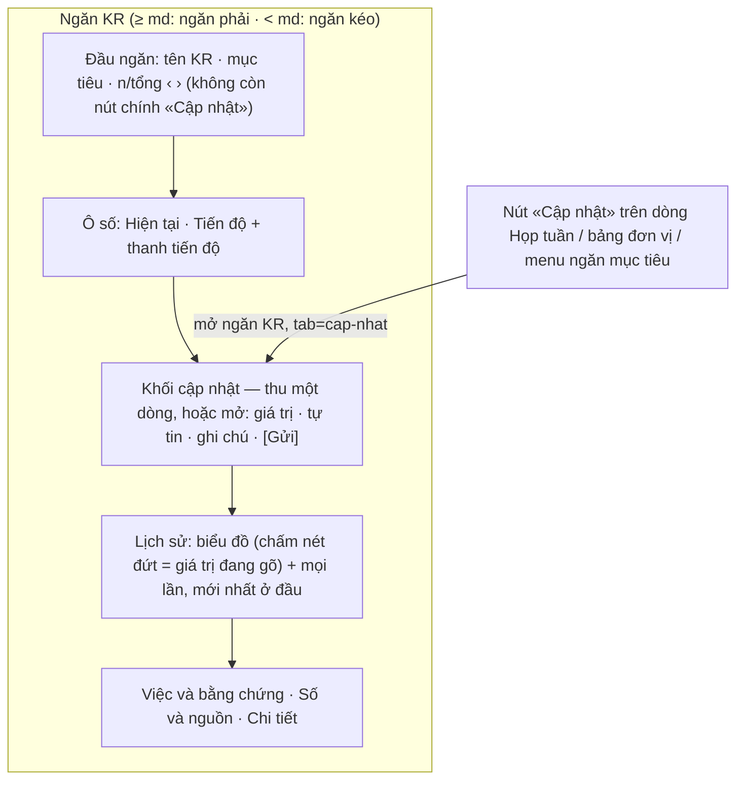

# Cập nhật KR ngay trong ngăn KR — thiết kế

Hàng SV8 của `docs/plan/lo-trinh-okr.json`. Ô Cổng Đáng: `_acceptance/cap-nhat-trong-ngan-kr/opportunity.md` (chủ kho
30/10, `build`). Luật: `docs/design.md` mục «Ghi vào bản ghi: ngay trong ngăn» và «Bấm vào KR và cập nhật»; trang tri
thức `crm-onehub-nguon:wiki/chu-de/ghi-trong-ngan.md`. Bản mẫu: `/proto/cap-nhat-trong-ngan-kr`.

## Hôm nay

Bấm «Cập nhật» ở bốn lối mở cùng một hộp thoại giữa màn (`HopThoaiCapNhatKr`):

| Lối | Chỗ |
|---|---|
| Nút chính ở đầu ngăn KR | `kr-sheet.tsx` `DauNganHanhDong` |
| Nút trên dòng Họp tuần | `hop-tuan.tsx` → `NutCapNhatDong` |
| Nút trên dòng KR của bảng theo đơn vị | `theo-don-vi/bang.tsx` → `NutCapNhatDong` |
| Mục «Cập nhật KR» trong menu «…» của ngăn mục tiêu | `objective-sheet.tsx` |

Hộp che ngăn: người ghi mất đúng phần cần nhìn — Lịch sử, số hiện tại, ‹ ›. Hộp tự vẽ biểu đồ gom theo tuần
(`okr.dienBien`) trong khi Lịch sử của ngăn vẽ mỗi lần một điểm (`okr.lichSuKr`, SV7), và tự vẽ khối «lần trước» trong
khi dòng đầu Lịch sử chính là lần trước. Bốn lối ghi chung `entry: "sheet"`, nên không đo được người vào từ đâu.

## Sau vòng này

### Khối cập nhật

- **Chỗ:** giữa ô số và Lịch sử, trong `CacMucKr`. Một thành phần `KhoiCapNhatKr` trong `apps/app/components/crm/record-
  sheet/` — chỉ ngăn KR dùng nó (một khu), nên chưa vào `packages/ui` theo luật «Một thành phần».
- **Ô:** giá trị (số, hay Chưa xong/Xong với KR mốc) · mức tự tin · ghi chú một dòng tối đa 200 ký tự · liên kết bằng
  chứng khi KR mốc chọn Xong · dòng «Ghi hộ <tên>» khi người ghi không phải người phụ trách. Dùng lại ba ô đang có của
  `cap-nhat-tuan` (`OGiaTri`, `ChonTuTin`, `OGhiChu`) — không vẽ ô mới.
- **Xem trước, không lặp:** khối không vẽ biểu đồ hay khối «lần trước». Đang gõ giá trị hợp lệ thì biểu đồ của Lịch sử
  hiện một chấm nét đứt tại giá trị ấy, và khối hiện một dòng mức đổi «12 → 14 (+2 đại lý)» so với lần mới nhất.
- **Thu và mở:** mở sẵn khi KR đến hạn chưa cập nhật; còn lại thu thành một dòng «Cập nhật KR này» kèm lần mới nhất,
  bấm thì mở và đặt con trỏ vào ô giá trị.
- **Gửi:** nút «Gửi cập nhật» là nút chính duy nhất của khối; Ctrl/⌘+Enter gửi. Gửi xong: một `OkrCheckIn`, ngăn vẫn
  mở, Lịch sử thêm dòng ở đầu và biểu đồ thêm điểm, ô số đổi, khối thu lại. Lỗi: báo ngay trong khối, nháp giữ nguyên.
- **Nháp:** gõ vào khối thì khai với bộ giữ thay đổi (`useKhaiThayDoi`); đóng ngăn hay bấm ‹ › khi còn nháp thì hỏi lại.
- **Không quyền** (`coNutCapNhat` sai — không phải người sửa được, kỳ khoá, mục tiêu đã bỏ): không có khối, ngăn như
  trạng thái chỉ đọc hôm nay.

### Lối vào

Mọi lối khác mở ngăn KR với `tab=cap-nhat` trên đường dẫn — cùng cách ngăn KR đã cuộn tới mục «Số và nguồn» khi
`tab=so-nguon` — rồi khối mở, cuộn tới và đặt con trỏ vào ô giá trị. Lối từ dòng Họp tuần giữ `thuTuKr` để ‹ › vẫn đi
theo bảng (HT2, HT6). Mỗi lối ghi `entry` riêng khi mở phiên cập nhật: `sheet` (khối trong ngăn) · `hop-tuan` ·
`bang-don-vi` · `muc-tieu`.

`HopThoaiCapNhatKr` và `useCapNhatKr` gỡ khỏi app; không còn Dialog nào trong luồng cập nhật một KR.

### «Đến hạn chưa cập nhật»

Hỏi-1 ở Cổng Phạm vi. Khuyến nghị: người sửa được KR, kỳ đang chạy, và KR chưa có lần cập nhật nào trong tuần này
(giờ Việt Nam, tuần bắt đầu thứ Hai) — đúng luật của danh sách «Cần cập nhật tuần này» ở Của tôi, nơi người phụ trách
bấm vào. Lối khác: thêm điều kiện «đã tới thứ cập nhật của chu kỳ» như tin nhắc — khối thu tới thứ ấy, người mở ngăn
sớm trong tuần phải bấm mở.

## Đặc tả UX

<!-- ux-spec:start -->
### Màn và trạng thái chạm

| Màn | Trạng thái |
|---|---|
| Ngăn KR (khổ ≥ md) | khối mở sẵn · khối thu · đang gõ (xem trước) · đang gửi · gửi lỗi · vừa gửi · KR mốc · ghi hộ · chỉ đọc |
| Ngăn kéo KR (< md) | như trên, khối nằm trong ngăn kéo |
| Họp tuần, bảng đơn vị, menu ngăn mục tiêu | bấm «Cập nhật» → ngăn KR mở với khối mở và được cuộn tới |

### Khuôn IA đã chọn + căn cứ

Khối soạn nằm trên dòng thời gian mà nó thêm vào — khuôn của `ActivityComposer` (Deal) và ô soạn Trao đổi (mục tiêu),
ghi ở `docs/design.md` bảng «Ghi vào bản ghi: ngay trong ngăn». Không tra mẫu ngoài: luật kho đã chọn khuôn.
<!-- ux-spec:end -->

## Đo

- DOM (`apps/app/test/cap-nhat-trong-ngan-kr.dom.tsx`) dựng `RecordSheetHost` và màn thật trên dữ liệu parse bằng
  schema thật, như HT2 và HT6.
- Phiên đo màn riêng của cây (`bun run do:man`) trên bộ OKR mẫu cho khổ 1280 và 375.
- Thước đã ký đang đo hộp thoại chuyển chỗ đo sang khối, giữ kỳ vọng — một yêu cầu `cham-tep`, chủ kho duyệt một lần
  (luật 34).
