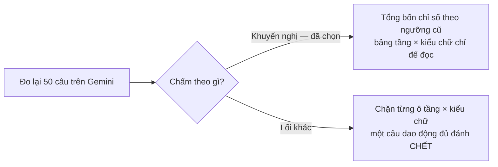
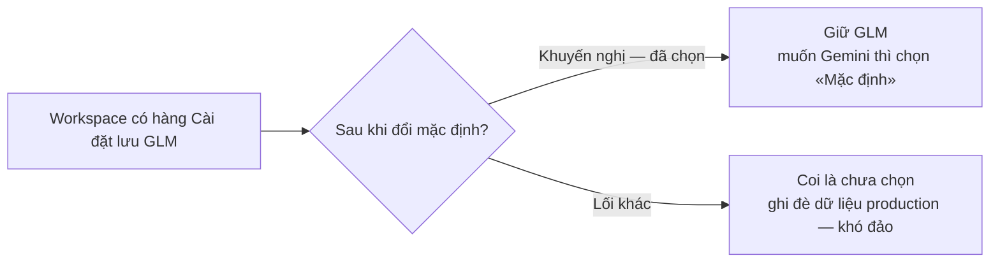

# Đổi model mặc định sang Gemini 3.8 Flash — thiết kế

Hàng phát sinh của dãy P6, đợt r2. Cổng Đáng: chủ kho duyệt khoảng 10:40Z 15/10, nguyên văn «Đồng ý theo đề xuất trên»
(`opportunity.md`). Hạng T2: không `migration`, không chạm `packages/db/prisma` hay module T3.

## Hiện trạng (đỉnh `eb5ab4269`)

| Chỗ | Giá trị hôm nay | Ai dùng |
|---|---|---|
| `DEFAULT_AGENT_MODEL` (`packages/db/src/settings.ts`) | `zai/glm-5.2-fast`, cửa sổ 1.000.000 | tác tử dựng và chạy khi Cài đặt → Chung chưa chọn model (`apps/agent/agent/lib/model.ts`), model lùi khi model đã chọn không còn trong danh mục |
| `TAI_LIEU_AGENT.soan.maModel` (`apps/agent/agent/lib/tai-lieu-config.ts`) | `zai/glm-5.2-fast`, ZDR | máy soạn đề xuất của Kho tài liệu |
| `TAI_LIEU_AGENT.hoi.maModel` | `zai/glm-5.2-fast`, ZDR | trợ lý đọc kho (màn Hỏi, Zalo) |
| `TAI_LIEU_AGENT.bangGia` | chỉ có giá GLM | sổ chi phí máy soạn (`chiPhiUsd`) |
| `MO_HINH_JUDGE` (trợ lý OKR, hai tệp config) | `zai/glm-5.2-fast` | model chấm — KHÔNG đổi |

Danh mục Gateway (`https://ai-gateway.vercel.sh/v1/models`, đọc 15/10): `google/gemini-3.8-flash` có cửa sổ
1.000.000 token, giá vào 0,00000075 và ra 0,00000375 USD mỗi token (0,75 và 3,75 USD mỗi triệu), có thẻ `tool-use`,
`structured-output`. Cửa sổ bằng GLM nên `contextWindowTokens` giữ 1.000.000.

## Làm gì

1. `DEFAULT_AGENT_MODEL.id` → `google/gemini-3.8-flash`; `contextWindowTokens` giữ 1.000.000.
2. `soan.maModel`, `hoi.maModel` → `google/gemini-3.8-flash`; `gateway.zeroDataRetention: true` giữ nguyên ở cả hai.
3. `bangGia` thêm `"google/gemini-3.8-flash": { vaoMoiTrieu: 0.75, raMoiTrieu: 3.75 }`; giữ dòng GLM (sổ chi phí cũ
   và người chọn GLM ở Cài đặt vẫn tính được).
4. Ảnh chụp mục Gemini của danh mục Gateway lưu ở `evidence/gateway-gemini-3-8-flash-2026-10-15.json` làm nguồn của
   giá trong bài kiểm.
5. `docs/agent.md` dòng model mặc định đổi theo.
6. Đo lại bộ 50 câu mẫu Kho tài liệu trên Gemini bằng `_acceptance/bo-cau-hoi-mau/rang/do-bo-mau.ts --do`
   (`BCM_EVIDENCE` trỏ thư mục hồ sơ), một lần, ở task cuối của S3; bộ so `rang/so-nguong.ts` đặt bốn chỉ số cạnh
   ngưỡng cũ của bộ chấm (`CHAM_BO_DO.nguong`: đúng trang ≥ 80%, từ chối đúng ≥ 80%, chuyển quy định ≥ 90%, chuyển
   nhầm ≤ 10%) và đếm câu lỗi model so với lượt đã ký của `bo-cau-hoi-mau`.

## Không làm

- Model chấm (`MO_HINH_JUDGE`) — phạm vi (3) đã duyệt.
- Trợ lý OKR (`apps/agent/agent/lib/okr/config.ts`, `apps/agent-okr`) — đã chạy Gemini 3.8 Flash từ trước.
- Workspace đã chọn model ở Cài đặt → Chung: giữ lựa chọn của họ; không ghi đè hàng `appSetting`.
- Hồ sơ cũ còn nhắc GLM trong tài liệu kế hoạch và bằng chứng đã ký — là lịch sử, không sửa.

## Đặc tả UX

Bỏ — không đổi màn nào (dòng sổ «bỏ đặc-tả-UX»). Màn Cài đặt → Chung tự hiện tên model mặc định mới vì đọc
`readAgentModel`.

## Hai điểm quyết định

Hỏi-1 — thước của lượt đo lại bộ mẫu (chủ kho chọn nhánh khuyến nghị):

Hỏi-2 — workspace đã lưu `zai/glm-5.2-fast` ở Cài đặt (chủ kho chọn nhánh khuyến nghị):

