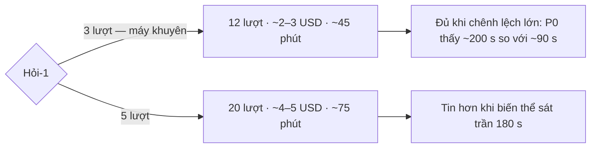

# Vì sao Tác nhân bộ dựng chậm trên GLM 5.3 — thiết kế điều tra

Ngày 16/10/2026 · hồ sơ `tac-nhan-glm-5-3-cham` (mã tạm MH3) · dãy P6, đợt r2.

## Đã biết từ đọc mã và nhật ký (không gọi model)

1. **Chỗ hỏng là phiên con `agent_builder`, không phải agent gốc.** Chín nhật ký của P0
   (`great-cray-f3b5c2/.acceptance-runs/do-glm/20261015T215652/`): hai lượt GLM 5.3 hỏng có agent gốc chạy xong hai
   bước rồi gọi `agent_builder`, và phiên con không trả về trước trần. Bảy lượt qua đều có dòng phiên con trả về.
2. **Lỗi 503 hàng đợi và lượt treo của eve dev không phân biệt.** Dòng «Queue message failed (… HTTP 503)» và «reference
   development generations that no longer exist» có ở cả chín lượt, qua lẫn hỏng.
3. **Trần 3 phút là của bài đo, không phải của sản phẩm.** `apps/agent/evals/agent-builder.eval.ts` đặt
   `timeoutMs: 180_000`; phiên bộ dựng thật có `SESSION_LIMITS.builder.sessionTimeoutMs` = `DAY_MS`
   (`dispatch-config.ts`). Trong sản phẩm, lượt GLM 5.3 không hỏng mà chỉ chậm — người dùng chờ hơn 3 phút (hàng K7).
4. **Đường Tác nhân không bật ZDR và không đặt mức suy luận.** `modelTheoVai("tac-nhan")` (`model.ts`) chỉ trả mã model
   và cửa sổ ngữ cảnh; `agent.ts` và `subagents/agent_builder/agent.ts` không khai `reasoning`. Vậy model chạy mức suy
   luận mặc định của nhà cung cấp (tài liệu eve `agent-config.md`, mục «Reasoning effort»). Giả thuyết ZDR không áp cho
   đường này.
5. **Danh mục Gateway (`/v1/models`):** `zai/glm-5.2-fast` có tuỳ chọn suy luận «toggle» và «effort none/low/medium/high»;
   `zai/glm-5.3` chỉ «effort low/high/max» — không tắt được suy luận. Có `zai/glm-5.3-fast` (hạng phục vụ nhanh).

## Còn phải đo

Mức suy luận mặc định của GLM 5.3 hay hạng phục vụ thường mới là nguyên nhân làm phiên con chậm? Đo bốn biến thể, mỗi
biến thể 3 lượt `eve eval agent-builder`, trên một kho đo riêng mỗi biến thể:

| Biến thể | Ô model (`writeAgentModel`) | Đổi tạm, không commit |
|---|---|---|
| mốc | `zai/glm-5.2-fast` | — |
| 5.3 mặc định | `zai/glm-5.3` | — |
| 5.3 hạng nhanh | `zai/glm-5.3-fast` | — |
| 5.3 suy luận thấp | `zai/glm-5.3` | `reasoning: "low"` trong `subagents/agent_builder/agent.ts` |

Mỗi lượt, trước khi xoá kho đo, đọc bảng `aiChiPhi` (sổ chi phí ghi từng bước): bước của phiên con `agent_builder`
(`phienCha` là phiên gốc của lượt) cho số bước, token vào và ra, giây từ bước đầu tới bước cuối, và `modelId` thật đã
dùng. Kết quả và mã thoát của eval đọc từ dòng ✓/✗ của nhật ký.

Thứ tự chạy xen kẽ theo vòng (mốc, glm53, glm53-fast, glm53-low) để tải máy và độ trễ Gateway theo khung giờ rải đều
lên các biến thể; mỗi lượt một kho đo riêng, lượt sau chỉ bắt đầu khi lượt trước đã kết thúc. Mỗi lượt ghi giờ bắt đầu và
kết thúc, cờ `bi_cat` khi eval huỷ ở 180 giây, băm của `subagents/agent_builder/agent.ts` lúc chạy (chứng bản sửa tạm chỉ
có ở lượt glm53-low), và kết xuất thô các hàng `aiChiPhi` của lượt ra `evidence/aichiphi-<biến thể>-<lượt>.json` trước khi
xoá kho. Bộ so tính lại mọi số từ bản kết xuất, không tin số trình đo tự viết.

Phép dò mức suy luận (`rang/do-suy-luan.ts`): gọi thẳng AI Gateway hai lần với `zai/glm-5.3`, cùng một câu, mức
`low` và `high`, ghi `usage` Gateway trả vào `evidence/do-suy-luan.json`. Nếu token suy luận của `low` nhỏ hơn `high`
thì mức low tới được nhà cung cấp; Gateway không trả trường đó thì kết luận ghi «chưa kiểm được».

Trình đo nằm ở `rang/do-tac-nhan.ts`; bộ so ở `rang/so-tac-nhan.ts`; kết luận ở `evidence/ket-luan.md`.

## Ngoài phạm vi

- Sửa sản phẩm (đặt mức suy luận, đổi model) — MH4 quyết theo số của hồ sơ này.
- Trải nghiệm chờ lâu — K7.
- Token suy luận riêng: sổ chi phí không ghi, chỉ có token ra tổng.

## Đặc tả UX

Không chạm giao diện.

## Hỏi-1 — 3 hay 5 lượt mỗi biến thể

