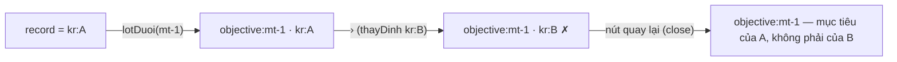
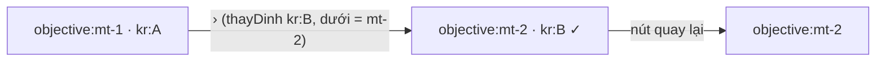

# Về đúng mục tiêu khi đi ‹ › qua bảng Họp tuần — thiết kế

Hàng HT6 của `docs/plan/lo-trinh-okr.json`. Ô Cổng Đáng: `_acceptance/ve-khung-muc-tieu-dung-kr/opportunity.md`
(chủ kho 30/10, `build`). Nguồn: mục Ngoài-4 ở Cổng Bằng chứng của HT2 `hop-tuan-tren-bang` (28/10), sổ
`_acceptance/hop-tuan-tren-bang/decisions.jsonl` dòng `d-20261028T114723Z-27` «mở hợp đồng mới».

## Lỗi

Ngăn bản ghi là một ngăn xếp sống trên đường dẫn (`?record=objective:mt-1,kr:A`, `record-stack.ts`). Mở ngăn KR từ
bảng Họp tuần thì `KrSheet` lót mục tiêu của KR xuống dưới (`lotDuoi`) — chỉ khi KR đang nằm một mình. Nút ‹ › gọi
`thayDinh`, thay đúng phần tử đỉnh. Đi › từ A (mục tiêu mt-1) sang B (mục tiêu mt-2) để lại `objective:mt-1,kr:B`:

Hai lối về cùng hỏng: nút quay lại ở đầu ngăn (`onBack = close`) và liên kết tên mục tiêu ở dòng phụ đề
(`LienKetMucTieu`: tầng dưới khác mục tiêu của B nên nó mở chồng thêm mt-2 thay vì quay về).

## Cách sửa

Ngăn xếp phải nói thật sau mỗi lần ‹ ›: tầng dưới là mục tiêu của KR đang xem.

1. `record-stack.ts` — `thayDinh(ref, duoi?)`: có `duoi` thì thay luôn phần tử ngay dưới đỉnh bằng `duoi` trong CÙNG
   một lần ghi đường dẫn (bỏ bản trùng của `duoi` ở tầng sâu hơn). Không có `duoi` thì như cũ.
2. `thu-tu-hop-tuan.ts` — `useThuTuHopTuan` trả từng dòng `{ keyResultId, objectiveId }` thay vì chỉ mã KR. Dòng bảng
   (`dongHop`) đã mang `objectiveId`, nên lúc bấm › máy biết mục tiêu đích mà không chờ tải.
3. `kr-sheet.tsx` — `sang(huong)`: theo thứ tự bảng thì gọi `thayDinh(kr đích, mục tiêu của KR đích)`; đi trong một
   mục tiêu thì gọi như cũ.

Một lần ghi, không qua trạng thái trung gian sai; tầng dưới đúng ngay khi ngăn mới dựng, nên `mtId` của ngăn KR mới không
còn tải nhầm mục tiêu cũ trong lúc chờ `canhKr`.

### Vì sao luôn theo KR đích

Câu đã ký ở Cổng Đáng: «bấm «Về khung mục tiêu» và mở đúng mục tiêu của KR đang xem». Tầng ngay dưới KR là chỗ mọi lối
về mở, nên theo thứ tự bảng nó luôn là mục tiêu của KR đích — bất kể trước đó là gì. Đã xét và bỏ hai phương án hẹp hơn:
chỉ đổi khi tầng dưới đang là mục tiêu của KR trước (giữ một đường dẫn chép tay như `objective:mt-2,kr:C`), và chỉ đổi
khi tầng dưới là một mục tiêu (giữ kế hoạch hay deal). Cả hai để lối về mở thứ khác mục tiêu của KR đang xem, trái câu
đã ký, mà thêm nhánh mã. Bảng Họp tuần không mở ngăn trên kế hoạch hay deal, nên ca ấy chỉ tới được bằng đường dẫn chép tay.

Ba lối về cùng đọc tầng dưới: nút quay lại ở đầu ngăn, liên kết tên mục tiêu ở phụ đề, và nút «Về khung mục tiêu» khi KR
đích không tải được. Đo cả ba.

### Vì sao chỉ theo thứ tự bảng

Ngoài Họp tuần, ‹ › đi trong các KR của một mục tiêu (VK7 AC-2), nên KR đích luôn cùng mục tiêu và tầng dưới không đổi.
Sổ HT2 `hop-tuan-tren-bang#d-20261027T131457Z-5`: «‹ › theo thứ tự bảng chỉ áp cho ngăn KR mở từ Họp tuần; mở từ mọi chỗ
khác giữ AC-2 của VK7.»

## Không đổi

Không đổi hình, chữ, nút hay khổ nào: cùng nút quay lại, cùng liên kết, cùng đếm «n/tổng · theo thứ tự bảng». Không
API, không migration, không chữ mới trong tệp chữ.

## Đo

Một tệp DOM mới `apps/app/test/ve-khung-muc-tieu-dung-kr.dom.tsx` dựng `HopTuan` và `RecordSheetHost` thật trên dữ liệu
parse bằng `hopTuanOutput`, `canhKrOutput` thật (cùng khung `khung-gop-y-dung-cho.tsx` của HT2), đọc đường dẫn qua
`NuqsTestingAdapter` và khung mục tiêu đang mở qua `[data-okr-sheet]`. Mỗi ca có chiều đỏ trên bản sao: trả `sang` về
`thayDinh` một đối số.
