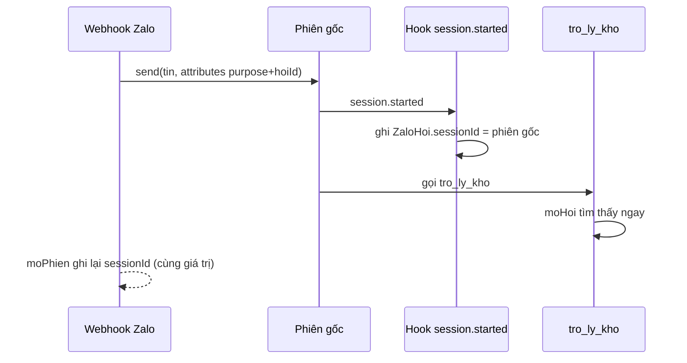
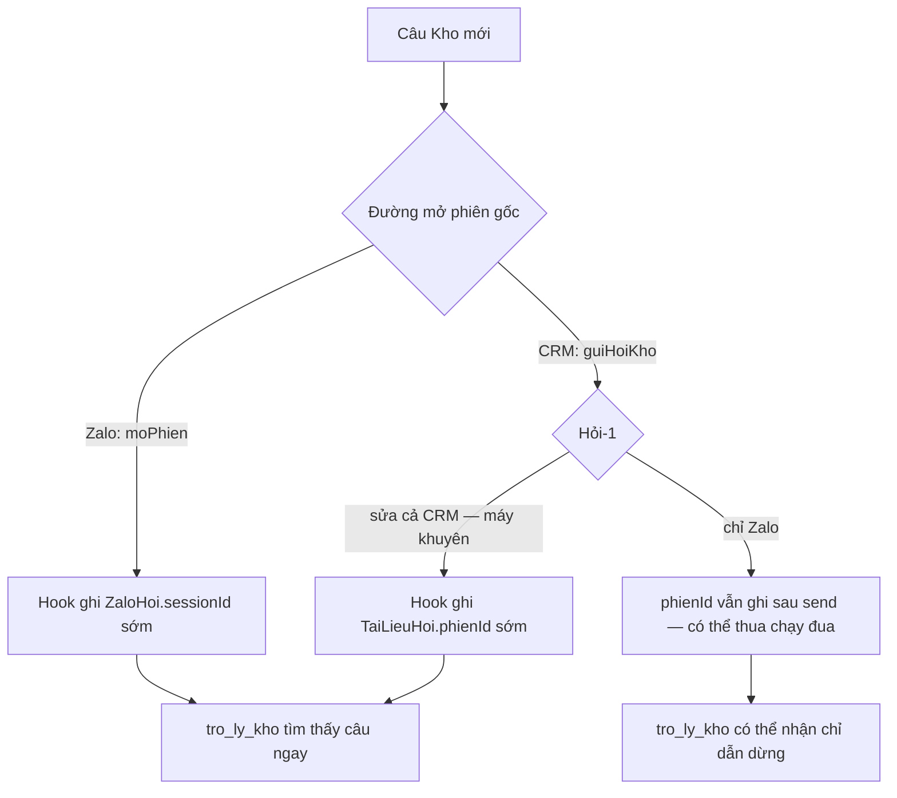

# Trợ lý kho luôn chạy với chỉ dẫn kho — thiết kế

Ngày 16/10/2026 · hồ sơ `zalo-tro-ly-kho-chi-dan` (mã tạm `l6`) · dãy P6, đợt r2.

## Vấn đề, đọc từ nhật ký

Phiên con `tro_ly_kho` lấy chỉ dẫn từ bộ giải động `session.started`
(`apps/agent/agent/subagents/tro_ly_kho/instructions.ts`). Bộ giải gọi `moHoi(ctx)`
(`apps/agent/agent/lib/tai-lieu-hoi.ts`) để tìm câu hỏi kho của phiên:

- mã phiên gốc lấy từ token `subagent:<phiên gốc>:<callId>` (`phienGocCua`; ngữ cảnh
  bộ giải của eve không có `session.parent`, xem fixture `so-chi-phi-that.json`);
- đường CRM: hàng `TaiLieuHoi` có `phienId` = phiên gốc, `trangThai` DANG_HOI;
- đường Zalo: hàng `ZaloHoi` có `sessionId` = phiên gốc, `ketQua` dang-hoi, rồi mở hàng
  `TaiLieuHoi` kênh ZALO;
- thử 8 lần, cách 250 ms (`TAI_LIEU_AGENT.hoi.timHoi`), không thấy thì ném
  «This session is not a library question».

Hai liên kết trên chỉ được ghi SAU khi lệnh mở phiên trả về:
`moPhien` (`zalo-tra-loi.ts`) ghi `ZaloHoi.sessionId` sau `deps.hoi(y)`, và `guiHoiKho`
(`tai-lieu-hoi-phien.ts`) ghi `TaiLieuHoi.phienId` sau `send(...)`. Phiên gốc đã chạy
trong lúc đó. Model càng nhanh thì agent gốc gọi `tro_ly_kho` càng sớm, và lần tra có thể
hết 2 giây trước khi liên kết kịp ghi.

Số dòng «Dynamic instructions resolver (session.started) threw» trong nhật ký eve của
các lượt đo bộ 50 câu ngày 15–16/10: Gemini 3.8 Flash 1 (lượt 2), GLM 5.3 2,
GLM 5.3 Flash 30. Đúng thứ tự tốc độ của model.

Khi bộ giải ném lỗi, eve ghi «threw — skipping» và phiên con chạy với chỉ dẫn mặc định
của khung (tài liệu eve `subagents.mdx`: slot vắng rơi về mặc định của khung). Chỉ dẫn
mặc định cho agent dò `/workspace`, đọc `README.md`, rồi chạm trần 8 nghìn token ra hoặc
trả sai khuôn kết quả. Đó là các dòng «output token limit» và «matching the requested
schema» trong nhật ký.

## Hướng sửa

1. **Phiên gốc tự ghi liên kết ngay khi bắt đầu.** Một hook mới của agent gốc
   (`apps/agent/agent/hooks/`) nghe `session.started`. Phiên gốc của hai đường đều mở với
   `auth.attributes` mang `purpose` và `hoiId`:
   - `purpose` = `zalo` (`ZALO.hoi.purpose`): ghi `ZaloHoi.sessionId` = mã phiên cho hàng
     `hoiId` còn `dang-hoi` và chưa có `sessionId`;
   - `purpose` = `kho` (`PURPOSE_KHO`): ghi `TaiLieuHoi.phienId` = mã phiên cho hàng
     `hoiId` có `phienId` = `gui:<hoiId>` (dấu chờ mà `guiHoiKho` đặt).

   Hook đọc `purpose` và `hoiId` bằng helper `attribute()` của `session-purpose.ts` — cùng cách các hook đang chạy
   (`audit.ts`, `okr-uy-quyen.ts`) đọc thuộc tính phiên. Mỗi lần thấy liên kết đúng (vừa ghi hay đã có), hook ghi
   một dòng `[lien-ket-hoi] <purpose> <hoiId> -> <mã phiên>` vào nhật ký, để lượt đo thật đếm được.

   Tài liệu eve (`guides/hooks.md`): hook chạy sau khi sự kiện đã ghi bền, eve chờ hook
   xong; hook ném lỗi thì thành `turn.failed`. Vì vậy hook bọc thân trong try/catch, chỉ
   ghi cảnh báo. Hai chỗ ghi cũ giữ nguyên làm lưới thứ hai: điều kiện `where` của chúng
   khớp cùng giá trị, ghi lại không đổi gì.
2. **Không bao giờ để phiên con chạy không có chỉ dẫn.** Bộ giải của `tro_ly_kho`
   thôi ném lỗi khi không tìm được câu hỏi. Nó vẫn gọi `ghiSaiCho` như cũ, rồi trả một
   chỉ dẫn dừng: không gọi công cụ nào, trả kết quả ngay. Nó ghi một dòng cảnh báo
   `[tro-ly-kho] khong tim thay cau hoi`, để lượt đo thật đếm được số lần thua sau bản sửa. Phiên con hỏng nhanh và rẻ thay
   vì dò `/workspace` tới trần token.

Chỉ dẫn dừng là lời cho model, viết tiếng Anh như `LOI_DAN`; nó không hiện cho người dùng.
Người hỏi qua Zalo vẫn nhận câu «Tôi chưa trả lời được câu này…» của đường `turn.failed`
như hôm nay.

## Đo

- Bài kiểm đơn vị và tích hợp trong `apps/agent/test/` đi qua chính hook và chính bộ giải,
  với ngữ cảnh dựng theo hình eve thật (`ctxBatDauThat` cho phiên con).
- Lượt đo bộ 50 câu bằng `do-bo-mau.ts` trên Gemini 3.8 Flash, như hồ sơ
  `re-mo-hinh-mac-dinh`: hai hằng model (`DEFAULT_AGENT_MODEL`, `TAI_LIEU_AGENT.hoi.maModel`)
  đổi tạm trên cây của lượt này, không commit. Bằng chứng gồm báo cáo bộ chấm, tệp chấm
  từng câu và bản chép nhật ký eve của lượt. Model mặc định của nhánh vẫn là GLM 5.2 Fast;
  đo trên đó không phân biệt được, vì GLM 5.2 Fast chậm nên ít khi thua chạy đua.

## Ngoài phạm vi

- Máy soạn (`may_soan`) gọi làm phiên con tra `TaiLieuNguon.phienId` theo cùng kiểu
  (`nguonCuaPhien`, `tai-lieu-phien.ts`). Cùng lớp rủi ro, việc riêng.
- Đổi model mặc định — hồ sơ `re-mo-hinh-mac-dinh`.
- Lỗi sai khuôn kết quả do chính model (không do thiếu chỉ dẫn).

## Đặc tả UX

Không chạm giao diện. Câu Zalo người dùng thấy không đổi.

## Hỏi-1 — sửa cả đường CRM hay chỉ Zalo

