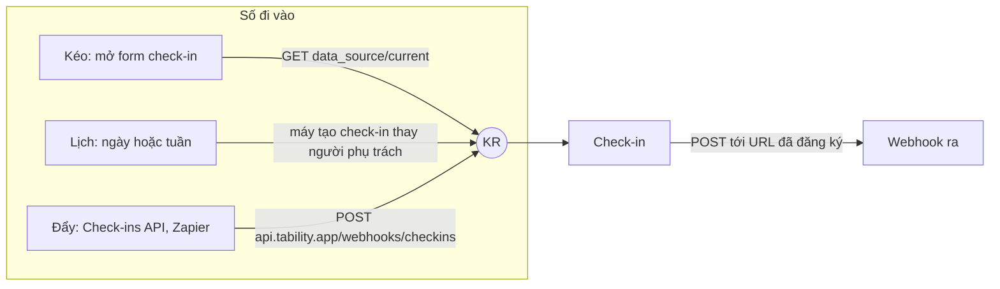

# Nguồn số tự cập nhật của KR — học từ Tability, dựng cho OneHub CRM

Ngày 20/10/2026, đối chiếu thêm tám công cụ ngày 21/10 · nhánh `onehub` ở `b32a1495f` · tài liệu
nghiên cứu, chưa phải hàng lộ trình.

Màn được xét: `tability.app/onehub/plans/ieJmFfcNwBzK/outcomes#outcome:xcpU-W_YYo-m:edit:data_source`
— thẻ **Data source** trong bảng sửa một KR (Tability gọi KR là *outcome*).

## Tóm tắt

1. Tability gom mọi nguồn — Google Sheets, Jira, HubSpot, SQL, BI — về **một việc duy nhất: lấy ra
   một con số**. Mỗi nguồn chỉ khác ở cách chỉ chỗ lấy số (một ô, một câu SQL, một câu JQL, một
   báo cáo). Bên trong, cấu hình là ba trường trên KR: `data_source_origin`, `data_source_type`,
   `data_source_meta` (JSON riêng từng nguồn).
2. Có **ba đường số đi vào**: kéo lúc người mở form check-in (điền sẵn), lịch tự đồng bộ ngày hoặc
   tuần (máy tạo check-in thay người phụ trách), và đẩy từ bên ngoài (Check-ins API, Zapier). Thêm
   một đường **đi ra**: webhook bắn khi có check-in mới.
3. Nguyên lý đáng học nhất không nằm ở kỹ thuật: **máy ghi số, người giữ phần phán đoán**. Tự
   đồng bộ không thay check-in của người — Tability vẫn nhắc người phụ trách giải thích, chấm độ tự
   tin, ghi rủi ro.
4. OneHub CRM **đã có nửa nền**: bốn nguồn (`tay` · `crm` · `api` · `bang-tinh`), bảng
   `OkrNguonKr`, lịch sử chỉ-thêm `OkrSoChup`, tác tử đọc ô Google Sheets bằng service account, và
   `POST /rest/okr/key-results/{id}/value` cho hệ thống khác. Ở vài chỗ OneHub chặt hơn Tability
   (khoá nguồn khi công bố, bản chụp tự mang định nghĩa, số đo cạnh).
5. Phần còn thiếu, theo thứ tự đáng làm: cách chọn ô linh hoạt cho Sheets (giá trị cuối hàng/cột),
   **webhook vào** riêng cho từng KR không cần khoá API cá nhân, ghi cộng dồn có khoá chống lặp,
   **webhook ra**, nhịp đồng bộ chọn được và nút «đọc ngay» có dòng «đọc lần cuối».
6. Đối chiếu thêm tám công cụ khác ngày 21/10 (mục 2.7): **không công cụ nào có webhook vào riêng
   từng KR** cho hệ thống không có tài khoản — Tability là ngoại lệ, Base Goal gần nhất. Bảy trên tám
   nối Sheets bằng tài khoản Google của từng người và chỉ lấy một ô cố định. Mẫu webhook ra tốt nhất là
   của Workpath (ký thân, `event_id` để bỏ trùng), không phải của Tability.

---

## 1. Phương pháp và bằng chứng

**REA** ở đây hiểu là *Reverse-Engineering Analysis* — phân tích ngược một tính năng có sẵn qua ba
bước: **quan sát** (bằng chứng có thể chỉ lại được) → **suy ra mô hình** (dữ liệu, luồng, luật) →
**kiểm lại** mô hình bằng bằng chứng thứ hai độc lập. Mỗi nhận định dưới đây ghi mã bằng chứng; điều
không có bằng chứng ghi rõ «chưa rõ».

Trang ở đường dẫn trên cần đăng nhập: trình duyệt chưa đăng nhập bị chuyển về
`/public/present` với câu «Quyền truy cập công cộng bị hạn chế đối với kế hoạch này». Vì vậy màn thật
chưa được chụp; bằng chứng lấy từ hai nguồn công khai, đọc chéo nhau.

| Mã | Nguồn | Đọc được gì | Độ tin |
| --- | --- | --- | --- |
| T1 | Hướng dẫn chính thức `guides.tability.io` (chỉ mục `docs/llms.txt`, bản `.md` của từng trang): Data sources, Auto-sync, Automate check-ins, Check-ins API, Webhooks, Google Sheet, Google Service Account, PostgreSQL, Salesforce, Jira, HubSpot, GitHub, Amplitude, Zapier, MCP Server | Hành vi người dùng thấy, gói giá, nhịp đồng bộ | Cao cho hành vi; tài liệu có chỗ lệch nhau (xem 2.6) |
| T2 | Bản dựng JavaScript công khai của app: `https://tability.app/assets/index-UPzGi8lO.js` (13,5 MB, tải 20/10/2026) | Tên trường thật, giá trị liệt kê, endpoint, mã màn sửa nguồn Google Sheets | Cao cho phía trình duyệt; **không** thấy mã máy chủ |
| T3 | Đường dẫn màn được giao | Mẫu hash `#outcome:<nano_slug>:edit:data_source` khớp đúng chuỗi trong T2 | Cao |
| O1 | Kho này: `packages/db/prisma/schema.prisma`, `packages/validation/src/okr-nguon.ts`, `apps/agent/agent/lib/okr-sheets.ts`, `apps/agent/agent/lib/okr-chup.ts`, `apps/api/src/okr/okr-so.service.ts`, `docs/api.md` mục «A KR's number has a source» | Cái OneHub đang có | Cao |

**Chưa rõ** (không bằng chứng nào chạm tới): thân JSON của webhook Tability gửi ra, chính sách thử
lại và hạn mức gọi phía máy chủ, cách máy chủ chọn giờ chạy lịch, cách xử lý khi KR đổi người phụ trách
giữa chừng.

---

## 2. Tability làm thế nào

### 2.1 Mô hình dữ liệu

Một KR mang các trường sau (T2 — đọc từ giá trị mặc định khi dựng KR mới và từ màn sửa):

| Trường | Nghĩa | Giá trị thấy được |
| --- | --- | --- |
| `data_source_origin` | Nguồn nào | 35 giá trị: `google_sheets`, `google_sheets_service_account`, `excel_cloud`, `big_query`, `big_query_service_account`, `postgresql`, `mysql`, `mariadb`, `power_bi`, `tableau`, `salesforce`, `hubspot`, `chargebee`, `chartmogul`, `amplitude`, `google_analytics`, `ahrefs`, `jira_cloud`, `linear`, `github`, `gitlab`, `sentry`, `pagerduty`, `helpscout`, `zendesk_sales`, `zendesk_support`, `asana`, `clickup`, `monday`, `trello`, `favro`, `google_tasks`, `link`, và hai giá trị cũ `dependencies`, `initiatives` |
| `data_source_type` | Cách chỉ chỗ lấy số | `cell`, `sql`, `jql`, `query`, `report`, `url`, hoặc mã chỉ số dựng sẵn (vd `gross_mrr_churn_rate`) |
| `data_source_meta` | Cấu hình riêng của nguồn, JSON | Khoá gặp nhiều: `sql`, `column`, `row`, `sheet`, `spreadsheet`, `spreadsheet_id`, `project_id`, `board_id`, `jql`, `query`, `report_id`, `repo`, `dataset_id`, `workbook_id`, `url`, `membership_id` |
| `data_source_sync_enabled` | Bật tự đồng bộ | `true`/`false` |
| `data_source_sync_interval` | Nhịp, đơn vị ngày | `1` (hằng ngày) hoặc `7` (hằng tuần); mặc định `0` |
| `data_source_synced_at` | Lần đồng bộ cuối | ngày giờ; rỗng thì màn ghi «chưa đồng bộ» |
| `data_source_ai_comment_enabled` | AI bình luận sau mỗi lần đồng bộ | `true`/`false` (T1: 200 credit mỗi lần) |
| `remote_checkins_enabled`, `remote_checkins_token`, `remote_checkins_url` | Cửa nhận số từ ngoài của riêng KR này | token ngẫu nhiên |

Check-in mang cờ `is_remote`; màn thêm chữ « (synced)» sau những check-in máy tạo (T2). Tài liệu ghi
check-in tự đồng bộ hiện tác giả là Tability AI/Tabby (T1).

**Hai tầng tách bạch.** Kết nối (đăng nhập Google, khoá PostgreSQL, OAuth HubSpot) là của
**workspace** hoặc của **một người**, sống ở `/v1/workspaces/:workspaceSlug/services/<origin>` và
`/:slug/account/integrations`. Cấu hình «lấy số nào» là của **KR**. Một kết nối phục vụ nhiều KR.

Cũng thấy trong T2: cùng bộ endpoint `data_source` tồn tại cho **KPI** (`/v1/kpis/:kpiId/data_source`)
— chỉ số theo dõi dài hạn, không thuộc chu kỳ OKR, dùng chung cơ chế.

### 2.2 Bốn lời gọi quanh một nguồn

Từ T2, mọi nguồn của một KR đi qua đúng bốn endpoint (`Vb = /v1/outcomes/:outcomeId`):

| Lời gọi | Việc | Ai gọi |
| --- | --- | --- |
| `PUT  /v1/outcomes/:id/data_source` | Lưu cấu hình (`data_source_origin`, `data_source_type`, `data_source_meta`) | nút **Save & preview** |
| `GET  /v1/outcomes/:id/data_source/current` | Tính số **ngay lúc này**, không ghi gì; trả `{ result }` hoặc `{ result: { error } }` | khung xem trước **và** form check-in |
| `POST /v1/outcomes/:id/data_source` | Đồng bộ ngay: lấy số và **tạo một check-in** | bấm vào nguồn trong ô *Data connector* |
| `DELETE /v1/outcomes/:id/data_source` | Gỡ nguồn; check-in cũ ở lại | nút gỡ |

Bật/tắt lịch và đổi nhịp không có endpoint riêng — chỉ là `PUT /v1/outcomes/:id` với
`data_source_sync_enabled` hoặc `data_source_sync_interval`.

Điểm thiết kế đáng chú ý: **xem trước và điền sẵn check-in dùng cùng một lời gọi**. Màn xem trước
giữ kết quả 300 ms (`staleTime: 300`), khoá truy vấn gồm toàn bộ cấu hình
(`data_source:google_sheets:cell<spreadsheet>:<sheet>:<column>:<row>`), nên đổi một ô là tính lại.

### 2.3 Ba đường số đi vào, một đường đi ra



**Kéo** (gói Plus) — mở form check-in thì số hiện sẵn; người xem lại, thêm bối cảnh và độ tự tin
rồi mới gửi (T1 Data sources; T2: thành phần form gọi `data_source/current` rồi `setScoreChanges`).

**Lịch** (gói Premium) — bật *Enable auto-sync*, chọn *Daily* hoặc *Weekly*. Mỗi lần chạy, máy tạo
một check-in thay người phụ trách. Lần đầu chạy trong vòng một giờ sau khi bật. Tài liệu cũ hơn của
từng nguồn ghi nhịp khác nhau — «cách ngày» (Sheets, BigQuery, Power BI, Salesforce), «mỗi 48 giờ»
(Jira, GitHub), «mỗi ngày» (HubSpot, Amplitude) — còn trang Auto-sync mới và mã T2 chỉ có 1 hoặc 7
ngày. Đọc ra: nhịp từng là cố định theo nguồn, nay thành lựa chọn của người dùng.

**Đẩy** (gói Plus) — bật *Check-ins API* trên từng KR để lấy `remote_checkins_token`, rồi:

```http
POST https://api.tability.app/webhooks/checkins?remote_checkins_token=<token của KR>
Content-Type: application/json

{ "personal_api_token": "<token cá nhân>", "score": "25000",
  "body": "MRR lên 25.000", "confidence": "green", "score_type": "increment" }
```

Hai token, hai vai: token trên URL nói **KR nào**, token cá nhân trong thân nói **ai ghi**.
`confidence` bỏ trống thì máy tự chấm theo tiến độ dự kiến (trên 70 % xanh, 50–70 % vàng, dưới 50 %
đỏ). `score_type: "increment"` cộng vào số của check-in trước — số âm thì trừ. Zapier dùng đúng cửa
này: trigger «thẻ Trello chuyển cột» → action *Create Check-In* với `score = 1`, kiểu cộng dồn.

**Webhook ra** (gói Premium) — đăng ký ở cấp workspace hoặc từng KR; chỉ bắn khi **tạo** check-in,
không bắn khi sửa. URL phải nhận `POST` và trả `200`; nút *Test* gửi thử và phải qua mới thêm được;
webhook đang chạy mà trả khác `200` thì bị **treo**. Endpoint: `/v1/workspaces/:slug/webhooks`,
`/v1/outcomes/:id/outcome_webhooks`. Thân JSON gửi ra: chưa rõ.

Ngoài ba đường trên, Tability còn mở **MCP server** (OAuth trên trình duyệt) để Claude hay ChatGPT đọc
OKR và tạo check-in bằng hội thoại (`tability_create_checkin`) — cùng một hành động «ghi một check-in»,
thêm một cửa.

### 2.4 Đi sâu: Google Sheets

Đây là nguồn được yêu cầu đầu tiên, và T2 cho thấy trọn màn sửa.

**Hai cách xác thực, hai `origin`.**

| | `google_sheets` | `google_sheets_service_account` |
| --- | --- | --- |
| Ai cấp quyền | Từng người, ở *Personal integrations* | Quản trị, dán khoá JSON của service account ở *Settings › Integrations* |
| Chọn bảng tính | **Google Picker** chạy trong trình duyệt, lọc `application/vnd.google-apps.spreadsheet`, dùng access token của người đó lấy qua `GET /services/google/token` | Nhập mã bảng tính (`spreadsheet_id`); người dùng chia sẻ bảng tính cho email service account như chia sẻ cho một người, quyền xem |
| Phạm vi OAuth | thấy trong T2: `drive.file`, `drive.readonly` (và `bigquery`, `analytics.readonly` cho nguồn khác) | không qua OAuth người dùng |
| Danh sách trang | máy chủ Tability gọi Sheets API thay trình duyệt: `GET /services/google/spreadsheets/:id` (có cả `?keyword=` để tìm) | `GET /services/google_service_account/spreadsheets/:id`, trả `sheets[].properties.title` — khuôn của Sheets API `spreadsheets.get` |
| Lỗi đặc trưng | «Authentication token not found. Try reconnecting your account.» | «we couldn't load the spreadsheet. Please check that the service account has access…» |

`drive.file` kèm Picker là chỗ khéo: ứng dụng chỉ thấy **đúng những tệp người dùng tự chọn**, không
cần quyền đọc cả Drive.

**Cấu hình lưu xuống** (T2, nguyên khuôn thân `PUT`):

```json
{
  "data_source_origin": "google_sheets",
  "data_source_type": "cell",
  "data_source_meta": {
    "spreadsheet": { "id": "…", "name": "…" },
    "sheet": { "id": "<tên trang>", "name": "<tên trang>" },
    "type": "cell | last_in_row | last_in_column",
    "row": "12 | last",
    "column": "C | last",
    "membership_id": "<người cấu hình>"
  }
}
```

Ba cách lấy số: **ô cố định**, **giá trị cuối của một hàng**, **giá trị cuối của một cột**. Hai
cách sau giải bài thật của bảng tính vận hành: người ta *thêm dòng* mỗi tuần chứ không ghi đè một ô
tổng. Chọn «cuối cột» thì màn ẩn ô *Row* và lưu `row: "last"`; «cuối hàng» thì ẩn *Column*.

`membership_id` gắn cấu hình với **người đã cấu hình**: máy chủ dùng kết nối Google của chính người
đó khi đồng bộ. Hệ quả suy ra (chưa có bằng chứng trực tiếp): người đó rời công ty hay gỡ kết nối thì
nguồn gãy — trang Auto-sync xếp «tài khoản đã nối còn quyền với sheet hay không» vào bước dò lỗi.

**Xem trước** ghi «Preview value (unformatted)» — số thô, không định dạng. Phía OneHub đang đọc đúng
kiểu này (`valueRenderOption=UNFORMATTED_VALUE`).

### 2.5 Các nguồn còn lại: cùng một khuôn

| Họ nguồn | Người chỉ chỗ lấy số bằng | Luật |
| --- | --- | --- |
| SQL (PostgreSQL, MySQL, MariaDB, BigQuery) | một câu truy vấn | chỉ `SELECT`, cấm dấu `;`, trả **một** số; kết nối cấp workspace (host, cổng, tên CSDL, người dùng, mật khẩu) |
| Salesforce | SOQL hoặc mã báo cáo + cột đã *Summarize* | như SQL |
| Power BI, Tableau | DAX / chọn trong báo cáo | trả một số |
| Jira | JQL | số là **số issue** khớp JQL |
| HubSpot, Amplitude, GitHub, ChartMogul… | chọn từ danh sách chỉ số dựng sẵn | không viết truy vấn |
| `link` | chỉ một đường dẫn | không lấy số, không tự đồng bộ — chỉ để người bấm sang xem |

Hai loại KR **không nhận nguồn ngoài**: KR cộng dồn từ KR con (*rollup*) và KR tính theo việc xong
(*milestone*) — số của chúng tính bên trong Tability. Hai `origin` cũ `dependencies`, `initiatives`
còn trong mã nhưng chỉ đọc.

### 2.6 Nguyên lý rút ra

| # | Nguyên lý | Bằng chứng |
| --- | --- | --- |
| P1 | **Kết nối là của workspace (hoặc của người), nguồn là của KR.** Một kết nối, nhiều KR. Quản trị có thể giới hạn nguồn nào thành viên được cấu hình. | T1 Data sources; T2 `/services/<origin>` |
| P2 | **Mọi nguồn quy về một hàm trả một số.** Cách chỉ chỗ lấy số khác nhau, kết quả luôn là một vô hướng — nhờ vậy lịch, xem trước, điền sẵn và check-in dùng chung một lõi. | T2 bốn endpoint; T1 «should return a single numeric value» |
| P3 | **Xem trước trước khi tin.** *Save & preview* lưu rồi đọc thử ngay, hiện số hoặc nguyên văn lỗi. | T1; T2 `data_source/current` |
| P4 | **Máy ghi số, người giữ phán đoán.** Tự đồng bộ không thay check-in người: vẫn nhắc, vẫn đòi độ tự tin và lời giải thích; check-in máy được đánh dấu riêng. | T1 Auto-sync «does not replace the owner's review»; T2 `is_remote` |
| P5 | **Lịch thưa, có nút «ngay bây giờ».** Ngày hoặc tuần, lần đầu trong một giờ; ai cần số mới bấm đồng bộ ngay. | T1; T2 |
| P6 | **Nói rõ lần đọc cuối.** «Last sync …» hoặc «never synced» đứng cạnh nguồn. | T2 `data_source_synced_at` |
| P7 | **Đẩy cần hai danh tính: KR nào và ai ghi.** | T1 Check-ins API |
| P8 | **Webhook ra phải tự chứng minh còn sống**: gửi thử mới được thêm, trả khác 200 thì treo. | T1 Webhooks |
| P9 | **Đổi hay gỡ nguồn không xoá lịch sử.** | T1 Data sources |

Chỗ Tability **yếu**, không nên chép: cộng dồn (`increment`) không có khoá chống lặp nên một lần gọi
bị gửi lại là số tăng hai lần; tài liệu lệch nhịp đồng bộ giữa các trang; cấu hình gắn một người
(`membership_id`) làm nguồn gãy khi người đó rời đi; lịch sử không ghi định nghĩa đã dùng để tính số.

### 2.7 Tám công cụ khác làm thế nào

Tra ngày 21/10/2026, chỉ tài liệu chính thức (help center, tài liệu API, trang giá). Mục đích: tách
mẫu thiết kế phổ biến khỏi cái chỉ riêng Tability làm. Độ tin thấp hơn T1 ở ba chỗ, đánh dấu ‡:
Quantive bị WorkBoard mua 28/05/2025, `help.quantive.com` nay chuyển sang `support.myworkboard.com` và
tài liệu API trả 403, nên cột Quantive đọc từ bản chỉ mục của máy tìm kiếm; help của Weekdone và
Lattice dựng bằng JavaScript, cũng chỉ đọc được qua bản tóm tắt tìm kiếm.

| Công cụ | Google Sheets | API ghi số | Webhook vào riêng từng KR | Webhook ra | Số máy ghi thành gì |
| --- | --- | --- | --- | --- | --- |
| Perdoo | OAuth từng người; **một ô**; mỗi ngày 0–1h CET, chỉ ghi khi số đổi; có «Save & Sync now»; hỏng thì email + trạng thái đỏ | GraphQL, tài liệu sau đăng nhập; Zapier chỉ **đặt** giá trị | không thấy | không thấy (Zapier hỏi định kỳ) | một progress update; không có độ tự tin |
| Quantive ‡ | OAuth tài khoản sở hữu sheet → map vào entity → câu SQL trả một số | REST Bearer + `gtmhub-accountid`; `checkinMetric` đặt giá trị | chưa rõ | chưa rõ | snapshot gồm value, comment, confidence, user |
| Profit.co | Super User bật, từng người OAuth; **một ô**; check-in 09:00 mỗi ngày | `POST …/keyresult?a=addStatus`; **khoá trong query string**; `comment` bắt buộc; ngày theo định dạng quốc gia | không (Custom Connector là chiều kéo) | không thấy | **tạo check-in** |
| Weekdone ‡ | **một ô**, mỗi giờ; đổi tên trang hay dời ô là mất kết nối | `PATCH …/objective/{id}/result/{id}` trường `progress`, OAuth2 | không | chưa rõ | chưa rõ |
| Mooncamp | OAuth từng người, chỉ Drive cá nhân; sheet + cột + hàng; kết nối **chia sẻ được** cho người khác; khuyên đồng bộ hằng ngày | **không có API công khai** | chưa rõ | chưa rõ | chưa rõ |
| Workpath | không thấy cho KR (KPI kéo từ Excel, Power BI) | `PATCH /key_results/{id}` với `current_value`, `confidence_level`; KPI có `POST /kpis/{id}/actuals` **upsert theo ngày** | không | **có**: vỏ `{schema_version, event, event_id, created_at, data}`, ký Ed25519, gửi lại cùng `event_id` | tự sinh status update khi tiến độ đổi |
| Lattice Goals ‡ | không có (chỉ Jira, Salesforce, mỗi giờ) | `POST /v1/goals/{id}/update`, **bắt chọn** `absolute` hoặc `increment`, `status` + `comment` bắt buộc, 240 lần/phút | không | chưa rõ | một goal update |
| Base Goal | chưa rõ | `POST …/extapi/v1/checkin/kr`, form, `access_token` + `username` tự khai; `name` («đã làm gì») và `confidence` | **gần có**: đường dẫn theo *metric*, chỉ tài liệu cho app Base gọi | có cho Base nói chung; với Goal chưa rõ | **tạo check-in** đứng tên `username` |

Mẫu chung rút ra:

| # | Quan sát | Hệ quả cho OneHub |
| --- | --- | --- |
| C1 | 7/8 nối Sheets bằng tài khoản Google **của từng người**; không tài liệu nào nói chuyện gì xảy ra khi người đó rời đi | Giữ service account (4.3) là chỗ rẽ cố ý, không phải thiếu sót |
| C2 | Perdoo, Profit.co, Weekdone chỉ lấy **một ô cố định**; Weekdone ghi rõ dời ô hay đổi tên trang là gãy | «Cuối hàng / cuối cột» (4.3 mục 1) đứng trước mọi thứ khác; lưu trang theo `sheetId` số của Google chứ không theo tên, để đổi tên trang không gãy (suy luận, chưa công cụ nào nói làm vậy) |
| C3 | Không ai có webhook vào riêng từng KR cho hệ thống không có tài khoản; mọi API ghi số đều cần token cấp người hay cấp tài khoản | Webhook vào (4.4) là chỗ OneHub đi trước thị trường, không phải chép Tability; cần đo nhu cầu thật ở Cổng Đáng trước khi coi là hiển nhiên |
| C4 | Lattice bắt bên gọi **chọn rõ** đặt hay cộng; Workpath lấy **ngày** làm khoá upsert | `kieu` nên bắt buộc thay vì mặc định `dat`; số theo ngày của OneHub (`OkrSoChup`) đã đúng khuôn upsert của Workpath |
| C5 | Workpath là mẫu webhook ra đầy đủ nhất: vỏ có `schema_version`, `event_id` để phía nhận bỏ trùng, chữ ký **bất đối xứng** (Ed25519, khoá công khai ở `/.well-known/…`) | 4.6 lấy vỏ của Workpath; giữ HMAC cho bản đầu vì đơn giản hơn với phía nhận nội bộ, ghi Ed25519 là hướng nâng |
| C6 | Lattice, Profit.co, Base bắt số máy kèm bình luận hay độ tự tin; Base cho tự khai `username` nên đứng tên ai cũng được | Giữ tách bản chụp (máy) khỏi cập nhật tuần (người) như 4.7; quyền ghi mượn từ người mở cửa, không cho phía gọi tự khai danh tính |
| C7 | Nhịp phổ biến: mỗi giờ (Weekdone, Lattice), mỗi ngày (Perdoo, Profit.co, Mooncamp) | `nhipNgay` 1/7 đủ cho KR; nhịp giờ chỉ đáng mở khi có KR vận hành cần thật |

---

## 3. OneHub CRM đang có gì

Nguồn số của KR đã chạy từ hàng `6 · so-okr-tu-chay` (`docs/plan/lo-trinh-okr.json`). Luật đầy đủ ở
`docs/api.md` mục «A KR's number has a source, and the source locks at publication».

| Khía cạnh | OneHub hôm nay | Đối chiếu Tability |
| --- | --- | --- |
| Loại nguồn | `okrKeyResult.source`: `tay` · `crm` · `api` · `bang-tinh` (`LOAI_NGUON_MAY` trong `@crm/validation/okr-nguon`) | 35 nguồn |
| Cấu hình | một hàng `OkrNguonKr` mỗi KR: `loai`, `chiSo`/`phamVi`/`bac` (chỉ số CRM), `sheetId`/`sheetO` (Sheets), `docLuc`/`docGiaTri`/`docLoi` (lần đọc cuối), `thuLuc` | `data_source_*` trên KR |
| Lịch sử số | `OkrSoChup` **chỉ thêm**, một hàng mỗi KR mỗi ngày cho `crm`, `bang-tinh`; mỗi hàng chép định nghĩa đã dùng | check-in |
| Google Sheets | service account (`GOOGLE_SHEETS_EMAIL`, `GOOGLE_SHEETS_KHOA`), dán đường dẫn + một ô `A1` hoặc `Trang!A1`; đọc thử bằng việc `okr-doc-sheet` khi lưu, rồi đọc mỗi sáng trong `chupSoOkr` (`apps/agent/agent/lib/okr-chup.ts`) | như `google_sheets_service_account`, thiếu «cuối hàng / cuối cột» |
| Lỗi đọc Sheets | bảy lý do có tên (`LY_DO_DOC_SHEET`): `chua-chia-se`, `khong-thay`, `khong-phai-so`, `o-trong`, `google-loi`, `tat`, `khong-hop-kieu` — mỗi lý do có câu tiếng Việt ở `apps/app/lib/messages/okr-so.ts` | trả nguyên văn lỗi |
| Đẩy từ ngoài | `POST /rest/okr/key-results/{id}/value`, header `x-api-key` (khoá của một thành viên được sửa KR), thân `giaTri`, `ghiChu?`; nhiều lần một ngày, lần mới nhất là số của ngày | Check-ins API, nhưng OneHub chưa có cộng dồn |
| Check-in tuần | KR nguồn máy: `guiCapNhat` bỏ số người gõ, ghi số của máy, vẫn đòi độ tự tin và ghi chú | đúng P4 |
| Khoá nguồn | công bố mục tiêu là khoá nguồn; KR `tay` được thêm **số đo cạnh** | không có |
| Kiểm kiểu | số phải hợp kiểu KR (mốc 0/1, phần trăm 0–100) | không thấy |
| Vết | mỗi lần đổi nguồn một dòng `doi-nguon`, mỗi lần ghi qua API một dòng `ghi-so-api` | không thấy |
| Ai gọi Google | chỉ `apps/agent`; API chỉ xếp `AgentTask` | máy chủ chung |
| Webhook ra | chưa có | có |
| Webhook vào không cần khoá cá nhân | chưa có | `remote_checkins_token` |
| Nhịp chọn được, «đọc ngay» | mỗi sáng cố định; có nút «Đọc lại» trong hộp thoại nguồn | ngày/tuần + đồng bộ ngay |

OneHub đã đi trước ở P9 và hơn thế: bản chụp tự mang định nghĩa nên lịch sử vẫn đọc được sau khi
nguồn đổi; số của một ngày bấm vào ra được danh sách bản ghi làm nên nó (`okr.banGhiChiSo`). Đó là
thứ Tability không có, và là lý do không nên chép mô hình dữ liệu của Tability nguyên khối.

---

## 4. Thiết kế đề xuất cho OneHub

### 4.1 Luật kho mà thiết kế phải giữ

- **Trí khôn ở `apps/agent`, không ở API** (`AGENTS.md`). Gọi Google, gọi một webhook ra, chạy lịch
  — đều là tác tử. API chỉ làm việc với hàng: ghi cấu hình, nhận số, xếp `AgentTask`.
- **Thiếu khoá thì mất một khả năng, không ném lỗi.** `cauHinhSheets()` trả `null` khi thiếu biến là
  mẫu đã có; webhook ra cũng phải tắt êm khi chưa cấu hình.
- **Phân tích ở biên.** Cấu hình từng loại nguồn là một nhánh của `discriminatedUnion("loai", …)`
  trong `packages/validation/src/okr-nguon.ts`; thân webhook vào được phân tích bằng Zod ngay ở cửa.
- **Hằng số một chỗ.** Nhịp, trần, số lần thử vào `OKR_SO` (`packages/db/src/okr-so-config.ts`).
- **Một `.env`.** Biến mới khai ở `.env.example` và `apps/api/src/config/env.validation.ts` nếu API đọc.
- **Kết nối là khả năng, tự động hoá là tác tử** (`docs/connections.md`). Cấu hình «KR này lấy số từ
  đâu» là thuộc tính của KR, sống trong hộp thoại nguồn số; trang Kết nối chỉ nói khả năng, ai đang
  dùng, và còn sống không.
- **Chạm `packages/db/prisma` là T3** (`CLAUDE.md`), thêm cổng duyệt kế hoạch.

### 4.2 Mô hình dữ liệu

Giữ `OkrNguonKr` một hàng mỗi KR. Không chép `data_source_meta` kiểu túi JSON không khuôn: cột có
nghĩa cho trường dùng chung, JSON có khuôn cho phần riêng từng loại.

```prisma
model OkrNguonKr {
  loai        String
  cauHinh     Json?
  nhipNgay    Int       @default(1)
  ...các cột đang có...
}

model OkrCuaVao {
  id           String    @id @default(cuid())
  keyResultId  String    @unique
  bamToken     String    @unique
  duoiToken    String
  taoBoiUserId String
  thuHoiLuc    DateTime?
  lanCuoiLuc   DateTime?
  createdAt    DateTime  @default(now())
}

model OkrLanVao {
  id          String   @id @default(cuid())
  keyResultId String
  maSuKien    String
  createdAt   DateTime @default(now())

  @@unique([keyResultId, maSuKien])
}
```

- `LOAI_NGUON_MAY` thêm `webhook`.
- `cauHinh` của `bang-tinh` thay dần cặp `sheetId`/`sheetO` bằng
  `{ sheetId, trang, cach: "o" | "cuoi-hang" | "cuoi-cot", o?, hang?, cot? }`. Hàng cũ đọc được nhờ một
  nhánh tương thích trong bộ phân tích, rồi một `migration` dữ liệu chuyển hết.
- `OkrCuaVao` giữ **băm** của token, không giữ token; màn chỉ thấy bốn ký tự cuối, như token bot Zalo.
- `OkrLanVao` là khoá chống lặp cho đường đẩy (4.4).
- `OkrSoChup.nguon` nhận thêm `webhook`; với `webhook` như `api`, nhiều hàng một ngày, mới nhất là số
  của ngày.

### 4.3 Google Sheets — làm tiếp trên service account

**Giữ service account làm cách mặc định.** OneHub là sản phẩm nội bộ: một địa chỉ đọc của công ty,
người dùng chia sẻ bảng tính cho nó, nguồn không gãy khi một người nghỉ việc. Đây là chỗ không nên
học Tability (`membership_id`).

Thêm, theo thứ tự:

1. **Cách lấy số**: ô cố định · giá trị cuối hàng · giá trị cuối cột. Tác tử đọc cả hàng hoặc cột qua
   `GET …/values/<Trang>!<cột>:<cột>` (hoặc `<hàng>:<hàng>`), lấy ô không rỗng cuối cùng, rồi đi đúng
   các bước kiểm hiện có (`soHopLe`, `hopKieuKq`). Thêm lý do lỗi `khong-co-gia-tri` khi cả dải rỗng.
2. **Chọn trang từ danh sách.** Sau khi dán đường dẫn, tác tử đọc `spreadsheets.get` lấy
   `sheets[].properties.title` — chính lời gọi Tability làm cho service account — và màn đổi ô gõ tên
   trang thành ô chọn. Lỗi `chua-chia-se` hiện ngay ở bước này, trước khi người gõ ô.
3. **Xem trước trả cả số lẫn ô đã đọc** («Đọc được 1.250 ở `Tổng!C14` lúc 09:12»): với «cuối cột»,
   người cần biết máy đã dừng ở dòng nào.

Kết nối Google cá nhân (Picker + `drive.file`) để sau, chỉ mở khi có người thật không chia sẻ được cho
service account. Lúc đó cần thêm luật khi người cấu hình rời workspace.

**Mỗi workspace một địa chỉ đọc (21/10).** Hôm nay cả kho dùng **một** service account lấy từ
`.env` (`cauHinhSheets()` trong `apps/agent/agent/lib/okr-sheets.ts`), không gắn workspace nào. Hệ quả:
quyền chia sẻ của Google không còn là hàng rào. Phòng tài chính chia sẻ bảng lương thưởng cho địa chỉ
đó để nuôi một KR của mình; bất kỳ ai được sửa một KR ở workspace khác mà biết mã bảng tính (mã nằm
ngay trên đường dẫn, lộ qua ảnh chụp, tin nhắn) là đọc được một ô của bảng ấy. Rủi ro càng lớn khi càng
nhiều loại người dùng và nhiều workspace cùng dùng tính năng — đúng hướng SaaS của mục 6. Ba cách chặn:

| Cách | Người dùng làm gì | Tách được | Giá |
| --- | --- | --- | --- |
| A. Mỗi workspace dán khoá service account của mình (như `google_sheets_service_account` của Tability) | tạo dự án Google Cloud, tạo service account, dán khoá JSON | trọn vẹn | người dùng phải biết Google Cloud; OneHub phải giữ khoá của từng workspace |
| B. Mỗi workspace một service account do OneHub tự tạo, địa chỉ riêng kiểu `ws-<mã>@….iam.gserviceaccount.com` | chia sẻ bảng tính cho địa chỉ của workspace mình, như hôm nay | trọn vẹn | trần số service account mỗi dự án Google Cloud (mặc định 100, xin nâng được); thêm việc tạo và xoay khoá |
| C. Kết nối Google của workspace qua OAuth với `drive.file` + Picker | một quản trị viên đăng nhập Google, chọn tệp | trọn vẹn, chỉ thấy tệp đã chọn | kết nối gắn một người; người đó rời đi là gãy (C1) |

Đề xuất: **B làm đích**, vì giữ nguyên trải nghiệm hôm nay (chia sẻ cho một địa chỉ) mà vẫn tách
workspace. A là lối cho đơn vị muốn tự giữ khoá. C chỉ mở khi có người không chia sẻ được cho service
account.
Trần 100 và cách tạo service account bằng IAM API chưa kiểm trên tài liệu Google — kiểm ở Cổng Phạm vi
của hàng.

### 4.4 Webhook vào — cửa riêng của từng KR

Bài toán: một hệ thống không có tài khoản OneHub (Google Apps Script, n8n, Make, máy POS, kịch bản của
một phòng) cần gửi số. Đường `x-api-key` hiện có đòi khoá của một thành viên — rộng quá, khoá đó mở
được mọi thứ thành viên ấy làm được.

```http
POST /rest/okr/vao/{token}
Content-Type: application/json

{ "giaTri": 1250, "kieu": "dat", "ngay": "2026-10-20",
  "maSuKien": "pos-2026-10-20-cua-hang-3", "ghiChu": "Chốt ca tối" }
```

| Trường | Bắt buộc | Nghĩa |
| --- | --- | --- |
| `giaTri` | có | số; phải hợp kiểu KR |
| `kieu` | **có** (C4: bên gọi chọn rõ, như Lattice) | `dat` = số này là số hiện tại; `cong` = cộng vào số mới nhất (âm thì trừ) |
| `maSuKien` | **bắt buộc khi `kieu: "cong"`** | khoá chống lặp; gửi lại cùng mã thì trả kết quả cũ, không cộng lần hai |
| `ngay` | không, mặc định hôm nay giờ Việt Nam | phải trong chu kỳ, không ở tương lai |
| `ghiChu` | không | đi vào dòng vết |

Luật:

- Token trên URL nói **KR nào**; quyền ghi mượn từ **người đã mở cửa** (`taoBoiUserId`) và được kiểm
  lại mỗi lần như `ghiSoKr` (`assertSuaKr`). Người đó mất quyền sửa KR thì cửa trả `403` và màn nguồn
  số báo «cửa nhận số cần người mở lại». Một token, không có token thứ hai trong thân — gọn hơn
  Tability mà vẫn giữ P7.
- Nhận được thì: phân tích thân bằng Zod → kiểm token (so băm) → kiểm chu kỳ, pha, kiểu → ghi
  `OkrSoChup` (`nguon: webhook`) + `OkrLanVao` + một dòng vết `ghi-so-webhook` trong **một giao
  dịch** → trả `{ ngay, giaTri }`. Không gọi gì ra ngoài, nên đây là việc của API, đúng luật kho.
- Hạn mức gọi theo token (vd 60 lần/phút, khai trong `OKR_SO`), `429` khi vượt.
- Thu hồi và tạo lại token ở hộp thoại nguồn số; token cũ chết ngay.
- `cong` chỉ cho KR kiểu đếm; KR mốc và phần trăm chỉ nhận `dat`.

Hộp thoại nguồn số hiện đường dẫn đầy đủ một lần duy nhất lúc tạo, kèm **lệnh mẫu** cho `curl` và
cho Google Apps Script (`UrlFetchApp.fetch`) — cùng chỗ hộp thoại đang hiện lệnh mẫu cho khoá API.

### 4.5 API cho hệ thống có tài khoản

Đường `POST /rest/okr/key-results/{id}/value` đã có, giữ nguyên, thêm đúng hai thứ cho ngang webhook
vào: `kieu: "cong"` với `maSuKien`, và trả lỗi có mã (`khong-nhan-api`, `ky-chua-toi`, `ky-da-qua`,
`khong-hop-kieu`) bên cạnh câu chữ, để kịch bản phía ngoài rẽ nhánh được mà không đọc tiếng Việt.

Đường đọc (`GET` số và lịch sử của KR qua khoá API) chỉ mở khi có người cần thật — YAGNI.

### 4.6 Webhook ra

Sự kiện đầu tiên: `okr.cap-nhat.tao` (một check-in tuần được gửi) và `okr.so.ghi` (một bản chụp mới —
từ lịch, từ API hay từ webhook vào). Mỗi lần gửi:

- Do **tác tử** gửi, từ một `AgentTask` mà API xếp trong cùng giao dịch với lần ghi.
- Vỏ thân theo mẫu Workpath (C5): `{ schemaVersion, event, eventId, createdAt, data }`.
- Ký `HMAC-SHA256` trên thân bằng khoá riêng của từng webhook, header `x-onehub-signature` và
  `x-onehub-event-id` để phía nhận chống lặp; gửi lại giữ nguyên `eventId`.
- Thử lại có giãn cách (vd 1′, 5′, 30′, 2 giờ), sau đó treo và ghi lý do — như cảnh báo webhook Zalo.
- Thêm webhook phải qua lần **gửi thử** trả `2xx`, như Tability (P8).
- Chặn địa chỉ nội bộ (`localhost`, `10.*`, `192.168.*`, `169.254.*`…) để webhook ra không thành cửa
  SSRF; chỉ nhận `https` trên production.
- Đăng ký ở **Cài đặt › Kết nối**, vì webhook ra là một khả năng của workspace, không phải của một KR.

### 4.7 Lịch và «đọc ngay»

- `nhipNgay` 1 hoặc 7, mặc định 1 (giữ hành vi hiện tại). Nhịp mỗi sáng của `chupSoOkr` bỏ qua KR
  `nhipNgay = 7` chưa tới ngày. Hằng số vào `OKR_SO.chup`.
- Nút «Đọc lại» hiện có thêm dòng **«Đọc lần cuối 09:12 hôm nay · được»** hoặc **«Chưa đọc lần
  nào»** ngay dưới nguồn, từ `docLuc`/`docLoi` — đúng luật «Failure is on the surface» của
  `docs/connections.md` và P6.
- Lần đọc đầu sau khi lưu vẫn là việc `okr-doc-sheet` như bây giờ (nhanh hơn «trong vòng 1 giờ» của
  Tability).
- Lịch **không tạo check-in**. OneHub đã tách bản chụp số (máy) khỏi cập nhật tuần (người); giữ tách,
  vì đó chính là P4 được làm đúng hơn Tability.

### 4.8 Giao diện

- Hộp thoại nguồn số (`apps/app/app/(app)/[slug]/okr/o-nguon-so.tsx`) thêm lựa chọn **Webhook**,
  cạnh Nhập tay · Chỉ số CRM · Khoá API · Google Sheets. Nhãn và câu mô tả theo khuôn đang có ở
  `okr-so.ts` (vd «Webhook — Một hệ thống khác gửi số vào đường dẫn riêng của KR này.»).
- Dấu nguồn trên bảng KR thêm `Webhook` cạnh `CRM`, `API`, `Sheets`.
- **Kết nối › Google Sheets**: địa chỉ đọc của service account (sao chép bằng `CopyValue`), số KR đang
  đọc, số KR đang lỗi theo từng lý do. Mang hai dòng của `docs/connections.md`: *mang vào* «một con số
  mỗi ngày cho từng KR đã chọn ô», *gửi đi* «Không gì cả, nên không gì ở đây sửa được bảng tính của
  bạn».
- **Kết nối › Webhook**: danh sách webhook ra, lần gửi cuối, lần hỏng cuối, nút gửi thử.
- Theo «Vẽ tay là bậc cuối» của `docs/design.md`: mọi khối mới dựng từ `packages/ui`, ghi bậc đã dừng
  vào mô tả PR.

### 4.9 Bảo mật

| Rủi ro | Chặn |
| --- | --- |
| Lộ token webhook vào | chỉ lưu băm; hiện một lần; thu hồi được; không ghi token vào nhật ký |
| Gửi lại làm cộng hai lần | `maSuKien` bắt buộc với `cong`, chỉ mục duy nhất `(keyResultId, maSuKien)` |
| Gửi dồn | hạn mức theo token |
| Webhook ra thành cửa SSRF | chặn dải địa chỉ nội bộ, chỉ `https`, hết hạn yêu cầu ngắn |
| Phía nhận bị giả mạo | chữ ký HMAC, mã sự kiện |
| Nguồn SQL (nếu có sau này) | **không làm trong đợt này**: mở cổng vào CSDL của phòng ban là rủi ro lớn hơn giá trị; dùng webhook vào hoặc Sheets |

---

## 5. Lộ trình đề xuất

Theo luật «lộ trình chỉ chứa việc dựng» và «thiếu dữ liệu thì dùng dữ liệu mẫu» của `CLAUDE.md`.
Mã hàng chưa đặt — tiền tố và số do người chốt khi đưa vào `docs/plan/lo-trinh-okr.json`.

| Thứ tự | Slug đề xuất | Việc | Bậc | Dữ liệu |
| --- | --- | --- | --- | --- |
| 1 | `sheets-cach-lay-o` | ô cố định · cuối hàng · cuối cột, chọn trang từ danh sách, xem trước nói rõ ô đã đọc | T3 (`migration` thêm `cauHinh`) | Sheets giả theo hợp đồng Sheets API v4 thật, qua `OKR_SHEETS_API_URL` đã có |
| 1b | `sheets-rieng-workspace` | mỗi workspace một service account (cách B ở 4.3); hộp thoại nguồn số và Kết nối hiện địa chỉ của workspace; hàng cũ chuyển sang địa chỉ mới | T3 | hai workspace mẫu, kiểm A không đọc được bảng tính chỉ chia sẻ cho B |
| 2 | `webhook-vao-kr` | `OkrCuaVao`, `POST /rest/okr/vao/{token}`, lệnh mẫu, thu hồi | T3 | bộ OKR mẫu (`bun run okr:mau`) thêm ca KR nguồn webhook; gửi số bằng đường ghi thật |
| 3 | `cong-don-chong-lap` | `kieu: "cong"`, `maSuKien`, `OkrLanVao`, mã lỗi máy đọc được — cho cả API và webhook | T3 | như trên |
| 4 | `doc-lan-cuoi-va-nhip` | dòng «Đọc lần cuối», `nhipNgay` 1/7 | T3 | bản chụp mẫu nhiều ngày |
| 5 | `webhook-ra` | đăng ký, ký HMAC, thử lại, treo, gửi thử, chặn SSRF | T3 | máy nhận giả ghi lại yêu cầu |
| sau | — | Google cá nhân (Picker), KPI ngoài chu kỳ, nguồn dựng sẵn (HubSpot…) | — | `chan_troi`, mở lại khi có người cần thật |

Đo giá trị (tỉ lệ KR có nguồn máy, số lần người phải gõ tay giảm bao nhiêu) là việc sau khi gộp:
`_acceptance/so-okr-tu-chay/rang/ty-le-kr-co-nguon.sql` đã đo được một nửa.

---

## 6. Mặc định kiểu SaaS thay cho câu hỏi

Chủ kho chốt 21/10: tính năng này thiết kế như một sản phẩm SaaS — **sẵn sàng cho nhiều tình huống
và nhiều loại người dùng khác nhau**, không bám vào việc một phòng ban đang làm gì. Thước đo đủ hay
chưa là ma trận dưới đây, không phải câu trả lời của một phòng ban.

### 6.1 Ai đưa số vào, và đi đường nào

| Loại người dùng | Hoàn cảnh | Đường | Ở đâu trong thiết kế |
| --- | --- | --- | --- |
| Người phụ trách KR không rành kỹ thuật | số nằm trong bảng tính, mỗi tuần thêm dòng hoặc sửa một ô tổng | Google Sheets: ô cố định · cuối hàng · cuối cột | 4.3 |
| Quản lý bán hàng | số đã có trong CRM (doanh thu, thoả thuận thắng) | nguồn `crm` — đã có | 3 |
| Người làm tự động hoá | dùng n8n, Make, Zapier, Google Apps Script | webhook vào + lệnh mẫu chép là chạy | 4.4 |
| Đội kỹ thuật | hệ thống riêng (ERP, kho, POS) có lập trình viên | API bằng khoá, hoặc webhook vào | 4.4, 4.5 |
| Hệ thống không có tài khoản | máy bán hàng, thiết bị, kịch bản của phòng khác | webhook vào, token riêng từng KR | 4.4 |
| Người nhận số đi ra | báo cáo BI, kênh chat, hệ thống lương thưởng | webhook ra | 4.6 |
| Quản trị viên | cần biết nguồn nào đang chạy, đang hỏng, ai mở | Kết nối › Google Sheets, Kết nối › Webhook; thu hồi token | 4.8 |
| Người phụ trách KR khi máy đã ghi số | vẫn phải nói độ tự tin và vì sao | cập nhật tuần tách khỏi bản chụp số | 4.7 |

### 6.2 Tình huống số phải chịu được

| Tình huống | Cách xử lý | Ở đâu |
| --- | --- | --- |
| Số tổng ghi đè nhiều lần một ngày | `dat`, lần mới nhất là số của ngày | 4.4 |
| Sự kiện rời rạc (mỗi đơn +1) | `cong` + `maSuKien` bắt buộc | 4.4 |
| Gửi lặp do mạng | cùng `maSuKien` trả kết quả cũ, không cộng lần hai | 4.4 |
| Ghi nhầm cần sửa | `dat` lại, hoặc `cong` số âm với mã mới; `ngay` cho ghi lùi trong chu kỳ | 4.4 |
| KR mốc hay phần trăm nhận `cong` | từ chối, mã lỗi `khong-hop-kieu` | 4.4, 4.5 |
| Kỳ chưa tới hoặc đã đóng | từ chối, mã lỗi `ky-chua-toi`, `ky-da-qua` | 4.5 |
| Đổi tên trang tính | lưu theo `sheetId` số, không theo tên | 4.3, C2 |
| Ô bị dời, bảng tính thêm dòng | cách lấy «cuối hàng / cuối cột» | 4.3 |
| Bảng tính chưa chia sẻ, ô rỗng, ô chữ | bảy lý do có tên + `khong-co-gia-tri` | 3, 4.3 |
| Người mở cửa webhook mất quyền sửa KR | cửa trả `403`, màn báo cần người mở lại | 4.4 |
| Người cấu hình rời đi | nguồn không gắn tài khoản Google cá nhân | 4.3, C1 |
| Đọc được bảng tính mình không được chia sẻ | mỗi workspace một địa chỉ đọc riêng | 4.3, hàng 1b |
| Hệ thống nhận số đi ra bị sập | thử lại có giãn cách, rồi treo và báo | 4.6 |
| Gửi dồn | hạn mức theo token, `429` | 4.4 |

### 6.3 Bốn câu hỏi cũ thành bốn mặc định

| Câu cũ | Mặc định SaaS | Lý do |
| --- | --- | --- |
| Phòng ban thêm dòng hay ghi đè một ô? | Có cả ba cách: ô cố định · cuối hàng · cuối cột | Người dùng nào cũng có một trong hai thói quen; ba trên tám công cụ chỉ có ô cố định và Weekdone ghi rõ nó gãy (C2) |
| Hệ thống nào gửi số, có cần cộng dồn? | Webhook vào chung cho mọi hệ thống; `dat` và `cong` có từ đầu, `cong` bắt buộc `maSuKien`; lệnh mẫu cho `curl`, Google Apps Script, n8n/Make | Không đoán được người dùng sẽ nối hệ thống nào; lệnh mẫu thay cho việc biết trước |
| Webhook ra có người nhận chưa? | Có, đứng cuối (hàng 5), khuôn của Workpath | SaaS cần một cửa ra chuẩn; nhưng 3/8 công cụ không có, nên xếp sau các cửa vào |
| Có KR cần nhịp tuần? | Chọn được ngày hoặc tuần, mặc định ngày | Giá gần bằng không; đúng mức các công cụ khác cho (C7) |

Thêm một hệ quả mà câu hỏi cũ không có: **mỗi workspace một địa chỉ đọc** (4.3, hàng 1b) — service
account chung hôm nay cho phép đọc vòng qua quyền chia sẻ của Google.

---

## Phụ lục A — Endpoint của Tability đọc từ bản dựng

Tiền tố `https://${REACT_APP_TABILITY_API_DOMAIN}`.

```text
PUT    /v1/outcomes/:outcomeId/data_source
GET    /v1/outcomes/:outcomeId/data_source/current
POST   /v1/outcomes/:outcomeId/data_source
DELETE /v1/outcomes/:outcomeId/data_source
PUT    /v1/outcomes/:outcomeId
GET    /v1/outcomes/:outcomeId/checkins
POST   /v1/outcomes/:outcomeId/outcome_webhooks
GET    /v1/workspaces/:workspaceSlug/webhooks
GET    /v1/workspaces/:workspaceSlug/integrations
GET    /v1/workspaces/:workspaceSlug/services/google/token
GET    /v1/workspaces/:workspaceSlug/services/google/spreadsheets/:spreadsheetId
GET    /v1/workspaces/:workspaceSlug/services/google/spreadsheets?keyword=…
GET    /v1/workspaces/:workspaceSlug/services/google_service_account/spreadsheets/:spreadsheetId
*      /v1/workspaces/:workspaceSlug/services/<origin>
*      /v1/kpis/:kpiId/data_source[/current]
POST   https://api.tability.app/webhooks/checkins?remote_checkins_token=…
```

Phương thức của hai dòng `*` và của `outcome_webhooks`, `webhooks` không đọc chắc được từ bản dựng.

## Phụ lục B — Nguồn

- Tability, *Data sources* — https://guides.tability.io/docs/become-a-tability-power-user/features/outcomes-key-results/data-sources
- Tability, *Auto-sync for data sources* — https://guides.tability.io/docs/become-a-tability-power-user/integrations/auto-sync-for-data-sources
- Tability, *How to automate check-ins* — https://guides.tability.io/docs/become-a-tability-power-user/features/check-ins/automate-check-ins
- Tability, *Using the Check-ins API* — https://guides.tability.io/docs/become-a-tability-power-user/features/check-ins/using-the-check-ins-api
- Tability, *Webhooks* — https://guides.tability.io/docs/become-a-tability-power-user/integrations/webhooks
- Tability, *Google Sheet* — https://guides.tability.io/docs/become-a-tability-power-user/integrations/google-sheet
- Tability, *Google Service Account* — https://guides.tability.io/docs/become-a-tability-power-user/integrations/google-service-account
- Tability, *PostgreSQL*, *Salesforce*, *Jira*, *HubSpot*, *GitHub*, *Amplitude*, *Power BI*, *BigQuery*, *Zapier*, *Tability MCP Server* — cùng thư mục `…/integrations/`
- Tability, chỉ mục tài liệu — https://guides.tability.io/docs/llms.txt
- Tability, bản dựng app — https://tability.app/assets/index-UPzGi8lO.js (tải 20/10/2026; tên tệp đổi theo mỗi lần Tability phát hành)

Mục 2.7, tra 21/10/2026:

- Perdoo — https://support.perdoo.com/en/articles/11631088-google-sheets-integration · https://support.perdoo.com/en/articles/3629954-api · https://support.perdoo.com/en/articles/11832280-progress-drivers-for-key-results · https://perdoo.com/pricing
- Quantive (đọc qua chỉ mục tìm kiếm) — https://help.quantive.com/en/articles/4509270-example-connect-a-google-sheet · https://help.quantive.com/en/articles/4516634-how-to-create-an-automated-key-result · https://developer.quantive.com/api-reference/results/usage.html · thương vụ WorkBoard: https://www.businesswire.com/news/home/20250915163931/en
- Profit.co — https://www.profit.co/integrations/google-sheets-integration/ · https://www.profit.dev/ · https://www.profit.co/integrations/custom-connector/ · https://profit.co/answers/okrs/what-are-automated-check-ins-in-profit-co
- Weekdone — https://weekdone.com/integrations/google-sheets · https://help.weekdone.com/article/show/151677-google-sheets-integration · https://weekdone.com/developer
- Mooncamp — https://mooncamp.com/docs/google-sheets-integration · https://mooncamp.com/docs/data-integrations · https://mooncamp.com/docs/faqs
- Workpath — https://connect.workpath.com/api/v3/docs · https://connect.workpath.com/api/v3/openapi.json
- Lattice — https://help.lattice.com/en-us/articles/15179227-integrate-with-lattice-goals · https://developers.lattice.com/reference/api_creategoalupdate.md · https://developers.lattice.com/docs/rate-limits
- Base Goal — https://documenter.getpostman.com/view/11329832/TzecE5zg · https://help.base.vn/support/solutions/articles/63000269249 · https://base.vn/app/goal
