# Họp tuần OKR — nghiên cứu, audit và học từ Tability

Gom từ hai trang báo cáo riêng tư của chủ kho và lịch sử phiên nghiên cứu, để quyết định và căn cứ nằm trong kho
thay vì chỉ ở artifact hay transcript. Mọi phần dưới đây làm trên **Mac Studio**.

| Nguồn | Ngày | Ở đâu |
| --- | --- | --- |
| Báo cáo «Hiện trạng Họp tuần» | 22/10 | https://claude.ai/artifact/E2T8zTYpnqTzyiYbf8eKP6 (riêng tư) |
| Báo cáo «Audit màn Họp tuần» (bản 4, có ảnh Tability) | 22/10 | https://claude.ai/artifact/AqQLbpZtPYUUoj1TiUKKui (riêng tư) |
| Phiên «Hiện trạng Họp tuần OKR» → PR #543 (`docs/plan/pham-vi-okr-hop-tuan-2210.md`) | 22/10 | phiên `local_7c404e9a…` |
| Phiên «HT1 · Họp tuần mở đúng bộ» — Cổng Phạm vi HT1, «Lối (b)» | 24/10 | phiên `local_87547054…`, nhánh `feat/hop-tuan-mo-dung-bo` |
| 37 trang hướng dẫn chính thức của Tability | tải 22/10 | https://guides.tability.io/docs/ (không chép vào kho; trích số dòng ở bảng §5) |

Ảnh: `anh/` là OneHub lái trên local (origin/onehub `4830de27d`, CSDL đo dùng một lần, bộ mẫu «Hải Đăng Logistics»
85 KR · 434 lần cập nhật). `tab/` là Tability thật, chụp 22/10 trong không gian «onehub» trên plan mẫu
«Sales OKRs 2026 Q4» do Tability tự tạo; chỉ mở rồi đóng form, không lưu lần cập nhật nào.

## 1. Quyết định của chủ kho (nguyên văn)

| Ngày | Lời chủ kho | Kết quả |
| --- | --- | --- |
| 22/10 | «Dùng rea mcp để screenshot trực tiếp tability để có ux cụ thể, phần ux tôi nghĩ nên học trực tiếp. Tôi nhớ Tability cập nhật trực tiếp trong bộ okr giúp đơn giản hóa chứ không có trang riêng?» | Xác nhận bằng ảnh chụp thật: Tability **không có** trang cập nhật tuần hay trang họp tuần riêng; họp và cập nhật ngay trên trang plan (§4). |
| 22/10 | «Có, thêm vào lộ trình đi đây là nỗi đau mà cần xử lý ngay vì bộ okr đang phải chạy» | Đợt `okr-hop-tuan-2210`: HT1–HT5, HT-C1, mốc hạn `m-1026ht` 26/10 (#543, gộp `eaa31c55d`). |
| 22/10 | «Đồng ý và báo với phiên điều phối để thực hiện» | HT1 được đổi AC-7 của VK3 (liên kết Họp tuần không kèm đơn vị mở bộ của người xem, chỉ quản trị mặc định OneHub); HT2 được đổi thứ tự ‹ › của ngăn KR khi mở từ Họp tuần. Ghi ở comment trên #543. |
| 24/10 | «Lối (b), nhưng tôi hỏi lúc research tability đã quyết định như vậy, nhưng phiên này không giữ được gì từ quyết định research» | Bỏ bảng cập nhật hàng loạt ở «Của tôi»; «Của tôi» chỉ liệt KR cần cập nhật, bấm KR mở ngăn KR trong bộ; tin nhắc 08:30 dẫn tới KR; chỉ còn hộp cập nhật một KR. Lật DH3 `cua-toi-ba-phan` (#443). Hàng riêng, đi sau HT2. |
| 24/10 | Cổng Phạm vi HT1: «/acceptance-gate:approve hop-tuan-mo-dung-bo duyệt» | Bỏ mục «Họp tuần» trên thanh bên; đường vào như Tability: Bộ OKR › Tôi dẫn › bộ mình › thẻ con, hoặc Của tôi › đơn vị bạn dẫn. Bộ mình dẫn thắng vai quản trị; hàng số Họp tuần là hàng riêng; ô «Tự tin thấp» là một số. |

**Bài học về ngữ cảnh:** câu hỏi 22/10 đã cho thấy hướng «cập nhật ngay trong bộ OKR, không trang riêng», nhưng các
hàng HT1–HT5 cắt cùng ngày không ghi hướng đó, nên phiên HT1 ngày 24/10 phải hỏi lại. Tài liệu này là chỗ giữ.

## 2. Hiện trạng Họp tuần trên onehub (22/10)

Đọc mã trên origin/onehub `4830de27d`, không đọc CSDL production.

- **Đã lên production từ 26/09, không cờ:** Cập nhật tuần (#153) và Bảng họp tuần (#157). Bảng họp tuần là cách
  xem `?xemOkr=hop-tuan` trên trang Bộ OKR, xếp KR theo thứ đáng bàn: tự tin tụt → KR im ≥ 14 ngày → ghi chú mới.
  Không điểm danh người.
- **Tóm tắt tuần (#226):** có mã và hồ sơ ký, ba nấc theo phòng ở `OkrProgramConfig` (tắt · ẩn · bật), **mặc định
  tắt**. Nấc thật trên production chưa đọc được.
- **Cập nhật tuần:** nay là phần «KR cần cập nhật tuần này» trong Của tôi (`phan-can-cap-nhat.tsx`,
  `BangCapNhat`); `/okr/cap-nhat-tuan` chuyển về đó. Mở được từ Của tôi, từ ngăn KR (nút Cập nhật) và từ dòng
  bảng Danh sách. Mỗi KR: giá trị, tự tin cao · vừa · thấp, ghi chú ≤ 200 ký tự. «Sửa lần gửi» thực ra ghi thêm.
- **Nhắc 08:30 qua Zalo hoặc Slack:** «N KR chờ cập nhật» (mở `/okr?tu=nhac`), «KR im n ngày», và «Tóm tắt tuần
  Phòng X · N KR đáng bàn — mở» — đường duy nhất từ tin nhắc vào bảng
  (`apps/agent/agent/lib/nhac-ke-hoach.ts:183-189`, dẫn tới `/okr/theo-don-vi?xemOkr=hop-tuan&donOkr=pb:…`).
- **Kara ở Họp tuần:** chỉ viết Tóm tắt tuần cho một phòng ban lúc 06:00 hôm sau ngày cập nhật.
- **OKR giới hạn** (`hienThi = gioi-han`) không bao giờ lên bảng họp, kể cả với trưởng đơn vị hay quản trị.

### Theo vai

| Vai | Thấy ở Họp tuần | Ghi được | Được nhắc |
| --- | --- | --- | --- |
| Người phụ trách KR (cả «chỉ OKR») | Bảng của mọi đơn vị, OKR công khai; tóm tắt của phòng khi nấc «bật» | Cập nhật KR mình phụ trách | «N KR chờ», «KR im» từ 14 ngày |
| Trưởng phòng ban | Như trên; mở bảng để lại vết `mo-hop-tuan` | Ghi hộ KR trong đơn vị qua ngăn KR | KR im từ 21 ngày; dòng «Tóm tắt tuần Phòng X» |
| Trưởng bộ phận | Bảng, không có khối tóm tắt | Ghi hộ trong bộ phận | KR im từ 21 ngày |
| Quản trị chương trình | Bảng; Sức khoẻ chương trình | Ghi hộ cấp OneHub; bật nấc tóm tắt | Như thành viên |

### Một lần cập nhật đi qua đâu

Lối vào (tin 08:30 `nhac` · Của tôi `viec-cua-toi` · ngăn KR `sheet` · dòng bảng Danh sách) → `okr.moCapNhat` /
`okr.guiCapNhat` (một transaction, khoá phiên) → `OkrCheckIn` chỉ thêm, `okrKeyResult.currentValue` (KR nhập tay),
`OkrTrail «cap-nhat-tuan»` → đọc lại ở Bảng họp tuần, ngăn KR · Diễn biến, Toàn cảnh, agent 06:00 Tóm tắt tuần.

### Khoảng trống (mức là gợi ý của nghiên cứu)

| Mức | Khoảng trống |
| --- | --- |
| Cao | Bàn trên một lần cập nhật, đọc trước họp — VK12 «Cập nhật gần đây» mang tới |
| Cao | Họp tuần chưa có chỗ riêng — VK3 tách thành thẻ con |
| Cao | Tóm tắt tuần chưa tới tay ai (mặc định tắt) |
| Cao | Chín thước màn của `cap-nhat-tuan-okr` đỏ sẵn từ khi bỏ thẻ «Cập nhật tuần» (F28 chưa mở) |
| Vừa | Không có việc theo dõi sau họp; cập nhật chỉ qua web (`KENH_CAP_NHAT = ["web"]`); trưởng ghi hộ không có lối gọn; tóm tắt chỉ cho phòng ban |
| Cần quyết | OKR giới hạn không lên bảng; không thấy ai chưa cập nhật (VK-C2) |

## 3. Audit màn Họp tuần (22/10)

**Vì sao bấm «Họp tuần» mà không thấy gì.** Tính năng chạy đúng; màn «trống» là lỗi UX, không mất dữ liệu.
Mở Họp tuần thì đơn vị mặc định là OneHub Center, kể cả với trưởng phòng. Cấp OneHub chưa có KR công bố trong chu
kỳ nên bảng ghi «0/0 KR», kèm câu sai lý do «Chưa có lần cập nhật nào để bàn». Cùng chu kỳ, phòng của trưởng phòng
có 4/4 KR đã cập nhật và một KR đáng bàn — màn không chỉ lối nào tới đó.

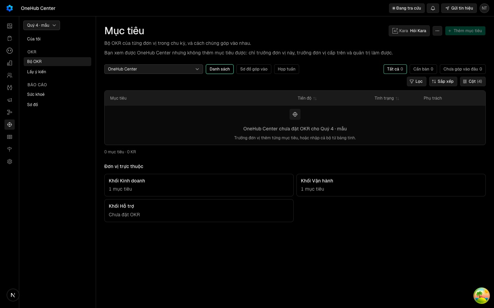
*Trưởng phòng mở `/okr/bo-okr`: màn Danh sách chọn sẵn OneHub Center, ghi đúng «OneHub Center chưa đặt OKR cho Quý 4 · mẫu».*

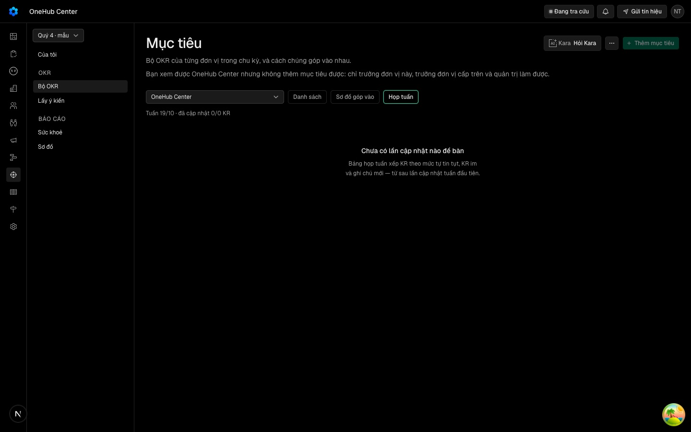
*Bấm «Họp tuần»: URL thành `?xemOkr=hop-tuan`, không mang `donOkr`, nên vẫn là OneHub — «0/0 KR», câu trống sai lý do.*

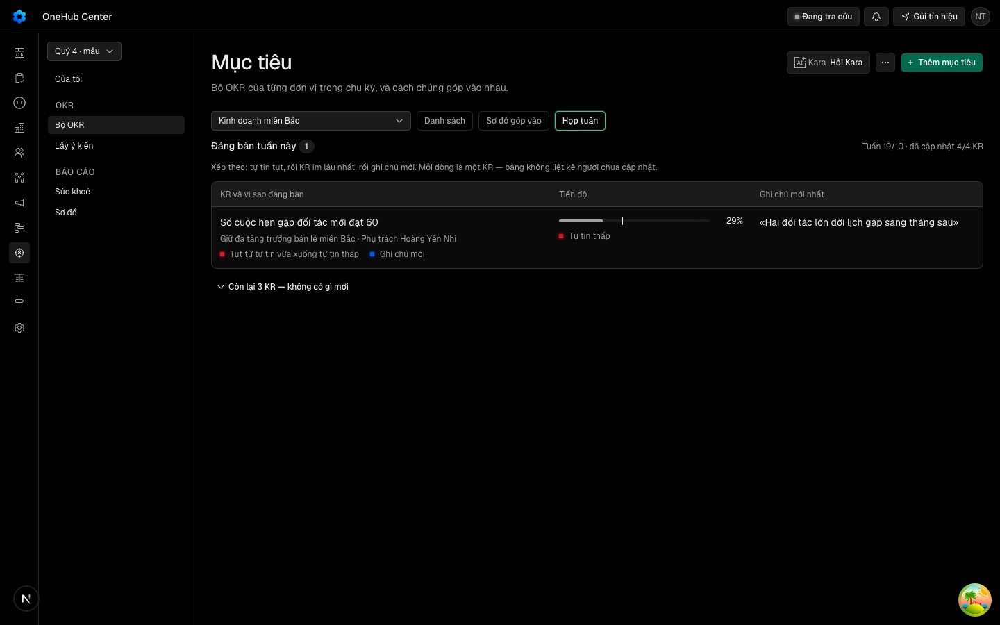
*Đổi ô đơn vị sang «Kinh doanh miền Bắc»: 4/4 KR đã cập nhật, một KR đáng bàn (tự tin tụt từ vừa xuống thấp, có ghi chú mới).*

Nguyên nhân trong mã: `okr.hopTuan` với đơn vị gốc chỉ lọc `level: "onehub"` (`okr-xem.service.ts:160-161`);
`tuanDau = tatCa.every(k => k.lan.length === 0)` ra `true` trên mảng rỗng (`okr-xem.service.ts:585`); màn hiện câu
«tuần đầu» (`okr/hop-tuan.tsx:238-249`).

### Tám phát hiện

| # | Mức | Phát hiện | Đề xuất | Hàng nhận |
| --- | --- | --- | --- | --- |
| F01 | Cao | Đơn vị mặc định là OneHub, không phải đơn vị người xem dẫn | Không có `donOkr` thì chọn đơn vị đầu tiên người xem dẫn (phòng ban rồi bộ phận); không dẫn đơn vị nào thì phòng chính; chỉ quản trị mặc định OneHub | HT1 (đổi AC-7 của VK3) |
| F02 | Cao | Một câu trống cho ba tình huống: không có KR công bố · chu kỳ đang lập kế hoạch · chưa ai cập nhật | Tách ba trạng thái, mỗi trạng thái một câu đúng | HT1 |
| F03 | Cao | Màn trống không có lối đi tiếp | Đặt khối «Đơn vị trực thuộc» trong trạng thái rỗng, mỗi đơn vị dẫn thẳng vào Họp tuần của nó | HT1 |
| F04 | Vừa | Khối Tóm tắt tuần vô hình tới khi có bản đầu tiên (`khoi-tom-tat.tsx:343` trả null) | Nấc «bật» mà chưa có bản: «Kara viết tóm tắt tuần đầu tiên lúc 06:00 ngày …» | HT4 |
| F05 | Vừa | Dưới 1024px mất cột «Ghi chú mới nhất» (`hidden lg:table-cell`, `hop-tuan.tsx:137, 162`) | Dưới lg đưa ghi chú vào dưới dòng KR | HT2 |
| F06 | Vừa | Ngăn KR che kín bảng; ‹ › đi theo KR trong một mục tiêu (`kr-sheet.tsx:400-401`, AC-2 đã ký của VK7) | Mở từ Họp tuần thì ‹ › theo thứ tự bảng, nền mờ | HT2 (đổi AC-2 của VK7) |
| F07 | Thấp | «Tuần dd/mm · đã cập nhật a/b KR» là chữ phụ xs, lệch phải | Hàng số ở đầu thẻ Họp tuần | HT1 |
| F08 | Thấp | Họp tuần là nút cạnh Danh sách, không có đường dẫn riêng | Thẻ con có đường dẫn riêng | VK3 |

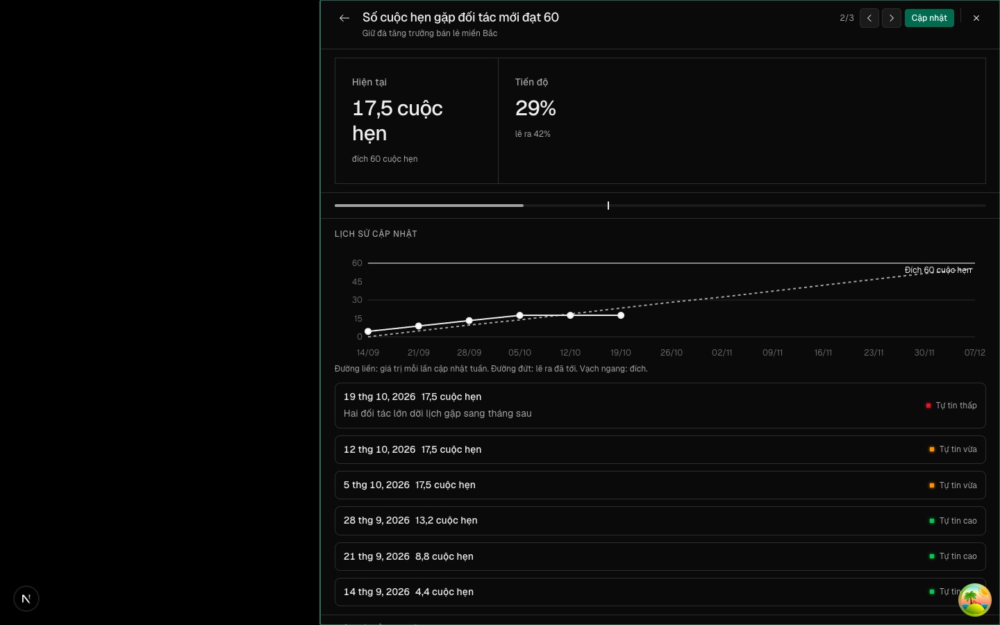
*Bấm KR → ngăn KR: hiện tại, đích, «lẽ ra 42%», biểu đồ theo tuần, từng lần cập nhật kèm tự tin, nút «Cập nhật». Nền phủ kín bảng (F06).*

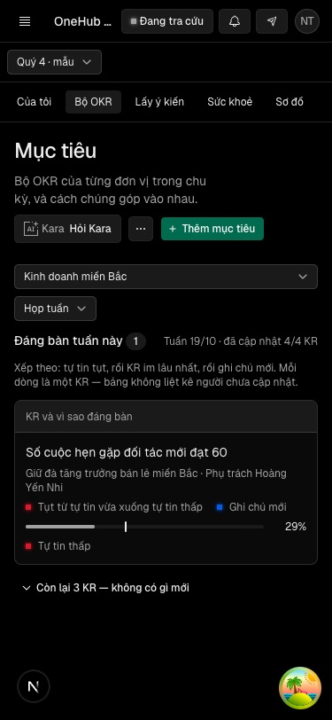
*375px: ô chọn kiểu xem thành menu thả xuống, bảng thành thẻ. Ghi chú mất (F05).*

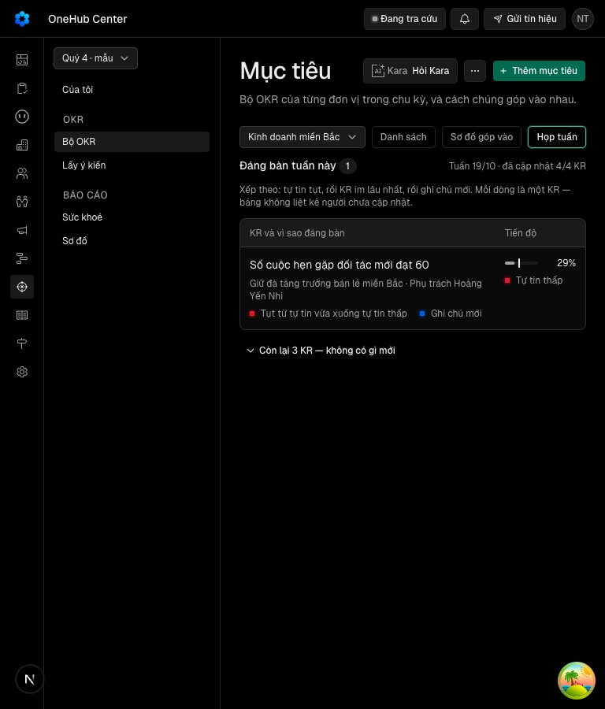
*768px: bảng còn hai cột KR và Tiến độ, ghi chú mất.*

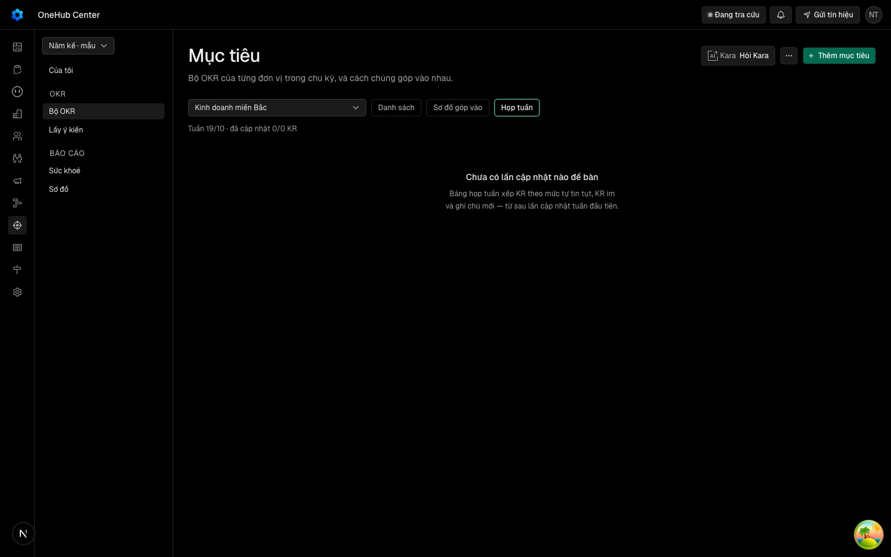
*Chu kỳ «Năm kế» đang lập kế hoạch: câu trống giống hệt trường hợp OneHub (F02).*

**Phần chạy tốt khi có dữ liệu:** thứ tự xếp đúng luật; nhãn lý do mang màu theo nghĩa; thanh tiến độ có vạch «lẽ
ra đã tới»; tự tin có chấm kèm chữ; «Còn lại N KR — không có gì mới» gập sẵn; 1024 và 768 không tràn ngang; màn
tối giữ tương phản.

## 4. Tability thật — không có trang họp riêng

Trang plan là nơi họp; chế độ trình chiếu chỉ là bản đọc của chính plan, và trong trình chiếu vẫn bấm «Create
check-in» được.

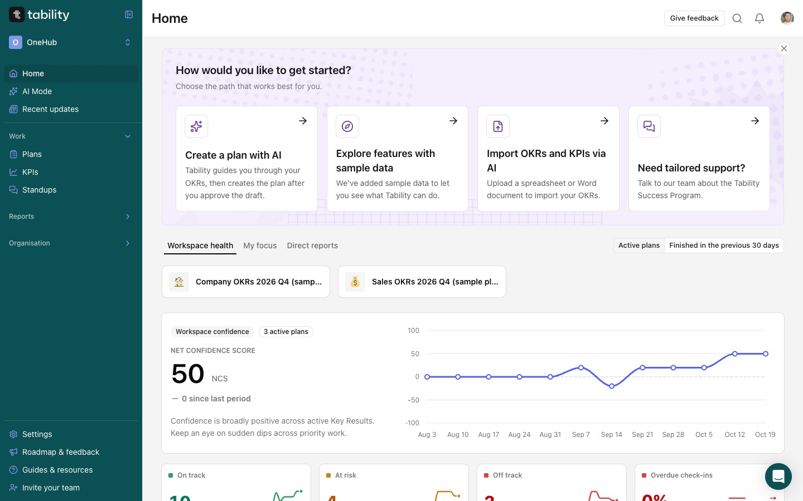
*Home › Workspace health: điểm tự tin chung NCS theo tuần và bốn ô On track · At risk · Off track · Overdue check-ins.*

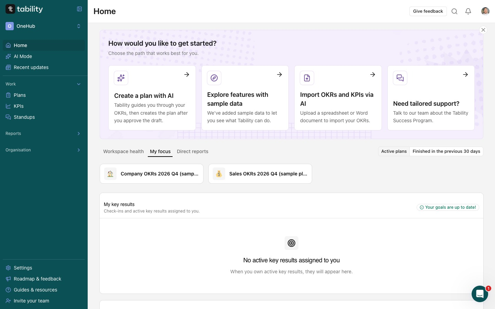
*Home › My focus: thẻ các plan đang chạy, rồi «My key results — check-ins and active key results assigned to you». Đây là chỗ người phụ trách thấy KR của mình; cập nhật vẫn diễn ra trong ngăn KR, không có bảng cập nhật hàng loạt trên trang này (căn cứ của «Lối (b)»).*

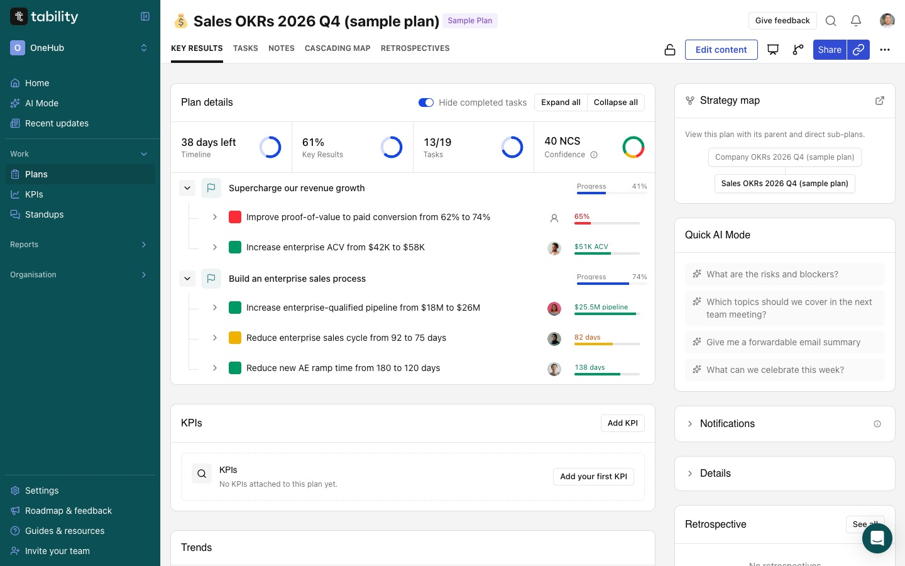
*Trang plan, thẻ Key Results: bốn ô số đầu (ngày còn lại, % KR, việc, NCS); mỗi KR một dòng với ô màu tự tin, người phụ trách, số hiện tại. Thẻ con: Key Results · Tasks · Notes · Cascading map · Retrospectives.*

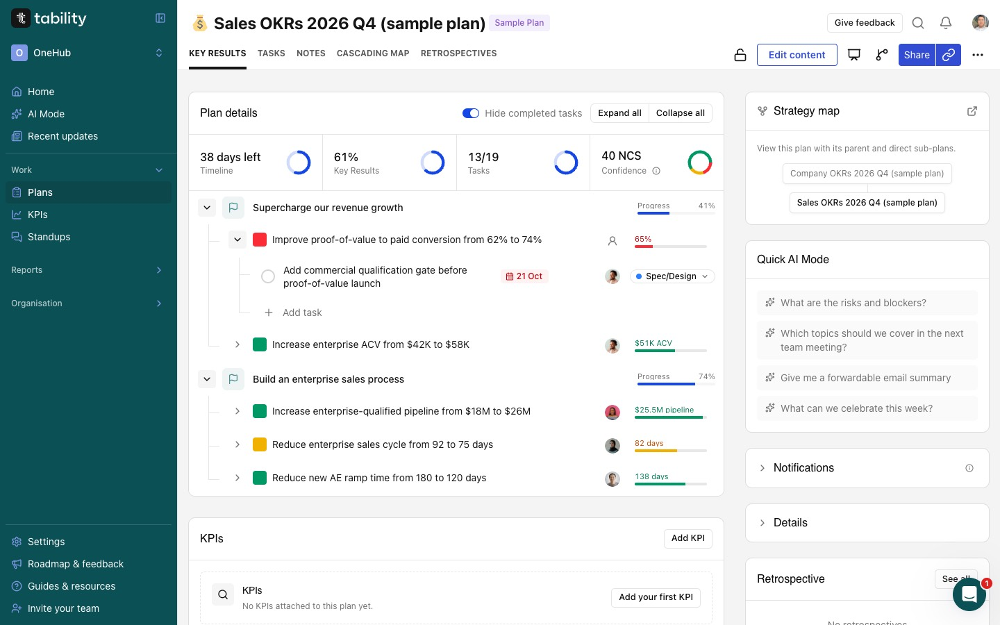
*Mở rộng một KR ngay trong plan: việc con hiện tại chỗ, «Add task»; cột phải có Strategy map và Quick AI Mode («Which topics should we cover in the next team meeting?»).*

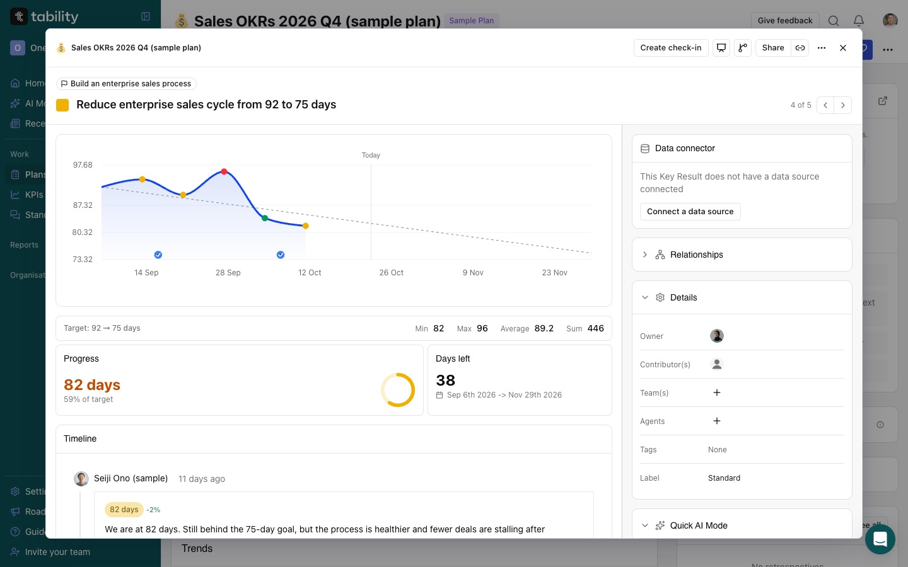
*Bấm KR mở ngăn chi tiết: «Create check-in» ngay đầu ngăn; «4 of 5» và ‹ › đi qua mọi KR của plan, không chỉ trong một mục tiêu; biểu đồ tô điểm theo màu tự tin.*

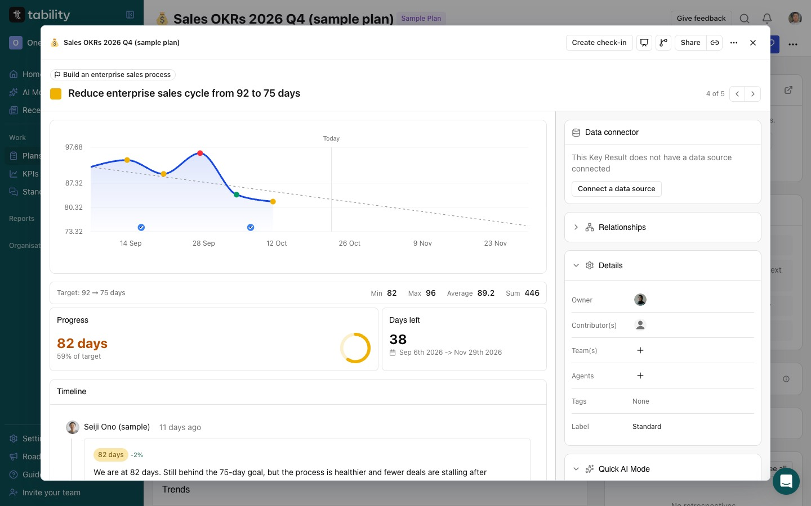
*Cùng ngăn: đích, Min/Max/Average, Progress và Days left; Timeline từng lần cập nhật có số, mức đổi (−2%) và câu phân tích.*

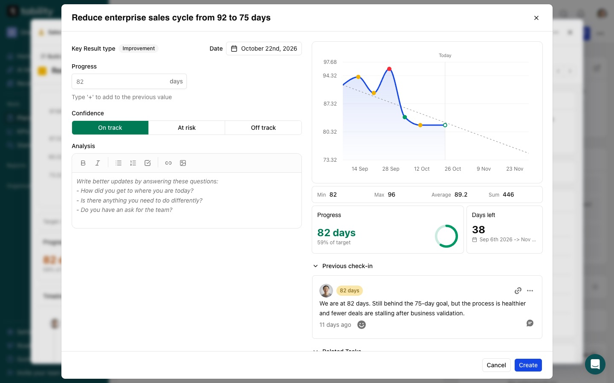
*Form cập nhật: Date (ghi lùi được), Progress («gõ + để cộng vào giá trị trước»), Confidence ba nút, Analysis có ba câu hỏi gợi ý; bên phải là biểu đồ, lần cập nhật trước và việc liên quan.*

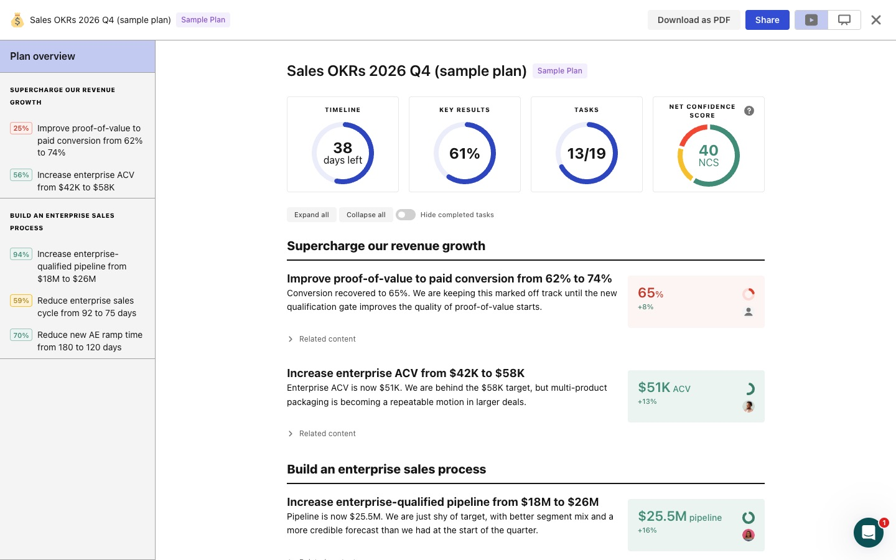
*Trình chiếu (phím P), trang tổng quan: bốn vòng số; mọi KR hiện câu phân tích mới nhất cạnh ô số màu tự tin và mức đổi so với lần trước; thanh trái liệt kê KR kèm %.*

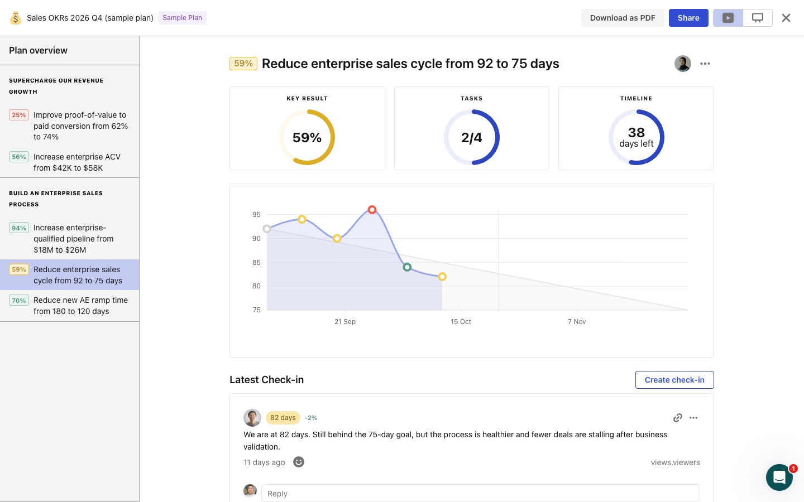
*Trình chiếu một KR: khối «Latest Check-in» có nút Create check-in, thả cảm xúc và ô Reply — vừa đọc, vừa cập nhật, vừa bàn, không đổi màn.*

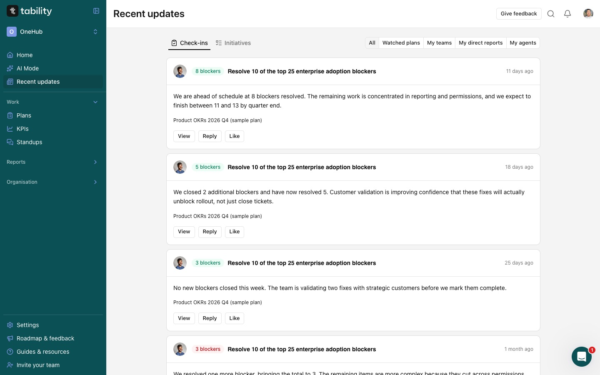
*Recent updates: lọc All · Watched plans · My teams · My direct reports · My agents; mỗi lần cập nhật có View · Reply · Like.*

## 5. Tability tổ chức họp tuần — theo 37 trang hướng dẫn

Nguồn: G = `https://guides.tability.io/docs/`, F = G + `become-a-tability-power-user/features/`. Hành vi chỉ thấy
trong bản dựng JavaScript công khai của app ghi «mã».

| Việc | Tability | Nguồn |
| --- | --- | --- |
| Họp tuần dùng gì | Presentation mode — «review one plan in a meeting»; TV mode cho màn treo tường | F `reporting/presentation-mode` · G `tutorials/running-goal-meetings-with-tability` |
| Nhịp | Plan chọn tuần/hai tuần/tháng/quý, khuyên hằng tuần; admin đặt ngày, giờ nhắc | F `plans/creating-and-editing-plans-and-sub-plans` · F `workspace-settings/customise-the-default-workflows` |
| Ai cập nhật | Người phụ trách được nhắc; ai sửa được outcome đều cập nhật được; đồng đội hoặc quản lý làm thay khi vắng | F `check-ins/how-to-create-check-ins` · G `…/running-a-weekly-routine` |
| Cập nhật ở đâu | Mở outcome từ My focus, Inbox hoặc ngay trong plan → «Create check-in» trong ngăn chi tiết; Slack DM có nút Create check-in | F `check-ins/how-to-create-check-ins` · F `integrations/slack` |
| Form | Date, Progress, Confidence (xanh/vàng/đỏ), Analysis | F `check-ins/how-to-create-check-ins` |
| Cập nhật hàng loạt | Hộp «Complete your checkins … N check-ins to complete», có «Previous check-in» và «Skip check-in» | mã (`modals.bulkCheckin`) |
| KR, người chưa cập nhật | Pending/overdue ở My focus, Filters, People, widget «Overdue check-ins»; chuỗi tuần (streak) | F `my-focus` · F `reporting/filters` · F `people` |
| Điểm tự tin của plan | Net Confidence Score | blog.tability.io/net-confidence-score |
| Đọc trước họp | Recent updates lọc theo plan theo dõi, đội, cấp dưới; bình luận, react, @mention trên check-in | F `my-focus` · F `../how-tos/how-to-use-tability-for-team-members` |
| Trình chiếu | Trang đầu tóm số, rồi mỗi outcome một trang; link công khai chỉ đọc | F `reporting/presentation-mode` |
| Màn rỗng | «Waiting for the first check-in… Create the first check-in»; plan nháp: «Publish your plan to enable tracking» | mã |
| Sau họp | Initiatives (Board, Timeline, đổi trạng thái kèm bình luận), Notes, Retrospectives | F `managing-initiatives` |
| Bản tin tuần | Email tuần, digest vào kênh Slack, prompt AI Weekly Summary | F `integrations/slack` |
| Giữ tự tin trung thực | Không quá hai tuần vàng liên tiếp | G `tutorials/track-progress-with-check-ins` |

Nhịp Tability khuyên: thứ Hai cập nhật xong trong ngày; thứ Ba đọc và bình luận không đồng bộ rồi họp 30 phút, chỉ
bàn KR at risk/off track hoặc tự tin thấp.

## 6. Học trực tiếp cho Họp tuần

| Tability (đã thấy trên màn) | Họp tuần 22/10 | Nên học | Hàng |
| --- | --- | --- | --- |
| Không trang họp riêng; họp trên plan và trình chiếu của plan | Cách xem rời, chỉ đọc, mặc định OneHub | Họp tuần là thẻ con của chính bộ OKR, mở đúng bộ người xem | VK3, HT1 |
| Không trang cập nhật riêng; cập nhật trong ngăn KR | Bảng cập nhật hàng loạt ở Của tôi | Chỉ còn hộp cập nhật một KR; Của tôi chỉ liệt KR | «Lối (b)» (hàng mới) |
| «Create check-in» ở ngăn KR và từng trang trình chiếu | Dòng bảng chỉ mở ngăn KR | Cập nhật được ngay từ dòng Họp tuần | HT2 |
| Câu phân tích mới nhất cho mọi KR, kèm mức đổi | Chỉ KR đáng bàn có ghi chú; mất dưới 1024px | Ghi chú mới nhất mọi dòng, mọi khổ, kèm mức đổi | HT2 |
| Bốn ô số đầu plan và trình chiếu | Một dòng chữ xs | Hàng số đầu thẻ Họp tuần | HT1 |
| ‹ › «4 of 5» qua mọi KR của plan | ‹ › «2/3» trong một mục tiêu | Mở từ Họp tuần thì ‹ › theo thứ tự bảng | HT2 |
| Form hiện lần trước, biểu đồ, câu gợi ý, «+» cộng dồn | Không thấy lần trước khi gửi | Lần cập nhật trước cạnh form; câu gợi ý cho ghi chú | HT3 (đã gộp #552) |
| Reply và Like trên từng lần cập nhật | Chưa có | VK12 mang Reply; Like | HT5 |
| Chế độ trình chiếu riêng | Không có | Để chờ: mở lại nếu sau HT1, HT2 trưởng đơn vị vẫn phải chiếu bằng công cụ khác | HT-C1 |

## 7. Chưa xác nhận

- Màn rỗng thật của Tability chưa chụp được (plan mẫu không có KR chưa cập nhật); câu rỗng lấy từ bản dựng app.
- Trình chiếu có lọc «off track» hay phím chuyển KR không: phím mũi tên xuống chỉ cuộn trang.
- Nấc Tóm tắt tuần thật trên production và việc đã có chu kỳ chạy với cập nhật thật hay chưa: cần đọc
  `OkrProgramConfig`, `OkrCheckIn` trên production.
- Giao diện sửa hay xoá lần cập nhật cũ của Tability: thấy lời gọi API trong mã, chưa thấy màn.
