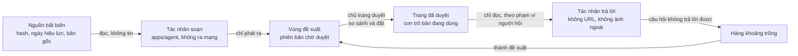

# Kho tài liệu theo mẫu LLM Wiki — nghiên cứu nền

Viết 2026-09-26, sau một phiên research 18 tác nhân trên mẫu LLM Wiki (Karpathy,
tháng 4/2026) làm tiền đề để dựng Kho tài liệu trong CRM OneHub. Đây là **nghiên
cứu nền**, không phải đặc tả và chưa qua cổng nào: nó nói điều gì đã biết, điều gì
chưa biết, và điều gì phải quyết trước khi viết mã. Bản mẫu bấm được nằm ở
`/proto/kho-tai-lieu` (nhánh `proto/kho-tai-lieu`).

Ba tệp đi cùng nhau, **số mục giữ nguyên xuyên suốt**:

- `kho-tai-lieu-nghien-cuu.md` (tệp này): mục 0–9 và 14–17.
- `kho-tai-lieu-viet-nam-va-do-luong.md`: mục 10–13, gồm pháp lý Việt Nam, hiệu lực văn bản
  pháp luật, đo chất lượng và tiêu chí đi/dừng, di chuyển và tiếp nhận.
- `kho-tai-lieu-nguon.md`: phụ lục nguồn từng phát hiện.

Mục lục: 0 Cách đọc · 1 Kết luận · 2 LLM Wiki là gì · 3 Cái đã có ngoài kia ·
4 Kiến trúc đề xuất · 5 Tính năng và thứ tự xây · 6 Đường đi của nội dung ·
7 Truy xuất và trả lời · 8 Người duyệt · 9 Vận hành, an toàn, nhà cung cấp mô hình ·
*10 Pháp lý Việt Nam · 11 Trang luật và hiệu lực · 12 Đo chất lượng và tiêu chí đi/dừng ·
13 Di chuyển, tiếp nhận, thông báo, xuất (bốn mục này ở tệp đồng hành)* ·
14 Rủi ro hàng đầu · 15 Chưa trả lời được · 16 Việc phải sửa ở bản mẫu · 17 Lộ trình lượt.

## 0. Cách đọc

### 0.1 Phiên research đã làm gì

11 mảng chạy song song (nguồn gốc, hệ sinh thái, mẫu hình sản xuất, đồ thị và điều
hướng, đường đi của nội dung, truy xuất, vận hành doanh nghiệp, ngăn xếp kỹ thuật,
tiền lệ CRM, quản trị người duyệt, rủi ro), một bước phản biện chỉ ra sáu chỗ thiếu,
rồi sáu tác nhân bổ sung đúng các chỗ đó (pháp lý Việt Nam, tài liệu tiếng Việt,
hiệu lực văn bản luật, mô hình dữ liệu và phân quyền, đo chất lượng, di chuyển và
tiếp nhận). Tổng: 18 tác nhân, 696 phát hiện, 546 nguồn không trùng.

### 0.2 Giới hạn của nó, nói trước

- **Hạn mức tìm web (200 lượt) cạn giữa chừng ở cả 11 tác nhân đầu, và đã cạn từ
  đầu ở 6 tác nhân bổ sung.** Phần sau đó dựa vào đọc trực tiếp URL, API của GitHub
  và arXiv, và thử nghiệm tại chỗ. Bù được phần nào, nhưng blog, diễn đàn, Hacker
  News, và mọi thứ tiếng Việt kiểu bài viết đều mỏng. Nhiều khẳng định «không tìm thấy»
  là khẳng định về việc **không tìm được sau khi hết hạn mức**, không phải bằng chứng
  vắng mặt.
- **Bằng chứng yếu ở đúng chỗ quan trọng nhất.** Không có nghiên cứu nào đo việc
  người duyệt có bắt được qualifier bị rơi, số sai hay trích dẫn bịa trong bản diff
  do LLM soạn cho trang quy định. Toàn bộ lập luận «chủ trang duyệt là cổng chính»
  là **giả định chưa kiểm**. Bằng chứng về duyệt lơ là đến từ code review, y khoa và
  các hộp thoại xin quyền của agent.
- Nhiều số liệu mạnh đến từ tiền ấn bản một tác giả (dùng LLM chấm), blog nhà cung
  cấp, hoặc tự báo cáo. Nhà cung cấp bán giải pháp (Mem0, Neo4j, Atlan, Guru, Slite,
  Intercom…) có lợi ích riêng trong con số của họ.
- Phần pháp lý dựa trên văn bản PDF gốc được OCR và bản tóm tắt của hãng luật,
  **không phải tư vấn pháp lý**. Mục 10 trình bày thành câu hỏi cho luật sư.
- Các tác nhân đôi khi mâu thuẫn về việc một nguồn có mở được không (ví dụ bài
  Medium của Mehul Gupta: một tác nhân ghi đã đọc, hai tác nhân khác ghi không mở
  được). Nguồn nào quyết định một thiết kế thì phải mở lại trước khi dựa vào.

Quy ước: câu không gắn nhãn là mô tả điều nguồn nói. **Đề xuất** là thiết kế của
mình dựa trên các nguồn đó. **Suy luận** là bước nhảy chưa có nguồn nào kiểm.

### 0.3 Điều mình đã tự kiểm chứng, và điều đính chính

Đã kiểm trực tiếp, không tin lời tác nhân:

- Tác nhân của kho hiện **không truyền tuỳ chọn nhà cung cấp nào** cho AI Gateway:
  `apps/agent/agent/lib/model.ts` chỉ trả mã model và cỡ cửa sổ; tìm
  `providerOptions`, `zeroDataRetention`, `AI_GATEWAY` trong `apps/agent/agent` không
  ra gì.
- Neon **đã gỡ `pg_search` ngày 2026-09-21** (trang di chuyển của Neon và các issue
  trên GitHub cùng nói vậy; `lakebase_text` là hàng thay thế).
- AI Gateway có tuỳ chọn theo từng yêu cầu và theo cả team: `zeroDataRetention`,
  `disallowPromptTraining`, `inferenceRegion` (tài liệu Vercel; mình xác nhận tên
  tuỳ chọn, chưa xác nhận danh sách vùng).
- `Alert` của `@crm/ui` đặt `role="alert"` (vùng thông báo trực tiếp) trước
  `{...props}`: hộp ghi chú trong trình đọc mình dựng lượt trước dùng sai vai. **Đã
  sửa** (`role="note"`), cùng với việc chặn ảnh ngoài và liên kết không `https` vì
  Streamdown mặc định cho mọi giao thức.

Đính chính lời mình nói trước đó trong phiên:

- Mình nói khoá AI có «trần $5 trọn đời». Ghi chép mới hơn của kho (2026-09-03
  chiều, 2026-09-26) là trần bám ngân sách team, **$20 mỗi tháng**, và model mặc định
  đã là `google/gemini-3.7-flash`. Mình chưa kiểm số này trên AI Gateway thật.
- Mình nói gist của Karpathy «được hơn 5.000 sao». Đó là đoạn trích tìm kiếm; các
  tác nhân **không xác nhận được** số sao (API trả 502). Chỉ có số bình luận (hơn
  1.100) là đã đếm.
- Mình gọi «trôi nhận thức (epistemic drift)» như từ vựng của mẫu hình. Nó là chữ
  của blog thứ cấp, **không phải của Karpathy** và không có trong gist. Nên tả rủi ro
  bằng lời thường: một nguồn bị đọc sai lúc nạp, lỗi ở lại và nuôi các lần nạp sau.

## 1. Kết luận

1. **Mô hình đúng hướng.** Tác nhân soạn, chủ trang duyệt, tác nhân trả lời chỉ đọc
   trang đã duyệt và trích dẫn. Nó khác bản gốc của Karpathy (LLM sở hữu wiki, người
   hiếm khi sửa) và trùng với điều những người triển khai nghiêm túc trong chính
   luồng bình luận của gist hội tụ về: mọi thay đổi qua duyệt, có nguồn, không ghi
   đè im lặng.
2. **Có cổng duyệt chưa đủ, phải thiết kế và đo cổng.** Người dùng bấm đồng ý 93–97%
   số hộp thoại xin quyền của agent; khi có một lệnh nguy hiểm được cài vào (thử nghiệm của chính Anthropic), người ta
   bắt được 13,6%, và còn khoảng 5% sau 50 hộp thoại. Kiểu bằng chứng này chưa đo cho
   trang quy định, nhưng nó đủ để coi màn duyệt như một **biện pháp an ninh**, không
   như một nút xác nhận.
3. **Wiki là tầng nội dung, tìm kiếm là công cụ; chưa cần vector hay GraphRAG.**
   Ở vài trăm trang, agent có công cụ tìm theo từ khoá cộng danh mục trang là mẫu mạnh
   nhất có bằng chứng; Postgres đủ (tsvector, unaccent, pg_trgm). Vector là phần
   thêm khi bộ đo cho thấy lexical trượt.
4. **Rủi ro chính là rủi ro im lặng.** Trang vẫn trôi chảy, vẫn có liên kết, trong khi
   qualifier, con số, ngày hiệu lực và nguồn mòn dần. Cách giảm có bằng chứng là cơ chế
   xác định (kiểm trích dẫn nguyên văn, hash nguồn, kiểm base revision, sổ khẳng định,
   kiểm độ phủ), không phải lời dặn trong prompt.
5. **Chi phí thật nhiều khả năng là người duyệt, không phải tiền model.** Chưa ai đo
   chi phí nạp thật (con số duy nhất là ước lượng của một blogger, khoảng 0,11 USD cho
   một nguồn nhỏ; một phiên nghiên cứu của tác nhân kho này đo được khoảng 0,19 USD).
   Thứ vỡ trước là năng lực duyệt: cổng rộng hơn số người duyệt thì tồn đọng hàng
   tháng, có wiki của Wikimedia tồn tới hơn 1.000 ngày.
6. **Phân quyền phải nằm dưới tác nhân, và mọi bề mặt đều là kênh rò rỉ.** Tiêu đề,
   danh mục, backlink, đoạn trích tìm kiếm, đồ thị, bản diff. Trang tổng hợp từ nhiều
   nguồn thừa hưởng phạm vi hẹp nhất của các nguồn (quy tắc trần, mục 4.4).
7. **Tiếng Việt là rủi ro số một mà chưa ai đo.** Đặt dấu thanh (hoà/hóa) làm lệch
   khoảng 18% câu trích khi so nguyên văn (đo trên mẫu 71 văn bản của một cổng pháp
   luật); bản quét có thể sai số lẫn chữ mà không ai
   thấy; LLM dò xung đột giữa các điều luật tiếng Việt rất kém khi không có ví dụ mẫu.
8. **Có một vấn đề pháp lý phải hỏi luật sư trước khi nạp tài liệu có dữ liệu cá nhân.**
   Theo văn bản gốc mà các tác nhân đọc được, gửi dữ liệu cá nhân cho một mô hình đặt
   ở nước ngoài là chuyển dữ liệu ra nước ngoài, cần hồ sơ đánh giá trong 60 ngày kể
   từ lần đầu. Câu hỏi tương tự có thể đặt ra cho **chính CRM đang chạy** (Neon, Vercel,
   các dịch vụ nước ngoài khác), không riêng Kho tài liệu (mục 10).
9. **Trang luật cần dữ liệu hiệu lực có cấu trúc.** Cổng chính thức `vbpl.vn` là nơi
   duy nhất có, nhưng đo thấy sai; nên chủ trang ghi căn cứ pháp lý và duyệt, còn một
   bộ theo dõi chỉ được **đề xuất** cờ cũ, không được quyết (mục 11).
10. **Đảo thứ tự lộ trình:** làm người viết, phiên bản, duyệt, tìm và phân quyền
    trước, không AI; dựng bộ đo (golden set, mồi rò rỉ) **trước** khi bật tác nhân
    trả lời; chỉ mở tác nhân soạn sau khi có quyết định pháp lý (mục 17).

## 2. LLM Wiki là gì

### 2.1 Điều Karpathy thực sự nói

- **2/4/2026** tweet «LLM Knowledge Bases» (khoảng 22 triệu lượt xem). **4/4/2026**
  một gist «idea file», một bản duy nhất 75 dòng, cố ý trừu tượng: dán nó cho agent
  của bạn để agent dựng bản của riêng bạn. Hơn 1.100 bình luận.
- **Ba lớp.** *Raw sources*: tuyển tập bất biến, người chọn, LLM chỉ đọc. *Wiki*: thư
  mục markdown do LLM viết và sở hữu hoàn toàn, người đọc. *Schema*: `CLAUDE.md`
  hoặc `AGENTS.md`, biến LLM thành người bảo trì có kỷ luật; người và LLM cùng sửa nó
  dần.
- **Ba thao tác.** *Ingest*: một nguồn mới, LLM đọc, viết trang tóm tắt, cập nhật
  trang thực thể và khái niệm, có thể đụng 10–15 trang. *Query*: tìm trang liên quan,
  đọc, trả lời có trích dẫn; câu trả lời tốt được **ghi ngược thành trang mới**.
  *Lint*: kiểm mâu thuẫn, khẳng định cũ, trang mồ côi, khái niệm thiếu trang, thiếu
  liên kết chéo, lỗ hổng dữ liệu.
- **Hai tệp dẫn đường.** `index.md`: danh mục nội dung, LLM đọc trước. `log.md`: nhật
  ký chỉ ghi thêm, tiền tố cố định để `grep`/`tail` được.
- **Điểm khác RAG là thời điểm**: biên dịch tri thức một lần lúc nạp và giữ nó mới,
  thay vì suy lại từ mảnh chữ ở mỗi câu hỏi. Ở cỡ khoảng 100 nguồn và vài trăm trang
  nó không cần hạ tầng embedding; chính gist dẫn tới một công cụ tìm kết hợp (qmd) khi
  lớn hơn.
- **Giới hạn ông tự nêu** khiêm tốn: trần quy mô, xử lý ảnh, ông thích nạp từng nguồn
  có giám sát, và ông mong có một sản phẩm thật thay cho mớ script. Trong luồng bình
  luận không có trả lời trực tiếp của ông cho các chỉ trích về rủi ro sai lệch.

### 2.2 Điều hay bị nói sai

- «Trôi nhận thức» không phải chữ của ông (mục 0.3).
- Có bài nói mẫu hình là chỉ ghi thêm, trang cũ đóng băng, và gist ra tháng 2: sai; gist
  nói ingest sửa trang thực thể và khái niệm và ra ngày 4/4.
- Bằng chứng «hiệu quả» chỉ có một nguồn tận mắt: wiki của chính ông, khoảng 100 bài,
  một người dùng. Mọi trần quy mô khác (150–200, 500, 1.000, 10.000 trang) là ước
  lượng blog hoặc tự báo cáo. **Biến số thật có vẻ là kiến trúc** (ghi lại cả trang,
  danh mục phẳng), không phải số trang.
- Có cãi nhau thật chưa ngã ngũ: ai sở hữu wiki (LLM hay người); wiki *thay* RAG hay
  chỉ là quan sát về quy mô; mâu thuẫn xử lý lúc ghi hay lúc lint; ghi câu trả lời
  ngược vào wiki có làm sai lệch nuôi nhau không.

### 2.3 Ba lớp ánh xạ sang OneHub

| Lớp gốc | Ở OneHub | Khác gốc ở đâu |
| --- | --- | --- |
| Raw sources | **Nguồn**: tệp tải lên, bất biến, có hash và ngày hiệu lực; bản gốc giữ nguyên | Kho là nhiều người, có chủ nguồn và phạm vi xem |
| Wiki | **Trang tài liệu**: nhiều phiên bản bất biến, đúng một **bản đang dùng** | Người **viết và sửa**; tác nhân chỉ **đề xuất**; không có ghi thẳng |
| Schema | **Quy tắc kho**: loại trang, mục bắt buộc, cách trích, mức duyệt | Sửa qua đúng đường duyệt, có chủ |
| `index.md` | Danh mục **sinh ra**, chỉ gồm trang đã duyệt và người xem được | Không phải nguồn truy xuất duy nhất |
| `log.md` | Bảng sự kiện chỉ ghi thêm, ngoài các bảng nội dung | Là nhật ký kiểm toán |
| File back | Câu trả lời của tác nhân **không** ghi vào kho; chỉ vào qua đề xuất | Chặn việc bịa thành nguồn |

## 3. Cái đã có ngoài kia

### 3.1 Hệ sinh thái: đông nhưng non và mỏng

486 repo mang chủ đề `llm-wiki`, gist có khoảng 9.900 bản fork, hơn 20 plugin
Obsidian; gần như tất cả dưới 6 tháng tuổi. Tất cả các dự án được đọc kỹ chung một lõi:
trang markdown có frontmatter YAML và `[[wikilink]]`, lớp nguồn bất biến, ingest/query/
lint, MCP hoặc Agent Skill. Khác nhau đúng ở chỗ OneHub cần:

- **Chỉ một dự án (Synto) mặc định có hàng đợi bản nháp chờ người duyệt.** Vài dự án
  (llm-wiki-compiler, SwarmVault, claude-obsidian) có duyệt nhưng tuỳ chọn; đa số ghi
  thẳng; Stigmergy từ chối hàng đợi duyệt trên nguyên tắc.
- **Danh tính, vai trò, ACL theo trang là lỗ hổng lớn nhất.** Gần như mọi công cụ là
  một người dùng; sage-wiki tự ghi «không có mô hình phân quyền nhiều người»; KiwiFS
  liệt RBAC là chưa ra. Chỉ Stigmergy (9 sao) có ACL theo trang.
- **Giấy phép**: nhiều dự án mạnh nhất là GPL, AGPL hoặc BSL. **Mượn thiết kế, không
  mượn mã.**

Ý tưởng đáng mượn (cấp mẫu hình):

| Ý tưởng | Nơi thấy | Dùng cho |
| --- | --- | --- |
| Duyệt gắn chặt với hash của đúng bản nháp; giữ theo chính sách | llm-wiki-compiler | Duyệt không thể áp lên bản đã khác |
| Từ chối kèm lý do và đưa lý do vào lần soạn sau; bản nháp ẩn với MCP | Synto | Từ chối là trạng thái hạng nhất |
| Giao dịch mang hash SHA-256 kỳ vọng | claude-obsidian | Base revision |
| Kiểm nguyên văn trích dẫn theo mã | Cortex | Cổng tự động trước người |
| Cách ly câu trả lời; ranh giới «nguồn không tin cậy» trong prompt | sage-wiki | Chống rò và tiêm lệnh |
| Ghi có kiểm ACL; hàng đợi trên Postgres | Stigmergy | Phân quyền, khớp với `AgentTask` |
| Bộ thực thi xác định áp thao tác KEEP/UPDATE/MERGE/SUPERSEDE/ARCHIVE do LLM đề xuất | palinode | Tách «quyết nội dung» khỏi «ghi» |
| Frontmatter có nguồn, người xác nhận, trạng thái, hạn cũ | Open Knowledge Format v0.2 | Lược đồ trang; **còn non** (v0.2 ra tháng 7, v0.3 đang đề xuất), **không có trường chủ trang hay thay thế** |

Lỗi thật người dùng đã báo, đáng học: ghi lại cả trang làm tốn bậc hai ở khoảng 1.100
tài liệu; đầu ra LLM bị cắt rồi ghi đè trang; markdown hiển thị không làm sạch (XSS);
chữ không phải Latin bị tách thành rỗng. Một người kiểm toán một dự án lớn ở 2.300–3.700
trang báo rằng ghi lại cả tệp làm hỏng trường nguồn của khoảng 436 trang và 92 tệp dính
chữ dựng khuôn của prompt (báo cáo của một người, chưa ai tái lập). Không dự án nào trong số đã đọc ghi nhận hỗ trợ tiếng Việt (có một bản
tiếng Việt, `mduongvandinh/llm-wiki`, khoảng 213 sao, chưa ai kiểm).

### 3.2 CRM và nền tảng hỗ trợ: cùng một hình dạng

Ở 10 sản phẩm chín muồi có bốn mẫu hội tụ:

1. **Vòng đời** Nháp → Đang duyệt → Đã duyệt → Đã đăng → Lưu trữ; bản đã đăng vẫn
   sống trong lúc bản mới chờ duyệt.
2. **Độ mới**: chủ tên riêng cộng xác nhận có hạn (Zendesk Enterprise, Notion, Guru,
   Slite, Glean). **Chỉ Slite và Guru gắn trạng thái xác nhận với việc AI được dùng gì.**
3. **Năm 2026 AI chuyển từ trả lời sang đề xuất sửa**: Intercom Fin Operator (ra ngày
   6/8/2026), Slite Agent (10/6/2026), HubSpot Knowledge Base Agent, bản nháp của Jira
   Service Management, Guru Knowledge Agents (1/2026). Gần như tất cả đi qua đề xuất
   kèm diff do người duyệt, **cùng hình dạng thiết kế của OneHub**. Guru là ngoại lệ:
   đi về hướng AI tự xác nhận, viện lẽ duyệt tay chỉ phủ 8–12% nội dung (số của hãng).
4. **Không hãng nào cam kết cứng «chỉ trả lời từ knowledge base».** Họ ghép lại: neo
   vào truy xuất, ngưỡng tin cậy, câu «không hiểu», phạm vi nguồn, chuyển người, trích
   dẫn tuỳ chọn; tài liệu của Glean còn nói câu trả lời có thể không qua truy xuất.

Thư viện quy định, SOP nội bộ là công dân hạng hai trong các sản phẩm trợ giúp khách
hàng (không có bản nháp, nội dung hạn chế bị loại khỏi AI); Zendesk mới mở chương
trình sớm cho tác nhân nhân viên (7–8/2026). Bằng chứng về «hối tiếc» chủ yếu là của
hãng; tiền lệ trách nhiệm là vụ Moffatt kiện Air Canada (đọc qua Wikipedia).

## 4. Kiến trúc đề xuất

Mọi thứ trong mục này là **đề xuất** của mình, dựng từ các nguồn trên và từ luật của
kho. Không nguồn nào cung cấp bản vẽ hoàn chỉnh: hệ thống gần nhất chỉ có từng mảnh
(mục 3.1).

### 4.1 Ba kho với độ tin cậy khác nhau, hai tác nhân

- **Kho 1, nguồn**: bất biến, có hash. Tác nhân **không bao giờ** sửa.
- **Kho 2, vùng đề xuất**: không tin cậy. Mỗi đề xuất là một phiên bản trang ở trạng
  thái chờ duyệt, kèm base revision, khẳng định, đoạn trích và lý do.
- **Kho 3, trang đã duyệt**: chỉ nơi này tác nhân trả lời được đọc, chỉ đọc, gắn với
  đúng một bản đã duyệt cho mỗi cuộc hội thoại.
- **Đăng là một đường mã và một danh tính riêng**, do chủ trang bấm qua API. Tác nhân
  soạn không có đường ghi vào bản đã duyệt. Đây là ranh giới «sidecar và người đăng đáng
  tin» mà Lopopolo mới **đề xuất, chưa ai chứng minh** chạy sản xuất; ngoài ra nó khớp
  với việc kho đã đặt trí khôn ở `apps/agent` và cho API chỉ ghi một hàng `AgentTask`.

### 4.2 Mô hình dữ liệu

| Thực thể | Giữ gì | Ghi chú |
| --- | --- | --- |
| **Nguồn và phiên bản nguồn** | hash nội dung, tên tệp gốc, ngày tải, ngày hiệu lực của tài liệu, người tải, phạm vi xem, lớp dữ liệu (mục 10.3, ở tài liệu đồng hành), trạng thái trích chữ | Bất biến. Xoá = bia mộ, bị cờ giữ pháp lý chặn |
| **Trang** | định danh, slug, chủ và người thay, nhóm, phạm vi xem, `approved_revision_id`, `head_revision_id`, cờ `agent_readable`, hạn cũ, bậc rủi ro | Hai con trỏ tách nhau |
| **Phiên bản trang** | markdown chuẩn (NFC), `base_revision_id`, trạng thái, tác giả `người:<id>` hoặc `tác nhân:<model>@<phiên bản prompt>`, lý do, hash bản diff | Bất biến. Khôi phục = phiên bản mới sao từ bản cũ |
| **Khẳng định và trích dẫn** | mệnh đề, đoạn trích nguyên văn kèm 32 ký tự trước và sau, hash và phiên bản nguồn, vị trí | Máy kiểm được **trước** khi người thấy |
| **Liên kết** | từ, đến, loại (tham chiếu, sửa đổi, thay thế, mâu thuẫn…), câu giải thích | Rút từ cây markdown lúc ghi; nuôi backlink và đồ thị |
| **Đề xuất** | phiên bản đề xuất, nguồn kích hoạt, bậc rủi ro, người được giao, hạn, cờ mồi (ẩn), lý do bị từ chối | Từ chối là trạng thái hạng nhất |
| **Sự kiện duyệt** | ai, khi nào, mở diff, mở nguồn, thời gian dừng, quyết định, sửa gì | Để đo chất lượng duyệt (mục 8.7) |
| **Phạm vi xem** | vai, phạm vi dữ liệu, phòng ban (mục 4.5) | Một hàm duy nhất trả lời «người này có thấy trang này không» |
| **Cờ và khoảng trống** | «sai/cũ» do người dùng đánh; câu hỏi tác nhân không trả lời được | Vòng khép kín về chủ trang |
| **Nhật ký kiểm toán** | hỏi, đáp, trang bị truy xuất và bị từ chối, trích dẫn, định tuyến model | Chỉ ghi thêm, ngoài các bảng nội dung |

**Con trỏ và khoá.** Đúng như FlaggedRevs và Approved Revs của MediaWiki: người đọc và
tác nhân thấy `approved_revision_id`, tách khỏi `head_revision_id`, với số thứ tự để
kiểm điều kiện đầu. **Duyệt = compare-and-set**: chỉ thành công nếu bản chủ trang xem
(hash diff đã thấy) vẫn là bản đề xuất và base chưa đổi; nếu người vừa sửa xen vào thì
đề xuất thành «cũ» và soạn lại, **không tự gộp** (Outline, MediaWiki, llm-wiki-compiler
đều có một dạng của điều này). Người duyệt khác người kích hoạt đề xuất (như GitHub với
PR do agent viết). Khôi phục là phiên bản mới cộng một dòng duyệt, không xoá.

**Một cửa duy nhất tới trang.** Approved Revs có một lỗ đã biết: người đọc khác vẫn kéo
được bản mới nhất chưa duyệt. Vì vậy mọi đường đọc (trang, tìm, backlink, đồ thị, tác
nhân) đi qua **một** view hoặc một hàm truy vấn duy nhất, trong đó điều kiện «đã duyệt và
người này được thấy» là một phần của câu SQL.

### 4.3 Vòng đời trang: ba trục tách nhau

Theo KCS v6 và các sản phẩm ở mục 3.2, đừng gộp thành một cột `status`:

1. **Vòng đời**: nháp · đang duyệt · đã duyệt · cần xem lại · bị thay thế · lưu trữ. Bản
   đã duyệt vẫn sống trong lúc bản mới chờ duyệt (Freshdesk, Zendesk, Confluence).
2. **Đối tượng**: vai nào, phòng ban nào được thấy và được hỏi tác nhân về trang này.
3. **Độ tin cậy**: chủ, «xác nhận đến ngày», và với trang luật là sức khoẻ hiệu lực
   (mục 11). Con dấu **hết hiệu lực khi có thay đổi thực chất** (như GitHub huỷ phê
   duyệt cũ khi diff đổi) và khi quá hạn.

Hạn xác nhận khởi điểm (đề xuất, chưa có nguồn độc lập cho mức tối ưu; Guru mặc định 1
tháng nhưng tự khuyên ít nhất hằng năm): trang Bậc 1 (tiền, pháp lý, tuân thủ) 90 ngày,
phần còn lại của quy định và chính sách 180 ngày, SOP vận hành 12 tháng; luôn kèm kích
hoạt theo thay đổi của nguồn hoặc của luật.

### 4.4 Quy tắc trần cho trang tổng hợp từ nhiều nguồn

Đây là chỗ nghiên cứu **mỏng nhất và ngành chưa có quy tắc chung**: Microsoft thừa hưởng
nhãn mức cao nhất của nguồn nhưng không suy ra ACL; Notion tự nói Custom Agents có thể
lộ dữ liệu người hỏi không mở được; bài Collaborative Memory đề nghị chỉ đọc được nếu
đọc được **mọi** nguồn đóng góp, kiểm lúc đọc; Stigmergy (9 sao) ép lúc ghi rằng đối
tượng của trang là tập con của mọi nguồn nó dùng. Đề xuất (chưa có hệ thống nào chạy
thế này, phải tự thử):

- Đối tượng mặc định của trang tổng hợp là **giao** đối tượng của các nguồn được trích,
  kiểm lại lúc đề xuất, lúc duyệt, khi ACL nguồn đổi, và mỗi lần đọc.
- Mở rộng đối tượng cần **người quản lý từng nguồn** duyệt «hạ mức» cho nguồn ấy.
- **Tách hơn là thu hẹp**: nếu một nguồn hẹp làm trang rộng phải hẹp lại, tác nhân đề
  xuất một trang phụ giới hạn và giữ trang rộng như cũ (Stigmergy).
- Siết ACL nguồn thì trang phụ thuộc ẩn ngay và xếp hàng duyệt lại. Người duyệt phải
  đọc được mọi nguồn trong diff, nếu không thì chuyển cho người phó có quyền.
- Đặt nguồn của trang trong **bảng** chứ không chỉ trong frontmatter, để truy vấn và
  để xoá nguồn lần ra được trang phụ thuộc.

### 4.5 Thi hành quyền: dùng cơ chế sẵn có của kho

Kho **đã có** thứ này và không tác nhân research nào biết: `packages/validation/src/
vai-workspace.ts` khai bốn vai (`owner`, `admin`, `member`, `okr`) và bốn phạm vi dữ liệu
(`doi-tac`, `to-chuc`, `okr`, `chung`), với `docDuocPhamVi(vai, phạm vi)`: vai «chỉ OKR»
chỉ thấy `okr`, `chung`, `to-chuc`. Đề xuất bám vào đó:

- Mỗi trang mang **một phạm vi**: quy định chung là `chung`; trang về hoa hồng hay điều
  khoản đối tác là `doi-tac`, nên người ngoài khối kinh doanh không thấy. Nếu cần một
  phạm vi riêng cho tài liệu thì thêm vào cùng tập, không dựng cơ chế thứ hai.
- Hạn chế theo phòng ban dùng `Department` sẵn có (đã có `archivedAt`). Ở cỡ vài trăm
  trang, **nhóm phẳng trong bảng Postgres là đủ**, chưa cần SpiceDB hay OpenFGA.
- Tác nhân **không bao giờ cầm kết nối SQL**. Công cụ của nó đi qua API, nhận định danh
  người hỏi từ phiên, và **không cache câu trả lời phụ thuộc người xem giữa người dùng**.
- Một hàm điều kiện «thấy được» duy nhất dùng cho trang, tìm, đoạn trích, backlink, đồ
  thị, trích dẫn, diff, kiểm toán, xuất. **Lọc trước khi xếp hạng, không lọc sau**: lọc
  sau làm kết quả đói và lộ số đếm. Trả 404 giống nhau cho «ẩn» và «không có»; log id
  và hash, không log tiêu đề.
- Postgres: vai DB **không phải chủ sở hữu**, một schema view chỉ gồm trang đã duyệt, biến
  người xem cục bộ theo giao dịch, RLS làm khoá thứ hai, kèm kiểm thử đối kháng.
  Phần Prisma RLS extension tự đánh dấu chỉ là ví dụ, và cách `SET LOCAL` chạy sau
  PgBouncer chế độ giao dịch của Neon **chưa ai xác nhận**: cần thử.
- Cờ `agent_readable` theo trang (kiểu «loại khỏi LLM» của Glean): giấu một trang khỏi
  tác nhân mà vẫn cho người đọc, ví dụ sau một lần khôi phục sai.
- Mọi bề mặt là kênh rò rỉ, không riêng thân trang: tiêu đề, danh mục, backlink,
  đoạn trích tìm kiếm, `log`, xem trước diff, nhãn trích dẫn. Quartz gửi cả
  `contentIndex.json` xuống trình duyệt sẽ lộ tiêu đề và liên kết trang người xem không
  mở được. **Đồ thị, backlink và xem trước tính ở máy chủ theo từng người xem.**

### 4.6 Khớp luật kỹ thuật của kho

- Trí khôn ở `apps/agent`; API chỉ lưu, phục vụ, ghi hàng `AgentTask`. Không vendor
  client trong Nest.
- Hình dạng vượt ranh giới gói (đề xuất, sổ khẳng định, frontmatter) được parse bằng Zod
  ở `packages/validation`, một module một hình, import theo subpath.
- Hằng số chỉnh được (hạn xác nhận theo bậc, trần token mỗi lần nạp, số đề xuất tối đa mỗi
  người, ngưỡng từ chối) nằm trong **một module cấu hình theo vùng**, không rải theo file.
- Thiếu khoá model riêng thì **mất khả năng, không lỗi** (mẫu `capabilities.ts`): Kho tài
  liệu phải chạy được cho người viết và người đọc khi tác nhân tắt.
- Xoá là lưu trữ trước, xoá hẳn sau: kho đã có mẫu này (`archivedAt`, `docs/api.md`); nó
  khớp với bia mộ và cờ giữ pháp lý ở mục 9.3.
- Giao diện ở `packages/ui`: trình đọc `markdown-reader` đã có ở đó.

## 5. Tính năng và thứ tự xây, theo bằng chứng

### 5.1 Điều hướng: thứ tự theo bằng chứng, không theo độ bắt mắt

Bằng chứng công khai cho thấy đồ thị toàn cục phần lớn là **công cụ chẩn đoán**, không
phải công cụ điều hướng: người dùng thật điều hướng bằng chuyển nhanh/⌘K, tìm kiếm,
liên kết trong bài, và panel backlink. Không có số đo dùng công khai cho đồ thị hay
backlink ở bất kỳ công cụ nào; bằng chứng hành vi định lượng duy nhất là Wikimedia Page
Previews (tỉ lệ tắt khoảng 0,01–0,03%), từ người đọc bách khoa. Thứ tự xây đề xuất:

1. Tìm nhanh và chuyển nhanh ⌘K.
2. Panel «được nhắc tới bởi» **kèm đoạn ngữ cảnh** (danh sách trơn không lý do là điều
   Zettelkasten.de chê).
3. Xem trước khi rê chuột hoặc focus (đã có ở bản mẫu; cơ chế Wikipedia: độ trễ cấu hình
   được, kích hoạt bằng focus bàn phím, ngữ nghĩa tooltip, nút tắt, tóm tắt lấy từ một
   endpoint nhẹ).
4. Breadcrumb, mục lục bên phải có đánh dấu mục đang đọc (đã có).
5. Danh sách theo thuộc tính: loại, chủ, trạng thái, ngày hiệu lực, trạng thái duyệt.
6. Đồ thị cục bộ (độ sâu 1–2) ở cột phải của trang.
7. Đồ thị toàn kho **cuối cùng**, cho chủ trang và admin như bảng sức khoẻ.

**Báo cáo xếp hạng đi trước đồ thị**: trang mồ côi, trang cụt, trang được liên kết mà
chưa có (wanted), liên kết gãy, trang cũ, trang có đề xuất chờ (mẫu «special pages» của
MediaWiki). Danh sách này cũng là **phương án thay thế dễ tiếp cận** và là **việc phải
làm** của chủ trang. Đồ thị tô cùng các tập đó.

- **Cạnh có loại và có lý do.** Liên kết tác nhân viết mang câu giải thích. Với văn bản
  quy định, loại cạnh đáng giá hơn liên kết chung: thay thế, sửa đổi, hướng dẫn thi
  hành, trích dẫn, mâu thuẫn.
- **Nhắc tên chưa nối liên kết** là việc của tác nhân, kết quả rơi vào diff thường (mẫu
  `llmwiki-tooling`), không phải panel ồn cho người.
- **Mã hoá trạng thái trên nút** bằng hình dạng và tô, không chỉ bằng màu: đã duyệt, chờ
  duyệt, cũ, nháp, loại, chủ, độ mới.
- Dựa vào số đo của chính OneHub: **đo từ ngày đầu** lượt tìm, lượt mở ⌘K, lượt bấm
  backlink, lượt rê xem trước, lượt mở đồ thị, lượt xử lý danh sách mồ côi. Quyết định
  số phận đồ thị toàn kho bằng số đó.

**Cách dựng đồ thị**: `d3-force` với SVG (khoảng 21 KB gzip kèm zoom và kéo; bố cục 500
nút mất 315 ms, 60 fps ở 500 nút dù bóp CPU 4 lần, trên một máy Apple Silicon: số một
máy). Tính bố cục **ở máy chủ hoặc worker** rồi cache theo phiên bản đồ thị liên kết; nút
là liên kết thật, focus được; luôn có danh sách backlink/outlink làm đường thay thế. Tuân
WCAG 2.5.7 (không có thao tác chỉ kéo được) và 2.2.2 (bố cục ổn định rồi dừng; tôn trọng
`prefers-reduced-motion`). ARIA Graphics không có vai cho đồ thị nút-cạnh; đừng trông
vào nó. Chỉ chuyển sang canvas khi vượt khoảng 1.000–5.000 nút; **tránh React Flow** trừ
khi cần sửa nút (là trình soạn sơ đồ, bố cục lực trả phí, gỡ ghi công cần gói Pro).
Trần dễ đọc (vài trăm nút) thấp hơn nhiều trần vẽ (hàng nghìn), nên nghẽn là khả năng
đọc, không phải hiệu năng. Không nghiên cứu nào cho thấy người dùng khiếm thị muốn hay
không muốn đồ thị: đừng tuyên bố điều đó.

### 5.2 Trình đọc

Bản đã dựng (`packages/ui/src/components/markdown-reader.tsx`) đi đúng hướng, với các điều
nghiên cứu xác nhận hoặc bổ sung:

- Giữ **Streamdown làm trình kết xuất duy nhất** (đã có trong `packages/ui` cho chat).
  Nó nặng khoảng 156 KB gzip so với 40 KB của react-markdown (do `parse5` qua
  `rehype-raw`); hai trình kết xuất dễ lệch giao diện, nên giữ một.
- Bắt buộc: chế độ tĩnh, tắt bảng điều khiển, tự vẽ thẻ `a` để có **liên kết thật**
  (chế độ an toàn liên kết mặc định làm mọi liên kết thành nút, hại bàn phím và trình
  đọc màn hình), và danh sách cho phép ảnh và liên kết (đã làm ở commit sửa gần nhất).
- Quyết định chưa chốt: callout theo GitHub (5 loại tách biệt) hay Obsidian (bí danh
  `important`→`tip`, `caution`→`warning`, lồng nhau, gập). Hai cú pháp không quy về một
  được nếu thiếu quy ước; cần **một quy tắc nhà** và nói trong quy tắc kho.
- Wikilink: giữ plugin tự viết hoặc chuyển sang nút mdast với ngữ nghĩa `remark-wiki-link`
  2.0.1 để phân tích và tuần tự hoá dùng chung một định nghĩa; **không dùng**
  `@flowershow/remark-wiki-link` 4.0.0 (gói tải hỏng). Thêm `[[Trang#Mục]]` và hàm slug
  không đụng độ (đã có logic NFD và đ), khử trùng tiêu đề. `[[a|b]]` trong ô bảng phải
  thoát `\|`: đưa vào quy tắc cho tác nhân.
- **Lưu markdown chuẩn ở mỗi phiên bản**, và dẫn xuất từ đó: HTML đã kết xuất (cache theo
  phiên bản bất biến), bảng liên kết rút từ cây markdown lúc ghi, cột `tsvector`.
  Chuẩn về NFC lúc nhận.
- Hộp ghi chú tĩnh không dùng `role="alert"`; nhãn theo ngôn ngữ (đã làm).

### 5.3 Soạn thảo và diff

**Soạn: trình soạn nguồn trước, không phải WYSIWYG.** Trong thử nghiệm quay vòng trên
một trang tiếng Việt 25 dòng, **mọi** trình soạn WYSIWYG đều viết lại dòng: Tiptap đổi
15 dòng và âm thầm làm rơi một ghi chú HTML, Milkdown 9, BlockNote 12, `remark-stringify`
mặc định 7; tất cả thoát `[!NOTE]`, hầu hết thoát `[[wikilink]]` nếu không dạy cú pháp
riêng. Chỉ trình soạn nguồn (CodeMirror 6 với `@lezer/markdown`, khoảng 105 KB gzip)
giữ nguyên chữ người gõ, và điều đó quan trọng vì **người duyệt duyệt một bản diff**:
bản diff phải bằng đúng điều người đã gõ. Cần thêm phần mở rộng Lezer cho wikilink và
callout, gợi ý `[[`, và dùng chính trình kết xuất làm xem trước. Nếu người dùng đòi
WYSIWYG, phải có **một bộ định dạng chuẩn** chạy trên mọi phiên bản (người hay tác nhân)
với tuỳ chọn tuần tự hoá cố định và xử lý riêng cho wikilink và cảnh báo; chấp nhận một
diff chuẩn hoá lần lưu đầu.

Trước khi chọn **bất kỳ** trình soạn contenteditable nào: thử bộ gõ Telex và VNI (Unikey,
EVKey trên Windows; bộ gõ tiếng Việt macOS) với Enter khi đang gõ dở, menu gạch chéo, giới
hạn độ dài. Đã có hai lỗi riêng tiếng Việt ở BlockNote và MDXEditor. Cũng lưu ý CodeMirror
và ProseMirror đã chuyển sang forge tự dựng (GitHub lưu trữ tháng 4/2026) trong khi npm
vẫn phát hành.

**Diff cho người duyệt** (không có gói nào so sánh cấu trúc markdown còn được bảo trì, nên
đây là việc tự làm):

- Xây trên `diffWords` của jsdiff (BSD-3, ghim ≥ 8.0.4) **sau một bước gióng theo khối**
  (gióng đoạn hoặc mục trước, so từ **bên trong** khối khớp) kèm phát hiện đoạn bị chuyển
  (cách wikidiff2). Có ngưỡng thời gian rồi lùi về diff dòng: viết lại 15.000 từ mất 18 giây
  nếu không chặn. Chuẩn NFC trước, vì lẫn NFC/NFD làm **mọi** từ có dấu bị đánh dấu khác.
- Bảo tác nhân viết **một đoạn một dòng**, không ngắt dòng cứng, để diff dòng còn nghĩa.
  `Intl.Segmenter('vi')` cho âm tiết chứ không phải từ, nên diff từ thực chất là diff âm
  tiết: đọc vẫn đủ cho duyệt.
- Chuyển được giữa diff **đã kết xuất** và diff **nguồn** như GitHub.
- Thêm **dải «sự kiện đổi»**: liệt kê mọi con số, phần trăm, ngày, hạn, thực thể có tên bị
  thêm hoặc bỏ. Đây là chỗ sai lọt nhất trong văn bản quy định, và nó lọt ngay trong văn
  xuôi.
- **Đoạn nguồn cạnh nhau, có tô** (trang và khung bao với PDF, Docling cấp được).
- Đổi kiểu dấu thanh, NFC/NFD, NBSP hiện là **không thuộc ngữ nghĩa**.
- Chưa nghiên cứu nào cho biết cách trình bày nào cho người duyệt văn bản quy định tốt
  nhất (diff đã kết xuất, thẻ theo khẳng định, hay nguồn cạnh nhau). **Cần A/B trong
  pilot bằng lỗi cài mồi** (mục 8.7).

### 5.4 Vòng khép kín từ người dùng về chủ trang

- **Báo câu trả lời này / báo đoạn này** tạo một việc giao cho chủ trang (Zendesk
  Knowledge Capture, Freshdesk). Đích của trải nghiệm là nhảy thẳng từ câu trả lời tới
  trang nguồn (nút «cải thiện» của Intercom).
- **Câu tác nhân không trả lời được** gom lại, nhóm, gửi về chủ trang như đề xuất (Slite
  Ask Insights, Intercom, GitBook Content gaps), kèm số đếm mỗi trang được trích so với
  kết quả hữu ích hoặc chuyển người, không chỉ lượt xem.
- **Quét trùng và mâu thuẫn hằng tuần** (Intercom làm khoảng 15 mâu thuẫn và 5 trùng mỗi
  tuần): mâu thuẫn giữa các trang là nguyên nhân trực tiếp trong vụ Air Canada.
- **Tiêu chuẩn viết áp dụng hai lần**: là chỉ dẫn cho tác nhân soạn và là bộ kiểm trước
  duyệt hiện cho người. Quy tắc hội tụ (14 yếu tố của Intercom, Freshdesk, Atlassian):
  một chủ đề mỗi trang, đoạn tự đủ, tiêu đề dạng câu hỏi, số liệu chính xác, thuật ngữ đã
  định nghĩa, nêu rõ đối tượng, nêu giới hạn. Lưu bản tiêu chuẩn thành **một trang được
  duyệt** trong kho.

## 6. Đường đi của nội dung: từ nguồn tới trang

### 6.1 Nguyên tắc

Mô hình chỉ quyết phần **nội dung** (trích gì, cập nhật hay tạo mới, hai khẳng định có
mâu thuẫn không). Liên kết, kiểm trích dẫn, phát hiện cũ và kiểm cấu trúc là **mã xác
định**. Đây là điểm đồng thuận mạnh nhất giữa các dự án (bài viết sản xuất của Meta tháng
9/2026, môi trường chạy OpenWiki của LangChain), và nó khớp với luật «trí khôn ở tác
nhân, không ở API».

### 6.2 Đề xuất là vá theo mục, không ghi lại cả trang

- Chỉ nhận **bản vá cấp mục** dựa trên một base revision; bác nếu base đã đổi; hạn số mục
  không liên quan một đề xuất được đụng; **khoá phần do người viết** khỏi tác nhân; lịch
  sử chỉ ghi thêm. Vì trang có chủ là người, cách «sinh lại từ đầu» mà một số blogger
  khuyên không dùng được.
- Lý do: ghi lại nguyên khối làm ngữ cảnh 18.282 token co còn 122 (ACE); bản ghi lại cả
  tệp làm hỏng trường nguồn của hàng trăm trang (mục 3.1).
- **Thất bại phải to tiếng**: «tác nhân nói đã lưu» không phải bằng chứng; kiểm hàng có
  thật; bác và cờ đầu ra bị cắt; mỗi lượt chạy nói đã đụng bao nhiêu trang, bao nhiêu
  token, có bị cắt không; báo động nếu một đề xuất bị bỏ âm thầm. Mọi công cụ đã xem đều
  có lỗi im lặng ở khoá, commit, chốt chặn cắt cụt hoặc hàng đợi.

### 6.3 Sổ khẳng định và kiểm xác định trước khi người thấy

Mỗi khẳng định trọng yếu mang: mệnh đề, đoạn trích nguyên văn (kèm 32 ký tự trước và sau,
kiểu W3C TextQuoteSelector), phiên bản nguồn đã kiểm. Chạy **trước** khi người thấy đề
xuất:

1. Đoạn trích có nguyên văn trong phiên bản nguồn được trích (sau NFC; dự phòng khớp mờ
   Bitap có ngưỡng).
2. Con số, ngày, ngưỡng trong trang có mặt trong đoạn được trích (trích bằng script).
3. Liên kết phân giải được, slug không trùng.
4. Phiên bản nguồn vẫn hiện hành.
5. Cờ văn bản ra lệnh hoặc gọi thẳng AI trong nguồn (tiêm lệnh).

Khẳng định không nguồn là **lỗi chặn duyệt**. Nhưng: trích đúng chỉ chứng minh «đoạn ấy có
trong nguồn», **không** chứng minh «đoạn ấy nói như vậy»; và mã kiểm nguyên văn trong
Cortex chỉ chứng minh sự tồn tại. Việc «đoạn này có nói thế không» thuộc **người**. Phát
hiện bị rơi thì sao: qualifier «trên 95%» thành «95%», hạn «trong 5 ngày làm việc» mất chữ
làm việc, cụm «trừ khi…».

### 6.4 Kiểm độ phủ, bù cho dữ kiện rơi im lặng

Biên dịch mù bằng LLM âm thầm bỏ dữ kiện (WiCER: 53–60% câu hỏi sai, so với 17% khi dùng
ngữ cảnh thô). Vì tác nhân trả lời **chỉ đọc trang đã duyệt**, dữ kiện rơi lúc biên dịch
là **không thể phục hồi lúc trả lời**. Đề xuất: sau khi soạn, trích danh sách ứng viên dữ
kiện từ nguồn (số, nghĩa vụ, hạn, ngưỡng, định nghĩa) và kiểm từng cái có mặt trong một
trang đề xuất hoặc bị đánh dấu ngoài phạm vi; **cho chủ trang thấy phần chưa được đại diện**.
Đây cũng lộ ra một **quyết định sản phẩm**: trả lời chỉ từ wiki, hay wiki trước và có đường
lùi «tìm trong nguồn» dán nhãn rõ (Meta chia wiki và RAG theo mật độ và tần suất).

### 6.5 Chia nội dung theo rủi ro

Con số chính xác, phí, điều khoản, ngày hiệu lực, điều khoản hợp đồng: **trích nguyên văn
có neo**, hoặc trả lời từ nguồn thô lúc hỏi. Tổng hợp của tác nhân để cho từ điển thuật
ngữ, tóm tắt liên tài liệu, quyết định (nơi trang dẫn xuất thêm được điều mà một nguồn đơn
lẻ không đọc ra). Lý do: tóm tắt LLM tổng quát hoá quá 26–73% và rơi qualifier; nén ngữ
cảnh xoá 47% quy tắc an toàn của agent sau một vòng (đo trên quy tắc an toàn, chưa ai
kiểm cho văn bản quy định). Với số tính ra (hoa hồng, phí, lãi): theo «Attested
Computation» của OKF, tác nhân **điền tham số của một công thức đã duyệt, không viết công
thức**.

### 6.6 Nạp theo định dạng

| Định dạng | Cách làm |
| --- | --- |
| **PDF có lớp chữ** | Giữ ảnh trang. **Thử độ tin lớp chữ theo trang**: loại nếu có U+FFFD, mã private-use, `(cid:`, ký tự mojibake xen chữ ASCII, hoặc tỉ lệ âm tiết có dấu thấp bất thường so với 0,815–0,919 của văn bản luật thật. Trang trượt chuyển sang OCR. Chữ TCVN3 cũ: `iconv -f TCVN5712-1` (đã kiểm) hoặc viparse, chỉ **sau** khi thử chữ; tên font chỉ là gợi ý (44% dương tính giả) |
| **Bản quét, ảnh chụp, đóng dấu, fax** | 300 dpi trở lên, giữ màu để tách dấu đỏ. **Hai máy độc lập**: (A) VLM hạng Gemini Pro với chỉ dẫn «chép nguyên văn, giữ mọi dấu và số, không sửa, đánh [?] khi không đọc được»; (B) máy tự lưu PaddleOCR-VL hoặc Qwen3-VL-32B. **Cổng bất đồng**: cờ mọi khối lệch hơn khoảng 5% khoảng cách sửa hoặc lệch **bất kỳ** số, ngày, số tiền, tên, số điều; hiện ảnh trang cạnh chữ cho người. **Không bao giờ để LLM «làm sạch» OCR âm thầm** (ảo giác con dấu là thất bại có tài liệu) |
| **DOCX** | Đọc OOXML trực tiếp (`w:t`; `w:ins`/`w:del` cho theo dõi thay đổi để diff hiện bản chấp nhận và từ chối); dựng lại đánh số Điều/khoản/điểm từ định nghĩa đánh số (số tự động **không nằm trong chữ**); font `.VnTime`/`.VnArial`/VNI thì xem chữ, không tin tên font; `.doc` qua LibreOffice trước. `mammoth` chỉ đáng tin khi dùng style Word; đừng hiện đầu ra chưa làm sạch. `pandoc` mặc định âm thầm chấp nhận thay đổi đang theo dõi |
| **XLSX** | Đọc giá trị có kiểu và định dạng số, **giữ dạng có cấu trúc** (bộ tách Postgres chẻ «7,5» thành 7 và 5; dấu chấm nghìn khác kiểu Anh); mỗi sheet ra markdown kèm hàng tiêu đề; cờ ô gộp và công thức có giá trị cache lệch |
| **Âm thanh họp, biên bản** | Bản ghi là **manh mối, không phải nguồn trích**: số, tên, quyết định phải được người xác nhận trước khi thành nguồn trích. Chưa có số WER cho tiếng họp tiếng Việt (PhoWhisper tác giả tự báo 26,7% trên VLSP2020 tự phát; Whisper large-v3 8,6–17,9% trên tập đọc hoặc web) |

Điểm tựa: trên MDPBench (2026), điểm tiếng Việt Gemini-3-pro 85,9, Claude-Sonnet-4.6 83,1,
GPT-5.2 82,1; ảnh chụp mất 5–23 điểm tuỳ mô hình; MonkeyOCR, MinerU và PP-StructureV3 chỉ
28–53 nên **không dùng cho tiếng Việt**. **Chưa có bộ đo công khai cho công văn, quyết định
thật có dấu đỏ, chữ ký, fax mờ**; không có số độc lập cho Google Document AI, Azure, Mistral
OCR. Chọn máy đọc bằng cách thử **30–50 tệp thật của OneHub** trước. Giấy phép: MinerU
(AGPL, có ngưỡng doanh thu), Marker (điều khoản trọng số), jina (CC-BY-NC), PhoBERT-v2
(AGPL); Docling là MIT. **Gửi tài liệu nội bộ cho máy đọc đám mây là một quyết định về xử
lý dữ liệu của chủ tài liệu**, không chỉ kỹ thuật (mục 10). Chi phí máy đọc đám mây ở vài
trăm trang không đáng kể (1,25–56 USD mỗi 1.000 trang tuỳ dịch vụ).

### 6.7 Vệ sinh tiếng Việt khi lưu, tìm, so

- **NFC tại biên; lưu nguyên văn như tác giả viết; tính riêng `quote_key`** (NFC, quy đổi
  vị trí dấu thanh, bỏ NBSP và ký tự rộng bằng không, gộp khoảng trắng, thống nhất nháy và
  gạch). **So trích dẫn trên `quote_key`, không so chuỗi thô.**
- Trong mẫu 71 văn bản luật, tất cả đều NFC nhưng vị trí dấu lẫn lộn (khoảng 85% kiểu cũ,
  15% kiểu mới; 27 trong 71 văn bản trộn cả hai): khoảng 18% chuỗi dài bằng câu có ít nhất
  một âm tiết khác nhau giữa hai kiểu. Không chuẩn hoá thì cứ **1 trên 5** trích dẫn đúng
  bị bác oan khi mô hình hoặc OCR đổi kiểu, và tệ hơn là người ta nới lỏng chính phép kiểm.
- `unaccent` xử lý chữ đ và vị trí dấu nhưng không xử lý i/y (`quy`/`qui`); phải chạy **trước**
  `to_tsvector` (không như từ điển sau bộ phân tích) kẻo số hiệu như `20/2026/ND-CP` tách
  sai; dấu thập phân tách; truy vấn cụm từ khớp vượt ranh giới câu. Khoảng 34% dạng không
  dấu trong mẫu là mơ hồ, nên truy vấn không dấu trả về kết quả hợp lý nhưng sai là rủi ro
  thật, chưa đo.
- Số hiệu văn bản để **cột khớp chính xác**; số nằm ở cột có cấu trúc. **Số điều, khoản,
  số hiệu trong câu trả lời sao chép từ metadata có cấu trúc, không do mô hình sinh**:
  VietLegal ghi lại mô hình bịa ra luật và sai độ chi tiết tiểu mục.
- Chunk theo Chương/Điều/Khoản/Điểm, khoá chunk là đường dẫn; cỡ 250–512 token (chưa ai
  kiểm cỡ nào tốt hơn).
- Slug giữ tiêu đề tiếng Việt khác biệt (một sản phẩm đã gộp mọi tiêu đề không Latin vào
  một tên tệp).

### 6.8 Chi phí và nhịp

- **Ước lượng token và từ chối trước khi chạy** nếu vượt ngân sách (mẫu WikiLoom); cache
  tiền tố (đọc cache 0,1×); bỏ nguồn không đổi theo hash.
- **Phân bậc model**: nhỏ để phân loại và phân lớp, trung bình để soạn, lớn chỉ cho kiểm
  mâu thuẫn được cờ. Trần token mỗi lần nạp và mỗi tháng.
- **Tốc độ nạp gắn với năng lực duyệt**: một nguồn có thể đụng 10–15 trang, và Wikipedia
  tiếng Anh cấm nội dung bài do LLM soạn từ 2026 vì tốc độ sinh vượt khả năng duyệt.
  Tốc độ sinh là **điều khiển hạng nhất**, không phải phụ kiện.
- Token tiếng Việt khoảng 1,3–1,5 lần tiếng Anh ở bộ tách từ lớn hiện đại, 2–3,6 lần ở bộ
  cũ; Anthropic nói bộ tách từ Claude 4.7 trở đi cho khoảng 30% token hơn. **Chưa ai đo
  Claude hay Gemini hiện tại trên tiếng Việt**: dùng `count_tokens` đúng mã model.

## 7. Truy xuất và trả lời

### 7.1 Bằng chứng nói gì về «wiki hay RAG»

Bằng chứng **không** ủng hộ chọn giữa «wiki» và «RAG» như hai kiến trúc đối địch ở quy
mô này; nó ủng hộ **wiki làm tầng nội dung, cùng một công cụ tìm rẻ đặt lên trên**.

- Thử nghiệm có đăng ký trước duy nhất (Cochran; 24 bài báo, 13 câu hỏi): wiki với tác nhân
  tự liệt kê và đọc trang thắng RAG hybrid có xếp hạng lại ở tổng hợp liên tài liệu và ở hỗ
  trợ trích dẫn cấp khẳng định (40,2% so với 18,9% khẳng định được hỗ trợ đầy đủ). Cái giá:
  khoảng **21 lần token** mỗi câu hỏi và 6,6 lần thời gian. Biến thể RAG phân rã đóng khoảng
  88% khoảng cách tổng hợp với chi phí thấp hơn 3,4 lần, nhưng không đóng khoảng cách trích dẫn.
  **Nó chỉ nên coi là gợi ý**: một tác giả, LLM chấm với độ đồng ý về «có căn cứ» gần 0
  (ρ = 0,04), và đo độ khớp với đoạn trích **của chính wiki**, không phải PDF gốc.
- Các số về chi phí **mâu thuẫn nhau**: Karpathy và nhiều blog nói biên dịch một lần làm
  truy vấn rẻ; Cochran đo ngược lại; một bài khác (ISC) báo 2,2K so với 16,3K token cho
  khẳng định biên dịch sẵn; Meta báo giảm khoảng 80%. Kiến trúc và corpus khác nhau, không
  số nào chuyển sang kho quy định tiếng Việt.
- Ở cỡ nhỏ, tìm khớp chữ do tác nhân điều khiển thường ngang hoặc hơn vector: khoảng 1.100
  tài liệu, tác nhân khám phá tệp đạt 77,4% so với 74,7% của BM25; điểm giao sang BM25 gần
  10 triệu token. Claude Code bỏ vector DB, nhưng đó là **bài toán mã**.
- **Danh mục dẫn hướng** chạy tốt tới khoảng 100–300 trang (vài chục nghìn token); quá
  khoảng 500 trang phải dựa vào tìm; từ 1.000 trở lên danh mục phải phân cấp hoặc chỉ còn
  tìm. Một wiki 709 trang vẫn chạy vì tác nhân đủ mạnh bỏ qua danh mục và tìm, nhưng phép
  kiểm độ tin cậy của nghiên cứu đó trượt (kappa 0,23).
- **GraphRAG** là hợp yếu nhất (xây tốn 41 lần, hay thua RAG thường ở câu hỏi một bước);
  wikilink và đi theo liên kết đã cho lợi ích nhiều bước. **Ngữ cảnh dài** khả thi (cửa sổ
  1 triệu token, đọc cache 0,1×) nhưng mỗi lần duyệt sửa làm mất hiệu lực tiền tố cache,
  trang tiếng Việt tốn token hơn và ngữ cảnh dài làm suy giảm: **giữ ngoài đường trả lời
  cho nhân viên**; dùng cho việc lô như lint, quét mâu thuẫn, cập nhật khi nạp.

### 7.2 Công cụ và Postgres

Cho tác nhân **hai công cụ chỉ đọc, chỉ trên trang đã duyệt**: `search_pages(query)` và
`read_page(slug)`, cùng một danh mục gọn (tiêu đề, một dòng tóm tắt, chủ, ngày hiệu lực).

- Cột `tsvector` sinh từ **bản đã duyệt** (mới theo giao dịch), cấu hình `simple` với
  `unaccent` chạy trước, chỉ mục GIN; `websearch_to_tsquery`, cụm từ có ngoặc cho thuật
  ngữ (vì token là âm tiết), `ts_headline` cho đoạn trích, `pg_trgm` cho gõ sai và biến
  thể i/y, sắp xếp `COLLATE "vi-x-icu"`, hàm bọc `IMMUTABLE` cho `unaccent` để dùng trong
  chỉ mục trigram trên tiêu đề (đã thử trên PG 16 và 17).
- **pgvector là pha 2 có đo.** Ở vài trăm trang quét đúng, không cần chỉ mục ANN; hợp nhất
  bằng RRF (k = 60) chỉ khi bộ đo cho thấy lexical trượt trên diễn đạt lại hoặc truy vấn
  không dấu. Embedding 3.072 chiều thì dùng `halfvec` hoặc giảm chiều. Thử 2–3 model đa
  ngôn ngữ (bge-m3 MIT, multilingual-e5-large-instruct MIT, Qwen3-Embedding Apache-2.0)
  trên 30–50 câu hỏi thật; tránh jina cho dùng thương mại nội bộ (CC-BY-NC).
- **Neon: đừng lập kế hoạch dựa vào `pg_search`** (Neon gỡ ngày 21/9/2026; đã xác nhận). Nếu
  sau này cần BM25: `lakebase_text` chạy trên cột `tsvector` thường, nhưng mới bản 0.1.x,
  phụ thuộc VACUUM, và tài liệu chỉ có cấu hình tiếng Anh. Thử `simple` với `unaccent` trước;
  ở vài trăm trang `ts_rank_cd` nhiều khả năng đủ.
- Bằng chứng tiếng Việt về truy xuất **không nhất quán và không chuyển được**: bge-m3 không
  tinh chỉnh ở mức trung bình trên các bộ luật tiếng Việt (Zalo Legal MRR@10 0,64–0,68;
  TVPL 0,33); tinh chỉnh hoặc hybrid cộng xếp hạng lại tăng nhiều (R@1 từ 0,65 lên 0,86);
  BM25 có tách từ giỏi trên bộ 294 điều quy định (68,75% top-1 so với 43–52% của dense chưa
  tinh chỉnh). Không có số độc lập cho Qwen3-Embedding hay jina trên luật tiếng Việt, cho
  tách từ, hay cho truy vấn không dấu. **Phải đo trên dữ liệu OneHub.**

### 7.3 Hợp đồng trích dẫn

Mỗi khẳng định trong câu trả lời mang **slug trang, revision, và đoạn trích nguyên văn**.
Máy chủ kiểm đoạn ấy là chuỗi con đúng của `quote_key` bản đã duyệt, và **bác hoặc rút**
khẳng định trượt. Nếu nhà cung cấp hỗ trợ `search_result` hay Citations của Anthropic, dùng
làm lớp thứ hai: chúng bảo đảm con trỏ có thật, **không** bảo đảm nó ủng hộ điều được nói
(và xung đột với structured outputs). Đánh giá hỗ trợ ở **cấp khẳng định**, không bằng điểm
LLM tổng thể. Câu trả lời hiện phiên bản và ngày duyệt; số điều, khoản, số hiệu lấy từ
metadata.

### 7.4 Hợp đồng từ chối, xác định

Nếu tìm không trả về gì vượt điểm sàn, hoặc không đoạn trích nào qua phép kiểm chuỗi con,
trả một **câu cố định** «chưa có trong các trang đã duyệt» nêu các trang gần nhất, và ghi câu
hỏi vào hàng khoảng trống cho chủ trang. Bộ đo cần 15–25% câu hỏi không trả lời được và suýt
trúng.

Lý do không dựa vào prompt: mô hình hay trả lời thay vì từ chối (0 trong 5 lần từ chối đúng
ở bốn dịch vụ RAG thương mại trên một corpus 81 tài liệu); AbstentionBench báo tinh chỉnh
suy luận làm giảm từ chối 24% trung bình; ba sản phẩm thương mại cùng 97–98% chính xác nhưng
vi phạm mồi «đáp án chắc chắn không có» từ 16,7% đến 98,1%; prompt từ chối vẫn thất bại khi
ngữ cảnh gây nhiễu (41,6% trả lời).

### 7.5 Trang hết hạn và trang cũ

Chính sách theo lớp rủi ro: **loại** khỏi câu trả lời, hoặc trả lời kèm câu «đã hết hạn xác
minh». Trang luật «cũ cứng» bị loại và tác nhân nói chủ đề đang chờ xem lại; «cũ mềm» trả
lời kèm cảnh báo nêu thay đổi đang chờ; trang đang «theo dõi» hiện ngày sắp tới; câu hỏi có
ngày sự kiện trước ngày xác minh chuyển sang điều khoản chuyển tiếp hoặc bị từ chối. Slite
loại tài liệu hết hạn khỏi tác nhân; Notion cho xác minh vô thời hạn (không dùng cho quy
định). Chỉ nên có **một** tình trạng «đã xác minh» quyết định điều tác nhân được dùng.

### 7.6 Ngân sách vòng lặp và ba việc còn lại

- **Giới hạn số lượt, suy luận mức vừa, ưu tiên một lần tìm trả đoạn cộng hai ba lần đọc
  trang** hơn là duyệt lung tung. Tác nhân wiki của Cochran mất khoảng 100 giây một câu ở
  suy luận tối đa và 30 lượt; bài LLM-Wiki báo 15–27 giây.
- **Câu trả lời của tác nhân không ghi vào kho.** Chúng chỉ vào qua đề xuất và cùng cổng.
  Đây là điểm sage-wiki cách ly và điểm gist Karpathy (ghi ngược) mở đường cho bịa thành nguồn.
- **Giữ dữ kiện sống của CRM ngoài wiki** (thoả thuận, cá nhân, giá, tồn) và lấy bằng công
  cụ: «mỗi sự thật ở chỗ chủ của nó». Wiki giữ quy định, SOP, quyết định, định nghĩa, kết quả
  họp, và **định nghĩa chuẩn của chỉ số** (chặn «ba định nghĩa doanh thu»).

## 8. Người duyệt

### 8.1 Bằng chứng

Duyệt lơ là **bình thường**, không phải ngoại lệ:

- Tỉ lệ đồng ý 93–97% với hộp thoại xin quyền của agent; bắt được lệnh nguy hiểm cài vào
  13,6%, còn khoảng 5% sau hơn 50 hộp thoại (Anthropic; hai bài của họ nêu 93% và 97%,
  chưa đối chiếu).
- Thiên kiến tự động hoá lặp lại ở y khoa, chẩn đoán hình ảnh, giải phẫu bệnh, code review,
  cho cả chuyên gia và người mới. **Lời giải thích, điểm tin cậy và trích dẫn chủ yếu làm
  tăng lòng tin, không tăng độ đúng** (Bansal, Ding).
- Bằng chứng KB: người duyệt thay đổi chờ ở Wikipedia được **giới hạn phạm vi** để không
  bảo chứng tính đúng; wiki tiếng Đức duyệt mọi bản sửa mất trung bình 15 ngày; Wikipedia
  tiếng Anh cấm nội dung bài do LLM viết năm 2026 vì tốc độ sinh vượt khả năng duyệt.
- Can thiệp có bằng chứng tốt nhất là **cấu trúc**: bắt người duyệt chốt phán đoán độc lập
  **trước** khi thấy kết luận của AI (Fogliato 2022; Buçinca 2021, dù bị ghét và có thể gây
  quá tải), gộp phán đoán độc lập, trách nhiệm giải trình về độ đúng, đơn vị duyệt nhỏ có
  giới hạn thời gian, và **đo hàng đợi bằng lỗi cài mồi**.
- Kết luận thẳng: chưa có nghiên cứu nào đo người duyệt diff wiki do LLM soạn. Mọi khuyến
  nghị dưới đây suy theo tương tự và **cần kiểm bằng lỗi cài mồi trong hàng đợi thật**.

### 8.2 Hai ý nghĩa cho con dấu

Định nghĩa rõ mỗi con dấu chứng nhận điều gì (Wikipedia thu hẹp phạm vi để con dấu không
nói quá):

- **«Đã đối chiếu nguồn»**: mỗi khẳng định khớp đoạn trích của nó.
- **«Chủ trang xác nhận còn đúng»**: vẫn khớp cách OneHub thực sự vận hành.

Tên chủ, ngày và phạm vi hiện trên trang và trong **mọi** trích dẫn của tác nhân.

### 8.3 Bậc rủi ro

Chia theo **hậu quả xuôi dòng của nội dung**, không theo độ lớn thay đổi:

| Bậc | Áp cho | Ai duyệt |
| --- | --- | --- |
| 0 | Lỗi chính tả, định dạng, sửa liên kết và backlink (**chỉ sửa cơ học xác định**) | Tự áp dụng, có nhật ký, một chạm hoàn tác |
| 1 | Cập nhật nội dung thường từ nguồn mới | Một chủ trang có tên |
| 2 | Chính sách, quy định, hoa hồng, giá, tuân thủ | Hai người có tên (người tạo và người kiểm) |

Bất kỳ thay đổi nào **giải quyết mâu thuẫn hoặc bỏ một khẳng định** ít nhất là bậc 1. Sửa
cơ học rẻ hoàn tác được thì tự áp dụng hợp lý ở bậc 0, nhưng rủi ro nằm ở điều tác nhân
trả lời **đọc**, nên nó chỉ đọc bản đã duyệt gần nhất.

### 8.4 Nguyên tắc màn duyệt

- **Đưa thông tin, không đưa khuyến nghị** (Goddard): người duyệt thấy **đoạn nguồn trước**,
  rồi khẳng định, rồi diff đã kết xuất. Không nút «Duyệt» chọn sẵn, không điểm tin cậy hay
  «trông ổn» của tác nhân trước khi người ghi phán đoán của mình.
- Bậc 1–2: yêu cầu một dòng trả lời cho từng khẳng định («nguồn nói gì về X?») hoặc một chấp
  nhận/bác **tạm** trước khi lộ lời của tác nhân, với ma sát **tương xứng** vì buộc chốt
  thì bị ghét và có thể gây quá tải. Tick bắt buộc từng khẳng định cho **con số, ngày, ngưỡng,
  điều kiện, ngoại lệ**.
- **Một bộ thay đổi cho mỗi lần nạp, có trần** gắn với năng lực người duyệt: một thẻ cho mỗi
  thay đổi khẳng định, xếp theo rủi ro; nhắm 200–400 dòng tương đương hoặc dưới một giờ mỗi
  buổi (Cisco); tác nhân viết một dòng «vì sao tôi đổi cái này»; **giảm tốc nạp khi hàng đợi
  vượt ngưỡng**.
- Chạy kiểm máy **trước** khi người thấy (mục 6.3), để chúng không chiếm sức phán đoán của
  người. Hàng đợi trộn cờ rủi ro (độ tin thấp, mâu thuẫn, thiếu trích dẫn, vi phạm khuôn) để
  **xếp thứ tự và dán nhãn**, không để bỏ qua duyệt.
- **Duyệt gắn với base revision và hash diff đã thấy**; con dấu mất hiệu lực khi có thay
  đổi thực chất; người duyệt phải đọc được mọi nguồn trong diff. **Từ chối phải rẻ ngang
  duyệt**: nếu không, đồng ý sẽ là đường dễ nhất.
- Nhãn AI chính xác: «soạn bởi tác nhân từ nguồn X, xác nhận bởi <chủ trang> ngày <ngày>»,
  không phải cái nhãn trơn «do AI tạo». Dùng ngôn ngữ thường cho phần không chắc («tôi không
  chắc nguồn nói vậy…») thay cho điểm số, vốn là độ chính xác giả nếu không hiệu chỉnh.

### 8.5 Thẻ quyết định cho xung đột

Nguồn mới **mâu thuẫn** với trang đang dùng: **không bao giờ ghi đè im lặng**. Hiện hai phía
cạnh nhau, mỗi phía có đoạn trích, ngày văn bản, ngày hiệu lực, mức thẩm quyền, theo thứ tự
trung tính và **bắt chọn**. Các lựa chọn: **thay thế** (bản cũ giữ như lịch sử có ngày kết
thúc), **giữ cả hai kèm phạm vi** (sản phẩm, khoảng ngày, đối tượng), **bác nguồn mới**, hoặc
**chuyển lên**. Với trang có gốc pháp luật Việt Nam, xung đột giữa văn bản cũ và mới (sửa
đổi, thay thế, hết hạn) là **ca mặc định** (mục 11).

### 8.6 Chủ trang và leo thang

- **Một chủ chịu trách nhiệm và một người phó có tên.** Từ chối trang không chủ (Notion
  yêu cầu chủ; Falconer nêu lỗi «không ai giữ trang»). Nhóm người xác minh kiểu Guru đặt việc
  vào hàng đợi của **mọi** thành viên và mời hiệu ứng người ngoài cuộc: dùng **một người được
  giao luân phiên**. Khi đổi vai trò phải giao lại (Zendesk cảnh báo người bị hạ quyền vẫn nhận
  thư).
- **Thang thời hạn có đồng hồ nhìn thấy**: chủ → người phó (bỏ qua người vắng) → trưởng khu
  vực → admin, có giới hạn lặp và đường lùi bằng tay. Nhắc kiểu Nudge (giảm 60% thời gian PR
  ứ đọng ở Microsoft, tối đa một thông báo mỗi mục). Khởi điểm: phản hồi đầu trong một ngày
  làm việc cho bậc 1 và hai cho bậc 2 (chỉ là điểm bắt đầu để chỉnh).
- Hạn: nhắc trước 30 và 7 ngày và đúng ngày; sau hạn hiện «hết hạn xác minh» và chính sách
  chọn giữa chỉ hiện băng-rôn hoặc loại khỏi tác nhân.

### 8.7 Năng lực và đo lường chất lượng duyệt

Không có dữ liệu trực tiếp về số đề xuất một chủ trang duyệt mỗi tuần. Số khởi điểm (**suy
luận** từ code review của Google: trung vị 4 lượt duyệt mỗi người mỗi tuần, 80% dưới 10;
Cisco: buổi dưới khoảng 60 phút):

- Trần khoảng **5 đề xuất mỗi chủ trang mỗi tuần**, không quá 10; dự trù 10–20 phút cho một
  trang tới khoảng 1.000 từ; tổng dưới khoảng **2 giờ mỗi tuần**; buổi 45–60 phút; giới hạn tốc
  độ tác nhân để nó không làm ngập một chủ trang.
- Sửa lặt vặt gom **một lô hằng tuần**, một lần duyệt; mọi thay đổi số, ngưỡng, ngày, tham
  chiếu pháp lý phải duyệt riêng.
- Duyệt hàng loạt (Zendesk giới hạn 30 một lần) chính là nơi sinh mệt mỏi: **không dùng cho
  trang có nội dung thực chất**.

**Đo chất lượng duyệt trực tiếp, không bằng số lần bấm đồng ý:** tiêm một phần nhỏ đề xuất
**cài lỗi** (sai con số, đoạn trích không ủng hộ khẳng định, văn bản đã bị thay thế) và theo
dõi tỉ lệ bắt được theo thời gian và theo vị trí trong hàng đợi (Anthropic đo 13,6% giảm còn
khoảng 5%): từ **40 mồi** thì sai số khoảng ±15 điểm. Theo dõi thêm: thời gian dừng trên diff,
mở nguồn, tỉ lệ sửa-trước-khi-duyệt, lý do từ chối, tỉ lệ khôi phục hoặc chỉnh sau duyệt, tuổi
hàng đợi, vi phạm hạn, tỉ lệ trang có con dấu còn hiệu lực. **Báo cho chủ trang như phản hồi
chất lượng, không như chỉ tiêu năng suất** (Gaube: chỉ tiêu tốc độ phá giám sát). Cân bằng: tỉ
lệ đồng ý «đúng nguyên» quanh 40–70%, sửa 15–40%, bác 5–25% là dải khỏe; đồng ý trên 85% với
bác dưới 3% và dừng dưới 15 giây là dấu hiệu đóng dấu cho có. Các dải này là suy luận từ PR
mã (khoảng 46/38/16 ở PR của Claude Code) và **chưa kiểm** cho quy định.

### 8.8 Điểm căng cần chủ kho quyết

Yêu cầu hiện nay là **chủ trang duyệt mọi thay đổi do tác nhân đề xuất**. Nhiều tác nhân
nghiên cứu khuyên cho **tự áp dụng sửa cơ học xác định** (chính tả, liên kết) với nhật ký,
tức nới yêu cầu đó. Bằng chứng nghiêng về **bậc rủi ro** (mục 8.3): duyệt mọi thay đổi tạo
tồn đọng và mệt mỏi (Wikimedia; wiki tiếng Đức); nhưng cũng chưa ai đo cho trang quy định.
Khuyến nghị của mình: **bắt đầu chặt** (duyệt mọi thay đổi) trong pilot và chỉ nới bậc 0
**sau khi có số đo** tỉ lệ bắt lỗi cài mồi và tỉ lệ khôi phục.

## 9. Vận hành: an toàn, kiểm toán, nhà cung cấp mô hình

### 9.1 Tiêm lệnh và «tam giác chết»

Các sự cố 2024–2026 (Slack AI, EchoLeak, ForcedLeak, GeminiJack, ServiceNow, lỗi DLP của
Copilot, Sev-1 của Meta) có **ba hình dạng lặp lại**: văn bản không tin cậy tới một tác
nhân đang cầm đặc quyền của người tin cậy; rò rỉ qua **liên kết hoặc ảnh tự tải**; lỗi mặt
phẳng điều khiển khi lớp quyền hay DLP nằm trong cùng sản phẩm với tác nhân. Trong phần lớn
ca, **mô hình không vượt quyền: nó dùng đúng quyền hợp lệ của nạn nhân**. Phòng thủ dựa
vào việc mô hình nhận ra tấn công thì yếu (bài Framing Gap: tấn công diễn đạt lại thành
công 100% với mô hình chống được tấn công lộ liễu); phòng thủ **giới hạn đích đến hay năng
lực** giữ được (0%).

Đề xuất, bám hai tác nhân của mục 4.1:

- **Tác nhân soạn** đọc tài liệu không tin cậy nên **không ra mạng** và chỉ ghi ra đề xuất;
  tài liệu được bao như **dữ liệu**, có lọc dấu phân cách.
- **Tác nhân trả lời** chỉ đọc bản đã duyệt, **không URL hay ảnh ra ngoài** trừ danh sách cho
  phép, không đọc nguồn thô chưa duyệt.
- **Trang đã duyệt vẫn có thể bị nhiễm** (tiêm lệnh thứ cấp kiểu ServiceNow): diff nên hiện
  nguồn và cờ văn bản mệnh lệnh hay gọi thẳng AI; trong prompt trả lời, gắn văn bản trang là
  **dữ liệu, không phải chỉ thị**; trạng thái, ngày hiệu lực, ACL luôn đến từ **cột cơ sở dữ
  liệu**, không bao giờ từ chữ trong trang.
- Bắt đầu bằng nguồn nội bộ đáng tin; coi PDF ngoài, email, biên bản họp là rủi ro cao hơn.
  Một điểm ForcedLeak: mọi đường tiếp nhận văn bản từ ngoài (form, lead) mà chữ có thể tới
  một tác nhân là cùng hình dạng rủi ro.

### 9.2 Nhật ký kiểm toán

- **Đường nạp**: hash nguồn, model và phiên bản prompt, diff sinh ra, người duyệt, quyết định,
  base revision.
- **Đường hỏi đáp**: người hỏi, ID revision trang được truy xuất **và bị từ chối**, model và
  phiên bản, token, câu trả lời, ID trích dẫn, cờ tiêm lệnh hoặc chặn liên kết.
- Chỉ ghi thêm, **ngoài** các bảng wiki. Đừng trông nhà cung cấp mô hình giữ nhật ký yêu cầu
  cho bạn (API Anthropic không có nguồn cấp kiểm toán theo từng yêu cầu). Bộ sự kiện chi tiết
  ở mục 12.9 (tài liệu đồng hành).

### 9.3 Lưu giữ, giữ pháp lý, xoá

Giữ nguồn bất biến có hash; mọi phiên bản trang đã duyệt bất biến; **cờ giữ pháp lý** chặn xoá
nguồn hay xoá trang; **bia mộ** cộng job dọn; xoá một nguồn phải kéo cờ và đưa vào xét lại
các trang dẫn xuất từ nó (theo dõi bằng bảng hoặc frontmatter, như nashsu/llm_wiki). Kho đã có
mẫu «lưu trữ trước, xoá hẳn sau». Yêu cầu xoá dữ liệu cá nhân có **cửa sổ hoàn tất 20 ngày**
theo Nghị định 356 (theo tóm tắt hãng luật, cần luật sư xác nhận), và **thời hạn lưu hồ sơ
bất động sản và tài chính phải xác nhận với luật sư**.

### 9.4 Đường tới mô hình, vùng và ngân sách

- **Hiện tại**: tác nhân gọi AI Gateway với mã model trần, không `providerOptions` (đã kiểm
  trong mã), nên định tuyến là **mặc định của gateway**: bất kỳ nhà cung cấp nào, bất kỳ
  vùng nào, không ZDR.
- **Đề xuất** (tác nhân research, chưa thử): (1) bật danh sách nhà cung cấp được phép toàn
  team; (2) bật ZDR và cấm huấn luyện trên prompt toàn team, hoặc đặt
  `providerOptions.gateway.zeroDataRetention` và `disallowPromptTraining` (**cần thử** xem
  eve có chuyển tiếp khoá gateway không, và đọc `providerMetadata.gateway.routing`);
  (3) `inferenceRegion` chọn `eu` hoặc `us`, không có cái nào gần Việt Nam; (4) tránh dòng
  model mà theo tác nhân **không chạy được dưới ZDR** và sẽ thất bại-đóng (chưa kiểm, cần
  đo trên model thật đang chọn); (5) ghi metadata định tuyến mỗi lời gọi vào nhật ký; (6)
  gửi `safetyIdentifier` đã hash, không bao giờ tên hay email.
- **Lưu trú**: theo tác nhân, không nhà cung cấp hay gateway nào ghim suy luận tại Việt Nam
  hay Singapore/Tokyo/Jakarta (Vercel chỉ `us`/`eu`/global; Anthropic gốc `us`/global; OpenAI
  trong vùng chỉ Mỹ/EU; Bedrock Sonnet 5 một vùng chỉ ở Melbourne). Batch không đủ điều kiện
  ZDR, và model «Covered» mới nhất yêu cầu lưu 30 ngày. **Đừng mô tả định tuyến vùng là «lưu
  trú ở Việt Nam» với cơ quan quản lý hay khách.**
- **Ngân sách**: khoá AI Gateway `onehub-crm-local` có trần bám ngân sách team 20 USD/tháng
  (ghi chép ngày 3 và 26/9; chưa kiểm trực tiếp) và **dùng chung với làn nghiên cứu**. Kho tài
  liệu cần **khoá riêng, trần theo tháng, dự toán trước** (đúng điều kiện đã chốt cho OKR lượt
  9). Cảnh báo chi phí: Cochran đo khoảng 900 triệu token gộp cho 24 bài báo; rủi ro chi phí thật
  là **vòng lặp và lint không giới hạn**, không phải một lần nạp.
- **Neon**: ngày 25/9 đăng nhập production treo 504 vì Neon hết quota; sau đó nâng lên
  gói tính theo mức dùng. Nhịp điều phối tác nhân mỗi phút là thứ giữ compute thức. **Nạp
  lô phải chạy theo nhịp điều phối đang có, không thêm bộ thăm dò mới**, và tìm kiếm không
  được kéo thêm nhịp.

## 14. Rủi ro hàng đầu

Xếp theo mức nghiêm trọng nếu không xử lý. «Bằng chứng» là độ mạnh của nguồn, không phải xác
suất xảy ra.

| # | Rủi ro | Bằng chứng | Giảm |
| --- | --- | --- | --- |
| 1 | Cổng duyệt rộng hơn năng lực người duyệt: tồn đọng | Mạnh (Wikimedia: hơn 1.000 ngày trung bình ở một số wiki; wiki tiếng Anh chỉ chặn dưới 0,05% số trang) | Bậc rủi ro; trần đề xuất mỗi chủ; giảm tốc nạp; đo hàng đợi (8.3, 8.7) |
| 2 | Duyệt cho có | Trung bình, theo tương tự (93–97%; bắt 13,6% giảm còn 5%) | Lỗi cài mồi; không nút chọn sẵn; đoạn nguồn trước; tick từng con số (8.4) |
| 3 | Rơi qualifier, con số, hạn một cách im lặng | Trung bình (WiCER; tóm tắt tổng quát hoá quá mức 26–73%) | Trích nguyên văn có neo; kiểm độ phủ; kiểm số bằng script (6.3–6.5) |
| 4 | Nguồn đã đổi mà trang vẫn được trả lời như hiện hành | Trung bình (vendor và luật) | Hash nguồn; hạn xác minh; sức khoẻ pháp lý; loại trang «cũ cứng» (4.3, 11) |
| 5 | Rò rỉ qua bề mặt phụ và trang tổng hợp | Trung bình (sự cố thật ở RAG; **chưa có sự cố riêng cho wiki**) | Một hàm «thấy được»; lọc trước; quy tắc trần; mồi rò (4.4, 4.5, 12) |
| 6 | Tiêm lệnh qua nguồn hay tệp tải lên | Mạnh ở RAG và agent, **chưa thấy ca thực trên LLM wiki** | Hai tác nhân; không ra mạng; trang là dữ liệu (9.1) |
| 7 | Tiếng Việt: OCR sai im lặng, so trích trượt do dấu thanh, tìm không dấu lệch | Trung bình, phần lớn từ thử nghiệm tại chỗ trên mẫu nhỏ | Hai máy OCR và cổng bất đồng; `quote_key`; bộ đo E0–E7 (6.6, 6.7, 12.10) |
| 8 | Dữ liệu cá nhân ra nước ngoài theo luật Việt Nam | Văn bản gốc do máy OCR đọc; **cần luật sư** | Phân lớp tài liệu; hai làn; hỏi luật sư trước; kiểm hồ sơ đang có (mục 10) |
| 9 | Chi phí ngoài kiểm soát; hạn mức Neon | Yếu về số đo; sự kiện Neon là thật (25/9) | Khoá và trần riêng; ước lượng rồi từ chối; không thêm bộ thăm dò (9.4) |
| 10 | Trang không chủ, chủ nghỉ hoặc đổi vai | Trung bình (Zendesk, Guru, Google) | Một chủ một phó; thang leo thang; giao lại khi đổi vai (8.6) |
| 11 | Câu trả lời được ghi ngược thành nguồn | Trung bình (bình luận gist, sage-wiki) | Chỉ vào qua đề xuất và cùng cổng (7.6) |
| 12 | Bản vá ghi lại cả trang làm hỏng dữ liệu | Trung bình (báo cáo lỗi của một người; ACE) | Vá cấp mục; base revision; kiểm hàng có thật (6.2) |
| 13 | Mất tệp còn nằm trong nhóm Zalo | Yếu (một trang trợ giúp Zalo, chưa kiểm), nhưng chi phí phòng ngừa gần bằng không | Gom tệp ngay (13.1) |
| 14 | Cổng chính thức về hiệu lực văn bản sai | Trung bình (đo tại chỗ) | Chủ trang là nguồn sự thật; cổng chỉ là tín hiệu; cần hai tín hiệu (11.2) |

## 15. Chưa trả lời được

**Cần dữ liệu nội bộ (không tra web ra):**

- Kiểm kê kho tài liệu: bao nhiêu tài liệu, định dạng nào, bao nhiêu bản quét, bao nhiêu
  nhân viên và vai ở mỗi bậc quyền.
- Năng lực người duyệt: có bao nhiêu chủ trang, mỗi người dành được bao nhiêu giờ mỗi tuần.
  Kích cỡ pilot, chi phí và ngưỡng đi/dừng phụ thuộc vào hai con số này.
- Các sự thật ở mục 10.6.

**Cần luật sư:** 12 câu ở mục 10.5, cộng phần cạo dữ liệu ở mục 11.2.

**Cần đo trong pilot:** tỉ lệ người duyệt bắt được lỗi trong diff quy định; cơ cấu kết quả
đề xuất; chi phí nạp thật; độ tin của bộ chấm tiếng Việt; người dùng có mở đồ thị không.

**Giả định trung tâm chưa được kiểm ở đâu:** chủ trang, thấy một diff do LLM soạn, sẽ bắt được
qualifier bị rơi, con số sai và trích dẫn bịa. Mọi bằng chứng là tương tự.

**Khẳng định «không tìm thấy» sau khi hết hạn mức tìm** (nên đọc như «chưa ai tìm»): không
có nghiên cứu nào về wiki do LLM duy trì và có người duyệt trên nội dung quy định ở bất kỳ
ngôn ngữ nào; không có tự thuật thất bại của một công ty đã dùng rồi bỏ; không có sự cố tiêm
lệnh thật trên một LLM wiki; không có bộ đo công khai cho công văn, quyết định tiếng Việt có
dấu đỏ, chữ ký, fax mờ; không có số về bộ chấm tiếng Việt; không ai đo bộ tách từ của Claude
hay Gemini hiện tại trên tiếng Việt.

**Điểm mở về chuẩn:** nên tuân thủ, mượn trường, hay bỏ qua Open Knowledge Format (v0.2 mới
vài tuần tuổi; các tác nhân trích hai vị trí kho khác nhau cho spec).

**Đọc trước khi đo điều hướng:** `docs/telemetry.md` (luật của kho về sự kiện) — các tác nhân đề
xuất đo lượt tìm, mở đồ thị, bấm backlink, mà mình **chưa đọc** file đó.

## 16. Việc phải sửa ở bản mẫu

Đã sửa trong phiên này: hộp ghi chú `role="note"`; chặn ảnh ngoài và liên kết không `https`.

Còn lại (thứ tự theo lượt):

1. **Màn duyệt** hiện dùng diff theo dòng và nút «Duyệt và đăng» chọn sẵn. Theo mục 8.4 cần:
   đoạn nguồn trước, thẻ theo khẳng định, dải «sự kiện đổi», không nút chọn sẵn, tick từng
   con số. Thêm các trạng thái mới: đề xuất «cũ» vì base đã đổi; thẻ quyết định xung đột
   (8.5); thẻ cũ pháp lý (11.5); trang khôi phục.
2. **Màn tác nhân trả lời**: chip trích dẫn chỉ có tên trang và mục; cần thêm phiên bản và ngày
   duyệt. Thêm câu từ chối cố định (7.4) và câu «hết hạn xác minh» (7.5).
3. **Điều hướng**: chưa có ⌘K; «Trang dẫn tới đây» chỉ có tên trang, chưa có đoạn ngữ cảnh; chưa
   có đồ thị cục bộ và các danh sách mồ côi/cụt/wanted/gãy/cũ (5.1).
4. **Danh sách trang**: thêm cột chủ và phó, bậc rủi ro, «hết hạn xác minh», «cần xem lại».
5. **Màn nguồn**: thêm «bản quét, cần hai máy đọc, có cờ bất đồng» (ảnh trang cạnh chữ), «lớp
   dữ liệu» (P/I/B/S) và ô «đã xác nhận che dữ liệu cá nhân» (10.3).
6. **Ô soạn**: hiện là textarea kèm tab xem trước; khi làm thật là trình soạn nguồn (5.3).
7. **Trình đọc**: chốt quy tắc callout (GitHub hay Obsidian); thêm `[[Trang#Mục]]` (5.2).
8. **Trang hạn chế**: thêm trạng thái người xem không có quyền, dùng 404 giống nhau (4.5).
9. **Từ điển** `CONTEXT.md`: thêm Kho tài liệu, Trang tài liệu, Nguồn, Bản đề xuất, Bản đang
   dùng, Chủ trang, Xác minh đến ngày, Bậc rủi ro. Luật của kho là thêm mục **trước** khi đặt
   nhãn trên màn hình.

## 17. Lộ trình lượt, đã sắp lại theo bằng chứng

Mỗi lượt sau đây là một vòng `/feature-loop:feature-loop`. Lượt 1 và 3 đụng
`packages/db/prisma` nên là T3 (thêm cổng duyệt kế hoạch).

| Lượt | Người dùng được gì | AI | Điều kiện mở |
| --- | --- | --- | --- |
| **0** Nền, không mã | Không | Không | — |
| **1** Người viết và người đọc | Trang, phiên bản bất biến, con trỏ «đã duyệt», chủ và phó, đề xuất (do người tạo) qua **cùng đường duyệt và bậc rủi ro**, phạm vi xem theo cơ chế sẵn có, tìm (unaccent), backlink, xem trước, mục lục, ⌘K, danh sách mồ côi/cụt/wanted/cũ, hạn xác minh và nhắc, nhật ký kiểm toán, xuất Markdown và PDF có phiên bản, trình soạn nguồn | Không | Từ điển; lược đồ được Cổng Phạm vi ký |
| **2** Tác nhân trả lời, chỉ đọc | Hỏi đáp có trích dẫn nguyên văn; từ chối cố định; báo câu trả lời sai; hàng khoảng trống | Chỉ đọc, chỉ trang lớp P và I | Bộ vàng, mồi rò rỉ và cổng G1–G10 đã chạy; **khoá riêng, trần theo tháng**; cấu hình gateway đã thử |
| **3** Tác nhân soạn đề xuất | Tải nguồn; hàng chờ duyệt có nguồn cạnh nhau; thẻ xung đột | Soạn đề xuất, không đăng | Trả lời của luật sư cho Q1–Q5 và Q12; số đo E0–E7 trên tệp thật; đã có số người duyệt |
| **4** Bảo trì và trang luật | Cảnh báo cũ; bộ theo dõi Công báo; đồ thị cục bộ và toàn kho cho chủ trang | Đề xuất sửa; lint xác định | Pilot lượt 3 đã cho số đo bắt lỗi mồi |

**Lượt 0 (nền, không mã):**

1. Gửi 12 câu ở mục 10.5 cho luật sư. Nó chặn lượt 3 và câu hỏi về hồ sơ chuyển dữ liệu của
   CRM đang chạy nên đi sớm.
2. Kiểm kê tài liệu và năng lực người duyệt (mục 15).
3. **Gom các tệp trong nhóm Zalo ngay** (13.1).
4. Chọn khoảng 20 tài liệu pilot và viết 50 câu hỏi thật từ nhân viên: mầm của bộ vàng.
5. Nếu muốn dùng Zalo để nhắc: hỏi Zalo bằng văn bản trước (13.3).
6. Thêm từ vào `CONTEXT.md` (mục 16).

**Vì sao sắp lại so với lộ trình mình đưa lúc đầu phiên** (1 người viết và xem, 2 tác nhân trả
lời, 3 tải nguồn và AI soạn, 4 soát định kỳ). Thứ tự lượt không đổi, nhưng bản đầu **không có bộ
đo và không có cổng pháp lý**. Bằng chứng nói cần cả hai: (a) cái gì làm chậm là **người duyệt**, nên
phải có hàng đợi và số đo trước khi cho máy sinh việc; (b) **bộ đo phải có trước tác nhân trả
lời**, vì abstention và rò rỉ là thuộc tính của cấu hình, không suy ra từ model; (c) pháp lý
chặn nạp tài liệu có dữ liệu cá nhân. Lượt 1 vẫn đủ đáp ứng yêu cầu ban đầu («người dùng tạo
và xem») mà chưa cần chi phí AI hay quyết định gửi tài liệu cho nhà cung cấp mô hình.

## 18. Nguồn

- Phụ lục đầy đủ, máy sinh: `kho-tai-lieu-nguon.md` (546 nguồn, kèm độ tin từng phát hiện).
- Đã tự mở lại: [gist LLM Wiki của Karpathy](https://gist.github.com/karpathy/442a6bf555914893e9891c11519de94f),
  [tweet 2/4/2026](https://x.com/karpathy/status/2039805659525644595) (đọc qua bản sao),
  [Neon: chuyển từ pg_search sang lakebase_text](https://neon.com/docs/extensions/migrate-pg-search-to-lakebase-text),
  [Vercel AI Gateway: ZDR](https://vercel.com/docs/ai-gateway/security-and-compliance/zdr),
  [Vercel AI Gateway: suy luận theo vùng](https://vercel.com/docs/ai-gateway/security-and-compliance/regional-inference).
- Các nguồn mà nhiều tác nhân dựa vào: [The New Stack, 6 mẫu knowledge base có tác nhân](https://thenewstack.io/agentic-knowledge-base-patterns/),
  [tobi/qmd](https://github.com/tobi/qmd), [awesome-harness-engineering](https://github.com/ai-boost/awesome-harness-engineering).
