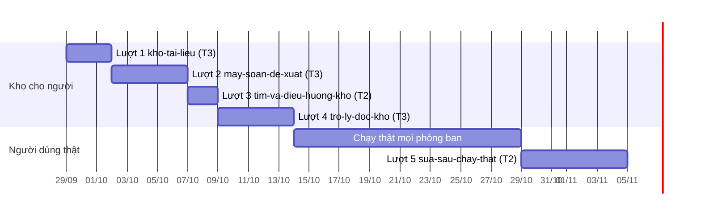

# Lộ trình Kho tài liệu trên CRM OneHub

Viết 2026-09-27, sắp lại cùng ngày theo quyết định của chủ kho: lộ trình chia theo
**thứ người dùng làm được** sau mỗi lượt, mỗi lượt là một vòng feature-loop đầy tay,
ra sản phẩm cho mọi phòng ban dùng rồi sửa một đợt. Nghiên cứu nền ở
`kho-tai-lieu-nghien-cuu.md` và `kho-tai-lieu-viet-nam-va-do-luong.md`; bản mẫu ở
`/proto/kho-tai-lieu`; bàn giao để chạy tiếp ở máy khác: `kho-tai-lieu-ban-giao.md`.

Kho tài liệu là nơi giữ quy định, chính sách, quy trình và biểu mẫu nội bộ theo mẫu
LLM Wiki: người viết và đọc trang, máy soạn bản đề xuất từ tệp có sẵn, chủ trang duyệt
mọi thay đổi, trợ lý AI trả lời chỉ từ bản đang dùng và trích nguyên văn.

**Ngày ở đây là đề xuất của máy, chưa được chủ kho chốt.** Điều kiện mở ở mục 3 mới là
thứ quyết một lượt được mở hay chưa; ngày trượt thì điều kiện vẫn giữ nguyên.

## 1. Đích đến

| Mốc | Ngày đề xuất | Nghĩa là |
| --- | --- | --- |
| Kho cho người | 2026-10-01 | Nhân viên viết trang, chủ trang duyệt, cả công ty đọc bản đang dùng |
| Nội dung vào nhanh | 2026-10-06 | Phòng ban tải tệp đang có lên, máy soạn thành trang, chủ trang duyệt |
| Tìm được | 2026-10-08 | ⌘K có dấu hay không dấu, backlink, tab Sức khoẻ |
| Hỏi được | 2026-10-13 | Hỏi trong CRM hay qua Zalo, trả lời có trích trang và phiên bản |
| Chạy thật | 2026-10-14 → 2026-10-28 | Mọi phòng ban tự nạp tài liệu và dùng hai tuần; đo bốn số |
| Sửa một đợt | 2026-11-04 | Góp ý đã gom được sửa trong một lượt |

Sau đó mới quyết hai lượt để sau (mục 7) bằng số đo của chạy thật.

Nhịp trên lấy từ nhịp thật của kho này: mười lăm vòng gần nhất có 8–16 AC mỗi vòng, một
vòng S4, xong trong 1–2 ngày; OKR đi sáu lượt từ 24/09 đến 27/09. Thứ giới hạn là giờ
chủ kho ngồi ở cổng, không phải giờ máy. Chồng lịch với OKR (R2 lên 20/11, R3 lên 18/12)
do cùng chủ kho điều phối.

## 2. Nguyên tắc chia lượt

- **Một lượt là một thứ người dùng nói được** («Tôi viết được một trang, gửi chủ trang
  duyệt…»), theo khuôn lộ trình OKR. Không chia theo tầng kỹ thuật.
- **Mỗi lượt đặt sát trần của kit: 5–15 AC, S4 tối đa ba vòng.** Muốn lớn hơn thì xếp
  lượt sát nhau và làm S0–S1 của lượt sau khi lượt trước còn ở S4 (như OKR lượt 2 và 6),
  không phình một lượt. Lượt 1 đang ở trần; quét S1 vượt 15 thì tách lịch sử, khôi phục,
  lưu trữ sang lượt 3, không phình lượt 1.
- **Lược đồ đi trước vào lượt T3.** Lượt 1 đặt sẵn cột tìm kiếm và bảng liên kết để lượt
  3 là T2; lượt 2 thêm bảng nguồn. Chạm `packages/db/prisma` là T3 và có thêm Cổng 1.5.
- **Không có cổng đo giữa các lượt.** Bộ vàng 470, mồi rò rỉ, G1–G10, E0–E7 của nghiên
  cứu thành: 50 câu hỏi thật làm evals của lượt 4, và bốn số đo lúc chạy thật (mục 5).
- **Design-pass cho từng lượt dùng chung bản mẫu `/proto/kho-tai-lieu`.** Luật `docs/proto.md`
  bắt slug bản mẫu bằng slug hồ sơ, nên mỗi lượt thêm một mục `catalog.ts` trỏ cùng
  module với tập trạng thái của lượt đó (`PROTO_COMPONENTS` là `Map`, nhiều slug trỏ một
  module được). Nhãn «Lượt 1/2/3» trong catalog đang theo đánh số cũ, sửa trong lượt 1.
- **Chốt 2026-09-26 (Manh Phan): duyệt mọi thay đổi.** Không có bậc tự áp dụng, kể cả
  sửa chính tả và liên kết.
- **Chốt 2026-09-27 (Manh Phan): lộ trình chỉ theo dõi việc bàn giao phần mềm.** Pháp lý
  không phải cổng của lượt nào; tuân thủ khi chạy production do chủ kho lo.
- **Chốt 2026-09-27 (Manh Phan), năm điểm:** đợt đầu mọi trang cả công ty đọc được, trang
  nhạy cảm để ngoài, phạm vi xem theo trang làm sau chạy thật · nạp nguồn và máy soạn ở
  lượt 2, trước tìm và trợ lý · hỏi trong CRM và qua bot Zalo · ngưỡng Cổng Đáng ở mục 5 ·
  tệp nguồn lưu ở Vercel Blob.
- Nhãn trên màn theo từ điển: trợ lý AI (không phải «tác nhân»), chủ trang, bản đề xuất,
  bản đang dùng, nguồn, xác minh đến ngày, bậc duyệt. Tám mục từ điển đang ở dạng «đề
  xuất» được chốt cùng lúc ở Cổng 1 của lượt 1, không có bước riêng.

## 3. Tổng quan

| Lượt | Slug | Sau lượt này, nhân viên nói được | Hạng | Mở khi |
| --- | --- | --- | --- | --- |
| 1 | `kho-tai-lieu` | «Tôi viết được một trang, gửi chủ trang duyệt, cả công ty đọc được bản đang dùng» | T3 | Từ điển chốt ở Cổng 1; lược đồ qua Cổng Phạm vi và Cổng 1.5 |
| 2 | `may-soan-de-xuat` | «Tôi tải tệp quy định đang có lên, máy soạn thành trang, tôi sửa và duyệt» | T3 | Lượt 1 đã lên `onehub` |
| 3 | `tim-va-dieu-huong-kho` | «Tôi gõ ⌘K có dấu hay không dấu là ra trang; thấy trang nào nhắc tới trang này; sáng ra biết có mấy bản chờ tôi duyệt» | T2 | Lượt 1 đã lên |
| 4 | `tro-ly-doc-kho` | «Tôi hỏi bằng lời thường, trong CRM hay qua Zalo, được trả lời có trích trang và phiên bản; không biết thì nói không biết» | T3 | Lượt 3 đã lên; có 50 câu hỏi thật |
| — | Chạy thật | Mọi phòng ban tự nạp 10–20 tệp, dùng hai tuần; góp ý gom một chỗ | — | Lượt 4 đã lên |
| 5 | `sua-sau-chay-that` | Danh sách góp ý đã gom được sửa trong một lượt | T2 | Chạy thật xong |

Nguyên tắc «Now / Next / Later»: **Now** là lượt 1. **Next** là 2, 3, 4, chạy thật, 5.
**Later** là hai lượt ở mục 7.

## 4. Từng lượt

### Lượt 1 — `kho-tai-lieu` · T3

**Phạm vi.**
- Lược đồ: trang (slug bất biến, tiêu đề đổi được, đơn vị theo `Department` có sẵn, loại
  trang, chủ trang, xác minh đến ngày), phiên bản bất biến, `approved_revision_id` tách
  `head_revision_id`, bản đề xuất có `base_revision_id`, sự kiện duyệt ghi người, thời
  điểm, hash diff (đây cũng là nhật ký chỉ ghi thêm), trạng thái lưu trữ. Đặt sẵn cột
  `tsvector` (`unaccent`, `pg_trgm`; kiểm tạo được extension trên kho test ở S2) và bảng
  liên kết rút từ cây markdown lúc ghi.
- Tạo trang là một bản đề xuất đầu tiên; sửa trang đang dùng là bản đề xuất mới; NFC hoá
  lúc nhận. Trình soạn nguồn CodeMirror 6 có gợi ý `[[`; xem trước bằng `markdown-reader`.
- Chủ trang có hàng «chờ tôi duyệt»; duyệt là so-và-đặt trên hash diff đã xem; bản gốc đổi
  thì đề xuất cũ, phải làm lại trên bản mới; từ chối kèm lý do. Chủ trang duyệt được bản
  của chính mình; người khác thì không. Admin duyệt thay khi chủ trang vắng (phó để sau).
- Đọc trang: mục lục, wikilink tới trang có và chưa có, phiên bản và ngày duyệt của bản
  đang dùng. Danh sách theo đơn vị và loại; kho rỗng. Lịch sử phiên bản; khôi phục là
  một đề xuất từ bản cũ; lưu trữ qua duyệt, trang lưu trữ ẩn khỏi danh sách mặc định.
- Mọi người trong workspace đọc được mọi bản đang dùng (chốt 2026-09-27).

**Ngoài phạm vi.** Phó, thang leo, phạm vi xem theo trang, bậc 2, nhắc, tìm, backlink,
xuất, mọi AI.

**Đo.** Bản chưa duyệt không đọc được ở đường nào; duyệt thất bại khi base đổi; người
không phải chủ trang hay admin không duyệt được; slug không đổi khi đổi tiêu đề.

### Lượt 2 — `may-soan-de-xuat` · T3

**Phạm vi.** Nguồn bất biến có hash, lưu ở Vercel Blob (thiếu `BLOB_READ_WRITE_TOKEN` thì
tắt nạp nguồn, không lỗi); nhận docx và PDF có lớp chữ, từ chối bản quét bằng cờ «cần gõ
tay». API ghi một `AgentTask`; `apps/agent` soạn markdown có trích đoạn nguồn thành bản
đề xuất (theo trang «quy tắc viết» do chủ kho viết trong kho). Màn duyệt: nguồn cạnh nhau,
dải số và ngày đổi, không nút chọn sẵn. Nguồn có bản mới là nguồn mới, máy soạn thành bản
đề xuất mới. Trang trích nguồn thì tải được nguồn về (biểu mẫu, tệp đính kèm đi đường
này). Khoá AI Gateway thứ hai cho kho, biến môi trường tuỳ chọn, trần tháng đặt ở Gateway.

**Ngoài phạm vi.** OCR bản quét, thẻ mâu thuẫn giữa trang, sổ khẳng định, phân lớp dữ
liệu và ô che dữ liệu cá nhân.

**Đo.** Bản máy soạn không bao giờ thành bản đang dùng mà không qua duyệt; mọi con số
trong bản đề xuất có đoạn nguồn; agent hỏng thì đề xuất vắng và có lý do, không có bản
rỗng.

### Lượt 3 — `tim-va-dieu-huong-kho` · T2

**Phạm vi.** Tìm `unaccent` trên cột đã có từ lượt 1, tính lúc duyệt, không tính lúc đọc;
⌘K có dấu hay không; backlink kèm đoạn ngữ cảnh; lọc theo đơn vị, loại, chủ; tab Sức
khoẻ (mồ côi, gãy, wanted, chờ duyệt, quá hạn xác minh); trang lưu trữ không ra kết quả.
Dòng «N bản đề xuất chờ anh duyệt» trong nhắc buổi sáng có sẵn của `apps/agent`. Nếu
lượt 1 tràn thì nhận thêm lịch sử, khôi phục, lưu trữ.

**Không dùng** `pg_search` (Neon gỡ ngày 2026-09-21). Không vector.

### Lượt 4 — `tro-ly-doc-kho` · T3

**Phạm vi.** Hai công cụ chỉ đọc `search_pages` và `read_page` ở `apps/agent`, chỉ thấy bản
đang dùng, không thấy trang lưu trữ; trích dẫn gồm slug, phiên bản, đoạn nguyên văn, máy
chủ kiểm chuỗi con sau NFC; câu từ chối cố định; cảnh báo «quá hạn xác minh» theo trường
của lượt 1; nút «báo sai» thành việc cho chủ trang; bảng nhật ký hỏi và hàng câu chưa trả
lời được. Hỏi trong CRM và qua bot Zalo có sẵn (đã có trần theo người và theo xưởng, đã
chặn người chưa nối). Dùng khoá AI thứ hai của lượt 2.

**Evals.** Một script chấm «trả lời có trích đúng trang mong đợi» trên 50 câu hỏi thật
(`kho-tai-lieu-bo-vang.md`), cộng 10–15 eval judgment cho câu khó và câu phải từ chối.

## 5. Chạy thật và lượt sửa

**Chạy thật** là Cổng Giá trị của cả sản phẩm: mọi phòng ban cùng lúc, hai tuần. Mỗi phòng
ban tự tải 10–20 tệp đang có lên, chủ trang duyệt, nhân viên tìm và hỏi. Kiểm kê và gom
tệp Zalo (`kho-tai-lieu-kiem-ke.md`) là việc phòng ban làm trong đợt này, không phải việc
chủ kho làm trước. Góp ý gom ở một nhóm Zalo hay Slack có sẵn; chủ kho tổng hợp thành
đề bài của lượt 5. Không dựng tính năng góp ý.

**Bốn số, đều đếm từ bảng, không cần telemetry:**

| Số | Lấy từ | Ngưỡng đề xuất, ký ở Cổng Đáng lượt 1 |
| --- | --- | --- |
| Trang đã duyệt theo đơn vị | bảng trang | Mỗi phòng ban tham gia ≥ 10 trang |
| Câu hỏi được trả lời có trích trên tổng câu hỏi | nhật ký hỏi của lượt 4 | ≥ 70% |
| Trung vị thời gian từ đề xuất tới duyệt | sự kiện duyệt của lượt 1 | ≤ 5 ngày làm việc |
| Số lần bấm «báo sai» | bảng việc | Chỉ đếm, để định đề bài lượt 5 |

Trung vị duyệt là số nghiên cứu bảo sẽ vỡ trước. Nếu vượt 5 ngày thì lượt 5 lấy phó và
thang leo (mục 7) làm việc đầu tiên.

**Lượt 5** là một vòng T2 với đề bài lấy nguyên từ danh sách góp ý.

## 6. Bảng phủ — mười lăm trạng thái bản mẫu về đúng một lượt

| Trạng thái ở `catalog.ts` | Lượt |
| --- | --- |
| `ST-danh-sach` `ST-doc-trang` `ST-viet-trang` `ST-kho-rong` `ST-dang-tai` `ST-de-xuat-cu` | 1 |
| `ST-tai-nguon` `ST-duyet-ban-may-soan` | 2 |
| `ST-tim-nhanh` `ST-suc-khoe` | 3 |
| `ST-tac-nhan-tra-loi` `ST-tac-nhan-tu-choi` | 4 |
| `ST-khong-co-quyen` | để sau: `chu-trang-va-pham-vi` |
| `ST-soat-dinh-ky` `ST-the-cu-phap-ly` | để sau: `bao-tri-trang-luat` |

## 7. Để sau, không làm, rủi ro

**Hai lượt để sau**, mở hay không tuỳ số đo chạy thật:

- `chu-trang-va-pham-vi` (T3): phó và thang leo chủ → phó → admin; hạn xác minh có nhắc
  qua email hay Zalo; phạm vi xem theo trang dùng vai và phạm vi có sẵn ở
  `packages/validation/src/vai-workspace.ts`, một hàm «thấy được», 404 giống nhau cho ẩn
  và không có; bậc 2 cho tiền và pháp lý.
- `bao-tri-trang-luat` (T3): soát định kỳ, cờ cũ theo hash nguồn, thẻ căn cứ pháp lý đã
  đổi, thẻ mâu thuẫn, đồ thị cục bộ và toàn kho.

**Để sau, chưa gắn lượt**: xuất Markdown và PDF · OCR bản quét · bộ vàng lớn và mồi rò rỉ ·
phân lớp dữ liệu P/I/B/S và ô che dữ liệu cá nhân · ZDR.

**Không làm, kèm lý do để khỏi bàn lại**: WYSIWYG (mọi trình đã thử viết lại dòng, phá
diff người duyệt) · vector và GraphRAG (vài trăm trang không đòi) · chuyển hàng loạt tài
liệu cũ (KCS: chưa bao giờ hiệu quả; nhập làm nguồn theo nhu cầu) · tự áp dụng sửa cơ học
(chốt 2026-09-26) · ảnh chèn trong trang (tệp đính kèm thay) · hạng mục pháp lý (chốt
2026-09-27; nghiên cứu ở mục 10 của `kho-tai-lieu-viet-nam-va-do-luong.md` giữ làm tư liệu).

**Rủi ro:**

| Rủi ro | Giảm |
| --- | --- |
| Chủ trang không theo kịp hàng duyệt | Hàng «chờ tôi duyệt» từ lượt 1, dòng nhắc sáng từ lượt 3, admin duyệt thay; trung vị duyệt là số đo chính của chạy thật |
| Mọi trang ai cũng đọc được trong đợt đầu | Tài liệu nhân sự, tài chính đứng ngoài đợt đầu; lượt phạm vi mở ngay sau nếu phòng ban cần |
| Tiền AI của lượt 2 và 4 | Khoá Gateway thứ hai có trần tháng; ước 0,1–0,2 USD một tệp, 100 tệp khoảng 20 USD trong tháng chạy thật |
| Neon hết hạn mức | Tệp nguồn ở Blob, không ở Postgres; tìm kiếm tính lúc duyệt; không thêm nhịp thăm dò |
| Nhánh bản mẫu tụt sau `onehub` | Mỗi phiên kéo `onehub` vào trước khi làm |

## 8. Theo dõi — cập nhật sau mỗi hạng mục

Sổ theo dõi duy nhất của Kho tài liệu. Một dòng một hạng mục; số dòng không dùng lại,
hạng mục đổi slug thì mở dòng mới và dòng cũ nhận «đã thay». Cột Trạng thái chỉ nhận:
chưa mở · Cổng Đáng · Cổng Phạm vi · đang dựng · Cổng Bằng chứng · đã lên `onehub` ·
Cổng Giá trị · xong · đã thay. Ngày là ngày đổi trạng thái gần nhất. Cột Ghi chú chỉ nối
thêm, không sửa chữ cũ. PR của hạng mục nào tự sửa dòng của hạng mục đó. Khi dòng ở đây
lệch với `PRODUCT-MAP.md`, theo `PRODUCT-MAP.md` rồi sửa dòng. Trang theo dõi tiến độ
(artifact, đường dẫn ở `kho-tai-lieu-ban-giao.md`) là bản đọc nhanh của bảng này. **Từ 03/10 (kit 2.21.0) trạng thái sống của từng hàng nằm ở `LO-TRINH.html` ở gốc kho**: kit đọc tệp ý định `docs/plan/lo-trinh-kho-tai-lieu.json` và suy trạng thái từ hồ sơ `_acceptance/`; cột Trạng thái của bảng dưới THÔI cập nhật, bảng giữ làm sử liệu và ghi chú. Đổi kế hoạch thì sửa tệp JSON bằng PR. Trang dựng tay và bản chụp `.data.js` đã gỡ.

| # | Hạng mục | Trạng thái | Ngày | PR | Ghi chú |
| --- | --- | --- | --- | --- | --- |
| 0 | Lượt 0 — nền | xong | 2026-09-27 | — | Nghiên cứu nền xong 2026-09-26 (18 luồng, 546 nguồn): ba tệp `kho-tai-lieu-*.md` và hồ sơ `kho-tai-lieu-ho-so/`. Bản mẫu `/proto/kho-tai-lieu` 15 trạng thái, trình đọc `markdown-reader` trong `packages/ui`. Chốt 2026-09-26 (Manh Phan): duyệt mọi thay đổi. Tám mục từ điển thêm dạng đề xuất. Nhánh `proto/kho-tai-lieu` đã kéo `onehub` 2026-09-27 và đẩy lên `origin` để chạy tiếp ở máy khác. Còn: 12 câu luật sư, kiểm kê, giờ duyệt, gom tệp Zalo, chọn pilot, 50 câu hỏi, duyệt từ điển. 2026-09-27: máy soạn gói gửi luật sư `kho-tai-lieu-goi-luat-su.md` (thư, 12 câu xếp theo thứ tự cần trả lời, phụ lục dữ liệu CRM gửi đi đâu tra từ mã, bảng sự thật chủ kho điền); tra ra CRM chạy từ khoảng 31/08–07/09/2026, nên nếu hạn hồ sơ là 60 ngày thì rơi vào đầu tháng 11/2026. Chờ chủ kho điền phụ lục B và gửi. 2026-09-27: máy soạn `kho-tai-lieu-kiem-ke.md` — cột kiểm kê kèm lớp dữ liệu và quy tắc chọn đích, tin mẫu hỏi giờ duyệt, các bước gom tệp Zalo có dấu vân tay `sha256`, bảng số mang về kho. Chờ chủ kho điền. 2026-09-27: máy soạn `kho-tai-lieu-bo-vang.md` — cột gom câu hỏi nguyên văn, sáu bước máy chuẩn hoá và gán tầng S1–S3, S6, S7, nơi giữ; ghi quyết định còn mở trước lượt 2: bộ niêm phong không được nằm trong git vì phiên máy đọc được git. Chờ chủ kho gom câu. 2026-09-27: Manh Phan bỏ hạng mục pháp lý khỏi lộ trình; xoá `kho-tai-lieu-goi-luat-su.md`. Kiểm kê, giờ duyệt, gom Zalo, chọn pilot, 50 câu chuyển sang dòng 7. Lượt 0 còn: duyệt từ điển, design-pass tuỳ chọn. 2026-09-27: Manh Phan chốt lộ trình theo output (năm lượt, chạy thật, lượt sửa); từ điển chốt ở Cổng 1 lượt 1, design-pass là nghi thức S1-D của lượt 1 — lượt 0 không còn việc riêng, xong |
| 1 | Lượt 1 — `kho-tai-lieu` | đã lên `onehub` | 2026-09-28 | #180 | T3. Slug hồ sơ trùng slug bản mẫu. 2026-09-27: sắp lại — lượt 1 nay gồm cả hàng «chờ tôi duyệt», đề xuất cũ khi base đổi, admin duyệt thay, lưu trữ, các trường đơn vị, loại, xác minh đến ngày, cột tìm và bảng liên kết cho lượt 3; đang ở trần 15 AC. Mở khi từ điển chốt ở Cổng 1. 2026-09-27: vòng mở; chủ kho chốt trình soạn giàu kiểu Google Docs và diff kiểu Track Changes cho người dùng văn phòng; lịch sử, khôi phục, lưu trữ dời lượt 3. S1 xong: thiết kế, hợp đồng 15 AC, evals, gap-probe 5 P1 đã sửa, design-pass bản mẫu 8 trạng thái; thẻ Cổng Phạm vi đã trình. Sửa 4 test api đỏ sẵn (commit `7acbffec`). 2026-09-27: Cổng Phạm vi và kế hoạch 10 task duyệt; dựng năm màn, router `taiLieu`, `migration`, trình soạn Tiptap, màn duyệt Track Changes, lọc dán từ mẫu Word và Google Docs thật. 2026-09-28: chấm ba lượt — lượt 1 trả lại (bảng trong màn duyệt, hai lệnh kiểm đỏ), lượt 2 trả lại (test bảng yếu), lượt 3 đạt 28/28 phép đo, 4/4 bộ kiểm. Mạnh ký Cổng Bằng chứng: E14j đạt, 17 hạn chế đã biết ở `Notes` của hợp đồng, nặng nhất là dấu `|` trong ô bảng làm mất dữ liệu và danh sách đề xuất trần 25 dòng. Gộp `onehub` (55 commit), ghim lại xanh ở lượt ba — hai lượt đầu đỏ vì hai test bập bênh ngoài Kho tài liệu (OKR, Zalo). 2026-09-28: PR #180 đỏ CI (`diff-trang-dai` 2552 ms trên máy GitHub, trần 2 giây) và đụng độ `onehub` sau #178, #179; `migration` trùng dấu `20260930010000` với `okr_khep_ky` đã lên production. Gộp `onehub`, dời `migration` sang `20261001010000_kho_tai_lieu`, trần test 6 giây trên CI và giữ 2 giây tại chỗ (bỏ trần diff thì quá 120 giây), ghim lại. 2026-09-28: CI lần hai đỏ ở `lai tung component ra man` của `packages/ui` (quá trần 5 giây trên máy GitHub, tại chỗ 1,7 giây; component nặng của lượt này làm test đó chậm), chạy lại job thì xanh. Merge `c1e37b73` vào `onehub`, lên production cùng `migration` `20261001010000_kho_tai_lieu`. Cổng Giá trị đóng ở chạy thật (dòng 3) |
| 2 | Lượt 3 — `tim-va-dieu-huong-kho` | đã lên `onehub` | 2026-09-29 | #205 | T2. 2026-09-27: từ lượt 1b thành lượt 3, sau máy soạn; nhận thêm dòng nhắc sáng «chờ duyệt», lọc theo đơn vị, loại, chủ; xuất Markdown và PDF chuyển sang để sau. 2026-09-29: vòng mở trên nhánh `feat/tim-va-dieu-huong-kho` cắt từ `onehub` (`05664c7a`). Chủ kho chốt trong phiên: dòng nhắc sáng đếm bằng số tab «Chờ duyệt», quản trị đếm mọi bản chờ; nhận chèn liên kết tới trang trong trình soạn. S1 xong: thiết kế, hợp đồng 12 AC, 25 eval, gap-probe 1 P0 + 3 P1 + 1 P2 đã sửa, design-pass bản mẫu `/proto/tim-va-dieu-huong-kho` (6 ảnh, 7 phát hiện), ba hình quyết định, `opportunity.md` với ngưỡng đề xuất. `TaiLieuTrang` chưa có trạng thái lưu trữ, nên máy đề xuất tách lịch sử, khôi phục, lưu trữ sang lượt 3b `lich-su-va-luu-tru-trang` (T3); lượt 3 giữ T2, không migration. Chờ chủ kho: ký Cổng Đáng, chọn tách hay gộp, duyệt Cổng Phạm vi. 2026-09-29: Phan Le Manh duyệt Cổng Phạm vi trên hợp đồng 12 AC như đang viết — nhận tách lịch sử, khôi phục, lưu trữ sang lượt 3b, gạch hai dòng giả định của Coverage; lint độ phủ sửa nhãn lớp của 7 eval DOM, cảnh báo chữ trùng khác nghĩa giữ nguyên như lượt 1. Cổng Đáng (`opportunity.md`) chưa ký. Vào S2. 2026-09-29: Phan Le Manh ký Cổng Đáng — build, ngưỡng giữ như đề xuất (sống: ≥ 50% trang không mồ côi, trung vị duyệt ≤ 5 ngày làm việc; chết: lộ bản chưa duyệt, trung vị > 10 ngày, < 20% không mồ côi) | 2026-09-29: S3 xong, năm lệnh xanh; tệp kiểm nhắc sáng của agent để sót trang tài liệu làm đỏ 56 ca agent khi chạy cả kho, đã vá. S4 round 1 BLOCKED (một agent chấm không nộp kết quả) kèm một phát hiện trong hợp đồng: nhắc sáng và thẻ Tổng quan tự tính lại luật duyệt thay vì dùng chung hàm với tab «Chờ duyệt»; hội đồng ảnh thấy tiêu đề «Tài liệu» bị ba nút đè ở khổ 390. Sửa: một luật duyệt; đầu trang dùng chung (PageShell) cho hàng nút xuống dòng; «hết hạn xác minh» thành «xác minh đến». Round 2 PENDING-JUDGMENT: 25 eval và bốn suite xanh, hội đồng ảnh UNCERTAIN (thiếu ảnh đủ năm danh sách Sức khoẻ, chip «Biểu mẫu» ở 390, nhãn «Có đề xuất chờ duyệt»); bảy phát hiện ngoài hợp đồng, nặng nhất là màn chi tiết agent trên điện thoại lệch bố cục do bản sửa đầu trang. Chờ anh ký Cổng Bằng chứng. 2026-09-29: Phan Le Manh ký Cổng Bằng chứng — E12j Đạt; mười mục ghi Known limits, bốn mục mở hợp đồng mới (màn chi tiết agent lệch bố cục trên điện thoại, hộp chèn liên kết báo «không có trang nào khớp» khi tìm lỗi, phép kiểm đường dẫn liên kết chèn vào), ba mục chấp nhận không sửa. Gộp `onehub` (#204), ghim lại xanh; mở PR #205. 2026-09-29: CI của PR #205 xanh (acceptance gate, check-types, lint, test, lệnh dựng); chủ kho lệnh merge, merge commit vào `onehub`, lên production. Còn phiên nghiệm thu (`/acceptance-gate:uat-session tim-va-dieu-huong-kho`) và bốn hợp đồng mới từ Cổng Bằng chứng; Cổng Giá trị đóng ở chạy thật (dòng 3).
| 3 | Chạy thật — mọi phòng ban | chưa mở | — | — | Không AI. 2026-09-27: từ «pilot một phòng ban» thành chạy thật mọi phòng ban hai tuần, bốn số đo ở mục 5, ngưỡng ký ở Cổng Đáng lượt 1 |
| 4 | Lượt 4 — `tro-ly-doc-kho` | chờ merge | 2026-10-01 | #231 | Cổng G1–G10. 2026-09-27: bỏ cổng G1–G10 và giới hạn lớp P và I; mở khi lượt 3 lên và có 50 câu hỏi thật; hỏi trong CRM và qua Zalo; evals là script chấm 50 câu cộng 10–15 judgment. 2026-10-01: vòng mở trên nhánh `feat/tro-ly-doc-kho` cắt từ `onehub` (`bb558531`), S0–S1 không chờ 50 câu hỏi thật (chỉ AC-15 chờ bộ câu đo). Lên **T3**: kho chưa có «bảng việc» nào dùng được cho «báo sai» (`Activity` kiểu `TASK` không có người được giao, `OkrViecKr` bắt buộc KR), nên thêm hai bảng `TaiLieuHoi` và `TaiLieuBaoSai`, có Cổng 1.5. Chủ kho chốt trong phiên: hỏi ở tab «Hỏi» của Kho; Zalo do trợ lý AI tự nhận ra câu quy định; thêm ô đặt «Xác minh đến ngày» lượt này vì `xacMinhDen` chưa có đường ghi nào (danh sách «Quá hạn xác minh» của lượt 3 luôn rỗng ở production); chỉ lưu chữ câu từ chối và câu bị báo sai. S1 xong: thiết kế, hợp đồng 15 AC, 22 eval, gap-probe 1 P0 + 4 P1 đã sửa, design-pass `/proto/tro-ly-doc-kho` (6 ảnh, 9 phát hiện), hai hình quyết định. Ngoài phạm vi: vai «chỉ OKR» hỏi kho, «báo sai» qua Zalo, phép tính trên số trích, trang lưu trữ (lượt 3b). Đường nền đỏ đúng ca `kr-may` đỏ sẵn trên `onehub`. Chờ chủ kho: ký Cổng Đáng, chọn bộ câu đo của AC-15, duyệt Cổng Phạm vi. 2026-10-01: Phan Le Manh duyệt Cổng Phạm vi trên hợp đồng 15 AC như đang viết, cùng bộ câu đo theo ngả máy khuyên — vòng chấm dùng bộ «tạm» máy soạn từ trang mẫu của kho đo (trong git), 50 câu thật chủ kho gom song song, giữ ngoài kho, chạy lần đầu trong tuần đầu chạy thật. Lint độ phủ sửa nhãn lớp của 4 eval DOM; cảnh báo chữ trùng khác nghĩa giữ nguyên như lượt 1 và 3. Cổng Đáng (`opportunity.md`) chưa ký. Vào S2. 2026-10-01: kế hoạch 12 task (`docs/superpowers/plans/2026-10-01-tro-ly-doc-kho.md`) chờ Cổng 1.5; năm lựa chọn gánh tải ghi ở sổ quyết định, trong đó thước màn đóng vai trợ lý thay vì công tắc model giả, và thước Sức khoẻ của lượt 3 lên bảy khối kèm ghim lại hồ sơ lượt 3. 2026-10-01: Phan Le Manh duyệt kế hoạch ở Cổng 1.5, chọn thi công tuần tự trong phiên; vào S3. Cổng Đáng chưa ký. 2026-10-01: S4 round 1 REJECT, round 2 dừng-vá; chủ kho chọn đổi khuôn E15 sang eval chạy trên máy chủ eve thật (`apps/agent/evals/tro-ly-kho`). Khuôn mới lộ và đã sửa một lỗi thật: trên Zalo, câu quy định không bao giờ tới trợ lý kho vì eve không đưa `session.parent` cho bộ dựng chỉ dẫn. 2026-10-02: S4 round 3 REJECT — 19/19 eval máy đạt (E15: đúng trang 100%, từ chối đúng 100%, Zalo chuyển 100%, chuyển nhầm 0%); E16j hội đồng đề xuất không đạt (chip gợi ý bị cắt ở 390, biểu tượng nổi đè góc ô soạn); một phát hiện trong hợp đồng ở E12 (đo ZDR trên hàm dựng model, không trên bộ chọn model của agent). Chạm trần 3 round; chủ kho mở round 4 hẹp (chip gợi ý xuống dòng ở 390, thước màn gỡ lớp phủ dev, E12 đo ZDR qua bộ chọn model thật của agent). 2026-10-02: S4 round 4 PENDING-JUDGMENT sau hai lượt BLOCKED hạ tầng (resume cùng round) — 22/22 eval máy đạt, 0 phát hiện trong hợp đồng. Phan Le Manh ký Cổng Bằng chứng 2026-10-02 (E15j, E16j Đạt; 10 mục Known limits, 1 mở hợp đồng mới: trợ lý kho bị mời ở mọi phiên gốc). Hai hợp đồng nên mở tiếp: chặn tool cho phiên gốc «kho», và câu hỏi đi qua model không ZDR của agent gốc. Gộp onehub (#226, #228, #229, #230), ghim lại `tro-ly-doc-kho`, `nen-chat-ai-elements`, `tim-va-dieu-huong-kho`; mở PR #231. Cổng Đáng chưa ký |
| 5 | Lượt 2 — `may-soan-de-xuat` | đã lên `onehub` | 2026-09-28 | #194 | Chặn bởi trả lời luật sư. 2026-09-27: bỏ cổng luật sư; còn chặn bởi E0–E7 trên tệp thật và số người duyệt. 2026-09-27: từ lượt 3 thành lượt 2 vì nó nạp nội dung cho chạy thật; bỏ nốt cổng E0–E7; gồm nạp nguồn (Blob), máy soạn, màn duyệt có nguồn cạnh nhau, khoá AI thứ hai. 2026-09-28: T3. Mở S0–S1 trên nhánh `feat/may-soan-de-xuat` cắt từ `proto/kho-tai-lieu` (`5e3e35b9`) khi PR #180 còn chờ merge. S1 xong: thiết kế, hợp đồng 15 AC, 28 eval, gap-probe 1 P0 + 3 P1 + 1 P2 đã sửa, design-pass bản mẫu `/proto/may-soan-de-xuat` (6 ảnh, 9 phát hiện), hai hình quyết định, kế hoạch 12 task. Phan Le Manh duyệt Cổng Phạm vi 2026-09-28 trên hợp đồng như đang viết: không tick bắt buộc từng khẳng định, mục Nguồn của từ điển giữ nguyên — hai điểm máy khuyên khác, ghi ở sổ quyết định. Còn: ký Cổng Đáng (`opportunity.md`), duyệt kế hoạch ở Cổng 1.5; S2 mở khi lượt 1 đã lên `onehub`; S3 cần trang «Quy tắc viết» của chủ kho. 2026-09-28: Phan Le Manh ký Cổng Đáng (build, ngưỡng giữ nguyên); lượt 1 đã lên `onehub` (#180, `c1e37b73`) và đã kéo vào nhánh; chủ kho chọn khoá Duyệt tới khi tick từng con số và sửa câu lớp dữ liệu của mục Nguồn — Cổng Phạm vi mở lại để duyệt lại AC-11. 2026-09-28: Phan Le Manh duyệt lại Cổng Phạm vi với tick từng con số; còn Cổng 1.5 (kế hoạch 12 task). 2026-09-28: Phan Le Manh duyệt kế hoạch ở Cổng 1.5; chờ lệnh mở S3. 2026-09-28: mở S3; xong T1–T11 (lược đồ, hàm ghi chung, kiểm số, Blob, API nguồn, đọc chữ, máy soạn, thành phần giao diện, hộp tải và tab Nguồn, màn duyệt nguồn cạnh nhau, tài liệu); năm lệnh xanh, đã đẩy `30a23d0e`. S3 dừng ở T12: chờ trang «Quy tắc viết» (`mau/quy-tac-viet.md`), ba tệp mẫu thật (`mau/that/`), khoá AI Gateway thật, và quyết định kho Blob private. 2026-09-28: chủ kho chọn cách C cho «Quy tắc viết» (máy soạn v0 từ ba văn bản mẫu, chủ kho nhận và sửa dần); S3 xong. Chấm năm vòng: round 2 BLOCKED ở E2t (thiếu Blob thật); Cổng Bằng chứng mở lại Cổng Phạm vi thêm AC-16/E16 vì thủ tục nhận nguồn có thể xoá tệp của nguồn đã có; round 3 REJECT chạm trần ba vòng; round 5 đạt, E2t chạy trên kho Blob riêng tư thật `kho-tai-lieu-nguon` (`sin1`, chưa gắn dự án). Phan Le Manh ký Cổng Bằng chứng round 5, bốn hạn chế đã biết ở `Notes` của hợp đồng. Merge #194 (`8b76152a`) lên `onehub` và production. Dòng này sửa ở PR trang theo dõi vì PR #194 để trạng thái «S3». 2026-09-28, sau merge: #195 (`cfac5bea`) dựng vùng kéo-thả tệp nguồn trên móc ReUI `use-file-upload`; #196 (`074a1cb9`) bỏ vế «hoặc chọn tệp» khỏi câu gợi ý; #197 (`8797af8b`) kho nguồn đọc khoá riêng `KHO_TAI_LIEU_BLOB_TOKEN`, tách khỏi `BLOB_READ_WRITE_TOKEN` của logo vì Vercel đặt riêng tư theo cả kho — khoá đặt tay trên Production của `crm-onehub-api` và `crm-onehub-agent`, kho `kho-tai-lieu-nguon` cố ý không gắn dự án; #198 (`7db7cea3`) `soSanh` bỏ vòng Myers mức khối, ca `tat-dinh` hết sát trần CI; #200 (`a2c559cc`) thước màn chữ của `bo-chu-lap-keo-tha` theo khoá mới. Hộp «Tải nguồn lên» đã mở trên production; chưa tải tệp thật nào trên production. Còn: phiên nghiệm thu `may-soan-de-xuat`, nguồn kẹt `CHO_DOC` (hợp đồng riêng) |
| 6 | Để sau — `bao-tri-trang-luat` | chưa mở | — | — | Chặn bởi số đo pilot lượt 3. 2026-09-27: để sau, quyết bằng số đo chạy thật |
| 7 | Chuẩn bị chạy thật | đang dựng | 2026-09-27 | — | Tách từ dòng 0 ngày 2026-09-27. Máy đã soạn mẫu `kho-tai-lieu-kiem-ke.md` và `kho-tai-lieu-bo-vang.md`. Chờ chủ kho: gom tệp Zalo (gấp), kiểm kê, giờ duyệt, chọn phòng ban và 20 tài liệu, 50 câu hỏi. 2026-09-27: sắp lại — kiểm kê và gom Zalo là việc phòng ban làm trong chạy thật; chủ kho chỉ còn gom 50 câu hỏi trước lượt 4 và viết trang «quy tắc viết» trước lượt 2 |
| 8 | Lượt 5 — `sua-sau-chay-that` | chưa mở | — | — | T2. Đề bài lấy từ danh sách góp ý của chạy thật |
| 9 | Để sau — `chu-trang-va-pham-vi` | chưa mở | — | — | T3. Phó, thang leo, nhắc hạn xác minh, phạm vi xem theo trang, bậc 2. Mở ngay sau chạy thật nếu trung vị duyệt vượt 5 ngày hoặc phòng ban cần trang hạn chế |
| 10 | Lượt 3b — `lich-su-va-luu-tru-trang` | chưa mở | 2026-09-29 | — | T3 (cần cột trạng thái lưu trữ trên `TaiLieuTrang`, có `migration`). Tách từ lượt 3 ngày 2026-09-29: chủ kho nhận ở Cổng Phạm vi của `tim-va-dieu-huong-kho`. Gồm lịch sử phiên bản, khôi phục là một đề xuất từ bản cũ, lưu trữ qua duyệt, và «trang lưu trữ không ra kết quả» của tìm kiếm. Dòng mở ở PR tiến độ 29/09 vì PR #205 chưa mở dòng |

## 9. Bắt đầu thế nào

Xem `kho-tai-lieu-ban-giao.md` mục «Chạy tiếp ở máy khác». Tóm gọn: kéo nhánh
`proto/kho-tai-lieu`, đọc mục 1 và 17 của `kho-tai-lieu-nghien-cuu.md`, rồi mở lượt 1 bằng
`/feature-loop:feature-loop kho-tai-lieu — lượt 1 của docs/plan/lo-trinh-kho-tai-lieu.md`.
Từ điển được chốt ngay tại Cổng 1 của lượt đó.
