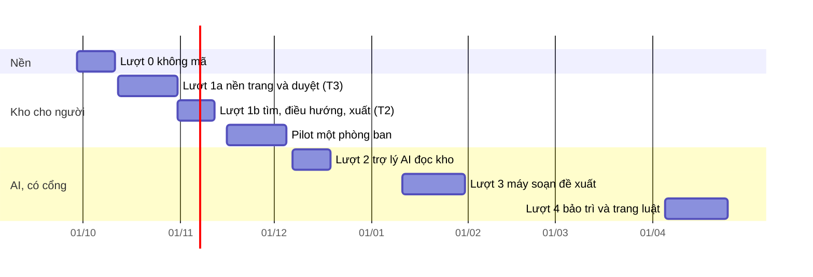

# Lộ trình Kho tài liệu trên CRM OneHub

Viết 2026-09-27, từ nghiên cứu nền (`kho-tai-lieu-nghien-cuu.md`,
`kho-tai-lieu-viet-nam-va-do-luong.md`) và bản mẫu `/proto/kho-tai-lieu`. Bàn giao
để chạy tiếp ở máy khác: `kho-tai-lieu-ban-giao.md`.

Kho tài liệu là nơi giữ quy định, chính sách, quy trình và biểu mẫu nội bộ theo mẫu
LLM Wiki: người viết và đọc trang, máy chỉ soạn bản đề xuất, chủ trang duyệt mọi
thay đổi, trợ lý AI trả lời chỉ từ bản đang dùng và trích nguyên văn.

**Ngày ở đây là đề xuất của máy, chưa được chủ kho chốt.** Cổng điều kiện ở mục 3
mới là thứ quyết một lượt được mở hay chưa; ngày trượt thì cổng vẫn giữ nguyên.

## 1. Đích đến

| Mốc | Ngày đề xuất | Nghĩa là |
| --- | --- | --- |
| Nền sẵn sàng | 2026-10-10 | Đã gửi 12 câu cho luật sư, đã kiểm kê tài liệu và giờ duyệt, đã gom tệp Zalo, đã có 50 câu hỏi thật làm mầm bộ đo |
| Kho cho người | 2026-11-13 | Một phòng ban viết, duyệt, đọc, tìm trang trong CRM; chưa có AI |
| Pilot người dùng thật | 2026-11-16 → 2026-12-04 | Một phòng ban, khoảng 20 tài liệu, 25–50 nhân viên; đo chủ trang có theo kịp không |
| Trợ lý AI đọc kho | sớm nhất 2026-12-07 | Chỉ khi cổng G1–G10 đã qua; chỉ trang lớp P và I |
| Máy soạn đề xuất | quý 1/2027 | Chỉ khi luật sư đã trả lời và đã đo tiếng Việt trên tệp thật |
| Bảo trì và trang luật | quý 2/2027 | Chỉ khi pilot máy soạn cho số đo bắt lỗi mồi |

Chồng lịch với OKR: R2 lên 20/11, R3 lên 18/12 do cùng chủ kho điều phối. Kho tài
liệu cố ý **không có AI tới hết năm** để không tranh ngân sách AI (trần team 20
USD/tháng, khu OKR 9 USD) và không tranh giờ duyệt của cùng những người.

## 2. Nguyên tắc chia lượt

- Một lượt là một vòng `/feature-loop:feature-loop`. Lượt chạm
  `packages/db/prisma` là T3 và có thêm Cổng 1.5.
- Hồ sơ nghiệm thu của lượt 1a lấy slug **`kho-tai-lieu`**, trùng slug bản mẫu, vì
  `docs/proto.md` bắt slug bản mẫu bằng slug hồ sơ để design-pass mở đúng URL.
- **Chốt 2026-09-26 (Manh Phan): duyệt mọi thay đổi.** Không có bậc tự áp dụng,
  kể cả sửa chính tả và liên kết. Chỉ xét nới sau pilot, khi đã có số đo bắt lỗi mồi.
- Mỗi lượt có AI chỉ mở khi cổng của nó ở mục 3 đã qua. Ngày không mở cổng.
- Không lượt nào gửi dữ liệu cá nhân ra nước ngoài trước khi luật sư trả lời.
- Nhãn trên màn theo từ điển: trợ lý AI (không phải «tác nhân»), chủ trang, bản đề
  xuất, bản đang dùng, nguồn, xác minh đến ngày, bậc duyệt.

## 3. Tổng quan

| Lượt | Tên | Hạng | Người dùng được gì | AI | Cổng mở |
| --- | --- | --- | --- | --- | --- |
| 0 | Nền, không mã | — | Không | Không | — |
| 1a | `kho-tai-lieu` | T3 | Trang, phiên bản bất biến, con trỏ bản đang dùng, bản đề xuất do người tạo, duyệt bậc 1 và 2, chủ và phó, phạm vi xem, hạn xác minh, nhật ký kiểm toán, trình soạn nguồn | Không | Từ điển duyệt; lược đồ qua Cổng Phạm vi và Cổng 1.5 |
| 1b | `tim-va-dieu-huong-kho` | T2 | Tìm có dấu và không dấu, ⌘K, backlink kèm ngữ cảnh, xem trước, mục lục, tab Sức khoẻ, xuất Markdown và PDF có phiên bản | Không | 1a đã lên `onehub` |
| P | Pilot | — | Một phòng ban dùng thật | Không | 1b đã lên; đã chọn phòng ban và 20 tài liệu |
| 2 | `tro-ly-doc-kho` | T2 | Hỏi đáp có trích nguyên văn, từ chối cố định, báo sai, hàng câu chưa trả lời được | Chỉ đọc, lớp P và I | G1–G10 qua; khoá AI riêng có trần tháng; ZDR và danh sách nhà cung cấp đã thử |
| 3 | `may-soan-de-xuat` | T3 | Tải nguồn; máy soạn bản đề xuất; màn duyệt nguồn trước, thẻ mâu thuẫn, ô che dữ liệu cá nhân | Soạn, không đăng | Luật sư trả lời Q1–Q5 và Q12; E0–E7 trên tệp thật; biết số người duyệt |
| 4 | `bao-tri-trang-luat` | T3 | Soát định kỳ, cờ cũ, theo dõi Công báo, thẻ căn cứ pháp lý đã đổi, đồ thị cục bộ và toàn kho | Đề xuất sửa; lint xác định | Pilot lượt 3 cho số đo bắt lỗi mồi ≥ 70% |

Nguyên tắc «Now / Next / Later»: **Now** là lượt 0. **Next** là 1a, 1b, pilot.
**Later** là 2, 3, 4.

## 4. Lượt 0 — nền (2026-09-29 → 2026-10-10)

Không viết mã. Mỗi dòng ghi ai làm.

| Việc | Ai | Xong khi |
| --- | --- | --- |
| Gửi 12 câu ở mục 10.5 của `kho-tai-lieu-viet-nam-va-do-luong.md` cho luật sư; câu Q3 (hồ sơ chuyển dữ liệu của CRM đang chạy) đi trước | Chủ kho | Có ngày luật sư hẹn trả lời |
| Kiểm kê tài liệu: số tệp, định dạng, tỉ lệ bản quét, nơi đang nằm | Chủ kho, máy soạn bảng mẫu | Có bảng kiểm kê |
| Hỏi số chủ trang tương lai và giờ duyệt mỗi tuần mỗi người | Chủ kho | Có con số, dù ước |
| Gom tệp trong các nhóm Zalo trước khi Zalo xoá khỏi máy chủ | Chủ kho | Tệp gốc nằm ở một chỗ, kèm nhóm và ngày |
| Chọn phòng ban pilot và khoảng 20 tài liệu | Chủ kho | Có danh sách |
| Viết 50 câu hỏi thật của nhân viên (mầm bộ vàng) | Chủ kho gom, máy chuẩn hoá | 50 câu, mỗi câu có trang vàng dự kiến |
| Duyệt tám mục từ điển mới trong `CONTEXT.md` | Chủ kho | Mục đổi từ «đề xuất» sang «chốt» |
| Design-pass bản mẫu `/proto/kho-tai-lieu` (nếu muốn duyệt giao diện trước Cổng Phạm vi) | Máy dựng, chủ kho phản ứng | Gói ảnh đã duyệt |

## 5. Từng lượt

### Lượt 1a — `kho-tai-lieu` · T3

**Người dùng được gì.** Nhân viên tạo và đọc trang tài liệu; mọi sửa đổi thành bản
đề xuất; chủ trang duyệt; lịch sử phiên bản; khôi phục đi qua duyệt.

**Phạm vi.**
- Lược đồ: nguồn (chỉ khung, chưa nạp), trang, phiên bản bất biến,
  `approved_revision_id` tách `head_revision_id`, bản đề xuất có `base_revision_id`,
  sự kiện duyệt, chủ và phó, bậc duyệt, xác minh đến ngày, nhật ký chỉ ghi thêm.
- Duyệt là so-và-đặt gắn với hash bản diff đã xem; đề xuất cũ khi base đổi.
- Phạm vi xem dùng vai và phạm vi dữ liệu có sẵn (`packages/validation/src/vai-workspace.ts`);
  một hàm «thấy được» duy nhất; 404 như nhau cho ẩn và không có.
- Trình soạn nguồn CodeMirror 6 có gợi ý `[[`; xem trước bằng `markdown-reader`.
- Nhắc duyệt: trong ứng dụng cộng email; thang chủ → phó → admin.

**Ngoài phạm vi.** Tìm, backlink, ⌘K, xuất (lượt 1b); mọi AI.

**Đo.** Không rò: 0 trên ma trận vai × trang (chạy trong S4). Bậc 2 cần hai người khác
nhau. Duyệt thất bại khi base đổi. Mọi đường đọc qua cùng một hàm.

### Lượt 1b — `tim-va-dieu-huong-kho` · T2

**Phạm vi.** `tsvector` cấu hình `simple` với `unaccent` chạy trước, `pg_trgm`, sinh
từ bản đang dùng; ⌘K; backlink kèm đoạn ngữ cảnh; xem trước khi rê chuột; mục lục;
tab Sức khoẻ (quá hạn, chưa có trang, mồ côi, gãy, cụt, chờ duyệt); xuất Markdown
có frontmatter và PDF có dấu phiên bản; ghi sự kiện điều hướng theo `docs/telemetry.md`.

**Không dùng** `pg_search` (Neon gỡ ngày 2026-09-21). Không vector.

### Pilot — một phòng ban

Ba đến bốn tuần. Đo theo mục 12.8 phần P1 và P4 (không có AI nên bỏ P2, P3, P5):
thời gian ra quyết định của chủ trang, tỉ lệ hoạt động hằng tuần, trang quá hạn xác
minh. Nếu trung vị thời gian duyệt quá 5 ngày làm việc thì dừng mở lượt 3.

### Lượt 2 — `tro-ly-doc-kho` · T2

**Phạm vi.** Hai công cụ chỉ đọc `search_pages` và `read_page` ở `apps/agent`, lọc theo
người hỏi; hợp đồng trích dẫn (slug, revision, đoạn nguyên văn, máy chủ kiểm chuỗi
con); từ chối cố định; báo câu trả lời sai; hàng câu chưa trả lời được.

**Cổng trước khi mở.** Bộ vàng 470 câu (hoặc bản rút gọn chủ kho duyệt) và bộ mồi rò
rỉ đã chạy; G1–G10 ở mục 12.8 qua; khoá AI Gateway riêng có trần theo tháng;
`zeroDataRetention`, `disallowPromptTraining` và danh sách nhà cung cấp đã thử trên
đúng model sẽ dùng.

### Lượt 3 — `may-soan-de-xuat` · T3

**Phạm vi.** Tải nguồn; phân lớp dữ liệu P/I/B/S; nạp theo định dạng (PDF, DOCX,
XLSX, bản quét hai máy đọc); sổ khẳng định; kiểm xác định trước người; kiểm độ phủ;
màn duyệt như bản mẫu (nguồn trước, dải số đổi, thẻ mâu thuẫn, ô che dữ liệu cá
nhân); tốc độ nạp gắn năng lực người duyệt.

**Cổng trước khi mở.** Luật sư trả lời Q1–Q5 và Q12; E0–E7 trên 30–50 tệp thật; biết
số chủ trang và giờ duyệt.

### Lượt 4 — `bao-tri-trang-luat` · T3

**Phạm vi.** Soát định kỳ bằng mã; cờ cũ theo hash nguồn và hạn xác minh; lược đồ
hiệu lực văn bản luật (mục 11); bộ theo dõi Công báo chỉ đề xuất; thẻ căn cứ pháp lý
đã đổi; đồ thị cục bộ và toàn kho cho chủ trang.

**Cổng trước khi mở.** Pilot lượt 3 cho số đo bắt lỗi mồi ≥ 70% ở lỗi nặng.

## 6. Rủi ro và cách giảm

| Rủi ro | Giảm |
| --- | --- |
| Chủ trang không theo kịp hàng duyệt | Trần đề xuất mỗi người; pilot không AI đo trước; dừng lượt 3 nếu trung vị > 5 ngày |
| Luật sư trả lời chậm | Lượt 1a, 1b, 2 (lớp P và I) không cần câu trả lời; chỉ lượt 3 bị chặn |
| Chồng lịch với OKR | Kho không AI tới hết năm; cùng người duyệt không nhận hai hàng duyệt mới một lúc |
| Neon hết hạn mức | Không thêm nhịp thăm dò; tìm kiếm tính lúc ghi, không tính lúc đọc |
| Nhánh bản mẫu tụt sau `onehub` | Mỗi phiên kéo `onehub` vào trước khi làm (đã làm 2026-09-27) |

## 7. Chưa làm — kèm lý do, để khỏi bàn lại

- Vector và GraphRAG: bằng chứng ở vài trăm trang không đòi; đo trước ở lượt 2.
- Trình soạn WYSIWYG: mọi trình đã thử viết lại dòng, phá bản diff người duyệt.
- Tự áp dụng sửa cơ học: chủ kho chốt duyệt mọi thay đổi (2026-09-26).
- Nhắc qua Zalo: chính sách tin ZBS với nhân viên chưa rõ; hỏi Zalo bằng văn bản trước.
- Chuyển hàng loạt tài liệu cũ: nhập làm nguồn, di chuyển theo nhu cầu.

## 8. Theo dõi — cập nhật sau mỗi hạng mục

Sổ theo dõi duy nhất của Kho tài liệu. Một dòng một hạng mục; số dòng không dùng
lại. Cột Trạng thái chỉ nhận: chưa mở · Cổng Đáng · Cổng Phạm vi · đang dựng ·
Cổng Bằng chứng · đã lên `onehub` · Cổng Giá trị · xong. Ngày là ngày đổi trạng
thái gần nhất. Cột Ghi chú chỉ nối thêm, không sửa chữ cũ. PR của hạng mục nào tự
sửa dòng của hạng mục đó. Khi dòng ở đây lệch với `PRODUCT-MAP.md`, theo
`PRODUCT-MAP.md` rồi sửa dòng.

| # | Hạng mục | Trạng thái | Ngày | PR | Ghi chú |
| --- | --- | --- | --- | --- | --- |
| 0 | Lượt 0 — nền | đang dựng | 2026-09-27 | — | Nghiên cứu nền xong 2026-09-26 (18 luồng, 546 nguồn): ba tệp `kho-tai-lieu-*.md` và hồ sơ `kho-tai-lieu-ho-so/`. Bản mẫu `/proto/kho-tai-lieu` 16 trạng thái, trình đọc `markdown-reader` trong `packages/ui`. Chốt 2026-09-26 (Manh Phan): duyệt mọi thay đổi. Tám mục từ điển thêm dạng đề xuất. Nhánh `proto/kho-tai-lieu` đã kéo `onehub` 2026-09-27 và đẩy lên `origin` để chạy tiếp ở máy khác. Còn: 12 câu luật sư, kiểm kê, giờ duyệt, gom tệp Zalo, chọn pilot, 50 câu hỏi, duyệt từ điển. 2026-09-27: máy soạn gói gửi luật sư `kho-tai-lieu-goi-luat-su.md` (thư, 12 câu xếp theo thứ tự cần trả lời, phụ lục dữ liệu CRM gửi đi đâu tra từ mã, bảng sự thật chủ kho điền); tra ra CRM chạy từ khoảng 31/08–07/09/2026, nên nếu hạn hồ sơ là 60 ngày thì rơi vào đầu tháng 11/2026. Chờ chủ kho điền phụ lục B và gửi. 2026-09-27: máy soạn `kho-tai-lieu-kiem-ke.md` — cột kiểm kê kèm lớp dữ liệu và quy tắc chọn đích, tin mẫu hỏi giờ duyệt, các bước gom tệp Zalo có dấu vân tay `sha256`, bảng số mang về kho. Chờ chủ kho điền |
| 1 | Lượt 1a — `kho-tai-lieu` | chưa mở | — | — | T3. Slug hồ sơ trùng slug bản mẫu |
| 2 | Lượt 1b — `tim-va-dieu-huong-kho` | chưa mở | — | — | T2 |
| 3 | Pilot một phòng ban | chưa mở | — | — | Không AI |
| 4 | Lượt 2 — `tro-ly-doc-kho` | chưa mở | — | — | Cổng G1–G10 |
| 5 | Lượt 3 — `may-soan-de-xuat` | chưa mở | — | — | Chặn bởi trả lời luật sư |
| 6 | Lượt 4 — `bao-tri-trang-luat` | chưa mở | — | — | Chặn bởi số đo pilot lượt 3 |

## 9. Bắt đầu thế nào

Xem `kho-tai-lieu-ban-giao.md` mục «Chạy tiếp ở máy khác». Tóm gọn: kéo nhánh
`proto/kho-tai-lieu`, đọc mục 1 và 17 của `kho-tai-lieu-nghien-cuu.md`, làm các việc
lượt 0 còn lại, rồi mở lượt 1a bằng
`/feature-loop:feature-loop kho-tai-lieu — lượt 1a của docs/plan/lo-trinh-kho-tai-lieu.md`.
