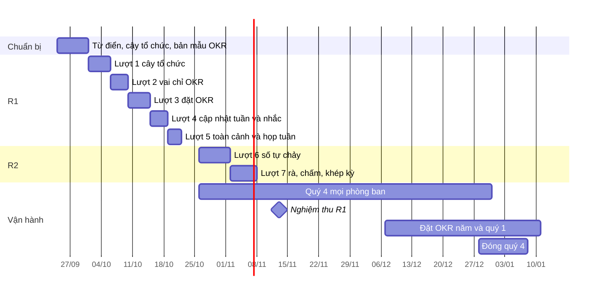

# Lộ trình OKR trên CRM OneHub

Viết 2026-09-24, từ bản phạm vi sản phẩm OKR (78 tính năng, ba đợt phát hành,
chốt vai «chỉ OKR» ngày 2026-09-23). Bản phạm vi và nghiên cứu nền nằm ở hai
trang riêng tư của chủ kho; mã tính năng (`TC-01`, `CI-02` …) ở đây là mã của
bản phạm vi đó, và bảng phủ ở mục 8 chép lại từng mã để không mã nào rơi giữa
hai lượt.

Đây là việc giao một **công cụ quản trị nội bộ**, không phải thử phương pháp
OKR: chủ kho đã chạy OKR nhiều chu kỳ. Cách chạy (chu kỳ, thang chấm, trần, OKR
cá nhân, bước duyệt) là cấu hình của chương trình, không cứng trong mã.

## 1. Đích đến

| Mốc | Ngày | Nghĩa là |
| --- | --- | --- |
| R1 lên production | 2026-10-23 | Cả công ty đặt, cập nhật, xem OKR quý trong CRM; người ngoài khối kinh doanh vào bằng vai «chỉ OKR» |
| Quý 4 trên CRM, mọi phòng ban | 2026-10-26 → 2026-12-31 | Mọi phòng ban đưa OKR quý 4 vào CRM và cập nhật hằng tuần — chốt 2026-09-24 (Manh Phan). Phòng ban chưa có OKR quý 4 đặt trong tuần đầu |
| R2 lên production | 2026-11-20 | Số tự chảy từ CRM; rà giữa kỳ, chấm, nhìn lại, mang sang trong công cụ |
| R3 lên production | 2026-12-18 | Trợ lý OKR góp ý khi bấm và tóm tắt tuần; cập nhật trong Slack hoặc Zalo khi lượt 10 đủ điều kiện — thứ tự và điều kiện chạy ở `docs/plan/lo-trinh-tro-ly-okr.md` |
| Đóng quý 4 trong công cụ | 2026-12-28 → 2027-01-08 | Lần chấm và nhìn lại đầu tiên chạy thật |
| OKR năm 2027 và quý 1 | 2026-12-07 → 2027-01-11 | Toàn công ty đặt và công bố trong CRM |
| Tết Đinh Mùi | 2027-02-06 (mùng 1) | Lịch chu kỳ phải biết khoảng nghỉ trước ngày 2027-01-11 |

Tốc độ dựng không phải điểm nghẽn: các lượt của Điều phối 30 ngày đi từ Cổng
Đáng tới merge trong vài giờ tới một ngày rưỡi. Lịch trên chừa chỗ cho ba thứ
chậm hơn — design-pass, Cổng 1.5 của lượt T3, và phản hồi từ người dùng quý 4 —
và cho việc khác của CRM chạy song song. Mọi lượt đi **tuần tự**: 32 commit ghim
lại từ 15/09 là cái giá của nhiều nhánh song song.

Từ 2026-09-27, lượt 8, 9, 10 và lượt vá lối rò Slack không còn ngày trên Gantt:
lượt nào đủ điều kiện thì chạy, theo thứ tự ở mục 4 của
`docs/plan/lo-trinh-tro-ly-okr.md`. Chỗ khác với bản đầu ở «Chỗ lệch với lộ
trình Trợ lý OKR», cuối mục 5.

## 2. Nguyên tắc chia lượt

- **Mỗi lượt giao một câu người dùng nói được.**
- **Dựng trên dữ liệu mẫu, bật trên dữ liệu thật.** Đổi 2026-09-28 (Manh Phan),
  thay cho luật cũ «lượt sau đứng trên dữ liệu thật của lượt trước»: một lượt
  không còn chờ dữ liệu thật mới được dựng. Mỗi lượt có hai điều kiện: **chạy
  khi** chỉ nói về mã (lượt nào phải gộp trước), **bật khi** nói về dữ liệu thật
  (phép đo nào phải đạt trên OKR thật của công ty). Cổng Bằng chứng ký trên bộ
  OKR mẫu; Cổng Giá trị vẫn đọc số trên dữ liệu thật. Luật cũ vẫn đúng ở chỗ
  người dùng thấy: không nhắc khi chưa cập nhật được, không tóm tắt khi chưa có
  lần cập nhật — nay đó là điều kiện bật, không phải điều kiện dựng. Chi tiết ở
  «Dựng hết bằng dữ liệu mẫu» cuối mục 5.
- **Không chạm hai lớp khó-đảo trong một lượt.** Lượt chạm `packages/db/prisma`
  hoặc quyền là T3, có Cổng 1.5.
- **Một cây tổ chức cho cả CRM.** OKR không có cây riêng, không có vai workspace
  riêng; cây của lượt 1 là cây mà Điều phối 30 ngày cũng dùng.
- **Mọi mã OKR ở chỗ riêng** để kéo bản mới của hãng ít xung đột:
  `apps/api/src/okr`, một khu route riêng trong `apps/app`, chuỗi ở
  `lib/messages/okr.ts`, khuôn dữ liệu ở `packages/validation/src/okr-*.ts`,
  các bảng là một khối liền cuối `schema.prisma` với ít quan hệ ngược nhất có
  thể. Vết OKR là bảng riêng, không đi qua `Activity` của hãng.
- **Mỗi thủ tục ghi có một AC đọc lại từ DB**, và mỗi màn có trạng thái rỗng ·
  đang tải · lỗi. Vòng một của Điều phối lọt lỗ vì chỉ đo tạo và đọc.

## 3. Tổng quan

| # | Slug | Câu giao | Hạng | Đứng trên |
| --- | --- | --- | --- | --- |
| 0 | chuẩn bị | «Từ, cây và màn đã được duyệt trước khi viết mã» | T1 | — |
| 1 | `cay-to-chuc-co-nguoi` | «Tôi biết ai thuộc phòng ban nào, phòng ban nào thuộc bộ phận nào, ai là trưởng» | T3 | ô `cau-truc-to-chuc` |
| 2 | `vai-chi-okr` | «Người ngoài khối kinh doanh vào làm OKR mà không thấy dữ liệu đối tác» | T3 | lượt 1 |
| 3 | `dat-okr-trong-crm` | «Đơn vị tôi đặt được OKR quý, căn chỉnh vào mục tiêu OneHub» | T3 | lượt 1, 2 |
| 4 | `cap-nhat-tuan-okr` | «Sáng thứ Hai tôi được nhắc và cập nhật mọi KR của mình trong một phút» | T3 | lượt 3 |
| 5 | `toan-canh-okr` | «Cả công ty nhìn được toàn cảnh và họp tuần trên cùng một màn» | T2 | lượt 4 |
| 6 | `so-okr-tu-chay` | «Số của KR tự chảy từ CRM, bấm vào là ra bản ghi» | T3 | lượt 3 |
| 7 | `khep-ky-okr` | «Kỳ được rà, chấm, nhìn lại và mang sang trong công cụ» | T2 | lượt 4, 6 |
| 8 | `canh-kr-okr` | «Việc, sáng kiến, ghi nhận và mẫu nằm cạnh KR» | T3 · tách 8a, 8b | lượt 3 và bộ OKR mẫu · từ 2026-09-28 không còn chờ bốn tuần dùng quý 4 | · Cổng Phạm vi chủ kho duyệt 2026-09-28 07:58 (Manh Phan): 15 tiêu chí, 22 phép đo. S2 xong: kế hoạch 13 việc (`docs/superpowers/plans/2026-09-28-canh-kr-okr.md`), chờ Cổng 1.5; viết mã khi M đã gộp và chủ kho cho · Cổng 1.5 chủ kho duyệt 2026-09-28 (Manh Phan): 13 việc, subagent-driven, việc 1 và 2 song song. M (#186) đã gộp; dừng chờ lệnh viết mã
| — | vá lối rò Slack | «Tác nhân chạy nền không đăng được dữ liệu đối tác vào kênh Slack có người mang vai chỉ OKR» | T3 | lượt 6 đã gộp; xong trước ngày mở cho cả công ty |
| 9 | `tro-ly-okr` | «Trợ lý giúp tôi viết cho sắc và tóm tắt tuần cho đơn vị» | 9a T3 · 9b, 9c T2 | 9a sau vá Slack · 9b sau 9a và bộ OKR mẫu · 9c sau 9b; dữ liệu thật là điều kiện bật |
| 10 | `okr-trong-chat` | «Tôi cập nhật ngay trong Slack hoặc Zalo, và biết sớm KR nào đang trượt» | T3 | lượt 4, 9a và bộ OKR mẫu; số đo của lượt 4 là điều kiện bật |
| M | `bo-okr-mau` | «Máy dev và bản xem trước có một công ty giả chạy OKR đủ một quý, để mọi lượt sau dựng và đo trên cùng một bộ» | T2 | lượt 7 |

## 4. Chuẩn bị (2026-09-24 → 2026-09-30)

Không viết mã sản phẩm. Ba việc, mỗi việc một PR T1 hoặc một hồ sơ:

1. **Từ điển.** Thêm vào `CONTEXT.md`: Mục tiêu, Kết quả then chốt (KR), Cập
   nhật tuần, Mức tự tin, Chu kỳ, Căn chỉnh, Người phụ trách (OKR), Điểm cuối
   kỳ («không phải đánh giá nhân sự»), Bộ phận, Phòng ban, Trưởng đơn vị, vai
   «chỉ OKR». Sửa mục **Bộ phận** hiện có: hôm nay nó là bảng phẳng mà màn
   Điều phối gọi là «bộ phận»; sau lượt 1 bảng đó là **Phòng ban** và **Bộ
   phận** là cấp trên. Chốt một chữ cho «check-in» — đề xuất «Cập nhật tuần».
2. **Cây tổ chức.** Đưa `_acceptance/cau-truc-to-chuc/opportunity.md` qua Cổng
   Đáng với câu trả lời mà OKR cần: người thuộc phòng ban; có trưởng phòng ban
   và trưởng bộ phận; báo cáo và lọc theo bộ phận; mọi khu dùng chung. Hai cấp
   cố định dưới gốc OneHub — «nhóm» dưới phòng ban để sau, khi có đơn vị thật
   cần.
3. **Bản mẫu OKR.** Một phiên `/acceptance-gate:design-pass` trên `/proto` cho
   bốn màn: «Của tôi», «Cập nhật tuần của tôi», «Theo đơn vị» có cây căn chỉnh,
   «Toàn cảnh». Cảnh ngữ cảnh bắt buộc: chụp cạnh sheet Thoả thuận và kế hoạch
   30 ngày, cùng khổ 1440 và 390. Duyệt bản mẫu một lần ở đây để lượt 3–5
   không phải dựng lại thẩm mỹ từng màn.

## 5. Từng lượt

### Lượt 1 — `cay-to-chuc-co-nguoi` · R1 · T3

**Ý định (dán vào `/feature-loop:feature-loop`):** CRM có cây tổ chức hai cấp
dưới gốc OneHub — Bộ phận chứa Phòng ban — dùng chung cho cả CRM; mỗi thành
viên thuộc một phòng ban chính; phòng ban và bộ phận có trưởng; quản trị dựng
cây và gán người ở Cài đặt, kể cả nhập hàng loạt từ bảng tính.

**Phủ mã:** TC-01, TC-02, TC-03, TC-04.

**Trong phạm vi**

- Bảng `Division` ở trên `Department` hiện có (bước kế hoạch 30 ngày vẫn giao
  cho `Department`, dữ liệu cũ không phải chuyển). Bảng nối thành viên với phòng
  ban (chính hoặc phụ). Trưởng là trường trên đơn vị, không phải vai workspace
  — vai lạ hôm nay bị hạ im lặng về member.
- Quản lý trực tiếp: suy từ trưởng phòng ban chính; ghi đè được từng người.
- Cài đặt: màn Tổ chức — cây, thêm, đổi tên, sắp, lưu trữ, gán người, gán
  trưởng. Nhập hàng loạt: dán hoặc tải bảng email · phòng ban · bộ phận · trưởng,
  xem trước rồi mới ghi, báo dòng hỏng.
- Màn Điều phối 30 ngày đổi nhãn theo từ điển mới; lọc theo bộ phận hoạt động.
- Sheet kế hoạch 30 ngày đổi nhãn ô «Mục tiêu» (đang hiện số ngày, vd «30
  ngày») sang một chữ không trùng với Mục tiêu của OKR — chốt 2026-09-24
  (Manh Phan).

**Ngoài phạm vi:** quyền theo đơn vị (lượt 2–3), cấp «nhóm», đồng bộ hệ thống
nhân sự (TC-07, Chưa làm).

**Ngưỡng đo gợi ý:** trên production sau một tuần, ≥ 90% thành viên còn hiệu
lực có phòng ban chính; mọi phòng ban có trưởng — đếm từ bảng nối.

### Lượt 2 — `vai-chi-okr` · R1 · T3

**Ý định:** Thêm vai «chỉ OKR»: người mang vai này đăng nhập được, thấy khu OKR
và hồ sơ của chính mình, nhưng không đọc được danh bạ, công ty, thoả thuận,
chiến dịch, kế hoạch 30 ngày — dù qua màn, qua gọi thẳng API, qua khoá API hay
qua trợ lý AI.

**Phủ mã:** TC-05.

**Trong phạm vi**

- Vai mới trong workspace và nơi quản trị gán vai (màn Thành viên, lời mời).
- Chặn ở máy chủ, chặn-mặc-định: lớp kiểm chung mà `go-la-cat-quyen-that` vừa
  dựng mở rộng thành «tư cách **và** phạm vi dữ liệu». Mỗi router khai mình
  thuộc nhóm dữ liệu nào; router không khai thì bị chặn với vai này.
- Điều hướng: vai này chỉ thấy mục OKR và Cài đặt cá nhân; đường dẫn tới màn
  dữ liệu trả trang «không có quyền» đã có.
- Trợ lý: công cụ đọc dữ liệu CRM của tác nhân kiểm cùng phạm vi.

**Ngoài phạm vi:** quyền xem theo đơn vị cho dữ liệu đối tác (chưa ai đòi).

**AC không được thiếu:** một phép đo cho từng đường vào (màn, tRPC, REST, khoá
API, trợ lý) với người mang vai «chỉ OKR» — đỏ được trước khi vá, như bài của
`go-la-cat-quyen-that`.

**Ngưỡng đo gợi ý:** 0 lượt đọc dữ liệu đối tác thành công của vai «chỉ OKR»
trong nhật ký sau hai tuần.

### Lượt 3 — `dat-okr-trong-crm` · R1 · T3

**Ý định:** Khu OKR mới trên thanh điều hướng. Quản trị mở chu kỳ năm và quý;
mỗi cấp — OneHub, bộ phận, phòng ban, và cá nhân nếu chương trình bật — đặt
mục tiêu với KR đủ sáu kiểu, gắn căn chỉnh vào mục tiêu hoặc KR cấp trên,
công bố; mọi sửa đổi để lại vết.

**Phủ mã:** CK-01, CK-02, CK-03, MT-01, MT-02, MT-03, MT-04, MT-05, KR-01,
KR-02, KR-03, KR-05 (nhập tay), QT-01, QT-03, QT-06.

**Trong phạm vi**

- Bảng: chu kỳ (loại, cha, ngày, pha, khoảng nghỉ, ngày cập nhật trong tuần),
  mục tiêu, người tham gia, căn chỉnh nhiều–nhiều, KR, vết OKR, cấu hình
  chương trình có phiên bản. Khuôn dữ liệu ở `packages/validation/src/okr-*.ts`.
- Quyền trong service theo bản ghi, theo khuôn `AgentAccessService`: trưởng
  đơn vị sửa OKR đơn vị mình và đơn vị con; người phụ trách sửa KR của mình;
  quản trị chương trình mở và khoá chu kỳ, không sửa nội dung thay người.
- Màn: danh sách «Theo đơn vị» tối thiểu và màn chi tiết mục tiêu trong khung
  record sheet (`RECORD_KINDS` thêm `objective`), đủ để đặt và công bố. Màn
  toàn cảnh đầy đủ ở lượt 5.
- Cấu hình chương trình: trần mục tiêu và KR (cảnh báo hay chặn), thang chấm,
  trọng số, OKR cá nhân bật/tắt.
- Nhập OKR từ bảng tính có bước xem trước — để quý 4 đang chạy vào được CRM.
- Lịch: mọi ngày theo giờ Việt Nam (`dauNgayVN`); khoảng nghỉ Tết khai được.

**Ngoài phạm vi:** cập nhật tuần (lượt 4), tự đo (lượt 6), mức hiển thị giới
hạn và mẫu (lượt 8).

**Cảnh ngữ cảnh ở design-pass:** màn chi tiết mục tiêu cạnh sheet Thoả thuận.

**Ngưỡng đo gợi ý:** đến 2026-11-02, mọi phòng ban có bộ OKR quý 4 ở pha
«Đang chạy»; không bộ nào phải sửa trong bảng tính rồi nhập lại quá một lần.

### Lượt 4 — `cap-nhat-tuan-okr` · R1 · T3

**Ý định:** Màn «Cập nhật tuần của tôi» gom mọi KR tôi phụ trách, điền sẵn số
tuần trước; mỗi lần cập nhật ghi giá trị, mức tự tin và một dòng ghi chú; tin
nhắc buổi sáng qua Zalo hoặc Slack và thẻ «việc của tôi» dẫn thẳng vào màn đó;
bình luận và nhắc tên trên mục tiêu và KR.

**Phủ mã:** CI-01, CI-02, CI-03, CI-04, NH-01, NH-02, NH-03, NH-04, XEM-01,
XEM-10, QT-05.

**Trong phạm vi**

- Bảng lần cập nhật: chỉ thêm, không sửa; người ghi, ghi hộ, kênh, số giây từ
  mở tới gửi đo ở máy chủ.
- Nhắc: một loại việc mới trong nhắc buổi sáng — cùng một luật với thẻ «việc
  của tôi» như `nhac-ke-hoach.ts` đang làm cho kế hoạch 30 ngày; không thêm tin
  thứ hai. KR im quá N ngày nhắc người phụ trách, rồi trưởng đơn vị.
- Theo dõi mục tiêu; báo khi được giao KR, được nhắc tên.
- Chuyển KR và mục tiêu khi người nghỉ: thêm vào hộp «Chuyển việc 30 ngày» ở
  màn Thành viên.
- Màn chạy tốt ở 390px.

**Ngưỡng đo gợi ý:** trên mọi phòng ban, ≥ 80% KR có lần cập nhật mỗi tuần,
ba tuần liền; trung vị thời gian một lần cập nhật dưới 60 giây — đều từ bảng
lần cập nhật.

### Lượt 5 — `toan-canh-okr` · R1 · T2

**Ý định:** Danh sách theo đơn vị có lọc, cây căn chỉnh toàn công ty, bảng họp
tuần xếp theo thứ đáng bàn, toàn cảnh cho lãnh đạo, khối OKR trên Tổng quan và
trang cá nhân, và màn sức khoẻ chương trình cho quản trị.

**Phủ mã:** XEM-02, XEM-03 (đầy đủ), XEM-04, XEM-05, XEM-06, XEM-07, QT-04.

**Trong phạm vi**

- `packages/ui`: cây nhiều cấp đi bằng bàn phím; thanh tiến độ trung tính có
  vạch kỳ vọng; biểu đồ đường có đích (bọc `LineChart`/`ReferenceLine` sẵn có);
  chọn quý; heatmap. Tình trạng hiện bằng `StatusIndicator` chấm kèm chữ —
  không tô khối.
- Lọc và dựng cây ở máy chủ, không lọc trong bộ nhớ trình duyệt.
- Bảng họp tuần xếp: tự tin tụt, KR im, ghi chú mới — theo KR, không liệt kê
  người chưa cập nhật.

**Ngưỡng đo gợi ý:** ở phiên nghiệm thu R1, một trưởng đơn vị chạy xong họp
tuần chỉ trên màn này — bấm giờ.

### Lượt 6 — `so-okr-tu-chay` · R2 · T3

**Ý định:** KR của khối kinh doanh lấy số tự động từ danh mục chỉ số CRM có
định nghĩa cố định; mỗi ngày chụp giá trị thành lịch sử không đổi; bấm vào con
số ra danh sách bản ghi đằng sau; KR ngoài CRM nhận số qua khoá API và Google
Sheets.

**Phủ mã:** DO-01, DO-02, DO-03, DO-04, DO-05, KR-04, KR-05 (tự đo, API).

**Trong phạm vi**

- Danh mục chỉ số trong mã theo khuôn `CRM_EVENT_CATALOG`: thoả thuận chốt được
  (đếm), thoả thuận mới, cuộc gọi chiến dịch hẹn được, bước kế hoạch 30 ngày
  xong đúng hạn theo phòng ban, cá nhân ghi danh đạt từng bậc, form thành cá
  nhân, email gửi ra theo người. Mỗi chỉ số khai đơn vị, ngày quyết định kỳ,
  cách quy công. Tham số theo người, phòng ban, bộ phận.
- Bảng bản chụp chỉ số; việc chụp đi qua lịch dispatch có sẵn, không thêm cron.
  Đổi tiền tệ báo cáo hay sửa dữ liệu cũ không đổi số của kỳ đã đóng.
- Đổi nguồn của một KR giữa kỳ để lại vết; số máy hiện cạnh số tay cho tới
  ranh giới kỳ.
- Thủ tục ghi giá trị KR qua khoá API; nhập từ Google Sheets theo lịch.

**Ngoài phạm vi:** giá trị tiền của thoả thuận và chỉ số theo giai đoạn — nghĩa
chưa chốt trong từ điển; trình dựng truy vấn tự do (NG-04, Chưa làm).

**AC không được thiếu:** phép thử tin số — năm chỉ số so với số đếm tay trên
production, lệch khai trước.

**Ngưỡng đo gợi ý:** ≥ 50% KR của khối kinh doanh trong quý 4 có nguồn CRM
trước ngày 2026-12-01.

### Lượt 7 — `khep-ky-okr` · R2 · T2

**Ý định:** Quản trị mở cửa sổ rà giữa kỳ; cuối kỳ máy gợi ý điểm từ số chốt,
người chỉnh được kèm lý do; mỗi mục tiêu có ô điều học được; kỳ chỉ đóng khi
mọi KR đã chấm; mục tiêu dở mang sang kỳ sau; số kỳ đã đóng bị khoá và xuất
được.

**Phủ mã:** CK-04, CD-01, CD-02, CD-03, CD-04, CD-05, AI-03 (kiểm bằng luật).

**Trong phạm vi**

- Sửa đích ngoài cửa sổ rà: ghi lý do, mang nhãn tới lúc chấm.
- Chấm đọc theo loại: mục tiêu tham vọng 0,7 là tốt. Màn chấm ghi «không phải
  đánh giá nhân sự».
- Kiểm chất lượng khi đặt bằng luật, không dùng mô hình: động từ chỉ việc làm,
  thiếu khởi điểm, đích bằng khởi điểm, thiếu đối trọng. Hỏi, không chặn lưu.
- Mở lại kỳ đã đóng có lý do và vết.

**Hạn cứng:** lên production trước 2026-12-14 — đóng quý 4 dùng nó.

### Lượt 8 — `canh-kr-okr` · T3 · tách 8a, 8b

**Ý định:** Việc và sáng kiến gắn vào KR, kể cả gắn một chiến dịch hay một kế
hoạch 30 ngày có sẵn; đính bằng chứng cho KR dạng mốc; gửi ghi nhận; mục tiêu
có mức hiển thị giới hạn; mẫu OKR theo loại đơn vị; bước duyệt nhẹ tuỳ chọn;
bản tin tuần vào kênh Slack của đơn vị; lọc lưu được và tìm trong ô tìm chung;
tái cơ cấu giữa kỳ không làm OKR mồ côi.

**Phủ mã:** SK-01, SK-02, CI-05, CI-06, MT-06, MT-07, QT-02, NH-05, XEM-08,
XEM-09, TC-06.

**Điều kiện mở lượt:** lượt nặng nhất về số mã, nhẹ nhất về độ khó. Sau bốn
tuần dùng quý 4, xếp lại theo điều người dùng thật hỏi nhiều nhất và cắt đôi nếu
hợp đồng vượt 15 tiêu chí.

**Tách hai (chỗ lệch 5):** 8a chạy khi đủ bốn tuần dùng quý 4; 8b chạy sau mùa
đặt OKR quý 1. Mã nào vào 8a, mã nào vào 8b chưa chia.

**Từ 2026-09-28 (chỗ lệch 12):** cả 11 mã đều dựng, không chờ bốn tuần dùng.
Chia theo lớp khó-đảo thay cho theo điều người dùng hỏi: 8a gồm mọi mã thêm bảng
hay đổi quyền (T3, có Cổng 1.5), 8b gồm phần chỉ đọc, lọc và gửi tin (T2). Việc
chia mã làm ở S0 của 8a. Bốn tuần dùng quý 4 vẫn được đọc, nhưng để chọn phần
nào cần mài sau khi đã lên, không phải để chọn phần nào được dựng.

### Lượt 9 — `tro-ly-okr` · 9a T3, 9b và 9c T2

**Ý định:** Trợ lý OKR trong `apps/agent` với công cụ chỉ đọc OKR theo quyền
người hỏi: viết lại câu mục tiêu hay KR khi người bấm, kiểm chất lượng bằng mô
hình sau lớp luật, tóm tắt cập nhật tuần của đơn vị với câu nào cũng dẫn về
lần cập nhật gốc, gợi ý căn chỉnh, gợi ý đích so với xu hướng.

**Phủ mã:** AI-01, AI-02, AI-03 (AI), AI-04, AI-05, DO-06.

**Trong phạm vi**

- Trần chi tiêu AI theo tháng cho workspace; thiếu khoá thì nút AI biến mất
  (theo `capabilities.ts`).
- Gợi ý hiện câu cũ cạnh câu mới, người nhận từng dòng; gợi ý bị bác không mời
  lại; đếm tỷ lệ nhận nguyên văn, sửa, bác.
- Tóm tắt: máy kiểm lại mọi con số trong câu so với lần cập nhật, lệch thì bỏ
  câu. Chạy qua hàng `AgentTask`, gom theo đơn vị, không một phiên mỗi KR.

**Ngoài phạm vi:** máy ghi số hay mức tự tin thay người (NG-05), soạn trọn bộ
OKR cho cả đội.

**Điều kiện mở lượt:** trả lời được «nội dung OKR có được gửi tới nhà cung cấp
mô hình đang dùng không» và có con số trần chi tiêu tháng. Đã trả lời
2026-09-26 (chỗ lệch 11).

**Chia ba lượt (chỗ lệch 1–4).** Ý định, bàn giao và điều kiện chạy của từng lượt
ở mục 5 của `docs/plan/lo-trinh-tro-ly-okr.md`; chỗ nào khác phần trên thì theo
tệp đó.

| Lượt | Slug | Hạng | Phủ | Chạy khi | Bật khi |
| --- | --- | --- | --- | --- | --- |
| 9a · nền | `tro-ly-okr-nen` | T3, có Cổng 1.5 | sổ chi phí AI, trần tháng, bật tắt theo đơn vị; người dùng chưa thấy gì | vá Slack đã gộp; ZDR đạt (đạt ở N0, 2026-09-27) | — |
| 9b · góp ý khi bấm | `tro-ly-okr-de-xuat` | T2 | AI-01 · AI-02 · AI-03 (AI) · AI-05 · DO-06 | 9a và bộ OKR mẫu đã gộp (lượt 7 đã lên) | N1 có ít nhất 12 ca từ OKR quý 4 thật và chúng đạt cùng ngưỡng như ca mẫu |
| 9c · tóm tắt tuần | `tro-ly-okr-tom-tat` | T2 | AI-04 | 9b đã gộp | chạy ở chế độ ẩn ít nhất 3 tuần trên Cập nhật tuần thật và đạt ngưỡng ký |

### Lượt 10 — `okr-trong-chat` · T3

**Ý định:** Tin nhắc có nút: chọn mức tự tin và sửa số ngay trong Slack hoặc
Zalo; trưởng đơn vị nhận cảnh báo khi tiến độ và mức tự tin lệch khỏi vạch kỳ
vọng; hỏi đáp trên OKR trong trợ lý chat theo quyền người hỏi.

**Phủ mã:** NH-06, AI-06, AI-07.

**Trong phạm vi:** cửa nhận tin vào cho Slack (URL tương tác, khoá ký, quyền
mới — T3) và cho Zalo nếu nền tảng bot cho phép; cảnh báo rủi ro bằng luật
trên dữ liệu, phần diễn giải qua trợ lý.

**Điều kiện mở lượt:** số đo của lượt 4 cho thấy độ trễ từ nhắc tới cập nhật
quá một ngày làm việc, hoặc một lần cập nhật quá 2 phút. Không có bằng chứng
thì lượt này lùi. Đề nghị tách chat và cảnh báo khỏi điều kiện này, quyết ở Cổng
Đáng của lượt 10 (chỗ lệch 7). Chat đi bằng một eve app riêng; trên Zalo dùng lại
kênh hỏi CRM qua Zalo (chỗ lệch 6).

**Từ 2026-09-28 (chỗ lệch 12):** điều kiện độ trễ ở trên thành điều kiện bật của
nút trong Slack, không còn là điều kiện dựng. Lượt 10 giữ cảnh báo trượt và nút
trong Slack; hỏi đáp OKR tách thành hạng mục C `hoi-dap-okr` và dựng ngay, không
đợi sau mùa.

### Chỗ lệch với lộ trình Trợ lý OKR

Chép 2026-09-27 từ mục 6 của `docs/plan/lo-trinh-tro-ly-okr.md` (#163). Tệp đó
viết lại lượt 9 và 10 theo kiến trúc AI chủ kho chọn ngày 2026-09-26, sau khi đo
trước khi dựng (N0). Mỗi dòng là một chỗ lộ trình này đã đổi theo.

| # | Chỗ | Bản đầu ghi | Nay |
| --- | --- | --- | --- |
| 1 | Hạng lượt 9 | Một lượt T2 | Ba lượt: 9a (T3, thêm bảng), 9b và 9c (T2) |
| 2 | Thứ tự lượt 9 | Sau lượt 8 | 9a ngay sau vá Slack; 9b sau lượt 7 |
| 3 | Chân đứng của 9b | Lượt 4 và 7 | Lượt 3, cùng luật của lượt 7 |
| 4 | AI tới người dùng | Thuộc R3 | Cấp OneHub được bật trước mùa OKR năm, sớm hơn R3 |
| 5 | Lượt 8 | Gantt đặt sớm hơn điều kiện mở của chính nó (sau bốn tuần dùng) | Tách 8a và 8b; 8a chạy khi đủ bốn tuần |
| 6 | Lượt 10 | Chat dựng trong lượt | Chat bằng eve app riêng; trên Zalo dùng lại kênh hỏi CRM qua Zalo |
| 7 | Điều kiện mở lượt 10 | Một điều kiện chung về độ trễ Cập nhật tuần | Tách chat và cảnh báo khỏi điều kiện đó |
| 8 | Nháp «điều học được» | Không có trong 78 mã | Sau mùa, có điều kiện |
| 9 | Vá lối rò Slack | Không có | Lượt T3 riêng, xong trước ngày mở cho cả công ty |
| 10 | Đóng băng | Không có | Quanh ngày mở cho cả công ty, và trong mùa đặt OKR quý 1; chỉ vá lỗi |
| 11 | Điều kiện mở lượt 9 | Dòng 9: gửi tới nhà cung cấp đang dùng, trần workspace $20 | Thêm ZDR bắt buộc (kể cả eval), và trần $9 cho khu OKR |
| 12 | Điều kiện của mọi lượt còn lại | Chờ dữ liệu thật mới dựng (N1, ba tuần Cập nhật tuần, bốn tuần dùng quý 4, số đo lượt 4) | Dựng ngay trên bộ OKR mẫu; dữ liệu thật thành điều kiện bật. Thêm M, S2, 7n, C, L, T. Chủ kho quyết 2026-09-28 |

### Dựng hết bằng dữ liệu mẫu

Chủ kho quyết 2026-09-28 (Manh Phan): dựng mọi hạng mục còn lại bằng dữ liệu mẫu,
kiểm lại bằng dữ liệu thật khi có. Lúc các phòng ban bắt đầu làm OKR thật, tính
năng đã có sẵn; người dùng làm gì là thấy kết quả ngay, không phải đợi thêm một
lượt dựng.

**Ba thứ phải có để quyết định này chạy tốt**

1. **Một bộ OKR mẫu dùng chung — hạng mục M, `bo-okr-mau`, T2.** Nếu mỗi lượt tự
   bịa dữ liệu thử, mười lượt đo trên mười công ty khác nhau và không so được với
   nhau. M dựng một lần, trước mọi lượt khác:
   - một công ty giả khoảng 40 người tên giả, ba bộ phận, mười phòng ban có trưởng,
     ít nhất một người mang vai «chỉ OKR»;
   - OKR năm cấp OneHub và OKR quý 4 cho mọi phòng ban, đủ sáu kiểu KR, vài KR có
     nguồn CRM;
   - sáu tuần Cập nhật tuần, mức tự tin trôi dần, có KR «đáng bàn» và KR bỏ cập
     nhật;
   - một quý 3 đã khép, để thử lượt 7 và nháp «điều học được»;
   - khoảng 30 ca góp ý mẫu, có ca trộn Anh–Việt, cùng khuôn với golden cases của
     N1, để đổi từ ca mẫu sang ca thật chỉ là đổi thư mục.

   Bộ mẫu nằm trong git vì không chứa dữ liệu thật; ca thật của N1 vẫn ngoài git.
   Lệnh nạp từ chối chạy khi trỏ vào cơ sở dữ liệu production, hoặc vào workspace
   đã có OKR thật.
2. **Công tắc ba nấc: tắt · chế độ ẩn · bật.** 9a có công tắc bật tắt theo việc ×
   đơn vị. Thêm nấc giữa: **chế độ ẩn** (tên cũ «chạy bóng», đổi 2026-09-28) — máy chạy trên dữ liệu thật, ghi sổ chi
   phí và số đo, nhưng chỉ quản trị chương trình thấy kết quả. Đó là cách kiểm
   bằng dữ liệu thật mà người dùng chưa phải nhận kết quả sai. Nấc này dựng trong
   9b, lượt đầu tiên dùng công tắc. Chế độ ẩn tốn tiền thật và tính vào trần $9.
3. **Hai làn viết mã, một hàng chấm.** Tối đa hai lượt viết mã cùng lúc, mỗi làn
   một lượt, vì hai lượt cùng làn chạm cùng chỗ (9b và 9c cùng trợ lý; 9c và 10
   cùng nhắc buổi sáng). S4 chấm từng lượt một: bộ test đầy đủ chập chờn khi hai
   bộ chấm chạy song song. Thiết kế (S0 tới hết Cổng 1.5) chạy song song không
   giới hạn; xong Cổng 1.5 mà làn còn bận thì dừng đợi.

**Thứ tự**

Đi trước cả hai làn: gộp 9a (#182); M; và **S2 `slack-thieu-quyen-email`** (T3) —
mục Ngoài-4 của vá lối rò Slack: kết nối Slack thiếu quyền đọc email thì bước kiểm
không nhận ra người mang vai «chỉ OKR». S2 phải lên trước ngày mở cho cả công ty.

| Làn | Thứ tự | Vì sao |
| --- | --- | --- |
| A · Trợ lý OKR | 9b → 9c → C → L → T | 9b dựng công tắc ba nấc và sổ đề xuất cả làn dùng lại; 9c cần 9b; C dùng công cụ đọc OKR theo quyền của 9b; L dùng sổ đề xuất; T gộp từ tóm tắt của 9c |
| B · OKR không AI và kênh | 8a → 7n → 10 → 8b | 8a thêm bảng nên đi sớm, xa mùa quý 1; 7n (nợ sau lượt 7) phải lên trước 14/12; 10 đợi 9c gộp vì cùng chạm nhắc buổi sáng — 9c chậm thì 8b đi trước 10; 8b nhẹ nhất |

Hạng mục mới:

| # | Slug | Hạng | Câu giao |
| --- | --- | --- | --- |
| M | `bo-okr-mau` | T2 | «Máy dev và bản xem trước có một công ty giả chạy OKR đủ một quý» |
| S2 | `slack-thieu-quyen-email` | T3 | «Kết nối Slack thiếu quyền đọc email vẫn không để lọt dữ liệu đối tác tới người mang vai «chỉ OKR»» |
| 7n | `no-sau-luot-7-okr` | T2 | «Mang sang đúng khi kỳ đích đổi pha, và đợt rà đặt lịch tương lai đóng được» — hai mục Cổng Bằng chứng lượt 7 mở hợp đồng mới |
| C | `hoi-dap-okr` | T3 | «Tôi hỏi về OKR trên web hoặc Zalo và nhận câu trả lời theo quyền của tôi» — phần chat của lượt 10, eve app riêng |
| L | `nhap-dieu-hoc-duoc` | T2 | «Lúc đóng kỳ, Trợ lý soạn nháp điều học được; tôi nhận hay sửa» — Cổng Đáng phải gắn một mã mới trong bản phạm vi |
| T | `tom-tat-cap-bo-phan` | T2 | «Trưởng bộ phận đọc một bản tóm tắt gộp từ các phòng ban» |

**Đóng băng giữ nguyên, nhưng cho việc gộp chứ không cho việc dựng.** Từ tuần dựng
cây tổ chức (19/10) tới khi các phòng ban công bố OKR quý 4, và trong mùa đặt OKR
quý 1, chỉ gộp bản vá lỗi và S2. Lượt nào chấm xong trong đóng băng thì chờ; hết
đóng băng thì kéo `onehub` về, ghim lại rồi mới gộp.

**Bật khi nào, ai bật**

| Hạng mục | Khi gộp, người dùng thấy | Bật khi |
| --- | --- | --- |
| M | không — chỉ máy dev và bản xem trước | không bao giờ trên production |
| 8a, 8b | có, ngay khi gộp (không có AI) | — ; bốn tuần dùng quý 4 chọn phần cần mài |
| 9b | không — công tắc tắt | N1 có ít nhất 12 ca thật, đạt cùng ngưỡng như ca mẫu; cấp OneHub trước mùa OKR năm, mọi phòng ban trước mùa quý 1 |
| 9c | không — chạy ở chế độ ẩn từ tuần có Cập nhật tuần thật | ba tuần ở chế độ ẩn đạt ngưỡng ký: câu bị bỏ ≤ 10%, không số lệch lọt qua |
| 10 · cảnh báo trượt | không — chạy ở chế độ ẩn hai tuần, đếm cảnh báo lẽ ra đã gửi | số cảnh báo mỗi trưởng đơn vị mỗi tuần nằm trong ngưỡng Cổng Phạm vi đặt |
| 10 · nút trong Slack | không | quản trị Slack đồng ý quyền mới, và số đo lượt 4 cho thấy cập nhật trễ quá một ngày làm việc hoặc quá 2 phút |
| C | không — công tắc tắt | eval hỏi đáp trên OKR thật đạt; phép đo «người vai chỉ OKR chỉ hỏi được OKR» xanh trên production |
| L | không | kỳ chấm và nhìn lại quý 4 |
| T | không | tóm tắt phòng ban đã bật và đạt ngưỡng |

Mỗi lần bật là một việc của chủ kho trên trang theo dõi, và là một dòng Ghi chú ở
mục 10. N1 không còn chặn việc dựng 9b; nó là bộ kiểm để bật 9b và C.

**Cái giá, nói trước**

- Ca mẫu do người viết thì sạch hơn OKR thật, nên lời nhắc và ngưỡng chỉnh trên ca
  mẫu có thể trượt trên ca thật. Chặn bằng công tắc tắt khi gộp, và chỉ bật khi ca
  thật đạt cùng ngưỡng; ca thật hỏng thì sửa trong một vòng nợ, không bật tạm.
- Lượt 8 mất bước xếp lại theo điều người dùng hỏi, nên có thể dựng phần ít ai
  dùng. Cổng Giá trị của 8a, 8b đọc tỷ lệ dùng từng phần.
- Eval lúc dựng gọi mô hình trên ca mẫu ở năm lượt AI (9b, 9c, C, L, T). Trước S4
  của 9b, chủ kho xác nhận khoá nào trả tiền cho eval và trần bao nhiêu.
- Sổ theo dõi thêm sáu hạng mục, và sáu hạng mục có thêm bước bật.

Còn lại sau quyết định này: **11 lượt viết mã** (M, S2, 7n, 8a, 8b, 9b, 9c, 10, C,
L, T), **1 việc không viết mã** (N1), **7 bước bật** (9b, 9c, cảnh báo và nút của
lượt 10, C, L, T). Ba bước mở rộng sau Cổng Giá trị (miền thứ hai, tài liệu, MCP)
không thuộc 78 mã OKR, vẫn chờ Cổng Giá trị; mục 9 «Chưa làm» giữ nguyên.

## 6. Triển khai cho người dùng

Chốt 2026-09-24 (Manh Phan): **mọi phòng ban áp dụng**, bắt đầu từ OKR quý 4.
Không có nhóm thí điểm, nên ngày 2026-10-26 là ngày cả công ty vào CRM lần đầu —
kể cả những người chưa từng dùng nó. Bốn điều kiện phải xong trước ngày đó:

- **Danh sách nhân sự** (email · phòng ban · bộ phận · trưởng) từ nhân sự trước
  2026-10-16, để quản trị nhập hàng loạt ở lượt 1.
- **Lượt 2 trên production.** Không mở CRM cho người ngoài khối kinh doanh khi
  vai «chỉ OKR» chưa lên: nếu lượt 2 trễ, ngày bắt đầu lùi theo tuần, không bỏ
  lượt 2.
- **Hướng dẫn và đào tạo.** Một trang ngắn cho mỗi vai (người phụ trách KR,
  trưởng đơn vị, quản trị) viết trong lượt 5, không đợi sau nó; một buổi 30 phút
  cho mỗi bộ phận trong tuần 2026-10-19.
- **Kênh nhắc.** Mỗi người nối Zalo hoặc Slack; màn sức khoẻ chương trình đếm
  người chưa có kênh nhắc.

| Tuần | Việc | Ai |
| --- | --- | --- |
| 2026-10-12 → 10-16 | Nhân sự gửi danh sách; ban lãnh đạo gửi OKR quý 4 cấp OneHub nếu đã có | Nhân sự, ban lãnh đạo |
| 2026-10-19 → 10-23 | Quản trị dựng cây tổ chức, nhập người, gán trưởng, gán vai «chỉ OKR»; đào tạo theo bộ phận; mỗi người nối kênh nhắc | Quản trị chương trình, trưởng bộ phận |
| 2026-10-26 → 11-02 | Phòng ban đã có OKR quý 4 nhập từ bảng tính; phòng ban chưa có đặt ngay trong CRM, căn chỉnh vào OKR cấp OneHub; công bố trước 2026-11-02; bật nhắc buổi sáng | Trưởng phòng ban |
| 2026-11-02 → 12-31 | Cập nhật tuần, họp tuần trên màn, phản hồi vào hàng việc | Mọi phòng ban |
| 2026-11-13 | Phiên nghiệm thu R1 (`/acceptance-gate:uat-session`) với ngưỡng của lượt 1–5; người dùng đại diện lấy từ ít nhất ba bộ phận, có cả người mang vai «chỉ OKR» | Chủ sản phẩm, người dùng đại diện |
| 2026-12-07 → 12-18 | Ban lãnh đạo đặt OKR năm 2027 cấp OneHub | Ban lãnh đạo |
| 2026-12-21 → 2027-01-11 | Các phòng ban đặt và công bố OKR quý 1 | Trưởng phòng ban |
| 2026-12-28 → 2027-01-08 | Chấm và nhìn lại quý 4 trong công cụ | Mọi phòng ban |
| 2027-02-09 | Đo bốn tuần đầu quý 1 — Cổng Giá trị của R1–R3 | Chủ sản phẩm |

Quý 4 chỉ còn chín tuần khi bắt đầu, nên cách đọc tiến độ phải tính từ ngày
công bố, không từ 2026-10-01: khởi điểm của KR là số tại ngày công bố, vạch kỳ
vọng đi từ ngày đó tới 2026-12-31.

## 7. Rủi ro và cách giảm

| Rủi ro | Cách giảm |
| --- | --- |
| Cây tổ chức đổi nghĩa chữ «bộ phận» trên màn Điều phối 30 ngày | Từ điển chốt ở bước chuẩn bị; lượt 1 đổi nhãn Điều phối trong cùng hợp đồng |
| Vai «chỉ OKR» sót một đường vào dữ liệu | Chặn-mặc-định ở lớp chung; router không khai nhóm dữ liệu thì bị chặn; phép đo cho từng đường |
| Một người ký mọi cổng, lịch dồn | Lượt T2 đi tiếp với cửa veto mở; gộp design-pass vào bước chuẩn bị |
| Bảy việc đang chờ Cổng Giá trị | Phiên nghiệm thu R1 gộp với phiên của Điều phối nếu cùng người dùng đại diện |
| Nhắc OKR làm tin buổi sáng quá dài | Trần số việc mỗi tin và 2.000 ký tự mỗi tin Zalo, như nhắc kế hoạch đang làm |
| Số tự đo sai nghĩa làm mất tin | Danh mục cố định trong mã; phép thử tin số là AC của lượt 6; nhãn nguồn trên mọi số |
| Bản rẽ khỏi hãng phình | Mã ở chỗ riêng theo mục 2; kiểm xung đột với `release` mỗi tuần |
| Test chập chờn làm đỏ CI (vd `claimDue`) | Đã sửa (PR #108); không `--no-verify` |
| GitHub Actions không chạy job vì lỗi thanh toán tài khoản (từ 2026-09-24) | Bằng chứng tạm là năm lệnh kiểm ở máy, ghi rõ trong hồ sơ; chủ kho sửa ở Billing & plans; không PR nào của lộ trình được coi là xanh CI cho tới khi job chạy thật |
| Chi phí AI khi cả công ty dùng | Lượt 9 chỉ mở khi có trần; tóm tắt gom theo đơn vị |
| Tính năng dựng trên ca mẫu trượt khi gặp OKR thật | Công tắc tắt khi gộp; chạy ở chế độ ẩn trên dữ liệu thật rồi mới bật; bật chỉ khi ca thật đạt cùng ngưỡng với ca mẫu («Dựng hết bằng dữ liệu mẫu», mục 5) |
| R1 trễ làm lỡ ngày mở cho cả công ty | Lùi theo tuần, không cắt lượt 2 hay lượt 4; lượt 5 có thể lên sau ngày mở vài ngày vì cập nhật tuần không cần nó |
| Gộp `onehub` giữa chừng làm hồ sơ đã ký khác hoá cũ, Pre-merge check đỏ (gặp ở #120) | Trước khi mở PR: chạy pre-merge check ở máy, ghim lại hồ sơ bị nêu tên; ghi vào gói việc mọi lượt |
| Cả công ty vào cùng lúc, câu hỏi dồn về một người | Hướng dẫn theo vai và đào tạo theo bộ phận trước ngày mở; một kênh hỏi đáp chung; trưởng bộ phận là tuyến hỏi đầu |
| Phòng ban đặt OKR vội trong một tuần | Kiểm chất lượng bằng luật (lượt 7) đưa lên sớm nếu lượt 3 còn chỗ; quý 1 có đủ ba tuần đặt |
| Người mới vào CRM lần đầu thấy màn dữ liệu đối tác | Vai «chỉ OKR» là điều kiện mở; phép đo cho từng đường vào ở lượt 2 |

## 8. Bảng phủ — mọi mã về đúng một chỗ

| Mã | Lượt |
| --- | --- |
| TC-01 · TC-02 · TC-03 · TC-04 | 1 |
| TC-05 | 2 |
| CK-01 · CK-02 · CK-03 · MT-01 · MT-02 · MT-03 · MT-04 · MT-05 · KR-01 · KR-02 · KR-03 · KR-05 (tay) · QT-01 · QT-03 · QT-06 | 3 |
| CI-01 · CI-02 · CI-03 · CI-04 · NH-01 · NH-02 · NH-03 · NH-04 · XEM-01 · XEM-10 · QT-05 | 4 |
| XEM-02 · XEM-03 · XEM-04 · XEM-05 · XEM-06 · XEM-07 · QT-04 | 5 |
| DO-01 · DO-02 · DO-03 · DO-04 · DO-05 · KR-04 · KR-05 (tự đo, API) | 6 |
| CK-04 · CD-01 · CD-02 · CD-03 · CD-04 · CD-05 · AI-03 (luật) | 7 |
| SK-01 · SK-02 · CI-05 · CI-06 · MT-06 · MT-07 · QT-02 · NH-05 · XEM-08 · XEM-09 · TC-06 | 8 |
| AI-01 · AI-02 · AI-03 (AI) · AI-04 · AI-05 · DO-06 | 9 |
| NH-06 · AI-06 | 10 |
| AI-07 | C `hoi-dap-okr` (tách khỏi lượt 10 ngày 2026-09-28) |
| TC-07 · NG-01 · NG-02 · NG-03 · NG-04 · NG-05 · NG-06 · NG-07 | Chưa làm |

Đủ 78 mã: 70 mã vào mười lượt và hạng mục C, 8 mã ở «Chưa làm». AI-03 và KR-05 tách hai
nửa ở hai lượt, ghi rõ nửa nào.

## 9. Chưa làm — kèm lý do, để khỏi bàn lại

- Nối điểm OKR vào lương, thưởng, xếp hạng (NG-01) — hoa hồng đã gắn doanh số;
  trộn hai thứ làm người ta đặt đích thấp và làm đẹp số.
- Liên kết với đánh giá hiệu suất hay KPI (NG-02) — module lớn kèm chính sách
  nhân sự; chờ có người quyết chính sách.
- OKR cho cá nhân trong mạng lưới môi giới (NG-03) — họ là đối tác, không phải
  nhân viên.
- Trình dựng truy vấn tự do (NG-04) — con số đổi nghĩa mà không ai hay.
- Máy ghi số hay mức tự tin thay người (NG-05).
- Nút phân rã chép KR cấp trên thành mục tiêu cấp dưới (NG-06).
- Bảng xếp hạng người, huy hiệu, điểm đổi quà (NG-07).
- Đồng bộ cây tổ chức từ hệ thống nhân sự (TC-07) — chưa có hệ thống nguồn.

## 10. Theo dõi — cập nhật sau mỗi hạng mục

Sổ theo dõi duy nhất của khu OKR, kể cả các lượt của Trợ lý OKR
(`docs/plan/lo-trinh-tro-ly-okr.md`). Một dòng một hạng mục; số dòng không dùng
lại, việc mới lấy số mới. Cột Trạng thái chỉ nhận: chưa mở · Cổng Đáng · Cổng
Phạm vi · đang dựng · Cổng Bằng chứng · đã lên `onehub` · Cổng Giá trị · xong.
Ngày là ngày đổi trạng thái gần nhất. Cột Trạng thái, Ngày và PR ghi lần đổi mới
nhất; cột Ghi chú chỉ nối thêm, không sửa chữ cũ.

PR của hạng mục nào tự sửa dòng của hạng mục đó, kể cả sang «đã lên `onehub`» ở
commit cuối trước khi gộp: chữ chỉ lên `onehub` khi PR gộp, nên dòng đúng ngay
lúc gộp. Tệp dưới `docs/` được miễn luật bằng chứng cũ của kiểm tra trước gộp,
nên sửa dòng sau khi ký Cổng Bằng chứng không phải ký lại. Khi dòng ở đây và
`PRODUCT-MAP.md` lệch nhau về cổng của một hồ sơ, theo `PRODUCT-MAP.md` — máy vẽ
nó từ hồ sơ — rồi sửa dòng.

**Từ 03/10 (kit 2.21.0) trạng thái sống của từng hàng nằm ở `LO-TRINH.html` ở gốc kho**: kit đọc tệp
ý định `docs/plan/lo-trinh-okr.json` và suy trạng thái từ hồ sơ `_acceptance/` mỗi lần vẽ lại bản đồ,
thẻ `/acceptance-gate:start` in hàng kế. Cột Trạng thái của bảng dưới THÔI cập nhật — bảng giữ làm sử
liệu và ghi chú. Đổi kế hoạch (thêm hàng, đổi thứ tự, gắn mốc) thì sửa tệp JSON bằng PR. Trang dựng tay
`lo-trinh-okr.html` và bản chụp `lo-trinh-okr.data.js` đã gỡ. Bản sống, nơi chủ kho đánh dấu việc và ghi chú, ở
https://claude.ai/artifact/X2YjeuJfqBESPHQPQP7y2b — riêng tư, chủ kho mở được trên
mọi máy đã đăng nhập. Bản chụp do máy sinh, không sửa tay, và không chép ghi chú
riêng của chủ kho.

Làm mới trang khi chủ kho nhắn «cập nhật lộ trình OKR»:

1. Đọc lại mục này, mục 7 của `lo-trinh-zalo.md`, `PRODUCT-MAP.md`, các PR đang mở
   và hồ sơ của các phiên đang chạy.
2. Ghi kho dữ liệu của trang trong một lượt, mỗi bản ghi ghim phiên bản đã đọc:
   `hang_muc`, `moc`, `meta` theo sổ; với `viec_chu_kho` chỉ thêm việc mới hoặc sửa
   việc máy tạo (`nguon: "máy"`) chưa xong; không đụng `ghi_chu`.
3. Sinh lại bản chụp từ kho dữ liệu, bỏ `ghi_chu`, chuỗi viết bằng ký tự ASCII để
   trình duyệt nào cũng đọc đúng; định dạng bằng `biome`; đưa vào một PR tài liệu.
4. Trang đổi thì đăng lại từ tệp này lên đúng link trên, truyền link đó làm `url`.

| # | Slug | Trạng thái | Ngày | PR | Ghi chú |
| --- | --- | --- | --- | --- | --- |
| 0 | chuẩn bị | xong | 2026-09-24 | #110 | từ điển · Cổng Đáng của `cau-truc-to-chuc` · design-pass `/proto` OKR. Chốt 2026-09-24 (Manh Phan): mọi phòng ban áp dụng từ quý 4. Từ điển xong: PR #110 gộp 2026-09-24 (`ea4fff80`), thêm mục Bộ phận · Phòng ban · Trưởng đơn vị · vai «chỉ OKR» và các mục OKR. Cổng Đáng `cau-truc-to-chuc` ký 2026-09-24 (Manh Phan) — xem dòng 1. Design-pass bốn màn OKR xong: chủ kho duyệt gói 2026-09-24, PR #113 gộp (`03efe44c`), hồ sơ `_acceptance/ban-mau-okr` với 23 trạng thái, 58 ảnh. Bốn chỗ mở đã chốt: heatmap toàn cảnh theo đơn vị × tuần; mức tự tin ba bậc Cao · Vừa · Thấp (lượt 4 dựng theo); cây căn chỉnh nằm trong «Theo đơn vị»; mọi vai kể cả «chỉ OKR» thấy «Toàn cảnh». 11 biến thể `packages/ui` cho lượt 5 ở mục Nhóm 2 của `design-pass.md`. Việc cho lượt 3: màn «Theo đơn vị» nhập thẳng cây từ module `cau-truc-to-chuc`, bỏ bản chép trong `ban-mau-okr`. Bước chuẩn bị xong |
| 1 | `cay-to-chuc-co-nguoi` | đã lên `onehub` | 2026-09-25 | #120 · #128 · #136 | Cổng Đáng ký 2026-09-24 (Manh Phan): build, ngưỡng SỐNG ≥ 90% thành viên có phòng ban chính và mọi phòng ban có trưởng, CHẾT < 70% hoặc phải sửa DB, đo lần đầu 2026-10-26; hồ sơ ở `_acceptance/cau-truc-to-chuc` (`c5d3daf3`, nhánh `proto/cau-truc-to-chuc`). Thêm việc: đổi nhãn ô «Mục tiêu» của sheet kế hoạch 30 ngày. Sơ đồ kéo/phóng to để sau lượt 1. Vòng làm mở ngay 2026-09-24 theo điều phối, không đợi 01/10. Hồ sơ nghiệm thu dùng chung `_acceptance/cau-truc-to-chuc/` (slug bản mẫu phải bằng slug hồ sơ); nhánh `feat/cay-to-chuc-co-nguoi`. Cổng Phạm vi duyệt 2026-09-24 (Manh Phan): 15 tiêu chí, 25 phép đo; ô «Mục tiêu» của sheet kế hoạch thành «Thời lượng». Cổng 1.5 duyệt 2026-09-24: kế hoạch 11 việc (`docs/superpowers/plans/2026-09-24-cau-truc-to-chuc.md`); `org.tree` trả bộ phận · chưa xếp · phòng ban chưa có trưởng · người kèm quản lý · độ phủ, là thứ lượt 3 đọc; hai hồ sơ Điều phối sẽ ghim lại vì danh sách phòng ban dời sang Cài đặt › Tổ chức. S3 xong 14:33; S4 ba vòng — vòng 1 và 2 bác vì lỗi nhập hàng loạt (thứ tự dòng, bộ phận đã lưu trữ, dòng đầu thiếu email, suy bộ phận từ dòng hỏng), vòng 3 PASS 29/29; Cổng Bằng chứng ký 2026-09-24 16:14 (Manh Phan) với hai giới hạn đã biết: ghi lô 1.000 dòng một giao dịch (1,2 s ở máy, trần 5 s) và đường `onboarding.*` cũ còn tạo/sửa phòng ban không chặn trùng tên → hợp đồng riêng. PR #120 gộp 2026-09-24 (`5901caa2`), CI xanh thật; migration `20260925010000_cay_to_chuc` chỉ thêm. Hai hồ sơ Điều phối (`noi-bon-nut-dieu-phoi`, `sua-luu-tru-dieu-phoi`) ghim lại hai lần vì gộp `onehub` giữa chừng. Cổng Giá trị đo 2026-10-26. Sau lái thử người lạ (24/09 16:56, 32 ảnh), chủ kho mở vòng nối tiếp `to-chuc-danh-sach-chi-tiet`: màn Tổ chức thành cây điều hướng trái + khung chi tiết phải, nhập và gắn người theo lô; S4 ba vòng (vòng 1 bác hai lỗi màn, vòng 2 kẹt làn máy), chủ kho ký Cổng Bằng chứng 25/09, PR #128 gộp (`472e8880`), production xanh. Vòng `mot-duong-ghi-phong-ban` (gỡ đường ghi phòng ban cũ, Ngoài-1 của lượt 1) Cổng Phạm vi (lại), 1.5 và Bằng chứng ký theo uỷ quyền ghi sổ trong phiên đó; S4 11/11 + 4/4, E9 chấm Đạt; chín hồ sơ ghim lại (hai hồ sơ đã chấm bởi thực tế miễn ghim); ba lần kéo onehub vì #129/#135; PR #136 gộp 25/09 11:2x (`134352be`). Hai việc tách: khôi phục phòng ban về bộ phận đã lưu trữ/trùng tên (gói việc), thước E10 dieu-phoi đỏ sẵn từ 22/09 (gói việc) |
| 2 | `vai-chi-okr` | đã lên `onehub` | 2026-09-25 | #129 | chốt 2026-09-23 (Manh Phan). Gói việc mở 15:30, chủ kho bấm chạy; điều phối cho làm S0–S1 song song lúc lượt 1 còn nghiệm thu, viết mã sau khi #120 gộp. Chạy trong phiên điều phối bằng tác nhân con (phiên chip cũ kẹt chờ duyệt). Cổng Phạm vi và 1.5 ký theo uỷ quyền 24/09: 13 tiêu chí, 17 phép đo, kế hoạch bảy việc; thay đổi đi kèm: ba ô ghi Cài đặt chung chỉ quản trị. S4 vòng 1 xanh nhưng soát đối kháng bắt nhật ký nhiễm chéo → vá, vòng 2 PASS 17/17; Cổng Bằng chứng chủ kho ký 25/09 (Ngoài-1 mở hợp đồng mới — nay #133 «chỉ quản trị đổi Cài đặt chung» đã đóng luôn cổng research; Ngoài-2 Known limits). Gộp onehub 50 commit → S4 delta vòng 3 xanh; gộp #130 → ghim lại. PR #129 gộp 25/09 09:53 (`a8572437`); cổng nghiệm thu và lệnh dựng trên onehub xanh, CI của đầu nhánh xanh sau gộp — bộ chờ gộp sớm vài giây trước khi CI đăng ký, đã sửa luật chờ |
| 3 | `dat-okr-trong-crm` | đã lên `onehub` | 2026-09-25 | #140 | tự khởi động trong phiên điều phối 25/09 ~10:00 trên worktree riêng từ onehub 9a7f024c; Cổng Đáng ký theo uỷ quyền; đang S1. Cổng Phạm vi ký theo uỷ quyền 25/09 ~11:00: 15 tiêu chí, 22 phép đo, sáu giả định chốt (sáu kiểu KR tăng tới·giảm xuống·giữ trên·giữ dưới·mốc·phần trăm; cấp OneHub do quản trị sửa; chỉ căn chỉnh vào đích đã công bố; nhập bảng tính bảy cột; nhãn rail «Mục tiêu»; sau «30 ngày đầu»); bỏ design-pass có tên với điều kiện S4 chụp ba bề mặt mới ở 1440/390 cạnh sheet Thoả thuận; `Progress` màu thương hiệu tạm, lượt 5 thay. Cổng 1.5 ký: kế hoạch 12 việc, subagent-driven. Đang S3. S4 vòng 1 thủ công 21/22 xanh, E18 chờ người; chủ kho chấm E18 Đạt, đồng ý cắt, phê hết Treo. Lưới ghi chặn nâng PASS vì hồ sơ trượt khuôn (hai run_id một dòng, verifier kèm ngoặc, suite không có trong run-log) → chấm lại vòng 2 đúng khuôn, 21 phép đo + 4 lệnh suite xanh, không lượt mốc, không soát đối kháng S4 (Known limits). Cổng Bằng chứng chủ kho ký 25/09 16:46. Gộp onehub #138 (khung Cài đặt: Chương trình OKR vào nhóm Con người) và #139; ghim lại `dat-okr-trong-crm` · `vai-chi-okr` · `khung-trang-cai-dat`. PR #140 gộp 25/09 18:4x (`739c8701`), ba kiểm tra xanh trên đầu nhánh, onehub xanh. Soát ảnh sau gộp: bốn điểm giao diện (bảng xem trước khi nhập cắt cột, thẻ Cài đặt trên điện thoại, «Quý» lặp, gợi ý «Năm 2027») → gói việc riêng. Cổng Giá trị: chủ kho |
| 4 | `cap-nhat-tuan-okr` | đã lên `onehub` | 2026-09-26 | #153 | nhắc qua Zalo cần vòng 1–2 và triển khai của `lo-trinh-zalo.md`, xong trước 26/10 · Zalo vòng 1 đã lên onehub 24/09 (#105) · vòng 2 chủ kho ký Cổng Bằng chứng 24/09, PR mở · gói việc đã mở, tự kiểm điều kiện (bảng OKR của lượt 3) · điều kiện đủ: bảng OKR lên onehub (#140), Zalo vòng 1–2 đã lên (#105, #118, #122, #125, #130); mở 25/09 tối trong phiên điều phối. Cổng Phạm vi ký 25/09 theo uỷ quyền: 15 tiêu chí (+AC-16 khoá ô «Hiện tại» với KR đang chạy) và 29 phép đo, hai sửa tại cổng (AC-16, thẻ OKR chỉ hiện cho người dính OKR); Cổng 1.5 duyệt kế hoạch mười việc, mỗi việc một tác nhân con kèm người soát. S3 xong 26/09 07:42. S4 chạy ở phiên riêng có Workflow: vòng 1 REJECT (4 eval — 3 là lỗi chụp ảnh sau #147, 1 danh sách hồ sơ bị chạm thiếu #144), vòng 2 và 3 BLOCKED vì bộ chấm bị nhiễm câu người gõ vào phiên chấm và cây đổi giữa lượt (không phải lỗi mã), vòng 4 PASS 29/29 + 4/4 suite; AC-11 vế hai thu hẹp (Known limits 394 eval của 56 hồ sơ bị chạm không chạy lại). Cổng Bằng chứng chủ kho ký 26/09 13:25 (E26 Đạt; 13 mục ngoài hợp đồng: 7 Known limits, 1 chấp nhận, 5 mở hợp đồng mới → gói việc «Nợ sau lượt 4 OKR»). Gộp onehub tới #152, ghim lại dat-okr-trong-crm ba lần. PR #153 gộp 26/09 13:44 (`b8ccf7f3`), ba kiểm tra xanh. Bài học: phép đo màn chạy trên kho riêng (#150), tin liên phiên bị giữ nên đọc transcript thay vì chờ, câu gõ vào phiên chấm lọt vào đề bài tác nhân. Cổng Giá trị: chủ kho, đo 02/11 → 22/11 |
| 4n | `no-sau-luot-4-okr` | đã lên `onehub` | 2026-09-27 | #176 | 5 mục ngoài hợp đồng mà Cổng Bằng chứng lượt 4 (26/09) định «mở hợp đồng mới»; gói việc «Nợ sau lượt 4 OKR» mở 26/09, chưa có hồ sơ hay nhánh. Một lỗi người dùng gặp: nhắc OKR theo sự kiện gửi giữa ngày rồi gửi lại sáng hôm sau. Bốn mục còn lại: màn tự tính ai được gửi cập nhật thay vì dùng quyền máy chủ trả về; một lần gửi nhận cùng KR hai lần; nhắc OKR đọc vết bằng JSON thô thay vì khuôn; khuôn mục nhắc OKR viết tay ở bốn, năm chỗ · 2026-09-27: hồ sơ `no-sau-luot-4-okr` qua Cổng Phạm vi và Cổng 1.5 (Manh Phan), đang dựng; chạm vùng nhắc buổi sáng của 9a — ai lên `onehub` sau gộp và soát lại · 2026-09-27: S4 round 1 PASS 16/16, Cổng Bằng chứng ký (Manh Phan), bảy mục ngoài hợp đồng ghi Known limits |
| 5 | `toan-canh-okr` | đã lên `onehub` | 2026-09-26 | #157 | gói việc đã mở, gồm 11 biến thể `packages/ui` từ bản mẫu và ba trang hướng dẫn theo vai · mở 26/09 sáng chạy song song lượt 4 (phần không cần bảng cập nhật làm trước). Cổng Đáng ký 26/09 theo uỷ quyền: build, keep, ngưỡng SỐNG ≥ 2/3 trưởng đơn vị chạy xong họp tuần chỉ trên bảng tại phiên nghiệm thu 13/11 (trung vị ≤ 15 phút cho đơn vị ≤ 12 KR) và từ tuần thứ ba (16/11) ≥ 60% đơn vị có trưởng mở bảng mỗi tuần, đếm bằng vết `mo-hop-tuan` bền; CHẾT < 30%. Cổng Phạm vi ký 26/09: 15 tiêu chí, 29 phép đo, design-pass không đồng bộ cho bốn bề mặt chưa có bản mẫu; bốn giả định chốt hướng A (trang cá nhân = trang OKR một người; «KR thiếu khởi điểm» = KR của mục tiêu chưa công bố; họp tuần là cách xem thứ ba của «Theo đơn vị», sức khoẻ là trang riêng chỉ quản trị thấy; đếm mở bảng qua bảng vết, dòng không mang mục tiêu/KR, không hiện ở tab Vết). S3 xong cả hai nhịp 26/09 12:04, hợp đồng implemented; chờ lượt 4 lên onehub để chấm S4 trên dải so sạch. S4 chạy bằng Workflow trong chính phiên lượt: vòng 1 BLOCKED (6 kiểm tra màn đỏ vì thước chưa theo bước đã duyệt, ba lệch sản phẩm — AC-5 quay mãi, Sức khoẻ năm thẻ, câu hẹn ngày), vòng 2 BLOCKED chỉ vì tác tử chấm E30 chết, 0 phép đo đỏ, kèm hai lỗi trong hợp đồng vá có chiều đỏ (AC-7 họp tuần mất «tụt tự tin» khi cập nhật hai lần một tuần; AC-3 cây đơn vị không Tab tới ở trang một người), vòng 3 PASS — 0 đỏ, 8/8 kiểm tra màn, hội đồng E27 PASS. Cổng Bằng chứng ký 26/09 18:0x theo uỷ quyền: 12 mục ngoài hợp đồng ghi Known limits (bài kiểm chưa chặt, mã chưa gọn), 4 mục mở hợp đồng mới gom thành một vòng «Nợ sau lượt 5 OKR» (tải trước Theo đơn vị kèm bộ lọc mức tự tin; bộ lọc phụ trách hiện tên thay cho mã; khối «OKR của bạn» báo lỗi khi không tải được chu kỳ); E11/E12/E20 của `dat-okr-trong-crm` bị chạm ngoài làn máy vào Known limits. `dat-okr-trong-crm` ghim lại hai lần. Phiên điều phối đổi tay 17:05 (bàn giao ghi ở trí nhớ dự án). PR #157 gộp 26/09 18:20 (`5ebcd077`), ba kiểm tra xanh trên đầu nhánh 561ee9de, onehub không tiến thêm nên không ghim lại. Vòng nợ đi trước lượt 6 vì phục vụ 26/10. Cổng Giá trị: phiên nghiệm thu R1 13/11, chủ kho. Vòng nợ `no-sau-luot-5-okr` (T2, ba việc gom một vòng): Cổng Phạm vi 9 tiêu chí 12 phép đo; S4 vòng 1 PASS 12/12 nhưng hội đồng bắt một hồi quy do chính vòng gây ra (khối «OKR của bạn» đổi sang báo lỗi khi tải lại chu kỳ ở nền hỏng dù bảng cũ còn dùng được) → nâng phạm vi thêm AC-10, duyệt lại, vòng 2 PASS 13/13; ký 26/09 theo uỷ quyền; PR #159 gộp 26/09 21:2x (`f9932858`), đã gộp #158 trên đường; không có hồ sơ cơ hội nên không có phiên nghiệm thu, vòng đóng |
| 6 | `so-okr-tu-chay` | đã lên `onehub` | 2026-09-27 | #162 | mở 26/09 20:0x bằng chip, chạy song song phần thiết kế khi vòng nợ lượt 5 còn viết mã (như lượt 2 với lượt 1), viết mã sau khi #159 gộp. Phiên điều phối đã ký Cổng Phạm vi (15 tiêu chí, 25 phép đo) và Cổng 1.5 (14 việc, subagent-driven) theo uỷ quyền trước khi Cổng Đáng có chữ ký, dòng Cổng Đáng tự đặt thay cho lệnh kit, bốn cờ vàng của thẻ không được nêu — chủ kho phát hiện 26/09 21:3x, quyết đi lại đúng thứ tự kit: hợp đồng mở lại về nháp (`b6aaf905`), chủ kho tự ký Cổng Đáng và duyệt lại Cổng Phạm vi trực tiếp trong phiên lượt 6, Cổng 1.5 giữ nếu phạm vi không đổi. Từ 21:4x phiên điều phối dừng, lượt 6 tự đi theo nếp kit. Chốt đã có, chờ ký lại: KR quý 4 công bố trước lượt này chỉ gắn số máy kiểu «số đo cạnh»; Google Sheets đọc bằng tài khoản dịch vụ chỉ đọc; «khối kinh doanh» = bộ phận «Kinh doanh». Đã gộp onehub f9932858 (#158 đổi schema nên migration lượt 6 đổi mốc 20260929010000). Ngưỡng đo gợi ý: ≥ 50% KR khối kinh doanh quý 4 có nguồn CRM trước 01/12 · Chủ kho tự ký Cổng Đáng và duyệt lại Cổng Phạm vi 26/09 21:4x trong phiên lượt 6 (15 tiêu chí, 25 phép đo); Cổng 1.5 duyệt lại: 14 việc, subagent-driven, việc 1, 2, 10 chạy song song. S3 xong 27/09 02:33. S4 vòng 1 (03:26): 24/25 phép đo máy đạt, E24 (soi thiết kế) chủ kho chấm Đạt, bốn lệnh chứng toàn kho xanh. Cổng Bằng chứng chủ kho ký 27/09 06:00: 9 mục ngoài hợp đồng ghi Known limits — 5 về mã (việc đọc Sheets có thể xếp trùng; nhật ký lỗi đọc Sheets thiếu chi tiết; khuôn đầu ra viết hai lần; hộp thoại KR đổi nguồn CRM sang kiểu mốc hay phần trăm trong một lần lưu luôn hỏng; thử lại sau lỗi 401 của Sheets không bao giờ thành công) và 4 về bài kiểm chưa chặt; đồng ý cắt; phê hết 13 quyết định treo, gồm bảng mức lệch cho phép trên production. Gộp onehub #161, ghim lại hai lần (sau gộp, và sau khi sửa bài năng lực Sheets để CI không cần khoá). PR #162 gộp 27/09 07:09 (`f2acca7f`), ba kiểm tra xanh trên đầu nhánh `ecf46ab0`. Cổng Giá trị: chủ kho, đọc số 2026-12-01 — SỐNG ≥ 50% KR đã công bố của khối kinh doanh quý 4 có nguồn CRM, và phép thử tin số trên production |
| 7 | `khep-ky-okr` | đã lên `onehub` | 2026-09-28 | #179 | hạn cứng 2026-12-14 · 2026-09-27: lượt 4 và 6 đã lên, nên chân đứng đã đủ; theo thứ tự của `lo-trinh-tro-ly-okr.md` mục 4, lượt 7 chạy sau vá lối rò Slack và 9a, hoặc đi trước nếu 9a kẹt · mở 2026-09-27 trong phiên lượt 7, nhánh `feat/khep-ky-okr`; chỉ S0–S2 và cổng người tới hết Cổng 1.5, viết mã khi chủ kho cho (sau 9a và 4n). Hạng T3 (năm bảng mới), không phải T2 như mục 3. S1 xong: 15 tiêu chí, 22 phép đo, bản mẫu `/proto/khep-ky-okr` 20 trạng thái (hướng A/B cho màn chấm), phản biện context sạch 5 lỗ đã sửa. Cổng Đáng chủ kho ký 27/09 11:05 (Manh Phan): build, keep; ngưỡng SỐNG quý 4 đóng trong CRM trước 2027-01-15 và ≥ 70% mục tiêu có điều học được, CHẾT tới 2027-01-31 chưa đóng hoặc chấm ngoài rồi gõ lại hoặc < 40% có điều học được hoặc phải mở lại vì lỗi công cụ; điều học được không bắt buộc để đóng · Cổng Phạm vi chủ kho duyệt 27/09 13:49 (Manh Phan): hướng A cho màn chấm (cách xem thứ tư của «Theo đơn vị»), KR phần trăm gợi ý như thanh tiến độ, nhận hai biến thể `packages/ui` (câu hỏi dưới ô, cách xem thu về danh sách thả xuống). Cổng 1.5 duyệt 27/09: kế hoạch 17 việc, subagent-driven, việc 1–3 song song. Dừng chờ lệnh viết mã (sau 9a và 4n) · PR #179 mở 28/09 · gộp onehub #178, ghim lại (4/4 lệnh chứng, 17/17 phép đo máy); PR #179 gộp 28/09 khi ba kiểm tra xanh trên đầu nhánh. Còn: vòng «Nợ sau lượt 7 OKR» trước 14/12; gộp lại khi 9a lên onehub; Cổng Giá trị chủ kho đọc số 2027-01-15 · chuyển 2026-09-28 từ mục 3, nơi phiên lượt 7 ghi nhầm: 27/09 chủ kho cho viết mã khi 9a chưa lên onehub; gộp onehub tới #177 (4n). S3 xong 28/09 ~00:15: 17 việc, mỗi việc một tác tử kèm một người soát (14 lượt soát ĐẠT, một lượt CẦN SỬA đã vá); vá thêm ngoài kế hoạch: mang sang bỏ người tham gia đã rời và giao KR của người đã rời cho người phụ trách mục tiêu; bài «việc của tôi» của lượt 4 phụ thuộc giờ chạy (đỏ cả trên onehub khi now+1h rơi vào thứ Hai) sửa cho tất định trong nhánh. Năm lệnh chứng xanh. Sang S4 · S4 vòng 1 (28/09): 21/22 phép đo máy đạt, 4/4 lệnh chứng xanh, 0 lỗi trong hợp đồng; E19 (hội đồng soi chuẩn kỹ thuật) «chưa chắc» vì chỉ được cấp tài liệu thiết kế; 7 mục ngoài hợp đồng chờ chủ kho · Cổng Bằng chứng chủ kho ký 28/09 (Manh Phan): E19 Đạt; 5 mục ngoài hợp đồng ghi Known limits (bài kiểm chưa chặt, luật mang sang chép hai nơi), 2 mục mở hợp đồng mới gom vòng «Nợ sau lượt 7 OKR» xong trước 14/12 (mang sang đúng lúc kỳ đích đổi pha; đợt rà đặt lịch tương lai không đóng được); đồng ý cắt; phê hết 17 quyết định treo (gồm tệp xuất ghi mã, mang sang bỏ người đã rời). Lưới trước gộp toàn kho sạch. Cổng Giá trị: chủ kho, đọc số 2027-01-15 |
| 7n | `no-sau-luot-7-okr` | chưa mở | — | — | 2026-09-28: hai mục ngoài hợp đồng Cổng Bằng chứng lượt 7 định «mở hợp đồng mới» — mang sang đúng lúc kỳ đích đổi pha; đợt rà đặt lịch tương lai không đóng được; phải lên trước 2026-12-14; làn B sau 8a |
| 8 | `canh-kr-okr` | đã lên `onehub` | 2026-09-29 | #201 | xếp lại sau bốn tuần chạy thử · 2026-09-27: tách 8a, chạy khi đủ bốn tuần dùng quý 4, và 8b, sau mùa đặt OKR quý 1 — chỗ lệch 5 ở mục 5 · 2026-09-28 (Manh Phan): dựng hết bằng dữ liệu mẫu — không chờ bốn tuần dùng quý 4; chạy khi M đã gộp, làn B đầu tiên; 8a gồm mã thêm bảng hay đổi quyền (T3), 8b phần chỉ đọc, lọc, gửi tin (T2), chia mã ở S0 của 8a | · 2026-09-28: 8a mở trong phiên riêng, nhánh `feat/canh-kr-okr`, hồ sơ `_acceptance/canh-kr-okr`; S1 xong trên bộ OKR mẫu: 15 tiêu chí, 22 phép đo, bản mẫu `/proto/canh-kr-okr` 23 trạng thái, phản biện context sạch năm lỗ đã sửa. Đề xuất chia mã chờ chủ kho ở Cổng Đáng: 8a = SK-01, SK-02, CI-05, CI-06, MT-07; tách MT-06, QT-02, TC-06 thành 8c (T3); 8b = XEM-08, XEM-09, NH-05 và thành T3 vì cần hai chỗ lưu. Viết mã khi M đã gộp và chủ kho cho · 2026-09-28: Cổng Đáng chủ kho ký 07:57 (Manh Phan): build, keep; chia mã như đề xuất — 8a năm mã, 8c mới (MT-06, QT-02, TC-06, T3), 8b T3; làn B 8a → 8c → 7n → 10 → 8b; ngưỡng SỐNG tới 2026-12-01 ≥ 40% mục tiêu công bố có việc hay sáng kiến, ≥ 60% KR mốc xong có bằng chứng, ghi nhận ở ≥ một nửa phòng ban, tới 2027-01-11 ≥ 30% mục tiêu quý 1 phòng ban từ mẫu; CHẾT < 15% và < 10 ghi nhận, hoặc mẫu không được dùng · 2026-09-28: chủ kho cho chạy tới Cổng Bằng chứng; gộp onehub tới #188, S3 bắt đầu · 2026-09-28/29: S3 chạy tiếp ở Mac mini từ việc 6, 13/13 việc xong, mỗi việc một người soát; gộp onehub tới #199, dời migration sang `20261004010000_okr_canh_kr` vì trùng mốc với #194; soát toàn nhánh sửa hai lỗ (mẫu lưu được tên KR quá ngắn, ba nhánh từ chối khi tạo từ mẫu chưa kiểm). S4 vòng 1: 21/21 phép đo máy và bốn lệnh suite xanh, E22 hội đồng «chưa chắc» vì thiếu diff. Cổng Bằng chứng chủ kho ký 2026-09-29 (Phan Le Manh): E22 Đạt, 9 mục ngoài hợp đồng ghi Known limits (Ngoài-1: KR tạo từ mẫu không báo người phụ trách), phê 11 quyết định sau Cổng 1. Còn: gộp PR, phiên nghiệm thu · 2026-09-29: PR #201 mở, gộp onehub tới #200, CI xanh; chủ kho cho gộp
| 8c | `gioi-han-duyet-cay-okr` | đã lên `onehub` | 2026-09-30 | #217 | 2026-09-28 (Manh Phan, Cổng Đáng của 8a): tách từ lượt 8 — MT-06 mức hiển thị giới hạn, QT-02 bước duyệt nhẹ, TC-06 tái cơ cấu giữa kỳ không làm OKR mồ côi; T3, đổi quyền trên mọi đường đọc OKR; làn B sau 8a, trước 7n  · 2026-09-29: mở trong phiên riêng, nhánh `feat/gioi-han-duyet-cay-okr`, hồ sơ `_acceptance/gioi-han-duyet-cay-okr`; S1 trên bộ OKR mẫu: 15 tiêu chí, 25 phép đo, phản biện context sạch năm lỗ (hai P0) đã sửa; hai mức hiển thị theo khuôn Perdoo, người duyệt suy từ cây, chặn lưu trữ đơn vị còn OKR mở. Cổng Phạm vi duyệt 29/09 (Manh Phan); Cổng Đáng chủ kho ký 29/09 (Manh Phan): build, keep, ngưỡng như đề xuất — SỐNG tới 2027-01-11 có ≥ 1 mục tiêu giới hạn và tỷ lệ ≤ 15%, duyệt (nếu bật) trung vị ≤ 48 giờ, 0 OKR mồ côi mỗi lần đọc tuần; Cổng 1.5 duyệt kế hoạch mười một việc, S3 bắt đầu · 2026-09-29: S3 xong — 11 việc, mỗi việc một người soát, soát toàn nhánh sạch; gộp onehub tới #207 (9b), đường đọc của trợ lý qua luật xem, dời mốc migration sang `20261008010000_okr_hien_thi_duyet`. S4: vòng 1 REJECT (khoá chữ bộ soi không thấy, hộp «Rút lại» ráp tay, ma trận E3 thiếu kiểm «vắng» với người xem được), vòng 2 REJECT (thước màn chập chờn khi máy chịu tải), vòng 3 PENDING-JUDGMENT — 24/24 phép đo máy và 4/4 suite xanh, E25 hội đồng «chưa chắc» vì thiếu thân diff. Cổng Bằng chứng chủ kho ký 2026-09-29 (Manh Phan): E25 Đạt, 8 mục ngoài hợp đồng ghi Known limits, 1 chấp nhận không sửa, phê 13 quyết định sau Cổng 1 (gồm đổi thước tach-giao-dich của 9b); còn mở: mục tiêu cá nhân của người nghỉ nằm mãi ở danh sách mồ côi (sổ d-14) · 2026-09-30: gộp onehub tới #213; ghim lại 8c (bộ soi mã bỏ qua bản chụp của eve; dữ liệu giả của thẻ góp ý mang mức hiển thị và quyền) và ghim lại 9b vì 8c đổi đường đọc của trợ lý — E22 xanh, E24 thoát 1 theo giới hạn đã khai ở #212. Lưới trước gộp toàn kho sạch. PR #217 mở 30/09; chủ kho cho gộp 30/09, gộp khi ba kiểm tra xanh trên đầu nhánh. Người dùng thấy ngay khi gộp, không công tắc. Còn: phiên nghiệm thu; Cổng Giá trị chủ kho đọc số 2027-01-11 |
| 8d | `ux-lai-thu-8c-okr` | PR mở, chờ gộp | — | #219 | 2026-09-30 (Manh Phan): mở sau buổi lái thử 8c trên giao diện — gom ba điểm UX mức Cao (nhãn «Giới hạn» ở mọi danh sách mục tiêu; gỡ người báo trước KR và mục tiêu đang chạy; điều kiện chặn biết trước thì báo trước khi xác nhận) và năm điểm mức Vừa (cây đơn vị đếm khớp khung; hộp gửi duyệt nêu người duyệt; người duyệt thấy lần trả lại trước, Vết ghi lý do; hạ «Công bố» sau khi trả lại; khung xương thay khung trống lúc tải). T2, nhánh `feat/ux-lai-thu-8c-okr`. Không gộp trong đóng băng từ 19/10 tới khi các phòng ban công bố OKR quý 4 · 2026-09-30: Cổng Phạm vi duyệt (Manh Phan) — 12 tiêu chí, 15 phép đo; S3 mười việc, thước màn bắt dòng lý do khoá «Gửi duyệt» ép tiêu đề trên điện thoại. S4 vòng 1 REJECT (thiếu bài máy chủ cho hộp gỡ người; ba chỗ đo sai ở bộ ảnh màn; năm phát hiện đo), vòng 2 PASS tại `ba46f37b` — 15/15 và bốn lệnh suite xanh. Gộp onehub tới #218. Cổng Bằng chứng chủ kho ký 30/09 (Manh Phan): Ngoài-1 (lý do lưu trữ chỉ tiếng Việt) mở hợp đồng mới, năm mục ngoài hợp đồng và hai lỗ đo ghi Known limits, phê 12 quyết định sau Cổng 1. Lưới trước gộp toàn kho sạch. PR #219 mở 30/09; gộp khi chủ kho nói và ba kiểm tra xanh trên đầu nhánh. Không hồ sơ cơ hội → không phiên nghiệm thu |
| 9 | `tro-ly-okr` | chưa mở | — | — | chờ trần chi tiêu AI · điều kiện mở đã trả lời 2026-09-26 (Manh Phan): cho gửi nội dung OKR tới nhà cung cấp mô hình đang dùng; trần chi tiêu AI của workspace 20 USD mỗi tháng. Ngân sách AI Gateway của team hôm nay cũng là 20 USD và dùng chung với làn nghiên cứu, nên lượt 9 cần khoá riêng có trần theo tháng · 2026-09-26 (Manh Phan) bổ sung điều kiện mở: chỉ gửi nội dung OKR khi có ZDR, kể cả eval; khu OKR trần $9 trong $20 của workspace · lượt 9 tách 9a (T3) · 9b · 9c; thứ tự, bàn giao và điều kiện mở ở `docs/plan/lo-trinh-tro-ly-okr.md` · N0 đo trước khi dựng xong 2026-09-27, ZDR đạt · 2026-09-27: theo dõi từng phần ở các dòng N0, S, 9a, N1, 9b, 9c ngay dưới; mục theo dõi của `lo-trinh-tro-ly-okr.md` gộp vào đây |
| N0 | đo trước khi dựng | xong | 2026-09-27 | — | 2026-09-27, $0,59; nhánh nháp `spike/n0-do-truoc` không đẩy; kết quả ở `docs/reports/2026-09-26-tro-ly-okr/N0-ket-qua.md` · chờ chủ kho chạy truy vấn production |
| S | `ro-slack-tac-nhan` | đã lên `onehub` | 2026-09-27 | #170 | chip đã mở 2026-09-26 · đủ điều kiện chạy từ 2026-09-27: lượt 6 đã gộp (#162) · vá lối rò Slack của Tác nhân, phải xong trước 2026-10-26; chạy từ 2026-09-27 trong phiên «Vá lối rò Slack của Tác nhân»; hợp đồng nháp, chờ Cổng Phạm vi · Cổng Đáng chủ kho ký 27/09 02:56 («Làm»): build, ngưỡng «Không đo được» — vá lỗ quyền, bằng chứng là phép đo đỏ trước vá, xanh sau vá; không phiên nghiệm thu. Cổng Phạm vi duyệt 27/09 02:59: 14 tiêu chí, 14 phép đo; năm lỗ của phản biện context sạch sửa trước duyệt. Cổng 1.5 duyệt 03:13: năm việc tuần tự; bộ đọc Slack viết trong tệp của bản rẽ để chỉ hai tệp của hãng bị sửa (`run-runtime.ts`, `approval.ts`), ghi chỗ rẽ có tên ở `docs/agent.md`. Gộp onehub giữa vòng (#164–#167, #169). S4 vòng 1 ở `81976d71`: 13/13 phép đo máy, 4/4 lệnh chứng, 0 lỗi trong hợp đồng. Cổng Bằng chứng chủ kho ký 27/09: E13 Đạt; 7 mục ngoài hợp đồng ghi Known limits (gồm: phép đo đỏ-trước và phép đo chỗ rẽ lấy mốc theo điểm gộp nên đỏ khi ghim lại sau gộp — phải truyền mốc cố định); Ngoài-4 mở hợp đồng mới — kết nối Slack thiếu quyền đọc email thì bước kiểm không nhận ra người vai «chỉ OKR», phải xong trước 26/10. Chưa báo hãng: chờ chủ kho cho phép, chỉ qua kênh bảo mật riêng. PR #170 |
| 9a | `tro-ly-okr-nen` | đã lên `onehub` | 2026-09-28 | #182 | ZDR đạt ở N0; chờ vá Slack · 2026-09-27: đo lại giá và tỷ lệ cache trên Gemini 3.8 trước Cổng Phạm vi — production chạy 3.8, N0 đo 3.7 (báo cáo Tác nhân, #165); ba bài học khác của báo cáo đã thành luật ở `docs/agent.md` mục «Khi nào thêm mã, `tool`, `skill`, `subagent` hay Tác nhân» (#167) | · 2026-09-27: Cổng Đáng ký 06:59 (Manh Phan, build; giữ bốn mục từ điển) · Cổng Phạm vi ký 07:58 (15 tiêu chí, 26 phép đo) · Cổng 1.5 duyệt · S3 xong. Đo trên app thật tìm ba lỗi của cách dùng eve và đã vá: hook không chặn được tool (thêm bản thay từ chối), phiên con không thấy việc (tìm qua phiên gốc), lời gọi của phiên con không mang cờ ZDR (model đã bọc tự gắn); eval cách ly 3/3, đối soát sổ với Gateway lệch 1% · 2026-09-28: S4 bốn vòng — vòng 4 vượt trần ba vòng theo lời chủ kho, sửa hai lỗi màn Cài đặt (trần hai số lẻ, trang sập khi đọc lỗi) · Cổng Bằng chứng chủ kho ký (E24 Đạt; 39 hạn chế đã biết; ba việc tách hợp đồng riêng: việc bị đóng giữa chừng khi phiên con chạy lâu, khoá cắm rồi vẫn báo chưa có khoá, phép đo cách ly chưa có chiều đỏ) · gộp onehub hai lần (khép kỳ OKR, Kho tài liệu), migration dời sang 20261002010000, ghim lại 24/24 phép đo máy; E15 và E24 chưa chấm lại sau gộp · PR #182 đã lên onehub
| N1 | golden cases | chưa mở | — | — | chờ OKR quý 4 công bố · 2026-09-28 (Manh Phan): dựng hết bằng dữ liệu mẫu — N1 không còn chặn dựng 9b; nó là bộ kiểm để bật 9b và C, cùng khuôn với ca mẫu của M |
| 9b | `tro-ly-okr-de-xuat` | đã lên `onehub` | 2026-09-29 | #207 · #212 | chờ 9a và lượt 7 lên, và N1 có ít nhất 12 ca · 2026-09-28 (Manh Phan): dựng hết bằng dữ liệu mẫu — chạy khi 9a (#182) và M đã gộp; dựng thêm nấc «chế độ ẩn» cho công tắc; bật khi N1 có ít nhất 12 ca thật đạt cùng ngưỡng ca mẫu · 2026-09-28: Cổng Đáng, Cổng Phạm vi (15 tiêu chí, 29 phép đo, T3 thay T2 vì công tắc của 9a không diễn được «OneHub bật, phòng ban chế độ ẩn») và Cổng 1.5 (10 việc) chủ kho ký; «chạy bóng» đổi thành «chế độ ẩn» · 2026-09-29: Cổng Bằng chứng chủ kho ký (Phan Le Manh), verdict PASS; PR #207 gộp 29/09 17:51 (`2e328047`); mọi công tắc tắt khi gộp; trần tháng chỉnh ở Cài đặt (mặc định 9 USD, tối đa 20 USD); migration `20261007010000_tro_ly_okr_de_xuat` chỉ thêm · 2026-09-30: vòng giao diện `the-gop-y-okr` (T2, phương án A của bản rà soát UX 29/09 — thẻ góp ý xếp dọc, một nút chính, hộp sửa rộng khi cột mở; chỉ đổi giao diện) chủ kho ký Cổng Bằng chứng 29/09, PR #212 gộp 30/09 06:04 (`0553e0ce`) · Bật khi: N1 có ít nhất 12 ca thật đạt cùng ngưỡng ca mẫu. Dòng này do phiên điều phối sửa sau gộp, vì #207 không tự sửa |
| 9c | `tro-ly-okr-tom-tat` | đang dựng | 2026-09-30 | — | chờ 9b gộp và ít nhất 3 tuần Cập nhật tuần thật · 2026-09-28 (Manh Phan): dựng hết bằng dữ liệu mẫu — chạy khi 9b đã gộp; ở chế độ ẩn từ tuần có Cập nhật tuần thật, bật sau ba tuần ở chế độ ẩn đạt ngưỡng · 2026-09-30: 9b đã gộp #207, #212 · Cổng Đáng ký (Manh Phan, build) · Cổng Phạm vi duyệt (Manh Phan): 15 tiêu chí, 22 phép đo; T2, không migration · 2026-10-01: S3 xong — 11 việc, mỗi việc một người soát; sang S4 |
| 10 | `okr-trong-chat` | chưa mở | — | — | chờ số đo độ trễ của lượt 4 · Zalo không có nút, trên Zalo là trả lời bằng chữ — vòng 3–4 của `lo-trinh-zalo.md`, đề xuất gộp vòng 4 · thứ tự, bàn giao và điều kiện mở ở `docs/plan/lo-trinh-tro-ly-okr.md`; N0 (2026-09-27): phép thử stub không đạt, chat đi bằng eve app riêng; trên Zalo dùng lại kênh hỏi CRM qua Zalo (#158) · 2026-09-28 (Manh Phan): dựng hết bằng dữ liệu mẫu — giữ cảnh báo trượt và nút trong Slack, hỏi đáp tách sang C; chạy khi 8a gộp và 9c gộp (cùng nhắc buổi sáng); số đo lượt 4 thành điều kiện bật nút Slack |
| M | `bo-okr-mau` | đã lên `onehub` | 2026-09-28 | #186 | 2026-09-28: hạng mục mới, T2, đi trước cả hai làn — công ty giả khoảng 40 người, OKR năm và quý 4, sáu tuần Cập nhật tuần, một quý đã khép, khoảng 30 ca góp ý mẫu cùng khuôn N1; không bao giờ chạy trên production · 2026-09-28: Cổng Phạm vi ký (Manh Phan): 15 tiêu chí, 17 phép đo; bản xem trước để ngoài vì nó dùng chung cơ sở dữ liệu và api với production — có bộ mẫu khi chủ kho tách hai thứ đó cho preview. S4 hai vòng: vòng 1 bắt lối vượt bước chặn bằng tham số `host` trong chuỗi kết nối, đã sửa; vòng 2 máy xanh. Cổng Bằng chứng ký (Manh Phan), 17 mục ngoài hợp đồng ghi Known limits, gom được vào một vòng «nợ sau M». Dùng: `bun run okr:mau` (máy dev, hoặc trong tiền đề `do:man --chay` của lượt sau); 30 ca góp ý ở `apps/agent/evals/okr/ca-gop-y/mau/`, ca thật N1 bỏ vào `ca-gop-y/that/` (ngoài git); hướng dẫn ở `docs/setup.md` mục «Bộ OKR mẫu» |
| S2 | `slack-thieu-quyen-email` | đã lên `onehub` | 2026-09-28 | #187 | 2026-09-28: tách từ Ngoài-4 của vá lối rò Slack (#170) — kết nối Slack thiếu quyền đọc email thì bước kiểm không nhận ra người vai «chỉ OKR»; T3, phải lên trước 2026-10-26, được gộp trong đóng băng · 2026-09-28: Cổng Phạm vi (11 tiêu chí, 11 phép đo), Cổng 1.5 và Cổng Bằng chứng chủ kho ký (Manh Phan); Ngoài-5, Ngoài-6 ghi Known limits; đồng ý cắt; phê hết quyết định treo. PR #187 gộp 28/09 14:51 (`52e00cad`), ba kiểm tra xanh trên đầu nhánh. Dòng này do phiên điều phối sửa sau gộp, vì #187 không tự sửa |
| C | `hoi-dap-okr` | chưa mở | — | — | 2026-09-28: AI-07 tách khỏi lượt 10, dựng ngay thay vì sau mùa; eve app riêng, trên Zalo dùng lại kênh hỏi CRM qua Zalo; làn A sau 9c; bật khi eval hỏi đáp trên OKR thật đạt |
| L | `nhap-dieu-hoc-duoc` | chưa mở | — | — | 2026-09-28: dựng ngay trên quý 3 mẫu của M, làn A sau C; Cổng Đáng phải gắn một mã mới trong bản phạm vi; bật ở kỳ chấm và nhìn lại quý 4 |
| T | `tom-tat-cap-bo-phan` | chưa mở | — | — | 2026-09-28: gộp từ tóm tắt phòng ban đã kiểm, làn A cuối; bật khi tóm tắt phòng ban đã bật và đạt ngưỡng |
| H | `dot-hoi-y-tuong-okr` | Cổng Bằng chứng | 2026-09-29 | — | 2026-09-29: hạng mục mới, mở từ phiên «Brainstorm tính năng OKR giai đoạn 1» — «Hỏi ý mục tiêu»: trước mỗi kỳ đặt OKR, cả công ty góp ý cho mục tiêu công ty, người gom xếp ý thành chủ đề, người chọn (CEO) viết trước rồi kết luận từng chủ đề bằng lý do tự viết, chủ đề chọn thành bản nháp mục tiêu; đưa bước 1–2 của mười bước VNOKRs vào CRM. T3: sáu bảng mới cuối `schema.prisma`, `setCyclePhase` từ chối rời «lập kế hoạch» khi còn lần hỏi ý chưa công bố. Cổng Đáng và Cổng Phạm vi (15 tiêu chí, 21 phép đo) chủ kho ký 29/09. S4 vòng 1 (30/09): mọi phép đo máy và bốn lệnh chứng toàn kho qua; một tiêu chí phán đoán chờ chủ kho; hai mục ngoài hợp đồng. Dựng trên bộ OKR mẫu; lần chạy thật đầu tiên là OKR năm 2027, mở cùng mùa đặt 2026-12-07. Không thuộc 78 mã của bản phạm vi; dòng do phiên điều phối thêm |
| K | `khung-tao-okr-nhu-deal` | đã lên `onehub` | 2026-09-30 | #220 | 2026-09-30 (Manh Phan) mở hạng mục làn B, T2: tạo và sửa Mục tiêu, thêm và sửa KR mở trong ngăn trượt phải cùng khung với tạo deal, trạng thái mở trên URL (`new`, `hopOkr`), cột góp ý thành ngăn rộng. Cổng Phạm vi ký 30/09 (Manh Phan): 13 tiêu chí, 23 phép đo, kèm sửa chân ngăn chung (bảy ngăn tạo ngoài OKR đổi theo). Đi trước màn soạn của `soan-okr-cung-tro-ly`. Ghim lại `the-gop-y-okr`, `tro-ly-okr-de-xuat`, `hop-thoai-giu-cho-dang-nhap`. Cổng Phạm vi duyệt lại 30/09 thêm AC-14 phần đầu cột góp ý (14 tiêu chí, 24 phép đo). Cổng Bằng chứng ký 30/09 (Manh Phan) sau năm vòng chấm; tám mục ngoài hợp đồng ghi hạn chế đã biết; lỗi hydrat có sẵn trên màn Deals tách việc riêng. Sau chữ ký sửa một `useEffect` thành `useMountEffect` do E11 của `hop-thoai-giu-cho-dang-nhap` bắt, hồ sơ ghim lại bằng làn máy. Ghim lại `the-gop-y-okr`, `hop-thoai-giu-cho-dang-nhap`; `tro-ly-okr-de-xuat` vẫn khớp nên không ghim |
| 11 | `soan-okr-cung-tro-ly` | đã lên `onehub` | 2026-10-02 | #232 | Cổng Đáng và Cổng Phạm vi ký 2026-09-30 (Manh Phan); hồ sơ `_acceptance/soan-okr-cung-tro-ly` (hợp đồng 15 AC, 28 phép đo, design-pass nấc 1 trên `/proto/soan-okr-cung-tro-ly`, ma trận quyền `rang/ma-tran-quyen.md`). Trưởng đơn vị soạn OKR của đơn vị cùng Trợ lý OKR: cuộc soạn, bản nháp (máy không ghi đích, người đưa vào bộ OKR), trang chiến lược, mô tả đơn vị và chức danh trong gói. Nền chat OKR là app eve riêng `apps/agent-okr` (quyết ở N0; hạng mục C `hoi-dap-okr` dùng lại nền này) — việc đầu tiên của S3 là phép thử «app thứ hai dựng và chạy cạnh app thứ nhất». Dựng hết bằng bộ mẫu Hải Đăng Logistics; bật khi ngưỡng Cổng Đáng đọc từ `rang/*.sql` (≥ 50 % đơn vị bật có cuộc tới «Đưa vào», ≥ 60 % dòng nháp được nhận/sửa, ≥ 70 % Mục tiêu nháp công bố trong 14 ngày, chi phí mỗi cuộc ≤ 0,25 USD, 0 lọt dữ liệu đối tác) · 2026-10-02: Cổng Bằng chứng ký (Manh Phan), 26/29 phép đo xanh, 2 phép đo phán quyết (Đạt), E22 tốc độ với model thật chưa đạt ổn định — giao ở nấc tắt, đo lại tốc độ và sửa bên chấm trước khi bật |

Hai việc của lộ trình Zalo chặn khu OKR, theo dõi ở mục 7 của
`docs/plan/lo-trinh-zalo.md`: triển khai Zalo trên production (dòng T, trước
2026-10-26) và hạ trần tháng hỏi CRM qua Zalo (`ha-tran-thang-hoi-zalo`, #168).
Sổ Zalo giữ chỗ riêng vì bài đo của năm hồ sơ Zalo đã ký đọc bảng đó.

## 11. Bắt đầu thế nào

1. Bước chuẩn bị: PR từ điển; đưa `cau-truc-to-chuc` qua Cổng Đáng với câu
   trả lời ở mục 4; phiên design-pass cho `/proto` OKR.
2. Lượt 1: nhánh mới từ `onehub`, `/feature-loop:feature-loop` với câu ý định ở
   mục 5. T3 — có Cổng 1.5.
3. Mỗi PR của một hạng mục sửa dòng của nó ở mục 10, theo luật đầu mục 10.
