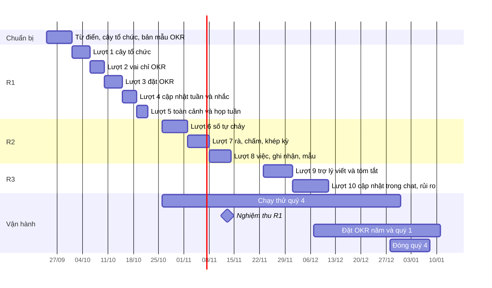

# Lộ trình OKR trên CRM OneHub

Viết 2026-09-24, từ bản phạm vi sản phẩm OKR (78 tính năng, ba đợt phát hành,
chốt vai «chỉ OKR» ngày 2026-09-23). Bản phạm vi và nghiên cứu nền nằm ở hai
trang riêng tư của chủ kho; mã tính năng (`TC-01`, `CI-02` …) ở đây là mã của
bản phạm vi đó, và bảng phủ ở mục 8 chép lại từng mã để không mã nào rơi giữa
hai lượt.

Đây là việc giao một **công cụ quản trị nội bộ**, không phải thử phương pháp
OKR: chủ kho đã chạy OKR nhiều chu kỳ. Cách chạy (chu kỳ, thang chấm, trần, OKR
cá nhân, bước duyệt) là cấu hình của chương trình, không cứng trong mã.

## 1. Đích đến

| Mốc | Ngày | Nghĩa là |
| --- | --- | --- |
| R1 lên production | 2026-10-23 | Cả công ty đặt, cập nhật, xem OKR quý trong CRM; người ngoài khối kinh doanh vào bằng vai «chỉ OKR» |
| Chạy thử quý 4 | 2026-10-26 → 2026-12-31 | Ban lãnh đạo và các đơn vị sẵn sàng đưa OKR quý 4 đang có vào CRM và cập nhật hằng tuần — thử công cụ, không thử phương pháp |
| R2 lên production | 2026-11-20 | Số tự chảy từ CRM; rà giữa kỳ, chấm, nhìn lại, mang sang trong công cụ |
| R3 lên production | 2026-12-18 | Trợ lý AI; cập nhật ngay trong Slack hoặc Zalo |
| Đóng quý 4 trong công cụ | 2026-12-28 → 2027-01-08 | Lần chấm và nhìn lại đầu tiên chạy thật |
| OKR năm 2027 và quý 1 | 2026-12-07 → 2027-01-11 | Toàn công ty đặt và công bố trong CRM |
| Tết Đinh Mùi | 2027-02-06 (mùng 1) | Lịch chu kỳ phải biết khoảng nghỉ trước ngày 2027-01-11 |

Tốc độ dựng không phải điểm nghẽn: các lượt của Điều phối 30 ngày đi từ Cổng
Đáng tới merge trong vài giờ tới một ngày rưỡi. Lịch trên chừa chỗ cho ba thứ
chậm hơn — design-pass, Cổng 1.5 của lượt T3, và phản hồi từ người chạy thử —
và cho việc khác của CRM chạy song song. Mọi lượt đi **tuần tự**: 32 commit ghim
lại từ 15/09 là cái giá của nhiều nhánh song song.

## 2. Nguyên tắc chia lượt

- **Mỗi lượt giao một câu người dùng nói được.**
- **Lượt sau đứng trên dữ liệu thật của lượt trước.** Không nhắc khi chưa cập
  nhật được; không tự đo khi KR chưa có nguồn; không tóm tắt khi chưa có lần
  cập nhật.
- **Không chạm hai lớp khó-đảo trong một lượt.** Lượt chạm `packages/db/prisma`
  hoặc quyền là T3, có Cổng 1.5.
- **Một cây tổ chức cho cả CRM.** OKR không có cây riêng, không có vai workspace
  riêng; cây của lượt 1 là cây mà Điều phối 30 ngày cũng dùng.
- **Mọi mã OKR ở chỗ riêng** để kéo bản mới của hãng ít xung đột:
  `apps/api/src/okr`, một khu route riêng trong `apps/app`, chuỗi ở
  `lib/messages/okr.ts`, khuôn dữ liệu ở `packages/validation/src/okr-*.ts`,
  các bảng là một khối liền cuối `schema.prisma` với ít quan hệ ngược nhất có
  thể. Vết OKR là bảng riêng, không đi qua `Activity` của hãng.
- **Mỗi thủ tục ghi có một AC đọc lại từ DB**, và mỗi màn có trạng thái rỗng ·
  đang tải · lỗi. Vòng một của Điều phối lọt lỗ vì chỉ đo tạo và đọc.

## 3. Tổng quan

| # | Slug | Câu giao | Hạng | Đứng trên |
| --- | --- | --- | --- | --- |
| 0 | chuẩn bị | «Từ, cây và màn đã được duyệt trước khi viết mã» | T1 | — |
| 1 | `cay-to-chuc-co-nguoi` | «Tôi biết ai thuộc phòng ban nào, phòng ban nào thuộc bộ phận nào, ai là trưởng» | T3 | ô `cau-truc-to-chuc` |
| 2 | `vai-chi-okr` | «Người ngoài khối kinh doanh vào làm OKR mà không thấy dữ liệu đối tác» | T3 | lượt 1 |
| 3 | `dat-okr-trong-crm` | «Đơn vị tôi đặt được OKR quý, căn chỉnh vào mục tiêu OneHub» | T3 | lượt 1, 2 |
| 4 | `cap-nhat-tuan-okr` | «Sáng thứ Hai tôi được nhắc và cập nhật mọi KR của mình trong một phút» | T3 | lượt 3 |
| 5 | `toan-canh-okr` | «Cả công ty nhìn được toàn cảnh và họp tuần trên cùng một màn» | T2 | lượt 4 |
| 6 | `so-okr-tu-chay` | «Số của KR tự chảy từ CRM, bấm vào là ra bản ghi» | T3 | lượt 3 |
| 7 | `khep-ky-okr` | «Kỳ được rà, chấm, nhìn lại và mang sang trong công cụ» | T2 | lượt 4, 6 |
| 8 | `canh-kr-okr` | «Việc, sáng kiến, ghi nhận và mẫu nằm cạnh KR» | T3 | lượt 3 |
| 9 | `tro-ly-okr` | «Trợ lý giúp tôi viết cho sắc và tóm tắt tuần cho đơn vị» | T2 | lượt 4, 7 |
| 10 | `okr-trong-chat` | «Tôi cập nhật ngay trong Slack hoặc Zalo, và biết sớm KR nào đang trượt» | T3 | lượt 4, 9 |

## 4. Chuẩn bị (2026-09-24 → 2026-09-30)

Không viết mã sản phẩm. Ba việc, mỗi việc một PR T1 hoặc một hồ sơ:

1. **Từ điển.** Thêm vào `CONTEXT.md`: Mục tiêu, Kết quả then chốt (KR), Cập
   nhật tuần, Mức tự tin, Chu kỳ, Căn chỉnh, Người phụ trách (OKR), Điểm cuối
   kỳ («không phải đánh giá nhân sự»), Bộ phận, Phòng ban, Trưởng đơn vị, vai
   «chỉ OKR». Sửa mục **Bộ phận** hiện có: hôm nay nó là bảng phẳng mà màn
   Điều phối gọi là «bộ phận»; sau lượt 1 bảng đó là **Phòng ban** và **Bộ
   phận** là cấp trên. Chốt một chữ cho «check-in» — đề xuất «Cập nhật tuần».
2. **Cây tổ chức.** Đưa `_acceptance/cau-truc-to-chuc/opportunity.md` qua Cổng
   Đáng với câu trả lời mà OKR cần: người thuộc phòng ban; có trưởng phòng ban
   và trưởng bộ phận; báo cáo và lọc theo bộ phận; mọi khu dùng chung. Hai cấp
   cố định dưới gốc OneHub — «nhóm» dưới phòng ban để sau, khi có đơn vị thật
   cần.
3. **Bản mẫu OKR.** Một phiên `/acceptance-gate:design-pass` trên `/proto` cho
   bốn màn: «Của tôi», «Cập nhật tuần của tôi», «Theo đơn vị» có cây căn chỉnh,
   «Toàn cảnh». Cảnh ngữ cảnh bắt buộc: chụp cạnh sheet Thoả thuận và kế hoạch
   30 ngày, cùng khổ 1440 và 390. Duyệt bản mẫu một lần ở đây để lượt 3–5
   không phải dựng lại thẩm mỹ từng màn.

## 5. Từng lượt

### Lượt 1 — `cay-to-chuc-co-nguoi` · R1 · T3

**Ý định (dán vào `/feature-loop:feature-loop`):** CRM có cây tổ chức hai cấp
dưới gốc OneHub — Bộ phận chứa Phòng ban — dùng chung cho cả CRM; mỗi thành
viên thuộc một phòng ban chính; phòng ban và bộ phận có trưởng; quản trị dựng
cây và gán người ở Cài đặt, kể cả nhập hàng loạt từ bảng tính.

**Phủ mã:** TC-01, TC-02, TC-03, TC-04.

**Trong phạm vi**

- Bảng `Division` ở trên `Department` hiện có (bước kế hoạch 30 ngày vẫn giao
  cho `Department`, dữ liệu cũ không phải chuyển). Bảng nối thành viên với phòng
  ban (chính hoặc phụ). Trưởng là trường trên đơn vị, không phải vai workspace
  — vai lạ hôm nay bị hạ im lặng về member.
- Quản lý trực tiếp: suy từ trưởng phòng ban chính; ghi đè được từng người.
- Cài đặt: màn Tổ chức — cây, thêm, đổi tên, sắp, lưu trữ, gán người, gán
  trưởng. Nhập hàng loạt: dán hoặc tải bảng email · phòng ban · bộ phận · trưởng,
  xem trước rồi mới ghi, báo dòng hỏng.
- Màn Điều phối 30 ngày đổi nhãn theo từ điển mới; lọc theo bộ phận hoạt động.

**Ngoài phạm vi:** quyền theo đơn vị (lượt 2–3), cấp «nhóm», đồng bộ hệ thống
nhân sự (TC-07, Chưa làm).

**Ngưỡng đo gợi ý:** trên production sau một tuần, ≥ 90% thành viên còn hiệu
lực có phòng ban chính; mọi phòng ban có trưởng — đếm từ bảng nối.

### Lượt 2 — `vai-chi-okr` · R1 · T3

**Ý định:** Thêm vai «chỉ OKR»: người mang vai này đăng nhập được, thấy khu OKR
và hồ sơ của chính mình, nhưng không đọc được danh bạ, công ty, thoả thuận,
chiến dịch, kế hoạch 30 ngày — dù qua màn, qua gọi thẳng API, qua khoá API hay
qua trợ lý AI.

**Phủ mã:** TC-05.

**Trong phạm vi**

- Vai mới trong workspace và nơi quản trị gán vai (màn Thành viên, lời mời).
- Chặn ở máy chủ, chặn-mặc-định: lớp kiểm chung mà `go-la-cat-quyen-that` vừa
  dựng mở rộng thành «tư cách **và** phạm vi dữ liệu». Mỗi router khai mình
  thuộc nhóm dữ liệu nào; router không khai thì bị chặn với vai này.
- Điều hướng: vai này chỉ thấy mục OKR và Cài đặt cá nhân; đường dẫn tới màn
  dữ liệu trả trang «không có quyền» đã có.
- Trợ lý: công cụ đọc dữ liệu CRM của tác nhân kiểm cùng phạm vi.

**Ngoài phạm vi:** quyền xem theo đơn vị cho dữ liệu đối tác (chưa ai đòi).

**AC không được thiếu:** một phép đo cho từng đường vào (màn, tRPC, REST, khoá
API, trợ lý) với người mang vai «chỉ OKR» — đỏ được trước khi vá, như bài của
`go-la-cat-quyen-that`.

**Ngưỡng đo gợi ý:** 0 lượt đọc dữ liệu đối tác thành công của vai «chỉ OKR»
trong nhật ký sau hai tuần.

### Lượt 3 — `dat-okr-trong-crm` · R1 · T3

**Ý định:** Khu OKR mới trên thanh điều hướng. Quản trị mở chu kỳ năm và quý;
mỗi cấp — OneHub, bộ phận, phòng ban, và cá nhân nếu chương trình bật — đặt
mục tiêu với KR đủ sáu kiểu, gắn căn chỉnh vào mục tiêu hoặc KR cấp trên,
công bố; mọi sửa đổi để lại vết.

**Phủ mã:** CK-01, CK-02, CK-03, MT-01, MT-02, MT-03, MT-04, MT-05, KR-01,
KR-02, KR-03, KR-05 (nhập tay), QT-01, QT-03, QT-06.

**Trong phạm vi**

- Bảng: chu kỳ (loại, cha, ngày, pha, khoảng nghỉ, ngày cập nhật trong tuần),
  mục tiêu, người tham gia, căn chỉnh nhiều–nhiều, KR, vết OKR, cấu hình
  chương trình có phiên bản. Khuôn dữ liệu ở `packages/validation/src/okr-*.ts`.
- Quyền trong service theo bản ghi, theo khuôn `AgentAccessService`: trưởng
  đơn vị sửa OKR đơn vị mình và đơn vị con; người phụ trách sửa KR của mình;
  quản trị chương trình mở và khoá chu kỳ, không sửa nội dung thay người.
- Màn: danh sách «Theo đơn vị» tối thiểu và màn chi tiết mục tiêu trong khung
  record sheet (`RECORD_KINDS` thêm `objective`), đủ để đặt và công bố. Màn
  toàn cảnh đầy đủ ở lượt 5.
- Cấu hình chương trình: trần mục tiêu và KR (cảnh báo hay chặn), thang chấm,
  trọng số, OKR cá nhân bật/tắt.
- Nhập OKR từ bảng tính có bước xem trước — để quý 4 đang chạy vào được CRM.
- Lịch: mọi ngày theo giờ Việt Nam (`dauNgayVN`); khoảng nghỉ Tết khai được.

**Ngoài phạm vi:** cập nhật tuần (lượt 4), tự đo (lượt 6), mức hiển thị giới
hạn và mẫu (lượt 8).

**Cảnh ngữ cảnh ở design-pass:** màn chi tiết mục tiêu cạnh sheet Thoả thuận.

**Ngưỡng đo gợi ý:** trong tuần đầu chạy thử, mọi đơn vị tham gia có bộ OKR
quý 4 ở pha «Đang chạy»; không bộ nào phải sửa trong bảng tính rồi nhập lại
quá một lần.

### Lượt 4 — `cap-nhat-tuan-okr` · R1 · T3

**Ý định:** Màn «Cập nhật tuần của tôi» gom mọi KR tôi phụ trách, điền sẵn số
tuần trước; mỗi lần cập nhật ghi giá trị, mức tự tin và một dòng ghi chú; tin
nhắc buổi sáng qua Zalo hoặc Slack và thẻ «việc của tôi» dẫn thẳng vào màn đó;
bình luận và nhắc tên trên mục tiêu và KR.

**Phủ mã:** CI-01, CI-02, CI-03, CI-04, NH-01, NH-02, NH-03, NH-04, XEM-01,
XEM-10, QT-05.

**Trong phạm vi**

- Bảng lần cập nhật: chỉ thêm, không sửa; người ghi, ghi hộ, kênh, số giây từ
  mở tới gửi đo ở máy chủ.
- Nhắc: một loại việc mới trong nhắc buổi sáng — cùng một luật với thẻ «việc
  của tôi» như `nhac-ke-hoach.ts` đang làm cho kế hoạch 30 ngày; không thêm tin
  thứ hai. KR im quá N ngày nhắc người phụ trách, rồi trưởng đơn vị.
- Theo dõi mục tiêu; báo khi được giao KR, được nhắc tên.
- Chuyển KR và mục tiêu khi người nghỉ: thêm vào hộp «Chuyển việc 30 ngày» ở
  màn Thành viên.
- Màn chạy tốt ở 390px.

**Ngưỡng đo gợi ý:** trong nhóm chạy thử, ≥ 80% KR có lần cập nhật mỗi tuần,
ba tuần liền; trung vị thời gian một lần cập nhật dưới 60 giây — đều từ bảng
lần cập nhật.

### Lượt 5 — `toan-canh-okr` · R1 · T2

**Ý định:** Danh sách theo đơn vị có lọc, cây căn chỉnh toàn công ty, bảng họp
tuần xếp theo thứ đáng bàn, toàn cảnh cho lãnh đạo, khối OKR trên Tổng quan và
trang cá nhân, và màn sức khoẻ chương trình cho quản trị.

**Phủ mã:** XEM-02, XEM-03 (đầy đủ), XEM-04, XEM-05, XEM-06, XEM-07, QT-04.

**Trong phạm vi**

- `packages/ui`: cây nhiều cấp đi bằng bàn phím; thanh tiến độ trung tính có
  vạch kỳ vọng; biểu đồ đường có đích (bọc `LineChart`/`ReferenceLine` sẵn có);
  chọn quý; heatmap. Tình trạng hiện bằng `StatusIndicator` chấm kèm chữ —
  không tô khối.
- Lọc và dựng cây ở máy chủ, không lọc trong bộ nhớ trình duyệt.
- Bảng họp tuần xếp: tự tin tụt, KR im, ghi chú mới — theo KR, không liệt kê
  người chưa cập nhật.

**Ngưỡng đo gợi ý:** ở phiên nghiệm thu R1, một trưởng đơn vị chạy xong họp
tuần chỉ trên màn này — bấm giờ.

### Lượt 6 — `so-okr-tu-chay` · R2 · T3

**Ý định:** KR của khối kinh doanh lấy số tự động từ danh mục chỉ số CRM có
định nghĩa cố định; mỗi ngày chụp giá trị thành lịch sử không đổi; bấm vào con
số ra danh sách bản ghi đằng sau; KR ngoài CRM nhận số qua khoá API và Google
Sheets.

**Phủ mã:** DO-01, DO-02, DO-03, DO-04, DO-05, KR-04, KR-05 (tự đo, API).

**Trong phạm vi**

- Danh mục chỉ số trong mã theo khuôn `CRM_EVENT_CATALOG`: thoả thuận chốt được
  (đếm), thoả thuận mới, cuộc gọi chiến dịch hẹn được, bước kế hoạch 30 ngày
  xong đúng hạn theo phòng ban, cá nhân ghi danh đạt từng bậc, form thành cá
  nhân, email gửi ra theo người. Mỗi chỉ số khai đơn vị, ngày quyết định kỳ,
  cách quy công. Tham số theo người, phòng ban, bộ phận.
- Bảng bản chụp chỉ số; việc chụp đi qua lịch dispatch có sẵn, không thêm cron.
  Đổi tiền tệ báo cáo hay sửa dữ liệu cũ không đổi số của kỳ đã đóng.
- Đổi nguồn của một KR giữa kỳ để lại vết; số máy hiện cạnh số tay cho tới
  ranh giới kỳ.
- Thủ tục ghi giá trị KR qua khoá API; nhập từ Google Sheets theo lịch.

**Ngoài phạm vi:** giá trị tiền của thoả thuận và chỉ số theo giai đoạn — nghĩa
chưa chốt trong từ điển; trình dựng truy vấn tự do (NG-04, Chưa làm).

**AC không được thiếu:** phép thử tin số — năm chỉ số so với số đếm tay trên
production, lệch khai trước.

**Ngưỡng đo gợi ý:** ≥ 50% KR của khối kinh doanh trong quý 4 có nguồn CRM
trước ngày 2026-12-01.

### Lượt 7 — `khep-ky-okr` · R2 · T2

**Ý định:** Quản trị mở cửa sổ rà giữa kỳ; cuối kỳ máy gợi ý điểm từ số chốt,
người chỉnh được kèm lý do; mỗi mục tiêu có ô điều học được; kỳ chỉ đóng khi
mọi KR đã chấm; mục tiêu dở mang sang kỳ sau; số kỳ đã đóng bị khoá và xuất
được.

**Phủ mã:** CK-04, CD-01, CD-02, CD-03, CD-04, CD-05, AI-03 (kiểm bằng luật).

**Trong phạm vi**

- Sửa đích ngoài cửa sổ rà: ghi lý do, mang nhãn tới lúc chấm.
- Chấm đọc theo loại: mục tiêu tham vọng 0,7 là tốt. Màn chấm ghi «không phải
  đánh giá nhân sự».
- Kiểm chất lượng khi đặt bằng luật, không dùng mô hình: động từ chỉ việc làm,
  thiếu khởi điểm, đích bằng khởi điểm, thiếu đối trọng. Hỏi, không chặn lưu.
- Mở lại kỳ đã đóng có lý do và vết.

**Hạn cứng:** lên production trước 2026-12-14 — đóng quý 4 dùng nó.

### Lượt 8 — `canh-kr-okr` · R2 · T3

**Ý định:** Việc và sáng kiến gắn vào KR, kể cả gắn một chiến dịch hay một kế
hoạch 30 ngày có sẵn; đính bằng chứng cho KR dạng mốc; gửi ghi nhận; mục tiêu
có mức hiển thị giới hạn; mẫu OKR theo loại đơn vị; bước duyệt nhẹ tuỳ chọn;
bản tin tuần vào kênh Slack của đơn vị; lọc lưu được và tìm trong ô tìm chung;
tái cơ cấu giữa kỳ không làm OKR mồ côi.

**Phủ mã:** SK-01, SK-02, CI-05, CI-06, MT-06, MT-07, QT-02, NH-05, XEM-08,
XEM-09, TC-06.

**Điều kiện mở lượt:** lượt nặng nhất về số mã, nhẹ nhất về độ khó. Sau bốn
tuần chạy thử, xếp lại theo điều người dùng thật hỏi nhiều nhất và cắt đôi nếu
hợp đồng vượt 15 tiêu chí.

### Lượt 9 — `tro-ly-okr` · R3 · T2

**Ý định:** Trợ lý OKR trong `apps/agent` với công cụ chỉ đọc OKR theo quyền
người hỏi: viết lại câu mục tiêu hay KR khi người bấm, kiểm chất lượng bằng mô
hình sau lớp luật, tóm tắt cập nhật tuần của đơn vị với câu nào cũng dẫn về
lần cập nhật gốc, gợi ý căn chỉnh, gợi ý đích so với xu hướng.

**Phủ mã:** AI-01, AI-02, AI-03 (AI), AI-04, AI-05, DO-06.

**Trong phạm vi**

- Trần chi tiêu AI theo tháng cho workspace; thiếu khoá thì nút AI biến mất
  (theo `capabilities.ts`).
- Gợi ý hiện câu cũ cạnh câu mới, người nhận từng dòng; gợi ý bị bác không mời
  lại; đếm tỷ lệ nhận nguyên văn, sửa, bác.
- Tóm tắt: máy kiểm lại mọi con số trong câu so với lần cập nhật, lệch thì bỏ
  câu. Chạy qua hàng `AgentTask`, gom theo đơn vị, không một phiên mỗi KR.

**Ngoài phạm vi:** máy ghi số hay mức tự tin thay người (NG-05), soạn trọn bộ
OKR cho cả đội.

**Điều kiện mở lượt:** trả lời được «nội dung OKR có được gửi tới nhà cung cấp
mô hình đang dùng không» và có con số trần chi tiêu tháng.

### Lượt 10 — `okr-trong-chat` · R3 · T3

**Ý định:** Tin nhắc có nút: chọn mức tự tin và sửa số ngay trong Slack hoặc
Zalo; trưởng đơn vị nhận cảnh báo khi tiến độ và mức tự tin lệch khỏi vạch kỳ
vọng; hỏi đáp trên OKR trong trợ lý chat theo quyền người hỏi.

**Phủ mã:** NH-06, AI-06, AI-07.

**Trong phạm vi:** cửa nhận tin vào cho Slack (URL tương tác, khoá ký, quyền
mới — T3) và cho Zalo nếu nền tảng bot cho phép; cảnh báo rủi ro bằng luật
trên dữ liệu, phần diễn giải qua trợ lý.

**Điều kiện mở lượt:** số đo của lượt 4 cho thấy độ trễ từ nhắc tới cập nhật
quá một ngày làm việc, hoặc một lần cập nhật quá 2 phút. Không có bằng chứng
thì lượt này lùi.

## 6. Triển khai cho người dùng

| Tuần | Việc | Ai |
| --- | --- | --- |
| 2026-10-19 | Quản trị dựng cây tổ chức, nhập người, gán trưởng, gán vai «chỉ OKR» | Quản trị chương trình |
| 2026-10-26 | Nhập OKR quý 4 đang có từ bảng tính; bật nhắc buổi sáng cho nhóm chạy thử | Trưởng đơn vị chạy thử |
| 2026-10-26 → 12-31 | Chạy thử quý 4: cập nhật tuần, họp tuần trên màn, phản hồi vào hàng việc | Ban lãnh đạo, đơn vị chạy thử |
| 2026-11-13 | Phiên nghiệm thu R1 (`/acceptance-gate:uat-session`) với ngưỡng của lượt 1–5 | Chủ sản phẩm, người dùng đại diện |
| 2026-12-07 → 12-18 | Ban lãnh đạo đặt OKR năm 2027 cấp OneHub | Ban lãnh đạo |
| 2026-12-21 → 2027-01-11 | Các đơn vị đặt và công bố OKR quý 1 | Trưởng đơn vị |
| 2026-12-28 → 2027-01-08 | Chấm và nhìn lại quý 4 trong công cụ | Đơn vị chạy thử |
| 2027-02-09 | Đo bốn tuần đầu quý 1 toàn công ty — Cổng Giá trị của R1–R3 | Chủ sản phẩm |

Hướng dẫn người dùng: một trang ngắn cho mỗi vai (người phụ trách KR, trưởng
đơn vị, quản trị), viết sau lượt 5, sửa sau phiên nghiệm thu R1.

## 7. Rủi ro và cách giảm

| Rủi ro | Cách giảm |
| --- | --- |
| Cây tổ chức đổi nghĩa chữ «bộ phận» trên màn Điều phối 30 ngày | Từ điển chốt ở bước chuẩn bị; lượt 1 đổi nhãn Điều phối trong cùng hợp đồng |
| Vai «chỉ OKR» sót một đường vào dữ liệu | Chặn-mặc-định ở lớp chung; router không khai nhóm dữ liệu thì bị chặn; phép đo cho từng đường |
| Một người ký mọi cổng, lịch dồn | Lượt T2 đi tiếp với cửa veto mở; gộp design-pass vào bước chuẩn bị |
| Bảy việc đang chờ Cổng Giá trị | Phiên nghiệm thu R1 gộp với phiên của Điều phối nếu cùng người dùng đại diện |
| Nhắc OKR làm tin buổi sáng quá dài | Trần số việc mỗi tin và 2.000 ký tự mỗi tin Zalo, như nhắc kế hoạch đang làm |
| Số tự đo sai nghĩa làm mất tin | Danh mục cố định trong mã; phép thử tin số là AC của lượt 6; nhãn nguồn trên mọi số |
| Bản rẽ khỏi hãng phình | Mã ở chỗ riêng theo mục 2; kiểm xung đột với `release` mỗi tuần |
| Test chập chờn làm đỏ CI (vd `claimDue`) | Việc sửa riêng đang chờ; không `--no-verify` |
| Chi phí AI khi cả công ty dùng | Lượt 9 chỉ mở khi có trần; tóm tắt gom theo đơn vị |

## 8. Bảng phủ — mọi mã về đúng một chỗ

| Mã | Lượt |
| --- | --- |
| TC-01 · TC-02 · TC-03 · TC-04 | 1 |
| TC-05 | 2 |
| CK-01 · CK-02 · CK-03 · MT-01 · MT-02 · MT-03 · MT-04 · MT-05 · KR-01 · KR-02 · KR-03 · KR-05 (tay) · QT-01 · QT-03 · QT-06 | 3 |
| CI-01 · CI-02 · CI-03 · CI-04 · NH-01 · NH-02 · NH-03 · NH-04 · XEM-01 · XEM-10 · QT-05 | 4 |
| XEM-02 · XEM-03 · XEM-04 · XEM-05 · XEM-06 · XEM-07 · QT-04 | 5 |
| DO-01 · DO-02 · DO-03 · DO-04 · DO-05 · KR-04 · KR-05 (tự đo, API) | 6 |
| CK-04 · CD-01 · CD-02 · CD-03 · CD-04 · CD-05 · AI-03 (luật) | 7 |
| SK-01 · SK-02 · CI-05 · CI-06 · MT-06 · MT-07 · QT-02 · NH-05 · XEM-08 · XEM-09 · TC-06 | 8 |
| AI-01 · AI-02 · AI-03 (AI) · AI-04 · AI-05 · DO-06 | 9 |
| NH-06 · AI-06 · AI-07 | 10 |
| TC-07 · NG-01 · NG-02 · NG-03 · NG-04 · NG-05 · NG-06 · NG-07 | Chưa làm |

Đủ 78 mã: 70 mã vào mười lượt, 8 mã ở «Chưa làm». AI-03 và KR-05 tách hai
nửa ở hai lượt, ghi rõ nửa nào.

## 9. Chưa làm — kèm lý do, để khỏi bàn lại

- Nối điểm OKR vào lương, thưởng, xếp hạng (NG-01) — hoa hồng đã gắn doanh số;
  trộn hai thứ làm người ta đặt đích thấp và làm đẹp số.
- Liên kết với đánh giá hiệu suất hay KPI (NG-02) — module lớn kèm chính sách
  nhân sự; chờ có người quyết chính sách.
- OKR cho cá nhân trong mạng lưới môi giới (NG-03) — họ là đối tác, không phải
  nhân viên.
- Trình dựng truy vấn tự do (NG-04) — con số đổi nghĩa mà không ai hay.
- Máy ghi số hay mức tự tin thay người (NG-05).
- Nút phân rã chép KR cấp trên thành mục tiêu cấp dưới (NG-06).
- Bảng xếp hạng người, huy hiệu, điểm đổi quà (NG-07).
- Đồng bộ cây tổ chức từ hệ thống nhân sự (TC-07) — chưa có hệ thống nguồn.

## 10. Theo dõi — cập nhật sau mỗi hạng mục

Một dòng một lượt; cột Trạng thái chỉ nhận: chưa mở · Cổng Đáng · Cổng Phạm vi ·
đang dựng · Cổng Bằng chứng · đã lên `onehub` · Cổng Giá trị · xong. Ngày là
ngày đổi trạng thái gần nhất. Không sửa dòng cũ, chỉ nối thêm ở cột Ghi chú.

| # | Slug | Trạng thái | Ngày | PR | Ghi chú |
| --- | --- | --- | --- | --- | --- |
| 0 | chuẩn bị | chưa mở | — | — | từ điển · Cổng Đáng của `cau-truc-to-chuc` · design-pass `/proto` OKR |
| 1 | `cay-to-chuc-co-nguoi` | chưa mở | — | — | đứng trên `cau-truc-to-chuc` |
| 2 | `vai-chi-okr` | chưa mở | — | — | chốt 2026-09-23 (Manh Phan) |
| 3 | `dat-okr-trong-crm` | chưa mở | — | — | — |
| 4 | `cap-nhat-tuan-okr` | chưa mở | — | — | nhắc qua Zalo cần vòng 1–2 và triển khai của `lo-trinh-zalo.md`, xong trước 26/10 |
| 5 | `toan-canh-okr` | chưa mở | — | — | — |
| 6 | `so-okr-tu-chay` | chưa mở | — | — | — |
| 7 | `khep-ky-okr` | chưa mở | — | — | hạn cứng 2026-12-14 |
| 8 | `canh-kr-okr` | chưa mở | — | — | xếp lại sau bốn tuần chạy thử |
| 9 | `tro-ly-okr` | chưa mở | — | — | chờ trần chi tiêu AI |
| 10 | `okr-trong-chat` | chưa mở | — | — | chờ số đo độ trễ của lượt 4 · Zalo không có nút, trên Zalo là trả lời bằng chữ — vòng 3–4 của `lo-trinh-zalo.md`, đề xuất gộp vòng 4 |

## 11. Bắt đầu thế nào

1. Bước chuẩn bị: PR từ điển; đưa `cau-truc-to-chuc` qua Cổng Đáng với câu
   trả lời ở mục 4; phiên design-pass cho `/proto` OKR.
2. Lượt 1: nhánh mới từ `onehub`, `/feature-loop:feature-loop` với câu ý định ở
   mục 5. T3 — có Cổng 1.5.
3. Sau mỗi lượt: cập nhật một dòng ở mục 10.
