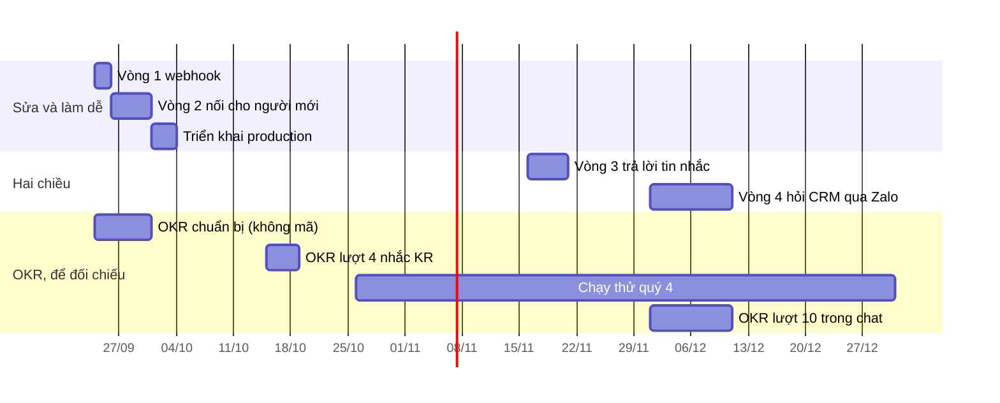

# Lộ trình Zalo — sau lần lái thử bot thật

Viết 2026-09-24. Lộ trình này dựa trên buổi lái thử bot Zalo thật ngày 2026-09-23,
làm ngay sau khi `nhac-qua-zalo` lên `onehub` (#94), và trên hai ý chủ kho nêu sau
buổi đó:

- nối Zalo còn khó với người mới;
- CRM có tác tử AI, vậy có điều khiển nó qua Zalo được không.

Chủ kho đồng ý thứ tự bốn vòng ngày 2026-09-24. Hồ sơ của lượt gốc nằm ở
`_acceptance/nhac-qua-zalo/`, và các hạn chế đã biết ở mục Notes của hợp đồng
trong đó.

## 1. Lái thử thấy gì

**Bản #94 không nối được ai khi chạy thật.** Hệ quả: hai vòng đầu là việc sửa,
không phải việc thêm. Chuỗi nguyên nhân:

- Zalo chỉ giao tin cho một lời gọi `getUpdates` **đang mở** đúng lúc tin đến.
  Tin đến lúc không có lời gọi nào mở thì mất, Zalo không giữ lại.
- Bản đã ship mở lời gọi 1 giây trong cron mỗi phút
  (`ZALO.poll.timeoutGiay: 1`). Tin mã anh nhắn lúc 18:16 rơi đúng vào khoảng
  trống đó.
- Khi chạy vòng đọc liên tục, mỗi lời gọi mở 30 giây, thì mã tới trong một giây
  và nối được. Máy gửi thật `chayNhac` sau đó đưa tin nhắc tới điện thoại:
  kênh `zalo`, kết quả `da-gui:4`.

**Vì sao 23/23 phép đo vẫn xanh.** Zalo giả trả tin ngay mỗi lần gọi, tức không
mô hình hoá luật giao tin của nền tảng thật.

**Vòng đọc liên tục không phải đường sửa.** Tác tử chạy serverless trên Vercel,
cron mỗi phút, nên không giữ được một vòng đọc sống lâu. Đường sửa là webhook.

**Nền tảng bot Zalo** (tài liệu `bot.zaloplatforms.com`, đọc 2026-09-23):

- Webhook và `getUpdates` loại trừ nhau.
- Webhook bắt buộc URL HTTPS công khai và `secret_token` dài 8–256 ký tự; Zalo
  gửi khoá đó trong header `X-Bot-Api-Secret-Token`.
- Tài liệu khuyên dùng webhook cho production.
- **Không có nút bấm trong chat.** Bot chỉ có `sendMessage`, `sendPhoto`,
  `sendSticker`, `sendVoice` và `sendChatAction`. Tin là chữ trơn, tối đa
  2.000 ký tự.
- Bot tạo **trong app Zalo**, qua OA «Zalo Bot Manager», không tạo trên trang
  web.

**Người mới vấp ở đâu** — ghi lại từ buổi lái thử.

Quản trị viên bật Zalo:

- Trang hướng dẫn chỉ sai nơi tạo bot.
- Màn Bot Manager đặt Webhook, Secret Token và Bot Token cạnh nhau, và ô webhook
  báo đỏ dù không cần. Chủ kho đã dán nhầm Secret Token.
- Phải sửa `.env` trên máy chủ rồi khởi động lại tác tử.
- Dán sai token thì không có chỗ nào báo lỗi.

Người dùng nối Zalo:

- Trang bảo nhắn cho `bot.uipSwwnr`, tức `account_name`, không phải tên tìm thấy
  được trong Zalo («Bot OneHub», `display_name`).
- Không có mã QR, không có đường dẫn mở bot.
- Tin mã mất nên trang đứng mãi ở «đang chờ».
- Đã nối rồi mà nhắn gì bot cũng trả câu hướng dẫn nối.
- Không có cách gửi thử nhắc.
- Nhãn trạng thái bị cắt («Not conne…»), và chữ «Zalo» bị lặp trong dòng lý do.

## 2. Nguyên tắc chia vòng

- **Hai vòng đầu dùng tuần chuẩn bị của lộ trình OKR.** Từ 2026-10-01 các lượt
  OKR chạy tuần tự (`docs/plan/lo-trinh-okr.md` mục 1). Tuần 2026-09-24 →
  2026-09-30 OKR không viết mã sản phẩm, nên dòng mã còn trống. Vòng 3 và 4
  không chen vào giữa hai lượt OKR; chúng có cửa sổ riêng ở mục 3.
- **Zalo giả phải mang luật giao tin thật** ở mọi vòng:
  - `getUpdates` chỉ giao tin khi lời gọi đang mở;
  - webhook sai khoá thì trả 403;
  - `message_id` trùng thì chỉ xử lý một lần.
  Thiếu ca đầu là đúng lỗ đã để #94 xanh mà hỏng.
- **Mỗi vòng giao một câu người dùng nói được.** Mỗi thủ tục ghi có một AC đọc
  lại từ DB, như hai lộ trình trước.
- **Mã Zalo ở chỗ riêng**, để kéo bản mới của hãng ít xung đột:
  - `apps/agent/agent/channels/zalo.ts` và `apps/agent/agent/lib/zalo-*`;
  - `packages/db/src/zalo-*`;
  - `packages/validation/src/zalo-*`.
- **Hai bot, hai chế độ.**
  - Bot công ty chạy webhook ở production.
  - Bot riêng của người làm, chạy `getUpdates`, để thử tại máy. Một bot không
    chạy được cả hai chế độ cùng lúc.
- **Vòng sau đứng trên dữ liệu thật của vòng trước.** Không làm trả lời tin nhắc
  khi chưa có tin nhắc thật đi qua Zalo.

## 3. Tổng quan

| # | Slug | Câu giao | Hạng | Cửa sổ | Đứng trên |
| --- | --- | --- | --- | --- | --- |
| 1 | `zalo-qua-webhook` | «Tôi nhắn mã là nối được ngay, tin không mất» | T2 (T3 nếu thêm cột) | 2026-09-24 → 09-25 | #94 |
| 2 | `noi-zalo-cho-nguoi-moi` | «Quản trị bật Zalo trên màn hình; người mới nối trong một phút và thử được ngay» | T3 | 2026-09-26 → 09-30 | vòng 1 |
| T | triển khai | «Nhắc buổi sáng đi qua Zalo ở production» | — | 2026-10-01 → 10-03 | vòng 1, 2 |
| 3 | `tra-loi-tin-nhac` | «Tôi trả lời "xong 2" là bước đó được đánh dấu xong» | T2 | 2026-11-16 → 11-20 | T, lượt 4 OKR |
| 4 | `hoi-crm-qua-zalo` | «Tôi hỏi CRM ngay trong Zalo, theo đúng quyền của tôi» | T3 | cùng lượt 10 OKR, tháng 12 | vòng 3, lượt 9 OKR |

## 4. Từng vòng

### Vòng 1 — `zalo-qua-webhook` · T2

**Ý định:** Bot nhận tin qua webhook. Tin mã tới là nối ngay, không phụ thuộc
nhịp cron.

**Trong phạm vi**

- Một kênh riêng `agent/channels/zalo.ts`, viết theo kiểu custom channel của eve
  (`apps/agent/node_modules/eve/docs/channels/custom.mdx`), mount
  `POST /eve/v1/zalo`.
  - Kiểm header `X-Bot-Api-Secret-Token`; sai khoá thì trả 403 và không đọc thân.
  - Thân webhook có cùng dạng với `getUpdates` (`{ok, result: {event_name,
    message}}`), nên tái dùng `parseZaloGetUpdates` và `messageIdCua`.
- Tái dùng `noiBangMa`, `chuanHoaMa`, `dangBiChan`, `ghiSai` của
  `packages/db/src/zalo-lien-ket.ts`. Luật mã (6 số, 15 phút, sai 5 lần trong
  một giờ thì chặn) giữ nguyên.
- Bỏ `pollZalo()` khỏi cron dispatch.
  - `getMe` vẫn chạy trong cron để ghi `zaloBotName`.
  - «Bot im» đổi nghĩa: dựa vào `getWebhookInfo` (URL đăng ký có đúng không)
    cùng thời điểm tin webhook cuối cùng, không dựa vào lượt đọc.
- Hai lệnh tay cho người vận hành:
  - `zalo:webhook` đăng ký `setWebhook` với URL và khoá;
  - `zalo:poll` là vòng đọc liên tục 30 giây, cho bot thử tại máy.
- Biến mới `ZALO_WEBHOOK_SECRET`, khai ở `.env.example` và
  `docs/environment.md`. Khai cả `ZALO_BOT_TOKEN` và `ZALO_WEBHOOK_SECRET` trong
  `turbo.json`; đây là Ngoài-3 của hồ sơ `nhac-qua-zalo`.

**Ngoài phạm vi:** nối vào mô hình AI; trả lời tin nhắc; đổi giao diện.

**Phép đo phải có**

- Zalo giả chỉ giao tin khi lời gọi đang mở. Chạy trên cách đọc tin cũ thì ca
  này phải đỏ.
- Khoá sai thì trả 403 và không có hàng `ZaloLink` nào.
- Mã hợp lệ thì có hàng `ZaloLink`, kiểm bằng cách đọc lại từ DB.
- Cùng một `message_id` gửi hai lần thì chỉ xử lý một lần.

**Ngưỡng đo gợi ý:** trên bot thật, 10/10 lần nhắn mã hợp lệ đều nối được, và
thời gian từ lúc gửi tới `linkedAt` dưới 10 giây.

**Người quyết:** URL webhook production (tên miền tác tử trên Vercel), và ai giữ
`ZALO_WEBHOOK_SECRET`.

### Vòng 2 — `noi-zalo-cho-nguoi-moi` · T3

**Ý định:** Quản trị viên bật Zalo ngay trên màn hình, không đụng máy chủ. Người
mới nối trong một phút mà không phải hỏi ai, và gửi thử được nhắc ngay.

**Trong phạm vi**

- **Quản trị viên**
  - Ô Bot Token trên `/settings/connections/zalo`, theo khuôn khoá nghiên cứu:
    tác tử kiểm bằng `getMe`, lưu vào `AppSetting`, hiện gợi ý đã che.
  - Lưu token xong thì tác tử tự đăng ký webhook.
  - Hướng dẫn tạo bot sửa cho đúng: Zalo › OA «Zalo Bot Manager» › Tạo bot. Ghi
    rõ Bot Token có dạng `<số>:<chuỗi>` và khác Secret Token.
- **Người dùng**
  - Mã QR và đường dẫn mở thẳng bot, nếu Zalo cho; kiểm ở S1.
  - Tên bot hiện theo `display_name`.
  - Cách nối đảo chiều: người dùng nhắn bất kỳ tin nào cho bot, bot gửi lại một
    đường dẫn dùng một lần vào CRM, người dùng xác nhận trong phiên đăng nhập
    của mình. Mã 6 số giữ làm đường dự phòng hay bỏ hẳn: chốt ở brainstorm.
  - Nút «Gửi thử nhắc ngay» trên trang «Thông báo của bạn».
  - Bot nhận ra người đã nối, ví dụ «Bạn đã nối với … Nhắc đến lúc 08:30.»
- **Vòng đời liên kết:** người rời workspace thì liên kết bị gỡ. Đây là một mục
  Notes của hồ sơ `nhac-qua-zalo`, và là điều kiện của vòng 4.
- **Sửa ba lỗi chữ:** nhãn trạng thái bị cắt; chữ «Zalo» lặp; bản tiếng Việt của
  cùng các dòng đó.
- **Từ điển:** sửa mục **Nối Zalo** trong `CONTEXT.md` nếu cách nối đổi.
- **design-pass:** chạy trên `/proto` trước Cổng Phạm vi.

**Ngoài phạm vi:** đọc hiểu tin để trả lời; mô hình AI.

**Điều kiện mở:** vòng 1 đã lên `onehub`.

**Ngưỡng đo gợi ý**

- Lái thử người lạ (nghi thức tay): một người chưa từng thấy tính năng nối xong
  trong 2 phút, không hỏi ai.
- Quản trị viên bật Zalo trong 5 phút, tính từ lúc đã có bot.

**Người quyết**

- Token lưu trong `AppSetting` như khoá nghiên cứu (hiện là chữ trơn), hay phải
  mã hoá.
- Cách nối đảo chiều thay hẳn mã 6 số, hay chỉ đứng cạnh nó.

### Triển khai — 2026-10-01 → 10-03

| Việc | Ai |
| --- | --- |
| Chạy `bun run db:deploy` ở production cho `20260923085702_nhac_qua_zalo` và `migration` của vòng 2. Không có CI nào chạy việc này | Chủ kho |
| Chọn bot công ty: dùng lại «Bot OneHub», hoặc tạo bot mới dưới tài khoản Zalo của công ty | Chủ kho |
| Đặt `ZALO_WEBHOOK_SECRET` trên project Vercel của tác tử. Có vòng 2 thì token dán trên màn hình; không có thì đặt cả `ZALO_BOT_TOKEN` | Chủ kho |
| Lái thử với 2–3 người trong đội, đo ngưỡng của vòng 1 và 2 trên production | Chủ kho, máy ghi số |
| Xong trước 2026-10-26, ngày bật nhắc buổi sáng cho nhóm chạy thử OKR | — |

### Vòng 3 — `tra-loi-tin-nhac` · T2

**Ý định:** Trả lời tin nhắc bằng chữ thì việc được làm ngay. Ví dụ «xong 2» là
đánh dấu xong mục 2 của tin sáng nay. Zalo không có nút, nên chữ là giao diện.

**Trong phạm vi**

- Mục số n trong tin là phần tử thứ n của `daGui` trong `payload` của hàng
  `nhac-ke-hoach` hôm nay. Hàng đó đã ghi đủ loại, `planId` và `stepId`.
- Đánh dấu xong bằng đúng thủ tục ghi màn kế hoạch dùng (`setStepDone`), kiểm
  bằng cách đọc lại từ DB.
- Bot xác nhận bằng một dòng.
- Số không có trong tin, hoặc tin của hôm qua, thì bot nói rõ, không đoán.
- Mục «kế hoạch im» không có «xong». Bot trả lời bằng gợi ý kèm đường dẫn mở kế
  hoạch.

**Điều kiện mở**

- Triển khai xong.
- Có ít nhất hai tuần tin nhắc thật qua Zalo.
- Lượt 4 OKR đã lên `onehub`, để cùng một luật trả lời phủ cả mục KR mà lượt đó
  thêm vào tin nhắc.

**Ngưỡng đo gợi ý**

- Trong hai tuần, ít nhất 30% tin nhắc qua Zalo có một lần «xong».
- Không có lần đánh dấu nhầm nào, đối chiếu bằng cách đọc lại DB.

**Liên quan OKR:** đây là nền cho vế «sửa số ngay trong Zalo» của lượt 10
(NH-06). Trên Zalo, vế đó là trả lời bằng chữ, không phải nút.

### Vòng 4 — `hoi-crm-qua-zalo` · T3

**Ý định:** Hỏi CRM ngay trong Zalo, trong giới hạn quyền của chính người hỏi.
Nấc đầu chỉ đọc. Nấc sau có ghi, và mỗi lần ghi phải được duyệt bằng chữ.

**Trong phạm vi**

- Kênh `zalo` của vòng 1 nối vào phiên tác tử: mỗi `chat.id` là một cuộc trò
  chuyện.
- Chủ thể lấy từ `ZaloLink`, theo cách `repFromCrm` đang làm cho khung chat, để
  `lib/approval.ts` coi đó là một người thật.
- Các công cụ đọc đã có: `search_crm`, `list_deals`, `list_outstanding_work`,
  `read_deal_history`.
- Thao tác thuộc `sensitiveWrite` đợi người nhắn «ĐỒNG Ý».
- Hiện «đang gõ» (`sendChatAction`).
- Tin trả lời là chữ trơn, không quá 2.000 ký tự.
- Từ điển: sửa mục **Bot Zalo**. Mục đó hiện ghi bot không tự làm việc gì và cấm
  gọi là «trợ lý»; sau vòng này bot trò chuyện được, nên chữ phải đổi theo.

**Điều kiện mở — đủ cả bốn**

1. Chủ kho quyết ranh giới dữ liệu: câu trả lời có tên khách, giá trị thoả thuận
   có được nằm trên máy chủ của Zalo không. Mục «What may be read, and what may
   leave» của `docs/agent.md` hiện chỉ giới hạn truy vấn gửi bên thứ ba, chưa nói
   gì về câu trả lời gửi ra kênh chat.
2. Có trần chi tiêu AI; dùng chung với điều kiện của lượt 9 OKR.
3. Vòng 1 đang chạy ở production.
4. Liên kết tự gỡ khi người rời workspace (vòng 2).

**Đề xuất: gộp vào lượt 10 OKR.** AI-07 của lượt đó («hỏi đáp trên OKR trong trợ
lý chat theo quyền người hỏi») dựng đúng cuộc trò chuyện này. Tách làm hai lượt
thì dựng kênh hội thoại hai lần. Chủ kho quyết ở Cổng Đáng.

**Rủi ro**

- Tin nhắn có thể cài câu lệnh cho tác tử.
- Ai cầm điện thoại có Zalo đã nối là hỏi được CRM.
- Chi phí mô hình tăng theo số tin.
- Luật bảo vệ dữ liệu cá nhân.

## 5. Chỗ chạm với lộ trình OKR

| OKR | Zalo | Hệ quả |
| --- | --- | --- |
| Lượt 4 — nhắc KR trong nhắc buổi sáng qua Zalo hoặc Slack | Vòng 1, 2 và triển khai | Thiếu thì nhắc KR qua Zalo không tới ai. Phải xong trước 2026-10-26 |
| Chạy thử từ 2026-10-26 — bật nhắc buổi sáng | Triển khai | Nhóm chạy thử cần nối được Zalo trước ngày đó |
| Lượt 10 — «tin nhắc có nút» | Vòng 3 | Zalo không có nút. Trên Zalo là trả lời bằng chữ; nút chỉ có ở Slack |
| Lượt 10 — AI-07 hỏi đáp trong chat | Vòng 4 | Đề xuất gộp |
| Rủi ro «2.000 ký tự mỗi tin Zalo» | Đã có ở `dungTin` | Không đổi |

## 6. Chưa làm — kèm lý do, để khỏi bàn lại

- **Nhóm Zalo.** Nền tảng đánh dấu `GROUP` là bản thử (Beta), và nhắc buổi sáng
  là tin riêng.
- **Nhắn khách hàng hay đối tác qua Zalo** (OA, ZNS). Đó là sản phẩm khác, có
  luật tiếp thị riêng; bot ở đây chỉ nói với người trong đội.
- **Nối Zalo bằng số điện thoại.** API bot không trả số.
- **Ảnh và tin thoại vào tác tử.** Chờ vòng 4 chạy bằng chữ trước.
- **Vòng đọc tin sống lâu ở production.** Tác tử chạy serverless.

## 7. Theo dõi — cập nhật sau mỗi hạng mục

Mỗi vòng một dòng. Cột Trạng thái chỉ nhận một trong các giá trị: chưa mở · chờ
điều kiện · Cổng Đáng · Cổng Phạm vi · đang dựng · Cổng Bằng chứng · đã lên
`onehub` · đang triển khai · Cổng Giá trị · xong. Cột Ngày là ngày đổi trạng thái
gần nhất. Không sửa dòng cũ; chỉ nối thêm vào cột Ghi chú.

| # | Slug | Trạng thái | Ngày | PR | Ghi chú |
| --- | --- | --- | --- | --- | --- |
| 0 | lái thử và lộ trình | xong | 2026-09-24 | — | lái thử bot thật 23/09; chủ kho đồng ý thứ tự 24/09 |
| 1 | `zalo-qua-webhook` | đã lên `onehub` | 2026-09-24 | #105 | cửa sổ 24/09 → 25/09 · S4 vòng 1 PENDING-JUDGMENT, chủ kho nâng phạm vi AC-10 (biến Zalo sang `globalPassThroughEnv`) · S4 vòng 2 PASS 12/12, máy thông (machine-cleared), cửa veto mở · Ngoài-3/Ngoài-4 (tin lỗi giữa chừng mất hẳn; trang báo bot sống chỉ theo `getMe`) chuyển sang vòng 2 · đã lên onehub 24/09 (#105, `790fa85e`) |
| 2 | `noi-zalo-cho-nguoi-moi` | đã lên `onehub` | 2026-09-24 | #118 | cửa sổ 26/09 → 30/09, mở sớm 24/09 · Cổng Phạm vi và Cổng 1.5 chủ kho duyệt 24/09 · 18 AC, 27 eval, design-pass trên `/proto/noi-zalo-cho-nguoi-moi` · nhận luôn Ngoài-3/Ngoài-4 của vòng 1 và ba lỗi chữ lái thử · thêm `migration` `20260924043321_noi_zalo_cho_nguoi_moi` cho hàng T · S4 ba vòng: vòng 1 nâng phạm vi thêm AC-16..18, vòng 2 REJECT (gọi thử hỏng trả lại khoá cũ), vòng 3 PASS · chủ kho ký 24/09 · hai hợp đồng tách ra: màn hình hiện bot cũ sau khi gọi thử hỏng (nên làm trước hàng T), và lỗi tác tử hiện thành «Tác tử chưa nối được» · đã lên onehub 24/09 (#118, `5bc9b6b0`) |
| 2b | `zalo-goi-thu-hong-hien-dung-bot` | đã lên `onehub` | 2026-09-24 | #122 | hợp đồng tách từ vòng 2 (Ngoài-2 HIGH, gộp Ngoài-3, Ngoài-4 vòng 3) · gọi thử webhook hỏng thì màn hiện đúng bot vừa lưu và cảnh báo «Đăng ký lại» giữ qua nhịp kiểm · T2, 10 AC, 12 eval · Cổng Phạm vi và Cổng Bằng chứng chủ kho ký 24/09 · S4 một vòng PASS 12/12 (lượt đầu BLOCKED hạ tầng, thử lại cùng vòng) · bốn mục ngoài hợp đồng ghi Known limits, đáng chú ý nhất: cờ «zalo-tu-choi» của nhánh Zalo từ chối hẳn cũng chặn nhịp ghi lại url · phải lên `onehub` trước hàng T · đã lên onehub 24/09 (#122, `7ba1c552`) |
| 2c | `loi-tac-tu-zalo-noi-dung-nguyen-nhan` | đã lên `onehub` | 2026-09-24 | #125 | tách từ Ngoài-6 vòng 1 / Ngoài-8 vòng 3 của vòng 2 · gộp Known limit Ngoài-1 · Cổng Phạm vi chủ kho duyệt 24/09 · theo luật điều phối hai phiên: A `zalo-goi-thu-hong-hien-dung-bot` lên `onehub` trước, 2b mở PR sau khi A merge · S4 vòng 1 PASS 11/11 trên cây đã gộp #122 · chủ kho ký Cổng Bằng chứng 24/09 · Ngoài-3 (408/429 của getMe đọc thành token sai) tách hợp đồng mới · đã lên onehub 24/09 (#125, `973f1b01`) |
| 2d | `zalo-webhook-doc-khuon-that` | đã lên `onehub` | 2026-09-25 | #130 | lỗi production đo 25/09: bot bỏ mọi tin vì thân webhook thật là `{event_name, message}`, không có vỏ `ok`/`result` như tài liệu Zalo (giả định (2), Ngoài-8 của vòng 1) · 0/11 người đã nối · T2, 5 AC, 6 eval · chủ kho chọn gỡ ca «c khong vo» của spec đã ký, thay AC-5 ý (3) của `zalo-qua-webhook` · Cổng Phạm vi chủ kho duyệt 25/09 · sau merge chủ kho thử lại trên production · chặn hàng T · S4 vòng 1 PASS 6/6, chủ kho ký Cổng Bằng chứng 25/09 · đã lên onehub 25/09 (#130, `325dbc7f`) · chủ kho thử trên production 25/09: nối được; log tác tử 09:43–09:44 có hai `POST /zalo/webhook` mức info, không còn `webhook sai khuon` |
| T | triển khai | xong | 2026-09-26 | — | hạn cứng trước 26/10 · đính chính 08/10: Zalo chạy production từ 26/09 — gộp `onehub` là tự lên production (Vercel tự triển khai, build API tự `prisma migrate deploy`), không còn hàng T tay |
| 3 | `tra-loi-tin-nhac` | đã lên `onehub` | 2026-09-25 | #144 | chờ hai tuần nhắc thật và lượt 4 OKR · chủ kho mở sớm 25/09, trước ba điều kiện (triển khai, hai tuần nhắc thật, lượt 4 OKR); luật trả lời viết theo loại mục để lượt 4 cắm thêm mục KR · T2, 14 AC, 17 eval · Cổng Phạm vi chủ kho duyệt 25/09 · ngưỡng chỉ đo được sau hàng T · S3 sửa AC-9 thành «không làm đỏ thêm eval nào so với merge-base» (46 eval của 28 hồ sơ đã ký đỏ sẵn vì môi trường), chủ kho duyệt lại 25/09 · S4 vòng 1 PASS 17/17 eval, 4/4 suite · chủ kho ký Cổng Bằng chứng 25/09, năm mục ngoài hợp đồng ghi Known limits (đáng chú ý: `rang/nguong.ts` đếm nhầm ngày cuối kỳ — sửa trước khi đo ngưỡng thật) · đã lên onehub 26/09 07:17 (#144, `287a5103`) |
| 4 | `hoi-crm-qua-zalo` | Cổng Giá trị | 2026-09-26 | #158 | chờ quyết ranh giới dữ liệu và trần chi tiêu AI; đề xuất gộp lượt 10 OKR · 26/09 mở Cổng Đáng theo chip «Mở vòng Zalo hỏi được trợ lý CRM»: hồ sơ `_acceptance/hoi-crm-qua-zalo/opportunity.md` trình bốn điều kiện mở (máy khuyên: ranh giới A — như web trừ liên hệ cá nhân, nguyên văn thư, `AppSetting`; trần 20 câu/người/ngày · 3/phút · 1.500/xưởng/tháng; tách khỏi lượt 10; Cổng Giá trị chỉ đo sau hàng T) · đã kiểm: production chưa có `ZALO_*`, chưa `db:deploy` migration Zalo · Cổng Đáng 26/09 (Phan Le Manh): build, ranh giới A, trần 20/3/1.500, tách khỏi lượt 10, chấp nhận rủi ro người cầm máy ở nấc chỉ đọc; bỏ ngưỡng chết · Cổng Phạm vi và Gate 1.5 duyệt 26/09: T3, 15 AC, 19 eval, kế hoạch 11 việc · bảng mới `ZaloHoi` (`migration` `20260928010000_hoi_crm_qua_zalo`) phải vào hàng T · Cổng Giá trị chỉ đo sau hàng T · S4 vòng 1 BLOCKED (agent lint:slop chết + 1 finding trong hợp đồng: token thiếu bước cuối), vòng 2 PASS 19/19 eval, 4/4 suite · soát cả nhánh tìm 5 lỗ (câu dẫn giữa lượt gửi nhầm, phiên 30 ngày chạm ngân sách token, tra web mở trên Zalo, đua hai tin, che số lọt), đã vá; hợp đồng duyệt lại 26/09 · chủ kho ký Cổng Bằng chứng 26/09, 15 mục Known limits, hai chip: siết thước và tin không chữ/số tiền · phiên nay theo Zalo, người và ngày giờ VN · merge 26/09 (`3090b8e9`), Vercel tự triển khai production 20:48; log 20:54 cho thấy đường hỏi chạy thật, và eve bỏ qua lớp ghi đè `zalo-chi-doc` ở bước replay — sửa ở vòng 4b · đính chính dòng «đã kiểm» ở trên: tiền đề đó sai — khoá bot nằm trong cài đặt dán trên màn hình, và build API production tự chạy `prisma migrate deploy` · Cổng Giá trị tính từ 26/09, đo lần đầu 10/10 |
| 4b | `hoan-thien-hoi-crm-qua-zalo` | đã lên `onehub` | 2026-09-27 | #166 | chặn ghi nằm trong chính công cụ (không dựa vào lớp ghi đè của eve), lớp ẩn chuyển sang `step.started`; tin không chữ nhận một câu báo; không che nhầm số tiền; siết tám chỗ thước xanh giả của vòng 4 · T2, 11 AC, 11 eval · Cổng Phạm vi chủ kho duyệt 26/09 · S4 ba round: r1 REJECT (AC-2, AC-9), r2 dừng-vá AC-9 → Known limits, r3 REJECT (phần tách số tiền làm lộ số điện thoại quốc tế) → chủ kho trả bộ che số về bản gốc, bỏ vế số tiền (Known limits), cho phép round 4 · đính chính 08/10 theo origin/onehub: round 4 qua, đã lên onehub 27/09 02:31Z (#166) |
| 4c | `ha-tran-thang-hoi-zalo` | đã lên `onehub` | 2026-09-27 | #168 | chủ kho quyết 27/09 theo số đo N0 (giá một câu $0,016 Gemini · $0,039 GLM): hạ trần tháng 1.500 → 300 câu của cả xưởng; trần 3/phút và 20/người/ngày giữ nguyên · T2, Cổng Phạm vi đi tiếp · S4 vòng 1 PASS 7/7 eval · chủ kho ký Cổng Bằng chứng 27/09 (7 Known limits, Ngoài-4 mở hợp đồng mới) · đã gộp onehub, ghim lại, mở PR #168 · đính chính 08/10 theo origin/onehub: đã lên onehub 27/09 06:30Z (#168) |
| R1g | `zalo-va` | đã lên `onehub` | 2026-10-06 | #276 | đợt lên-trước-14-10, làn R1g · đã lên onehub 06/10 01:38Z (#276) |
| H4 | `zalo-gui-hong-ghi-ly-do` | đang dựng | 2026-10-08 | nhánh `fix/zalo-gui-hong-ghi-ly-do` | sự cố production 30/09 → 08/10: hai lần Lưu bot sáng 30/09 thay sang một bot khác, liên kết Zalo cũ hết hiệu lực âm thầm và bot cũ vẫn trỏ webhook về production bằng khoá cũ (403 ngày 06/10, 08/10); chủ kho nối lại 08/10 11:10Z thì chạy · gộp cả H3 (đã đóng, P5-28) · đợt sau-14-10, làn P5, sửa nóng · T2 · Cổng Phạm vi chủ kho duyệt 08/10 12:00Z · nhật ký Zalo mang mã lỗi và `description`; mỗi nhánh bỏ qua và mỗi lần webhook bị từ chối ghi `ly_do=`; đổi sang bot khác thì hỏi rồi gỡ mọi liên kết trong một giao dịch, người cần nối lại thấy «cần nối lại»; khoá lệch hiện cảnh báo trên Kết nối › Zalo · S3: chờ chủ kho quyết mâu thuẫn với lời hứa «khoá sai không đọc thân» của `zalo-qua-webhook` (P5-35) |

## 8. Bám sát tiến độ

- **Đầu mỗi phiên** làm việc Zalo: đọc bảng mục 7 trước tiên.
- **Mỗi lần đổi trạng thái**, gồm mở cổng, ký, merge và triển khai: cập nhật một
  dòng trong cùng PR với việc vừa làm; không làm một PR riêng cho chuyện này.
- **Mỗi thứ Hai:** so cột Ngày với cửa sổ ở mục 3.
  - Trễ quá hai ngày thì ghi lý do vào Ghi chú rồi dời cửa sổ của vòng sau.
    Không nén vòng sau cho bù.
  - Vòng 1–2 trễ tới mức đe hạn 2026-10-26 thì báo chủ kho ngay, không đợi tới
    thứ Hai.
- **Vòng 3 và 4:** mỗi thứ Hai kiểm lại điều kiện mở. Đủ điều kiện thì chuyển
  sang «Cổng Đáng» và báo chủ kho; chưa đủ thì ghi còn thiếu điều kiện nào.

## 9. Bắt đầu thế nào

1. Vòng 1: nhánh mới từ `onehub`, chạy `/feature-loop:feature-loop` với câu ý
   định ở mục 4.
2. Sau mỗi vòng: cập nhật một dòng ở mục 7. Riêng vòng 1–2, thêm một dòng ghi chú
   vào lượt 4 của bảng theo dõi OKR khi đổi trạng thái.
