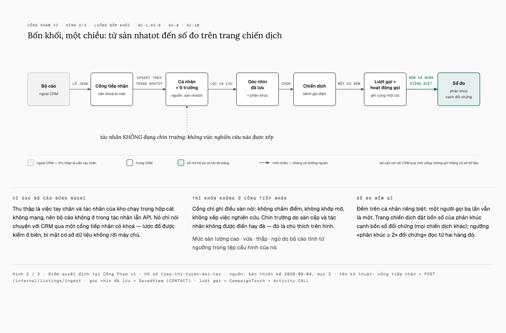
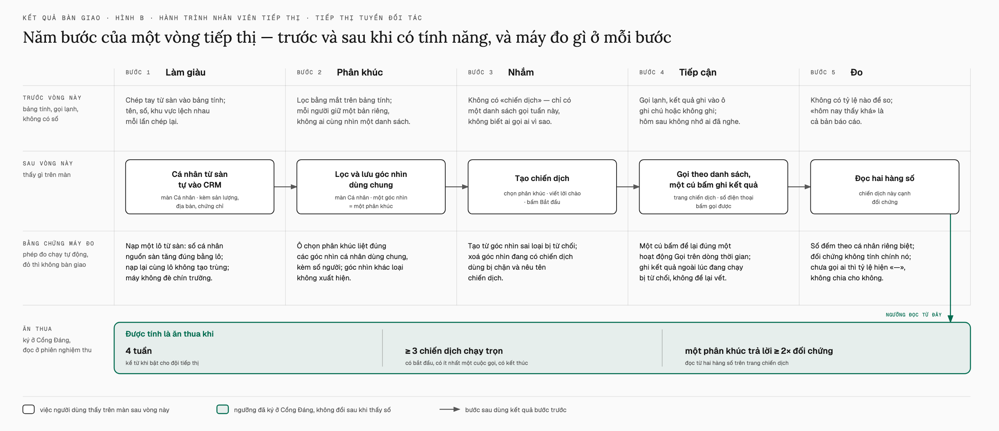

# Tổng kết vòng tuyển đối tác

Hồ sơ `tiep-thi-tuyen-doi-tac` · hạng T3 · khởi 04/09/2026 · ký bằng chứng 05/09 · vào nhánh 06/09 · PR [#2](https://github.com/phanlemanh/crm-onehub/pull/2), merge commit `08f532e`.
Bản trình bày có hình: <https://claude.ai/code/artifact/5bf6ae4d-9c79-4a36-882a-2660f8b2241d>.

**Đội tiếp thị chạy trọn một chiến dịch tuyển môi giới trong CRM** — từ ý «cào danh bạ môi giới về để tiếp thị» tới một tính năng đã ký bốn cổng người và nằm trên nhánh làm việc, trong ba ngày, ba vòng chấm, và một danh sách thẳng thắn những gì còn hở.

## Một câu

Giao được đúng thứ đã hứa, ký trên giới hạn đã khai, và nói ra từng chỗ hở.

Người dùng là đội tiếp thị nội bộ, không phải khách. Họ lọc ra một nhóm môi giới theo sản lượng đo từ sàn, gọi từng người, ghi kết quả bằng một cú bấm, và thấy ngay nhóm này trả lời khá hơn hay kém hơn phần còn lại. Mọi phép đo máy đều xanh; câu duy nhất máy không quyết được — «lượt cào thật có đủ người để mở chiến dịch đầu không» — người ký chấm Đạt sau khi máy đo lại được rằng 49 số điện thoại trong bằng chứng là số thật, khác nhau từng người.

| Cổng người | Ai · khi nào | Quyết gì |
|---|---|---|
| Cổng Đáng | Mạnh · 04/09 | Làm — pháp lý đã hỏi, số công khai và danh bạ có đồng ý. Tập trung growth hack nội bộ: phân khúc, làm giàu, nhắm, tiếp cận. |
| Cổng Phạm vi | Manh Phan · 04/09 | 16 tiêu chí, 25 phép đo, 9 mục cắt có tên. Duyệt trên thẻ, không sửa. |
| Cổng Kế hoạch (T3) | Manh Phan · 04/09 | 15 việc, 100 bước, chạy tuần tự. «Duyệt kế hoạch.» |
| Cổng Bằng chứng | Mạnh · 05/09 | E19 Đạt · 17 mục ngoài hợp đồng ghi giới hạn đã biết · 3 nhận nguyên trạng · 1 tách hồ sơ mới · phê 26 quyết định treo · ký. |
| Cổng Giá trị | chờ | Ngưỡng đã chốt 05/09. Phiên họp bốn tuần sau ngày bật — ngày bật chưa ghi. |

## Sản phẩm — bốn khối, một đường dữ liệu

Bộ cào đứng ngoài CRM, gửi lô qua một cổng có khoá. CRM ghi mỗi môi giới là một cá nhân với chín trường theo trang sàn. Phân khúc là một góc nhìn đã lưu của màn cá nhân — không có bảng mới. Mỗi cú bấm ghi kết quả tạo hai bản ghi trong cùng một giao dịch. Tác nhân nghiên cứu không đụng chín trường này.

**Nguồn — bộ cào nhatot**
- Python riêng ở `tools/listing-crawl`, ngoài turborepo; 28 bài kiểm; chế độ khô, chế độ mẫu, che danh tính.
- Qua được đố JS của Cloudflare bằng chế độ tàng hình; nhịp chờ 1,5 s nay chạy thật 1,5 s (trước khai vậy nhưng chạy 0,2 s).
- Gửi từng lô theo cấu hình, ghi đĩa trước khi gửi; hợp đồng hứa lô tới 500 mục và cổng nhận được thật 500 (trước đó trần thân yêu cầu chỉ chịu ~360).

**Làm giàu — chín trường từ sàn**
- Sản lượng · Tin đăng · Tin mới 30 ngày · Địa bàn · Hình thái · Chứng chỉ · Tên chuyên trang · Trang nhatot · Sàn cập nhật lúc.
- Khớp theo địa chỉ trang sàn; lô thiếu số điện thoại thì giữ số đang có.
- Cổng tiếp nhận có khoá riêng, kiểm lược đồ ở biên bằng Zod; không tạo việc cho tác nhân.

**Nhắm — phân khúc là góc nhìn đã lưu**
- Lọc Sản lượng = Cao, lưu góc nhìn dùng chung, chiến dịch chọn góc nhìn đó.
- Thành viên tính lại mỗi lần mở; bộ lọc «chưa gọi» quét theo lô, trần 5 000 người.
- Góc nhìn đang có chiến dịch dùng thì không xoá được.

**Tiếp cận & đo — chiến dịch**
- Nháp → đang chạy → kết thúc. Năm kết quả gọi: Không nghe · Trả lời · Hẹn gặp · Từ chối · Sai số.
- Mỗi cú bấm: một lượt gọi để đếm + một hoạt động Gọi trên dòng thời gian, cùng giao dịch — hỏng thì cả hai không ở lại.
- Số đo đếm người, không đếm cú bấm; đối chứng là mọi chiến dịch khác.
- Giao diện tiếng Việt trọn 12 trạng thái màn hình; cột bảng cắt theo bề rộng 768 và 1024.

## Con số

| Thước | Số | Ghi chú |
|---|---:|---|
| Tiêu chí nghiệm thu | 16 | 25 phép đo, 1 mục người phán |
| Commit | 74 | 28 · 20 · 2 theo ba ngày |
| Dòng thêm | ≈7 000 | API 1 310 · giao diện 1 972 · bộ cào 2 400 · kiểm 1 096 |
| Tệp kiểm mới | 13 | 1 migration, 2 bảng, 3 enum |
| Bài kiểm xanh | 1 320 | trọn bộ kho, 0 hit đệm, + 28 Python |
| Quyết định ghi sổ | 48 | 9 cắt có tên, 2 dấu cổng |
| Hồ sơ cào thật | 49/50 | 1 bị chặn · 49 số thật khác nhau |
| Tin đăng mỗi người | 37 – 436 | trung vị 61 · tứ phân vị 43 / 84 |

Dòng thêm đếm ngoài thư mục hồ sơ và tài liệu. Bài kiểm đếm ở lượt ghim lại bằng chứng trên cây đã gộp (`8b98a3d`), ép chạy lại toàn bộ.

## Đường đi — ba ngày, ba vòng chấm

| Khi | Gì | Chi tiết |
|---|---|---|
| 04/09 sáng | Khai thác theo lớp, bốn lượt | Từ «cào ba sàn» tới «tính năng cho tiếp thị nội bộ, không cho người dùng». Khảo sát kho crawl4ai sẵn có trước khi mở vòng. |
| 04/09 | Cổng Đáng · Cổng Phạm vi · Cổng Kế hoạch | Ba chữ ký trong một ngày. Năm hình vẽ cho người duyệt hình dung kết quả bàn giao. Chín mục cắt có tên — quan trọng nhất: chỉ một sàn, chỉ làn cá nhân, chỉ kênh người gọi tay. |
| 04/09 chiều–đêm | Viết 15 việc tuần tự, mỗi việc một phiên tươi | Bộ suy khoá trường không chịu tiếng Việt → ghi thẳng chín khoá ASCII. Dòng thời gian phải nói «Trả lời» chứ không nói mã. Lượt cào thật đầu: 0/11 vì Cloudflare → tàng hình → 11/11. |
| 05/09 00h | **Vòng chấm 1 — BLOCKED** | Hai phép đo trình duyệt chết vì làn bộ kiểm dựng lại cơ sở dữ liệu và khởi động lại máy chủ ngay dưới chân chúng. 22 phát hiện đã phản biện, 7 trong hợp đồng. |
| 05/09 01h | Bốn khuyết tật thật, sửa bằng mẫu rút từ trang thật | Bộ bóc không tách được hai con số; địa chỉ hồ sơ dựng từ chuỗi mờ nên mọi liên kết 404 — mà đó là khoá khớp. Phát hiện lớn nhất: **sàn chỉ công bố một con số** cho cả «tổng tin» lẫn «tin mới 30 ngày» — ghi thành việc của người, không đổi lặng. |
| 05/09 03h | **Vòng chấm 2 — REJECT, cùng lớp lỗi** | Vẫn là hai làn giẫm nhau. Theo luật lỗi-cùng-lớp, máy dừng, không tự chạy vòng ba, trình ba đường. Người chọn tách làn. |
| 05/09 04h–10h | Vòng chấm 3 — hai lượt tách rời, bốn lần chấm máy | Lượt lái trình duyệt: PASS. Lượt máy lần 1 lộ lệnh chỉ nạp 2/5 tệp kiểm; lần 2 lộ ba tệp kiểm xoá dữ liệu người dùng; lần 3 lộ trần thân yêu cầu thấp hơn lời hứa; lần 4: 0 trượt, 0 chặn, một lỗ trong hợp đồng khai chứ không sửa. |
| 05/09 11h–13h | Cổng Bằng chứng ký · ngưỡng nghiệm thu chốt | Một câu gộp định đoạt 21 mục ngoài hợp đồng. E19 chấm Đạt sau khi máy chứng minh chuỗi số giống nhau là do bước che danh tính của chính máy. |
| 05/09 → 06/09 | Giao — không thẳng | Nhánh nền đi trước 21 commit → gộp, ghim lại bằng chứng bằng một phiên tươi. Chốt trước-đẩy đỏ một lần vì hàng lạ trong cơ sở dữ liệu kiểm dùng chung — lần thứ ba của cùng lớp lỗi. Ba hồ sơ dở của vòng khác chặn merge → xếp lại sau (PR #7). |
| 06/09 | Vào nhánh làm việc | Merge commit, giữ nguyên các SHA mà chữ ký trích. Chốt chặn trên `onehub`: clean. |

## Người ký nhận gì — bốn thứ nằm trong chữ ký

- **Một lỗ trong hợp đồng, khai chứ không sửa.** Cổng tiếp nhận ghi mỗi mục một giao dịch riêng. Hỏng ở mục thứ n thì n−1 mục trước vẫn nằm lại, và lỗi trả về là 500 không thông điệp. Thuộc AC-3 (từ chối lô hỏng). Máy cạn lượt chấm và đã hứa lượt cuối, nên khai vào chữ ký thay vì mở vòng bốn không ai duyệt. Chỗ: `apps/api/src/listings/listing-ingest.service.ts:76`.
- **Sàn chỉ có một con số — việc của người.** Đo trên 49 hồ sơ thật, năm nguồn trên trang đều trùng: «tin mới 30 ngày» hiện là bản sao của «tổng tin», nên mức sản lượng thật ra xếp theo tổng tin. Một bài kiểm ghim lời khai này — ngày sàn tách hai số, bài đỏ và nhắc mở lại. Hai đường: bỏ trường và đổi tên ngưỡng, hoặc tìm nguồn khác cho độ tươi.
- **Ngưỡng 60 / 20 / 1 chưa có phân phối.** Mẫu thật thấp nhất 37 tin, nên hai mức dưới chưa hồ sơ nào chạm. Mức Cao = 60 chia mẫu gần đôi. Chỉnh trước chiến dịch đầu là việc đã khai từ Cổng Đáng.
- **17 giới hạn đã biết, 3 nhận nguyên trạng, 1 tách hồ sơ.** Nặng nhất trong 17: ghi kết quả gọi không cập nhật mốc hoạt động gần nhất; trường sàn bị lưu trữ làm lượt nạp sau lỗi liên tục; hộp tạo chiến dịch liệt cả góc nhìn riêng tư. Mục tách riêng: ô tìm trong trang thành viên thay hẳn bộ lọc phân khúc — người ngoài phân khúc lọt vào danh sách gọi (`_acceptance/tim-trong-phan-khuc/`).

## Sự cố & bài học — phần lớn thời gian mất vì hạ tầng

| Sự cố | Hệ quả | Đã làm | Trạng thái |
|---|---|---|---|
| Hai làn chung một cơ sở dữ liệu kiểm — ba lần | Vòng 1 BLOCKED, vòng 2 REJECT, chốt trước-đẩy đỏ khi giao | Tách làn (đường a); chip cô lập `crm_test` theo lượt → PR #6 | PR #6 chờ merge |
| Bộ kiểm xoá hàng chúng không tạo | Chạy đủ năm tệp thì ăn cả dữ liệu người dùng | Mỗi tệp chỉ dọn hàng mình dựng; chứng minh hai chiều bằng một hàng gieo sẵn | đã sửa |
| Lệnh chấm nạp 2/5 tệp kiểm | Hai tiêu chí chưa từng chạy dù hồ sơ khai đã chạy | Mở lệnh đủ năm tệp; chính bộ chấm bắt được | đã sửa |
| Mẫu tự dựng theo khuôn bên đọc | Bài kiểm xanh trong khi trang thật không tách được hai số | Mẫu rút từ trang thật, kiểm vòng tròn | đã sửa |
| Che danh tính thay mọi số bằng một hằng | Hội đồng nghi số điện thoại là giả | Đo lại bản trước khi che: 49 số khác nhau; ghi vào lời chấm E19 | đã bác |
| Dữ liệu thật trong lịch sử git | 3 commit mang tên và số của 49 môi giới | Che tệp hiện tại; chủ kho chọn đẩy nguyên vì pháp lý sạch và chữ ký trích SHA | quyết định người |
| `retireExhausted` trả 3 hàng khi trần 2 | CI đỏ 3/4 lượt gần nhất, không thuộc vòng này | Chip → PR #8 khoá lô bằng CTE vật chất hoá | PR #8 chờ merge |
| Cổng nghiệm thu trên CI chết trước khi chấm | 8 lượt đỏ liên tiếp vì thiếu một tệp khuôn | Chip → PR #3, đã merge | đã sửa |
| Nhánh `onehub` không bảo vệ | PR #3 merge với cổng đỏ; mọi cổng CI chỉ là thông tin | Nêu; bật bảo vệ nhánh là cài đặt kho | quyết định người |
| Ba hồ sơ dở chặn mọi PR | Luật cổng không gắn với diff; kit không có trạng thái xếp-lại | PR #7 xếp lại bằng cách đổi tên bằng chứng; chip kit | thủ thuật tạm |

Bài học đắt nhất không nằm ở code: bốn lần chấm máy trong vòng 3 đều lộ một chỗ mà lượt trước tự cho là đã đo. Màu xanh của một phép đo chưa từng đỏ không phân biệt được «vật lành» với «thước chưa chạy». Luật cặp hai-chiều của kit đã bắt đúng ba trong bốn chỗ đó.

## Hành trình sau bật — phiên nghiệm thu đo gì

Ngưỡng chốt 05/09, không sửa sau khi thấy số. Hồ sơ phiên: `_acceptance/tiep-thi-tuyen-doi-tac/uat-session.md` (`stage: scheduled`).

| Thước | Ngưỡng | Số đo |
|---|---:|---|
| Chiến dịch chạy trọn trong CRM sau 4 tuần | ≥ 3 | CHƯA ĐO |
| Phân khúc có tỷ lệ trả lời ≥ 2× trung bình toàn tập | ≥ 1 | CHƯA ĐO |
| Đội còn xuất bảng tính để chạy | không | CHƯA ĐO |
| Kết quả gắn ngược về đúng chiến dịch | có | CHƯA ĐO |

Giết ở Cổng Giá trị là thành công của quy trình — câu trả lời mua bằng giá một vòng dựng.

## Việc mở

**Của chủ kho**
1. Ghi ngày bật cho đội tiếp thị — phiên nghiệm thu là bốn tuần sau đó.
2. Merge PR #6 (cô lập DB kiểm) và PR #8 (sửa `retireExhausted`) sau khi check xanh.
3. Bật bảo vệ nhánh `onehub` với hai check bắt buộc — không thì cổng là sân khấu.
4. Quyết «một con số»: bỏ trường tin mới 30 ngày, hay tìm nguồn khác.
5. Chỉnh ngưỡng 60/20/1 theo phân phối thật trước chiến dịch đầu.

**Của máy, khi được gọi**
1. Lái-thử người-lạ — phiên tươi tự lái sản phẩm thật, giao nhật-ký-vấp; tiền trạm của phiên nghiệm thu.
2. Mở vòng `tim-trong-phan-khuc` — ô tìm phải tìm trong phân khúc.
3. Sửa lỗ AC-3 — nạp lô trong một giao dịch, lỗi có kiểu — như một vòng nhỏ có tiêu chí riêng.
4. Hai chip ở kho kit: thẻ Cổng 2 giấu lỗi trong hợp đồng chưa sửa; luật cổng không gắn diff và thiếu trạng thái xếp-lại.

## Tra cứu

Hồ sơ: `_acceptance/tiep-thi-tuyen-doi-tac/` — hợp đồng · bộ đo · sổ quyết định · bằng chứng (`verified_commit 8b98a3d`, ghim lại lần 1) · trang bằng chứng · phiên nghiệm thu. Thiết kế: `docs/superpowers/specs/2026-09-04-tiep-thi-tuyen-doi-tac-design.md`. Kế hoạch: `docs/superpowers/plans/2026-09-04-tiep-thi-tuyen-doi-tac.md`. PR: #2 · #3 · #6 · #7 · #8.

Từ điển: **known-limits** — giới hạn đã biết, người ký chấp nhận trước khi phát hành · **re-pin** — ghim lại bằng chứng lên cây mới sau khi gộp, bằng một lượt chạy có ghi sổ · **fixture** — hồ sơ dựng sẵn để thử, không phải hồ sơ thật · **machine-lane** — làn máy chạy trọn bộ kiểm, không có người can thiệp · **lỗi-cùng-lớp** — vòng sửa thứ hai vẫn sinh lỗi cùng tên lớp với vòng một ⇒ khuôn giải sai, máy dừng · **đối chứng** — mọi chiến dịch khác, không tính chính nó.
