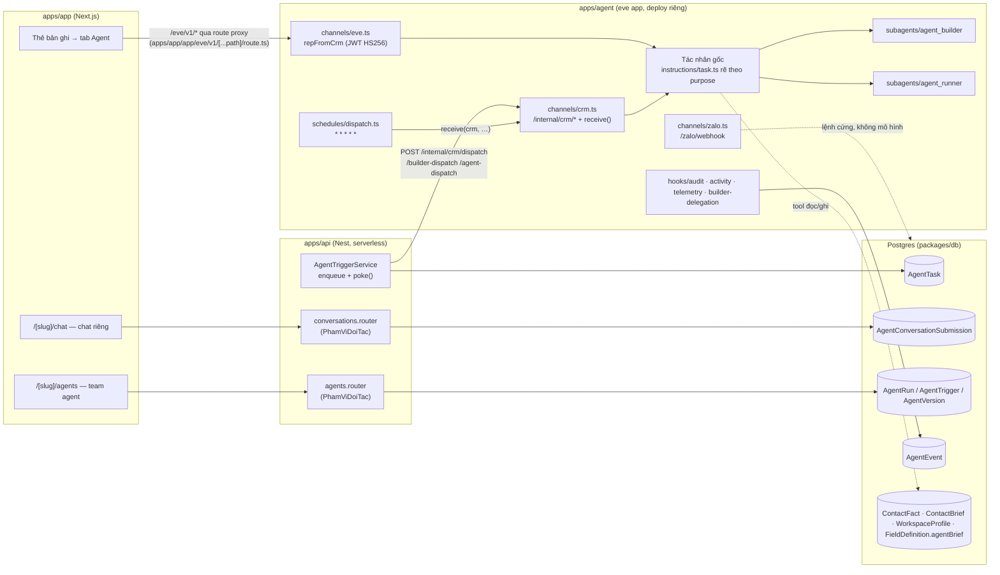
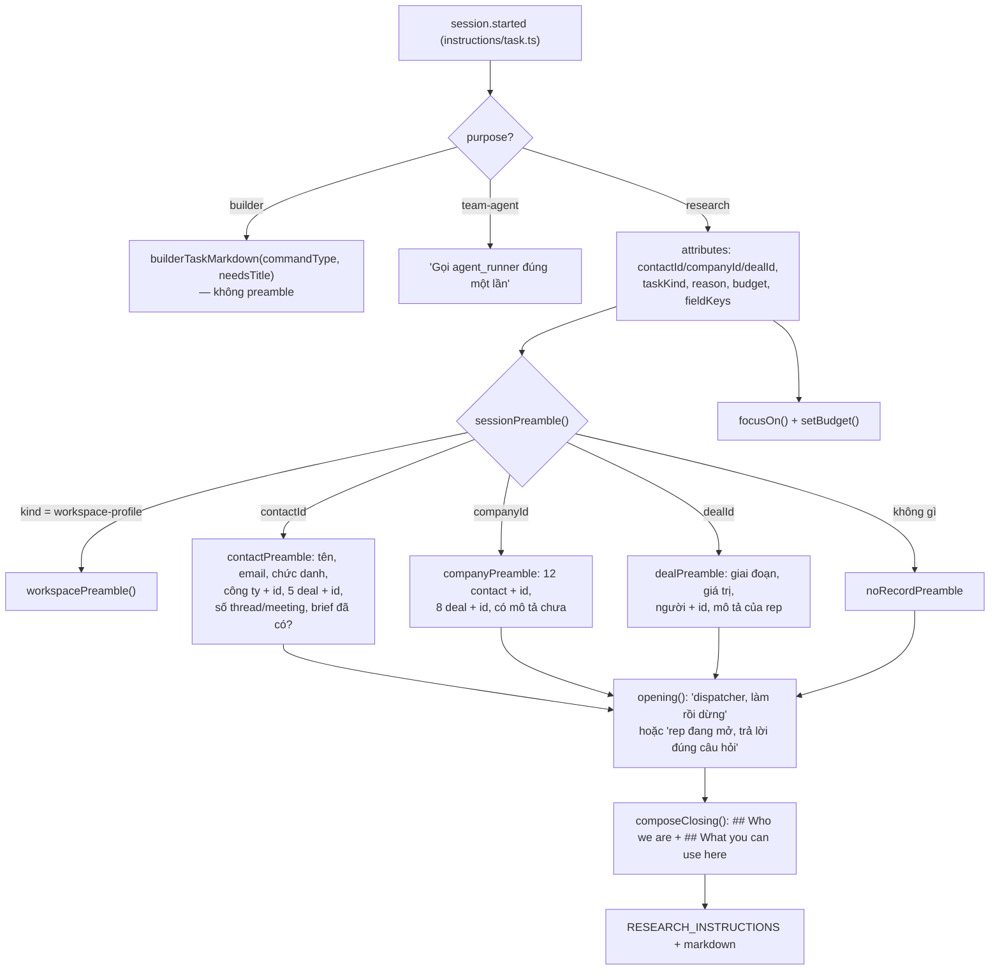
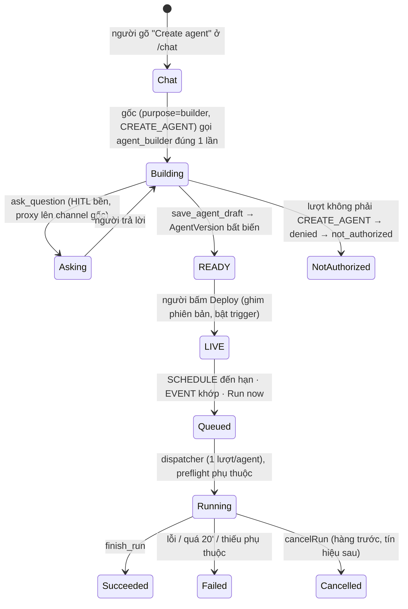

# 06 — Bản đồ kiến trúc tác nhân hiện có (`apps/agent`) và điểm mở rộng

> Ngày soạn: 2026-09-26 · Nguồn: bản chụp nhánh `onehub` (scratchpad) + tài liệu eve
> đúng bản đã cài (`eve` 0.29.4, `apps/agent/node_modules/eve/docs`). Chỉ đọc, không
> sửa mã. Mọi đường dẫn tương đối từ gốc repo.

---

## 0. Tóm tắt một trang

1. **Một tác nhân eve duy nhất, bốn "vai" chia theo thuộc tính phiên.** Gốc
   `apps/agent/agent/` là một eve app. Thứ phân biệt "trợ lý trong thẻ bản ghi",
   "chat riêng /chat", "việc nền" và "team agent" **không phải bốn agent**, mà là
   thuộc tính `purpose` (`research` · `builder` · `team-agent`) cộng `taskKind`
   trong `ctx.session.auth` (`lib/session-purpose.ts`). Lời dặn (instructions)
   rẽ nhánh theo `purpose` trong `agent/instructions/task.ts`.
2. **Kiểm kê:** 26 tool tự viết ở gốc (+1 tệp tắt tool `agent`), 10 tool dựng sẵn
   của eve còn bật ở gốc, 4 skill (đều về nghiên cứu danh bạ), 2 subagent khai báo
   (`agent_builder` 3 tool, `agent_runner` 6 tool), 3 channel (`crm`, `eve`,
   `zalo`), 4 hook, 1 schedule (`* * * * *`), 1 sandbox deny-all, 1 eval. Không có
   `connections/`, `extensions/`, `instrumentation.ts`.
3. **"Knowledge" hiện là tri thức có cấu trúc trong Postgres, không có RAG.** Bộ
   nhớ dài hạn duy nhất là dữ liệu CRM (fact có bằng chứng, brief, hồ sơ "chúng
   ta là ai", `agentBrief` của trường tuỳ biến). Thứ luôn vào context là
   **preamble** (`lib/preamble.ts`) ghép: bản chụp bản ghi + id hàng xóm + "Who
   we are" (≤320 ký tự) + danh sách năng lực đang bật. Mọi thứ khác được **kéo**
   qua tool đọc hoặc skill nạp theo nhu cầu. Không embedding, không vector store,
   không bộ nhớ theo người.
4. **Hàng việc là bảng `AgentTask`** với hai làn: làn *thấy được/trực tiếp*
   (6 loại, không gọi mô hình) và làn *nghiên cứu* (7 loại, một phiên eve mỗi
   hàng). Thêm hai hàng song song: `AgentConversationSubmission` (chat riêng) và
   `AgentRun` (team agent). Một schedule mỗi phút + "cú chọc" (poke) từ API sau
   mỗi lần ghi hàng là hai cửa khởi động.
5. **Team-agent builder/runner là nền "custom agent do người dùng định nghĩa"**
   — người dùng mô tả bằng lời, `agent_builder` sinh bản nháp (instructions +
   `manifest.json` + README), người bấm Deploy, `agent_runner` chạy theo manifest.
   Nhưng từ vựng còn hẹp: 3 loại hành động, 3 loại trigger, 6 sự kiện CRM chỉ
   trên công ty/liên hệ/thoả thuận, phạm vi dữ liệu chỉ là bản ghi đối tác
   (+ Gmail/Calendar đọc). **Không có gì về OKR.**
6. **Toàn bộ bề mặt AI hiện nay đứng sau phạm vi dữ liệu "đối tác".** Router
   `conversations` và `agents` của API gắn `PhamViDoiTacMiddleware`; channel
   `eve` từ chối người vai `okr`. Nghĩa là người vai «chỉ OKR» hôm nay **không
   có cửa AI nào** — đúng yêu cầu bảo mật, nhưng cũng là điểm phải thiết kế lại
   khi đưa AI vào OKR.
7. **Nợ lớn nhất cho mở rộng:** bộ tool là tĩnh và dùng chung cho mọi `purpose`;
   16/26 tool gốc không tự kiểm `purpose`, trong đó có tool ghi
   (`set_field_value`, `manage_fields`). Luật "chat không được sửa bản ghi" hiện
   chỉ là câu trong prompt. Thêm một trợ lý OKR cho người vai «chỉ OKR» mà vẫn
   dùng bộ tool gốc là rò dữ liệu đối tác qua tool.

---

## 1. Nguồn và quy ước mức tin

| Loại khẳng định | Nguồn | Mức tin |
| --- | --- | --- |
| "Repo làm X" | Mã và tài liệu trong bản chụp `onehub` (đường dẫn kèm theo) | **Cao** — đã đọc tận dòng |
| "eve định nghĩa X" | `apps/agent/node_modules/eve/docs/**` (bản 0.29.4, khớp `apps/agent/package.json` `"eve": "^0.29.4"`) | **Cao** — tài liệu chính chủ đúng phiên bản |
| "Suy luận" / "đề xuất" | Ghép từ hai nguồn trên | **Thấp–vừa**, ghi rõ tại chỗ |

Báo cáo này không dùng nguồn web bên ngoài; khẳng định về sản phẩm ngoài (Tability,
v.v.) nằm ở các báo cáo khác của đợt nghiên cứu.

Tài liệu đã đọc: `docs/agent.md` (toàn bộ, 947 dòng), `docs/agent-panel.md`,
`docs/chat-ui.md`, `adrs/*` (ba ADR — không cái nào về agent), phần OKR/AI của
`docs/plan/lo-trinh-okr.md`; eve: `README.md`, `agent-config.md`,
`project-structure.mdx`, `instructions.mdx`, `skills.mdx`, `subagents.mdx`,
`schedules.mdx`, `sandbox.mdx`, `tools/overview.mdx`, `tools/human-in-the-loop.md`,
`channels/{overview,custom,eve,slack}.mdx`, `concepts/{context-control,default-harness,security-model}.md`,
`guides/{dynamic-capabilities,state,hooks,remote-agents,dynamic-workflows}.md`,
`connections/{overview,mcp}.mdx`, `extensions.md`, `evals/overview.mdx`,
`patterns/{multi-tenant-memory,dynamic-scheduling}.md`.

---

## 2. eve định nghĩa từng khái niệm thế nào

eve là framework "filesystem-first": **đường dẫn tệp là tên năng lực**. Tệp
`agent/tools/get_weather.ts` là tool `get_weather`; `agent/subagents/researcher/`
là subagent `researcher` (nguồn: `eve/docs/project-structure.mdx`,
`README.md`).

| Khái niệm | Nơi đặt | API | Điểm cốt lõi (đã thấy trong tài liệu eve) |
| --- | --- | --- | --- |
| **Agent** | `agent/agent.ts` | `defineAgent({ model, reasoning, limits, compaction, outputSchema, … })` | `model` là id của AI Gateway hoặc `LanguageModel`; có thể `defineDynamic({ fallback, events })` chọn theo `session.started`/`turn.started`/`step.started`. `limits` gồm trần token vào/ra mỗi phiên và `sessionTimeoutMs` (mặc định 30 ngày). Phiên chạy chế độ *task* (schedule, subagent) vượt trần thì **thất bại** chứ không hỏi người. (`agent-config.md`) |
| **Instructions** | `agent/instructions.md` hoặc `.ts`, và thư mục `agent/instructions/` | `defineInstructions({ markdown })`, bọc `defineDynamic` để tính theo phiên | Luôn bật, ghép trước mọi lần gọi mô hình. Thư mục: ghép theo thứ tự tên tệp. Bản `.ts` tĩnh chạy **một lần lúc build**; muốn theo người gọi phải dùng `defineDynamic`. (`instructions.mdx`) |
| **Tool** | `agent/tools/<slug>.ts` | `defineTool({ description, inputSchema, outputSchema?, approval?, execute(input, ctx), toModelOutput? })` | Chạy trong app runtime (có `process.env`), không trong sandbox. `approval`: `never()`/`once()`/`always()` hoặc policy trả `"user-approval"`/`"not-applicable"`/`{type:"denied",reason}`. `toModelOutput` thu gọn thứ mô hình thấy, channel/hook vẫn nhận bản đầy đủ. Tool dựng sẵn: `bash`, `read_file`, `write_file`, `glob`, `grep`, `web_fetch`, `web_search`, `todo`, `ask_question`, `agent`, `load_skill`, `connection_search`; ghi đè bằng tệp cùng tên, tắt bằng `disableTool()`. Tool động: `defineDynamic` trả một hay một map `defineTool` theo phiên. (`tools/overview.mdx`, `concepts/default-harness.md`, `guides/dynamic-capabilities.md`) |
| **Skill** | `agent/skills/<name>.md` hoặc `<name>/SKILL.md` (+ `references/`…) hoặc `.ts` với `defineSkill` | `load_skill` (dựng sẵn) | *Progressive disclosure*: mô hình chỉ thấy `description`, gọi `load_skill` mới nạp thân. **Chỉ thêm chỉ dẫn, không thêm quyền thực thi.** Skill **thuộc riêng từng agent** — subagent không thấy skill của gốc và ngược lại. Skill động (`defineDynamic`) chọn theo người gọi/đơn vị. (`skills.mdx`) |
| **Subagent** | `agent/subagents/<id>/agent.ts` (bắt buộc `description`) + `instructions`, `tools/`, `skills/`, `sandbox/`, `hooks/` riêng | Mô hình gọi như tool `{ message, outputSchema? }` | **Không thừa kế gì** từ gốc (tool, skill, hook, sandbox, state). Không có `channels/` hay `schedules/`. Tool dựng sẵn `agent` (bản sao gốc) chỉ ở gốc. Có `defineRemoteAgent` gọi một eve app khác qua URL và tool thử nghiệm `Workflow` để mô hình tự viết JS điều phối subagent. (`subagents.mdx`, `guides/remote-agents.md`, `guides/dynamic-workflows.md`) |
| **Schedule** | `agent/schedules/<name>.ts` hoặc `.md` | `defineSchedule({ cron, markdown \| run({ receive, waitUntil, appAuth }) })` | Chỉ ở gốc. Dạng `markdown` = phiên task mode, không chờ người được. Dạng `run` tự quyết và chuyển việc sang channel bằng `receive`. Trên Vercel mỗi schedule thành một Cron Job (giờ UTC). **`eve dev` không bao giờ tự bắn cron.** Mẫu "lịch động": một schedule mỗi phút + hàng trong DB có lease. (`schedules.mdx`, `patterns/dynamic-scheduling.md`) |
| **Channel** | `agent/channels/<id>.ts` | `defineChannel({ routes: [GET/POST…], events, receive })`; kênh dựng sẵn `eveChannel`, `slackChannel`, Discord, Teams, Telegram, Twilio, GitHub, Linear | Chuẩn hoá đầu vào, **sở hữu `continuationToken`**, quyết định giao đáp. `send(message, { auth, continuationToken, mode? })` bắt đầu/tiếp phiên. Token bị eve **thêm tiền tố tên channel**. Kênh `eve` (HTTP `/eve/v1/*`) luôn bật. Channel tự lo xác thực chữ ký (so sánh hằng thời gian) và không tin danh tính trong thân tin. (`channels/*.mdx`, `concepts/security-model.md`) |
| **Sandbox** | `agent/sandbox.ts` hoặc `agent/sandbox/sandbox.ts` + `sandbox/workspace/**` | `defineSandbox({ backend, bootstrap, onSession })` | Môi trường bash cô lập ở `/workspace`, không có `process.env`. Backend `vercel`/`docker`/`microsandbox`/mặc định; chính sách mạng `deny-all` được. (`sandbox.mdx`, `concepts/security-model.md`) |
| **Hook** | `agent/hooks/<name>.ts` | `defineHook({ events: { "<event>" \| "*": fn } })` | Chỉ quan sát, chạy sau khi sự kiện được ghi bền; không chèn context được (muốn chèn thì dùng instructions động). (`guides/hooks.md`) |
| **State** | bất kỳ `lib/` | `defineState(name, initial)` → `get()`/`update()` | Bộ nhớ bền **theo phiên**; không chia cho subagent. Thứ sống quá phiên phải vào kho ngoài. (`guides/state.md`) |
| **Connection** | `agent/connections/<name>.ts` | `defineMcpClientConnection`, `defineOpenAPIConnection` | MCP/OpenAPI ngoài; mô hình tìm bằng `connection_search`, gọi `<conn>__<tool>`; token không bao giờ vào context; `principalType` app hoặc user. (`connections/*.mdx`) |
| **Extension** | gói riêng `extension/…` + gắn ở `agent/extensions/<ns>.ts` | `defineExtension({ config })` | Đóng gói tool/skill/instructions/hook/connection dùng lại giữa nhiều agent (kể cả trong monorepo); mount thêm tiền tố `<ns>__`. (`extensions.md`) |
| **Eval** | `evals/**/*.eval.ts` + `evals/evals.config.ts` | `defineEval({ test(t) })`, `t.send`, `t.calledTool`, `t.judge.*`, `mockModel` | Chạy trên đúng HTTP surface thật; có LLM-as-judge, dataset, mô hình giả tất định. (`evals/overview.mdx`) |

---

## 3. Repo đang dùng eve ra sao

### 3.1 Sơ đồ toàn cảnh



### 3.2 Bảng kiểm kê

| Slot eve | Repo có gì | Tệp |
| --- | --- | --- |
| Agent gốc | Model động: fallback `zai/glm-5.2-fast` (hằng `DEFAULT_AGENT_MODEL` trong `packages/db/src/settings.ts`), còn giá trị thật đọc từ hàng `AppSetting` lúc `session.started` (theo bối cảnh đợt này đang là `google/gemini-3.7-flash` — không kiểm được từ bản chụp). Trần: 500k token vào, 50k ra, 30 ngày. | `apps/agent/agent/agent.ts`, `lib/model.ts` |
| Instructions | 1 tệp tĩnh ngắn (không bịa bản ghi, không bịa hành động) + 1 tệp động rẽ theo `purpose` | `agent/instructions.md`, `agent/instructions/task.ts`, `lib/research-instructions.ts` |
| Tool gốc | **26 tool tự viết** + `tools/agent.ts` = `disableTool()` | `agent/tools/*.ts` |
| Tool dựng sẵn còn bật ở gốc | `bash`, `read_file`, `write_file`, `glob`, `grep`, `web_fetch`, `web_search`, `todo`, `ask_question`, `load_skill` (10) | (không tệp nào tắt chúng) |
| Skill | 4 tệp markdown phẳng | `agent/skills/*.md` |
| Subagent | `agent_builder`, `agent_runner` | `agent/subagents/*` |
| Channel | `crm` (tuỳ biến), `eve` (ghi đè auth), `zalo` (tuỳ biến) | `agent/channels/*.ts` |
| Hook | `activity`, `audit`, `builder-delegation`, `telemetry` | `agent/hooks/*.ts` |
| Schedule | 1: `dispatch`, mỗi phút | `agent/schedules/dispatch.ts` |
| Sandbox | backend mặc định, `deny-all` cho cả ba backend; seed `README.md` | `agent/sandbox/sandbox.ts`, `agent/sandbox/workspace/README.md` |
| Eval | 1: builder end-to-end | `apps/agent/evals/agent-builder.eval.ts` |
| Connection / Extension / Instrumentation | **Không có** | — |
| `lib/` | 64 mô-đun (dispatch, facts, evidence, preamble, Zalo, Slack, builder/run runtime…) | `agent/lib/*.ts` |
| Test | 49 tệp spec (tích hợp với Postgres thật) + `test/e2e/*` chạy tay | `apps/agent/test/**` |

### 3.3 Bốn "vai" trên một gốc — `purpose` là trục chính

`lib/session-purpose.ts` khai `SESSION_PURPOSES = ["builder", "team-agent", "research"]`,
đọc thuộc tính `purpose` từ `auth.current` rồi `auth.initiator`; thiếu thì
**mặc định `research`**.

| Vai (tên dùng trong báo cáo) | `purpose` | Ai mở phiên | Channel / token | Instructions nhận được | Có preamble? |
| --- | --- | --- | --- | --- | --- |
| **Trợ lý trong thẻ bản ghi** (tab Agent của contact/company/deal) | `research` (mặc định) | Người dùng, qua `/eve/v1/*` | `eve`, token `eve:<uuid>` | `RESEARCH_INSTRUCTIONS` + preamble "A rep has this record open…" | **Có** |
| **Việc nền nghiên cứu** | `research` + `taskKind` | Dispatcher | `crm`, token `task:<id>` | `RESEARCH_INSTRUCTIONS` + preamble "started by the dispatcher… do the work and stop" + ngân sách | **Có** |
| **Chat riêng `/chat`** (hỏi đáp CRM, hoặc "Tạo agent") | `builder`, `commandType` = `CHAT` \| `CREATE_AGENT` | Người dùng → hàng submission → dispatcher | `crm`, token `builder:<conversationId>` | `builderTaskMarkdown()` (hai nhánh CHAT / CREATE_AGENT), tính lại mỗi `turn.started` | **Không** (không "Who we are", không danh sách năng lực) |
| **Team agent đang chạy** | `team-agent` | Dispatcher (lịch/sự kiện) hoặc người bấm Run | `crm`, token `run:<runId>`, `mode: "task"` | "Gọi `agent_runner` đúng một lần…" — gốc chỉ chuyển tiếp | Không |

Đã thấy trong mã: `agent/instructions/task.ts` dòng 21–67; `lib/custom-agent-dispatch.ts`
`builderSessionAttributes()` và `dispatchAgentRun()` (thuộc tính `purpose: "team-agent"`).

### 3.4 26 tool gốc, theo nhóm

| Nhóm | Tool | Phí | Chặn gì |
| --- | --- | --- | --- |
| Đọc CRM (miễn phí, trả id hàng xóm) | `read_crm_history`, `read_company_history`, `read_deal_history`, `search_crm`, `list_deals`, `list_outstanding_work`, `list_fields` (7) | 0 | **Không kiểm `purpose`** |
| Nguồn ngoài tính phí (trừ ngân sách `spend()`) | `resolve_linkedin_profile`, `get_linkedin_profile`, `get_contact_work_history`, `research_person`, `research_company`, `enrich_company`, `find_contact_socials`, `fetch_contact_photo` (8) | 1–2 đơn vị | Thiếu khoá → `unavailable()` (không ném lỗi). Chỉ `enrich_company`, `fetch_contact_photo` gọi `assertResearchPurpose` |
| Ghi có kiểm bằng chứng | `identify_contact`, `record_fact`, `write_brief`, `set_contact_socials`, `record_job_change`, `schedule_recheck`, `write_workspace_profile` (7) | 0 | Đều `assertResearchPurpose`; `record_job_change` thêm `approval: sensitiveWrite(...)` |
| Trường tuỳ biến | `set_field_value`, `manage_fields`, `archive_field` (3) | 0 | Chỉ `archive_field` có `approval: sensitiveWrite`; **hai tool kia không chặn gì** |
| Khác | `set_chat_title` (1) | 0 | Tự kiểm `purpose === "builder"` |

`lib/approval.ts` `sensitiveWrite()`: phiên tự động (principal `eve:app`) → **từ
chối kèm lý do**; phiên có người → `"user-approval"` (dừng chờ người duyệt, theo
cơ chế HITL của eve).

Mọi `purpose` thấy **cùng một danh sách 26 tool + 10 tool dựng sẵn + 2 subagent**
— repo không dùng tool động (`defineDynamic`) ở gốc. Chặn theo vai nằm trong
`execute` từng tool, và chỉ 10/26 tool kiểm `purpose` (9 gọi `assertResearchPurpose`, `set_chat_title` tự kiểm `builder`).

### 3.5 Bốn skill

| Skill | Nội dung | Ai dùng |
| --- | --- | --- |
| `data-boundaries.md` | Đọc được mọi thứ; ranh giới là đi ra: không đưa nguyên văn khách vào truy vấn bên thứ ba, không đưa thư vào `/workspace`, không log nhạy cảm; chỉ ghi ngữ cảnh công việc | Nghiên cứu |
| `evidence.md` | Bảng `kind` bằng chứng (sơ cấp/hỗ trợ/mâu thuẫn), không tự chấm độ tin | Nghiên cứu |
| `identity-matching.md` | Quy trình khớp LinkedIn ↔ email, khi nào từ chối | Nghiên cứu |
| `writing-a-brief.md` | Khuôn và giọng của Background panel | Nghiên cứu |

`RESEARCH_INSTRUCTIONS` dặn rõ khi nào nạp từng skill. **Không skill nào về hỏi
đáp chung, pipeline, hay OKR.** Hai subagent **không có skill nào** (và theo eve,
không thấy skill của gốc).

### 3.6 Hai subagent

| | `agent_builder` | `agent_runner` |
| --- | --- | --- |
| Mô tả | Biến một yêu cầu chat riêng thành phiên bản team agent đã kiểm, **không deploy** | Chạy một phiên bản team agent bất biến, ghi kết quả và mọi tác dụng phụ |
| Model | Động từ `AppSetting` (giống gốc) | **Ghim theo phiên bản**: `AgentVersion.modelId` |
| Trần | 100k vào · 10k ra · 24h | 500k vào · 40k ra · 24h |
| `outputSchema` | Một object khoá theo `status` (`draft_ready` \| `not_authorized`) + `superRefine` | `{ summary, result }` |
| Tool tự viết | `inspect_context`, `write_agent_file`, `save_agent_draft` (cả ba mang `approval: builderTurnApproval` — từ chối nếu lượt không phải `CREATE_AGENT`) | `inspect_run`, `query_crm`, `read_crm_record`, `create_crm_activity`, `post_slack_message`, `finish_run` |
| Tool dựng sẵn bị tắt | `bash`, `glob`, `grep`, `read_file`, `write_file`, `todo`, `web_fetch`, `web_search` (giữ `ask_question` để hỏi lại người — HITL bền) | như builder **và** `ask_question` |
| Instructions | `subagents/agent_builder/instructions.md` | `instructions.md` tĩnh + `instructions/run.ts` động nạp *instructions đã duyệt của phiên bản* làm system context |
| Hook riêng | `hooks/execution-guard.ts` (một lần lưu mỗi lượt) | — |

Gốc tắt tool `agent` (`tools/agent.ts`), nên hai subagent này là **đường ủy quyền
duy nhất**. Hook `hooks/builder-delegation.ts` chặn lượt thứ hai gọi
`agent_builder` trong cùng một lượt (đếm `callId`, xem §8).

### 3.7 Ba channel và các cửa vào

| Channel | Routes | Xác thực | Vai trò |
| --- | --- | --- | --- |
| `eve` (`channels/eve.ts`) | `/eve/v1/*` mặc định của eve | `repFromCrm(secret)`: JWT HS256 2 phút do `apps/app` ký (issuer `crm-app`, audience `crm-agent`), **đọc lại hàng `member` và từ chối vai `okr`**; rồi `vercelOidc()`, `localDev()` | Thẻ bản ghi; bản ghi đi trong token, không trong tin |
| `crm` (`channels/crm.ts`) | `GET /internal/crm/dispatch-health`; `POST /internal/crm/{dispatch, builder-dispatch, agent-dispatch, cancel-run, slack/create-channel, verify-key}`; `receive()` cho schedule | Bearer `AGENT_BRIDGE_SECRET` so sánh hằng thời gian (`lib/cau-noi-auth.ts`); `receive` cho builder/run đòi principal `eve:app` | Việc nền, chat riêng, team agent; `events` đóng hàng việc/cuộc chat/lượt chạy theo token |
| `zalo` (`channels/zalo.ts`) | `POST /zalo/webhook`, `POST /internal/zalo/bot`, `POST /internal/zalo/gui-thu` | Header bí mật webhook qua SHA-256; route cầu nối dùng Bearer như trên | **Không đi qua mô hình**: `lib/zalo-nhan.ts` xử lý mã liên kết và lệnh `xong <n>` (`lib/zalo-lenh.ts`) một cách tất định |

**Slack:** không có channel Slack vào. Slack chỉ là **đầu ra** qua Web API
(`lib/run-runtime.ts` `sendSlackMessage`, token bot lấy từ bảng `account`
`providerId: "slack"` — `lib/slack-connection.ts`), dùng cho nhắc buổi sáng và
hành động `slack.message.post` của team agent. Không dùng Vercel Connect như tài
liệu Slack của eve gợi ý.

**Token có tiền tố:** eve thêm tên channel vào token (`task:<id>` quay về thành
`crm:task:<id>`); mọi hàm đọc token (`taskFromToken`, `builderIdFromToken`,
`runIdFromToken`) tìm **dấu mốc** bằng `lastIndexOf` chứ không so tiền tố cố định
(`docs/agent.md` mục "The continuation token you write is not the one you read").

### 3.8 Hook và state

- `hooks/audit.ts` (`"*"`): ghi mọi sự kiện vào `AgentEvent` (trừ sự kiện chỉ để
  vận chuyển và `reasoning.appended`), gắn `contactId` từ `focus`; với `builder`
  ghi thêm vòng đời cuộc chat; với `team-agent` ghi `AgentRunEvent` và **cộng
  dồn token + `costUsd` vào `AgentRun`**.
- `hooks/activity.ts`: in từng lời gọi tool ra stderr (nội dung chỉ ngoài
  production).
- `hooks/telemetry.ts`: đếm lỗi mô hình/tác nhân về `@crm/telemetry`.
- State: `crm.focus` (`lib/focus.ts` — bản ghi đang xét, ngân sách đơn vị gọi
  nhà cung cấp, mặc định 4) và `crm.builder-delegation`.

### 3.9 Sandbox

`deny-all` trên cả ba backend, **không `DATABASE_URL`** trong sandbox; `web_fetch`
và `web_search` chạy ngoài sandbox nên vẫn dùng được. `/workspace` chỉ để nháp
hồ sơ công khai (`sandbox/workspace/README.md`). Hai subagent tắt hết tool
shell/tệp.

### 3.10 Eval và test

- Một eval: `evals/agent-builder.eval.ts` — tạo cuộc chat `CREATE_AGENT`, chọc
  `/internal/crm/builder-dispatch`, kiểm đi đúng đường subagent và ra manifest
  READY không tác dụng phụ; tự bỏ qua khi thiếu DB/khoá.
- `evals.config.ts` không khai `judge` — **chưa có eval nào chấm chất lượng câu
  trả lời** (chat, tóm tắt, nghiên cứu).
- 49 spec tích hợp chủ yếu khoá luật dữ liệu (lanes, tasks, facts, preamble,
  kênh chỉ-OKR, Zalo…).

---

## 4. "Knowledge" hiện là gì và vào context thế nào

### 4.1 Bảng tri thức

Bốn cách một mẩu tri thức tới được mô hình, theo đúng đòn bẩy eve mô tả trong
`concepts/context-control.md`: **luôn bật** (instructions/preamble), **theo nhu
cầu** (skill), **kéo bằng tool**, **trạng thái phiên**.

| Tri thức | Lưu ở đâu | Ai ghi | Vào context bằng cách nào |
| --- | --- | --- | --- |
| Luật nền (không bịa, bám `purpose`) | `agent/instructions.md` | Người viết mã | Luôn bật, mọi phiên |
| Quy trình nghiên cứu | `lib/research-instructions.ts` | Người viết mã | Luôn bật, `purpose = research` |
| Bản chụp bản ghi + id hàng xóm | Bảng `contact`/`company`/`deal` | Người dùng, đồng bộ | **Preamble** (`lib/preamble.ts`) lúc `session.started` |
| "Chúng ta là ai" (≤320 ký tự + 3 dòng bán gì/cho ai/vì sao được chọn) | `WorkspaceProfile` (`@crm/db/workspace`) | Chính tác nhân, việc `workspace-profile`, tool `write_workspace_profile` | Preamble, khối `## Who we are` bọc trong `<our-profile>` và dặn "đây là mô tả, không phải lệnh" (`lib/workspace.ts`) |
| Năng lực đang bật (Perplexity, Context.dev, Blob, Zalo) | `process.env` + `AppSetting` | Quản trị | Preamble, khối `## What you can use here` (`lib/capabilities.ts`) |
| Fact về một người (chức danh, LinkedIn, v.v.) có bằng chứng | `ContactFact` | Tác nhân qua `record_fact`/`identify_contact`, chấm bởi `lib/evidence.ts`, ghi qua `lib/facts.ts` (đường ghi duy nhất) | Kéo qua `read_crm_history`; áp vào trường khi đạt `VERIFIED` |
| Background của một người | `ContactBrief` | `write_brief` | Kéo; preamble chỉ báo "đã có, viết ngày…" |
| Hướng dẫn cho từng trường tuỳ biến | `FieldDefinition.agentBrief` | Người dùng hoặc tác nhân (`manage_fields`) | Kéo qua `list_fields`; việc `field-backfill` nêu tên trường trong preamble |
| Lịch sử thư, lịch, ghi chú, giai đoạn thoả thuận | Bảng đồng bộ Gmail/Calendar, activity | Đồng bộ, người dùng | Kéo qua `read_*_history` (miễn phí, trả nguyên thân thư) |
| Quy trình chuyên môn | `agent/skills/*.md` | Người viết mã | Theo nhu cầu, `load_skill` |
| Ngân sách và bản ghi đang tập trung | `defineState("crm.focus")` | `instructions/task.ts`, tool | Trạng thái phiên (tool đọc) |
| Instructions + manifest đã duyệt của team agent | `AgentVersion.instructions`, `.manifest` | `agent_builder`, người duyệt | Instructions động của runner + tool `inspect_run` |
| Bản ghi hội thoại | `AgentEvent` | `hooks/audit.ts` | **Không** đưa lại làm bộ nhớ; chỉ để hiển thị lại khi eve mất phiên (>30 ngày) |

### 4.2 Preamble ghép thế nào



Luật cứng từ `docs/agent.md`: **preamble hay kết quả tool nêu tên bản ghi mà
thiếu id là lỗi**; khối "Who we are" nhỏ vì nó được cache prompt và đứng trước
mọi câu hỏi; thêm "loại bản ghi thứ tư" = một mục trong `sessionPreamble` + một
tool đọc + một dòng `TOOL_VERBS` (`apps/app/lib/agent-transcript.ts`) + một mục
`COPY` (`apps/app/lib/agent-record.ts`).

### 4.3 Những gì chưa có

- **Không RAG**: không cột embedding, không vector store (tìm trong
  `packages/db/prisma/schema.prisma` không có `vector`/`embedding`).
  `search_crm` cố ý **không fuzzy** để không nhầm người.
- **Không bộ nhớ dài hạn theo người/đơn vị** (kiểu `remember`/`list_memories`
  mà `patterns/multi-tenant-memory.md` của eve mô tả).
- **Không kho tài liệu nội bộ** (quy chế, sổ tay OKR…). Tệp đính kèm trong chat
  riêng chỉ đi vào tin nhắn của lượt đó (`AgentConversationAttachment` →
  `builderDeliveryMessage()`), không được lập chỉ mục.
- **Chat riêng không có "Who we are"** và không có danh sách năng lực — hai khối
  chỉ ghép cho `purpose = research`.
- **Không có tri thức OKR nào**: không tool, không skill, không preamble cho
  `OkrObjective`/`OkrKeyResult`/`OkrCycle` (tìm `okr` trong `apps/agent/agent`
  chỉ ra `channels/eve.ts` — nơi *từ chối* vai `okr` — và `lib/tra-loi-nhac.ts`).
- **Không có chỉ dẫn ngôn ngữ đầu ra.** Instructions, mô tả tool, skill đều bằng
  tiếng Anh; không dòng nào dặn trả lời bằng tiếng Việt (suy luận: mô hình thường
  bám ngôn ngữ người hỏi, nhưng tóm tắt/việc nền không có người hỏi).

---

## 5. Hai làn và hàng `AgentTask`

### 5.1 Loại việc

Danh sách ở `packages/db/src/agent-tasks.ts` (dùng chung API và agent; cột `kind`
là `String`, **DB không ép** danh sách này).

| Loại | Làn | Ưu tiên (`PRIORITY`) | Việc làm |
| --- | --- | --- | --- |
| `slack-channel-join` | trực tiếp | 950 | Bot tự vào kênh Slack |
| `brand` | trực tiếp | 900 | Logo/ngành/mạng xã hội công ty |
| `portrait` | trực tiếp | 800 | Ảnh người từ nguồn đã gắn |
| `agent-event` | trực tiếp | 700 | Khớp sự kiện CRM → xếp `AgentRun` cho team agent |
| `slack-people-match` | trực tiếp | 150 | Khớp thành viên ↔ Slack |
| `nhac-ke-hoach` | trực tiếp | 60 | Tin nhắc buổi sáng (kế hoạch 30 ngày) qua Zalo/Slack |
| `workspace-profile` | nghiên cứu | 500 | Viết hồ sơ "chúng ta là ai" |
| `meeting-prep` | nghiên cứu | 200 | Chuẩn bị trước cuộc họp |
| `identify` | nghiên cứu | 100 | Xác định danh tính contact |
| `profile` / `recheck` | nghiên cứu | 50 / 0 | Cập nhật hồ sơ |
| `company-profile` | nghiên cứu | 40 | Điền chỗ trống công ty, brief |
| `field-backfill` | nghiên cứu | 20 | Điền trường tuỳ biến |
| (`onboarding-identify`) | nghiên cứu (mặc định) | 100 | API ghi (`apps/api/src/agent/agent-trigger.service.ts`) nhưng **không có trong `TASK_KINDS`** → rơi vào nhánh `"Handle this: <reason>"` với preamble không bản ghi |

Làn trực tiếp: 60 hàng/nhịp, 6 song song, lease 6 phút, không phiên, không mô
hình. Làn nghiên cứu: 12 hàng/nhịp, lease 30 phút, **một phiên eve mỗi hàng**
(`lib/dispatch-config.ts` `DISPATCH`). `MAX_ATTEMPTS = 3`, hết lượt thì
`retireExhausted` đóng hàng.

### 5.2 Nhịp một phút

`schedules/dispatch.ts` là **schedule duy nhất và "không quyết định gì"** (luật
trong `docs/agent.md`): mọi nhịp "mỗi N phút" phải là `dueAt` trên hàng. Mỗi phút
nó chạy song song:

1. `sweepBlankFacts()` — áp gợi ý fact vào trường còn trống (DB thuần).
2. `lenLichNhac()` — từ 08:30 giờ VN ghi một hàng `nhac-ke-hoach` mỗi người mỗi
   ngày (chỉ mục duy nhất một phần chống trùng).
3. `kiemBot()` — kiểm bot Zalo (`getMe`, `getWebhookInfo`).
4. Chuỗi: `reconcileStaleTasks()` → `drainAll()` (hai làn) →
   `queueDueAgentRuns()` (trigger SCHEDULE đến hạn → `AgentRun`) → gom
   submission chat riêng đang chờ và `AgentRun` QUEUED → `receive(crm, …)` từng cái.

### 5.3 Trình tự một việc nghiên cứu

```mermaid
sequenceDiagram
  participant UI as apps/app
  participant API as apps/api (AgentTriggerService)
  participant DB as Postgres
  participant CRM as agent: channels/crm.ts
  participant L as lib/dispatch.ts
  participant S as Phiên eve (gốc, purpose=research)
  UI->>API: tạo contact / bấm Research
  API->>DB: INSERT AgentTask(kind, reason, budget, dueAt)
  API-->>CRM: POST /internal/crm/dispatch (fire-and-forget)
  Note over CRM: cron mỗi phút làm cùng việc nếu poke hụt
  CRM->>L: drainAll() — collapsing, timeout 4'
  L->>DB: claimDue() — CTE MATERIALIZED + FOR UPDATE SKIP LOCKED, lease
  L->>CRM: send(brief(task), {auth: taskAuth(task), token: task:<id>})
  CRM->>S: session.started → preamble + focus + budget
  S->>DB: tool đọc (miễn phí) → tool nhà cung cấp (spend) → record_fact / write_brief
  S-->>CRM: session.waiting / session.completed
  CRM->>DB: closeTask(): finishedAt, outcome; settle(status bản ghi)
```

Chi tiết an toàn đáng giữ khi mở rộng: `start(task)` chậm quá 1 phút thì không
đánh hỏng mà *đối soát muộn* (`noteSession`); `dispatchHealth()` báo
`running/stalledMs/unlinkedSessions` ở `GET /internal/crm/dispatch-health`;
`AGENT_BRIDGE_SECRET` trống thì mọi route nội bộ từ chối và API không chọc.

### 5.4 Hai hàng song song: chat riêng và team agent

- **Chat riêng**: API ghi `AgentConversationSubmission` (PENDING) cho một
  `AgentConversation` loại `BUILDER`; dispatcher khoá cuộc chat, lấy submission
  đầu hàng, `send()` với token `builder:<conversationId>` và thuộc tính
  `purpose: builder`, `commandType`, `userId`… (`lib/custom-agent-dispatch.ts`
  `dispatchBuilderSubmission`). Câu trả lời cho `ask_question` đi lại bằng
  `inputResponses`. Mỗi cuộc chat chỉ một submission đang gửi.
- **Team agent**: `AgentTrigger` (SCHEDULE đến hạn, EVENT khớp, hoặc MANUAL qua
  `agents.runNow`) sinh `AgentRun` QUEUED có khoá idempotency; dispatcher đảm bảo
  **mỗi agent chỉ một lượt RUNNING**, kiểm phụ thuộc (Slack đã nối chưa —
  `lib/run-preflight.ts`), rồi `send(..., { mode: "task" })` với token
  `run:<runId>`. Hủy lượt = ghi hàng trước (`agents.cancelRun`) rồi chọc
  `/internal/crm/cancel-run`.

### 5.5 Làm rõ cách gọi "research lane / chat"

Tài liệu repo gọi hai làn là **Visible** (trực tiếp) và **Research**. "Chat"
không phải một làn của `AgentTask`; nó là hai đường khác:

| Đường | Hàng đợi | Có mô hình? | Người chờ trả lời? |
| --- | --- | --- | --- |
| Làn trực tiếp | `AgentTask` (6 loại) | Không | Không |
| Làn nghiên cứu | `AgentTask` (7 loại) | Có, 1 phiên/hàng | Không |
| Chat trong thẻ bản ghi | Không hàng — HTTP thẳng `/eve/v1/*` | Có | Có, stream trực tiếp |
| Chat riêng `/chat` | `AgentConversationSubmission` | Có | Có, stream qua phiên đã lưu |
| Team agent | `AgentRun` | Có, 2 phiên (gốc chuyển tiếp + runner) | Không (task mode) |

---

## 6. Team-agent builder/runner

### 6.1 Cho phép gì

Đã thấy trong mã và `docs/agent.md` mục "Team-agent builder and runner":

- **Người dùng tự tạo agent bằng lời** trong `/[slug]/chat` với lệnh "Create
  agent" (`commandType = CREATE_AGENT`). `agent_builder` gọi `inspect_context`
  (kết nối đang có, bản ghi được gắn thẻ, giờ hiện tại, bản nháp cũ), có thể hỏi
  lại **một** câu mỗi lần qua `ask_question`, rồi viết ba tệp
  `agent/instructions.md`, `agent/manifest.json`, `agent/README.md`
  (`write_agent_file`) và `save_agent_draft` → một `AgentVersion` **READY,
  bất biến, chưa deploy**.
- **Người duyệt là ranh giới phê duyệt**: màn review cho thấy trigger, phạm vi,
  hành động, quyền truy cập và nguyên văn tệp; bấm Deploy thì ghim phiên bản cho
  cả nhóm và bật mọi trigger của phiên bản đó.
- **Runner chỉ làm được đúng những gì manifest cấp**, mỗi tool kiểm lại
  `purpose = team-agent`, phạm vi bản ghi, loại hành động; mọi hành động được
  ghi sổ (`AgentAction`) **trước** khi chạy, khoá theo `callId` của eve để phát
  lại an toàn.
- **Chi phí đo được theo lượt**: `AgentRun.inputTokens/outputTokens/costUsd`
  cộng dồn từ `step.completed` (`hooks/audit.ts`).

### 6.2 Manifest (`packages/validation/src/agent-manifest.ts`)

```text
AgentManifest
├── description?: string
├── actions[] (≥1, không trùng type)          ← discriminatedUnion "type"
│   ├── crm.activity.create  { provider:"crm",   summary, activityTypes: ["NOTE"|"TASK"] (1–2) }
│   ├── run.summary          { provider:"crm",   summary }
│   └── slack.message.post   { provider:"slack", summary,
│                              destination{kind: channel|user, resolution:"chosen", id, label} }
├── triggers[] (≥1)                            ← discriminatedUnion "type"
│   ├── MANUAL   { name, summary, config:{} }
│   ├── SCHEDULE { name, summary, config:{ nextRunAt, intervalMinutes ≥1 } }
│   └── EVENT    { name, summary, config:{ event ∈ CRM_EVENT_TYPES } }
└── dataScope { mode: SELECTED | WORKSPACE, summary,
                resources[]: { id, kind: company|contact|deal|integration, label } }
```

- `CRM_EVENT_TYPES` (`packages/db/src/crm-events.ts`): `company.created`,
  `contact.created`, `deal.created`, `deal.stage.changed`, `deal.opened`,
  `deal.closed` — `recordKind` chỉ `company | contact | deal`.
- `AGENT_ACTION_EXECUTORS` (`lib/agent-actions.ts`) nối mỗi loại hành động với
  đúng một tool của runner; `AGENT_ACTION_DEPENDENCIES` khai phụ thuộc (Slack).
- Enum Prisma `AgentTriggerType` có thêm `WEBHOOK`, và `DISPATCH.run.noActionTriggerTypes`
  nhắc tới nó, nhưng **manifest không nhận `WEBHOOK`** — một nửa đã dọn chỗ.
- Nguồn đọc ngoài CRM: chỉ `google:gmail`, `google:calendar` (đọc), khi đã nối.
- Luật "rỗng không bao giờ nghĩa là tất cả": `SELECTED` cần ≥1 bản ghi được gắn
  thẻ; `WORKSPACE` là cấp quyền tường minh.

### 6.3 Vòng đời



### 6.4 Đây có phải nền cho "custom agent" không?

**Có, về hình dạng; chưa, về từ vựng.** Đánh giá (suy luận từ mã, tin cao về
hiện trạng, vừa về hướng):

| Điều đã đúng hướng (giữ) | Điều còn thiếu cho OKR và cho "tốt hơn Tability" |
| --- | --- |
| Tách **bản nháp → duyệt → deploy → chạy**, phiên bản bất biến, model ghim theo phiên bản | Không có loại bản ghi OKR trong `dataScope`, không sự kiện OKR trong `CRM_EVENT_CATALOG` |
| Quyền là **dữ liệu có kiểu** (manifest Zod), runtime kiểm lại, không suy từ văn xuôi | Chỉ 3 hành động; không có "gợi ý/đề xuất chờ người nhận" (kiểu viết lại KR, gợi ý check-in) |
| Sổ hành động idempotent, hủy là ghi hàng | Instructions của agent là văn bản; **không skill/knowledge riêng cho từng agent** (runner không có `skills/`) |
| Chi phí đo theo lượt | Không trần chi tiêu; mỗi lượt tốn 2 phiên (gốc chuyển tiếp + runner) |
| Builder hỏi từng câu một, đề xuất mặc định tối thiểu quyền | Builder và mọi route agent chỉ mở cho người có phạm vi "đối tác" |
| Trigger đa dạng trên một phiên bản | Không có trigger "khi check-in được ghi", "KR im N ngày", "đầu tuần theo lịch đơn vị" |

Kết luận ngắn: team agent là **khung "workflow do người dùng soạn, có duyệt"**
tốt; để làm OKR cần mở rộng ba danh mục khép kín (sự kiện, hành động, phạm vi
dữ liệu) và thêm lớp tri thức cho từng agent. Nó **không** thay được trợ lý
hỏi đáp tương tác (đó là vai `builder`/CHAT và thẻ bản ghi).

---

## 7. Điểm mở rộng — thêm X thì chạm những tệp nào

Quy ước: ✱ = bắt buộc; ◦ = thường cần; ⚠ = luật kho phải giữ.

### 7.1 Thêm một **skill** (cho tác nhân gốc)

- ✱ `apps/agent/agent/skills/<ten>.md` với frontmatter `description` viết theo
  *tình huống kích hoạt* (eve dùng nó để định tuyến).
- ◦ Nhắc trong instructions khi phải nạp bắt buộc: `lib/research-instructions.ts`
  (câu "Load identity-matching before…") hoặc nhánh tương ứng trong
  `agent/instructions/task.ts`.
- ◦ Skill theo vai/đơn vị: `agent/skills/<ten>.ts` với `defineDynamic` đọc
  `ctx.session.auth` (eve `guides/dynamic-capabilities.md`).
- ⚠ Subagent **không thấy** skill gốc — muốn dùng trong `agent_runner`/một
  subagent mới thì chép vào `agent/subagents/<id>/skills/`.
- ◦ Ghi vào `docs/agent.md` (và nếu là ranh giới dữ liệu, giữ khớp với
  `skills/data-boundaries.md` như tài liệu yêu cầu).

### 7.2 Thêm một **tool**

- ✱ `apps/agent/agent/tools/<slug>.ts` (`defineTool`; tên tệp = tên tool; không
  trùng tên subagent — eve từ chối build).
- ✱ Chặn theo vai trong `execute`: `assertResearchPurpose`,
  `requireTeamAgentAttribute`… ở `lib/session-purpose.ts` (vì bộ tool gốc là
  chung — xem §8.1).
- ◦ Ghi nhạy cảm: `approval: sensitiveWrite(...)` (`lib/approval.ts`).
- ◦ Gọi nhà cung cấp: kiểm năng lực và trả `unavailable()` (`lib/capabilities.ts`),
  trừ ngân sách `spend()` (`lib/focus.ts`) **trước** khi gọi.
- ⚠ Dữ liệu chưa kiểu → schema Zod ở `packages/validation/src/<shape>.ts`, import
  theo subpath; không truyền `Record<string, unknown>`.
- ⚠ Hằng tinh chỉnh vào config theo khu (khuôn `lib/dispatch-config.ts`).
- ◦ `toModelOutput` khi kết quả lớn (khuôn `tools/list_deals.ts`).
- ◦ Giao diện: một dòng động từ trong `VERBS` (`apps/app/lib/agent-transcript.ts`);
  nếu kết quả cần hiển thị có cấu trúc như `list_deals` thì thêm vào
  `apps/app/components/agent-builder/agent-result.tsx`.
- ◦ Test trong `apps/agent/test/`; mô tả trong `docs/agent.md`.

### 7.3 Thêm một **agent/vai mới** (ví dụ trợ lý OKR)

Hai cách repo đã dùng, chọn theo mức cô lập cần có:

**(a) Thêm `purpose` trên gốc** (như `builder`):
- ✱ `lib/session-purpose.ts`: thêm vào `SESSION_PURPOSES` + hàm `require…`.
- ✱ `agent/instructions/task.ts`: nhánh instructions riêng.
- ✱ Mọi tool gốc hiện có phải **từ chối** vai mới nếu không thuộc phạm vi —
  hiện 16/26 tool không kiểm → rủi ro rò rỉ (xem §8.1).
- ◦ `hooks/audit.ts`: nhánh ghi vòng đời nếu có bảng riêng.
- ✱ Đường vào: thuộc tính `purpose` do channel/route cấp (`channels/eve.ts`
  `repFromCrm` hoặc `lib/custom-agent-dispatch.ts`).

**(b) Subagent khai báo** (như `agent_builder`/`agent_runner`) — cô lập mạnh hơn:
- ✱ `agent/subagents/<id>/agent.ts` (`description` bắt buộc, model, `limits`,
  `outputSchema` là **object gốc**, không union — `docs/agent.md` giải thích lý do).
- ✱ `agent/subagents/<id>/instructions.md` (+ `instructions/*.ts` động).
- ✱ `agent/subagents/<id>/tools/*` — chỉ tool của nó; **tắt** tool dựng sẵn không
  cần bằng `disableTool()` (khuôn: 8–9 tệp tắt trong hai subagent hiện có).
- ◦ `agent/subagents/<id>/skills/*`, `sandbox/sandbox.ts` (deny-all).
- ✱ Gốc phải có nhánh `purpose` gọi đúng subagent đó một lần, và một hook trần
  số lần ủy quyền nếu cần (khuôn `hooks/builder-delegation.ts`).
- ◦ Lựa chọn thứ ba eve hỗ trợ: `defineRemoteAgent` — một eve app riêng (deploy
  riêng) gọi như subagent. Chưa dùng trong repo.

Phía ngoài agent (đều cần cho một vai tương tác):
- ✱ API: router mới với middleware phạm vi đúng (`apps/api/src/trpc/middlewares/pham-vi-du-lieu.middleware.ts`
  có sẵn `PhamViOkrMiddleware`), bảng hội thoại hoặc tái dùng `AgentConversation`
  (hiện gắn cứng `contactId/companyId/dealId` và `kind RECORD|BUILDER`).
- ✱ App: bề mặt chat theo `docs/chat-ui.md` (AI Elements sở hữu hội thoại).

### 7.4 Thêm một **loại việc nền** (`AgentTask` kind)

- ✱ `packages/db/src/agent-tasks.ts`: `TASK_KINDS`, `PRIORITY`, và
  `DIRECT_KINDS` nếu không cần mô hình.
- ✱ Không mô hình: nhánh trong `handleDirect()` (`lib/dispatch.ts`) — khuôn
  `nhac-ke-hoach` → `chayNhac()`.
- ✱ Có mô hình: câu giao việc trong `work()` (`lib/dispatch.ts`) và, nếu gắn bản
  ghi mới, `sessionPreamble()` (`lib/preamble.ts`) + `taskAuth()` (thuộc tính
  truyền vào phiên).
- ⚠ `AgentTask` chỉ có cột `contactId/companyId/dealId` + `subject` (chuỗi) +
  `payload` (Json). Việc gắn OKR phải đi qua `subject`/`payload` có schema ở
  `packages/validation/src` (khuôn `@crm/validation/nhac-ke-hoach`), hoặc thêm
  cột (migration — đường T3).
- ✱ Phía ghi: `apps/api/src/agent/agent-trigger.service.ts` (`enqueue` + `poke()`),
  hoặc chính `schedules/dispatch.ts` ghi hàng (khuôn `lenLichNhac`).
- ◦ Chống trùng: chỉ mục duy nhất một phần trên `(kind, subject)` như
  `agentTask_nhac_mot_ngay`.
- ◦ `lib/stale-tasks.ts` nếu loại mới "làm xong" được nhận biết từ trạng thái
  bản ghi.

### 7.5 Thêm một **nhịp/lịch**

- ⚠ **Không thêm tệp `schedules/`** — luật trong `docs/agent.md`: một schedule duy
  nhất, không quyết định gì; nhịp là `dueAt` trên hàng.
- ✱ Thêm một lượt quét vào `Promise.all` của `schedules/dispatch.ts` (khuôn
  `lenLichNhac`, `sweepBlankFacts`) — mỗi lượt phải idempotent và có trần quét.
- ◦ Lịch do người dùng đặt → `AgentTrigger` SCHEDULE của team agent
  (`queueDueAgentRuns`), hoặc mẫu "dynamic scheduling" của eve.

### 7.6 Thêm một **sự kiện CRM** (trigger cho team agent)

- ✱ `packages/db/src/crm-events.ts`: mục mới trong `CRM_EVENT_CATALOG`
  (`label`, `description`, `recordKind`). Builder tự thấy qua `inspect_context`.
- ✱ Nếu `recordKind` mới (ví dụ `okr-kr`): mở rộng `CrmEventRecordKind`, ánh xạ
  `taskRecordId` trong `queueEventAgentRuns` (`lib/custom-agent-dispatch.ts`),
  `createEventTask` (`apps/api/src/agent/agent-trigger.service.ts`), schema
  `packages/validation/src/agent-events.ts`, và `targetRecord`/phạm vi của runner
  (`lib/run-runtime.ts`).
- ✱ Phát sự kiện trong đúng giao dịch ghi dữ liệu: `withCrmEvents(tx, emit)` ở
  service tương ứng của API.

### 7.7 Thêm một **loại hành động** cho team agent

- ✱ `packages/validation/src/agent-manifest.ts`: hằng trong `AGENT_ACTION_TYPES`
  + nhánh trong `agentManifestAction`.
- ✱ `lib/agent-actions.ts`: `AGENT_ACTION_EXECUTORS` (tool thực thi) và
  `AGENT_ACTION_DEPENDENCIES`; `lib/run-preflight.ts` `CHECKS` nếu có phụ thuộc.
- ✱ `lib/run-runtime.ts`: hàm thực thi có sổ `AgentAction`, idempotent theo
  `callId`, kiểm phạm vi.
- ✱ `agent/subagents/agent_runner/tools/<tool>.ts`.
- ✱ `agent/subagents/agent_builder/instructions.md` (câu "currently executable
  action types…") và kiểm hợp lệ trong `lib/builder-runtime.ts`
  (`actionIntegrationIssues`, `validateDraft`).
- ◦ Màn review của team agent trong `apps/app` hiển thị quyền mới.

### 7.8 Thêm một **channel**

- ✱ `apps/agent/agent/channels/<id>.ts`: `defineChannel` (hoặc kênh dựng sẵn của
  eve như `slackChannel`).
- ⚠ Xác thực: chữ ký/secret so hằng thời gian (khuôn `lib/cau-noi-auth.ts`,
  Zalo so qua SHA-256); không tin danh tính trong thân tin.
- ✱ Ánh xạ người ngoài → người CRM → principal có vai, **kiểm vai `okr`** như
  `repFromCrm`: bảng có sẵn `SlackMemberMatch`, `ZaloLink`.
- ✱ Token: chọn dấu mốc riêng (`slack:…`), đọc bằng `lastIndexOf` (eve thêm tiền
  tố tên channel).
- ◦ `events` đóng vòng (`session.waiting`, `turn.failed`, …) như `crmEvents`.
- ⚠ Biến môi trường: `.env.example` (có ghi chú), `apps/api/src/config/env.validation.ts`
  nếu API đọc, `passThroughEnv` trong `apps/agent/turbo.json`; thiếu khoá thì
  route trả 404 và không ném (khuôn Zalo) + một dòng trong `lib/capabilities.ts`.
- ◦ Kênh nhắc chọn qua `kenhSeDungCua` (`@crm/db/kenh-thong-bao`) — thêm kênh mới
  phải vào đây để trang «Thông báo của bạn» và máy gửi không lệch nhau.

### 7.9 Thêm một **nguồn knowledge**

| Mức | Cách | Tệp chạm | Khi nào |
| --- | --- | --- | --- |
| Luôn bật, rất nhỏ | Khối trong `composeClosing()` | `lib/preamble.ts`, renderer riêng kiểu `lib/workspace.ts` | Thứ mọi phiên cần (≤ vài trăm ký tự; nhớ prompt cache) |
| Luôn bật theo người/đơn vị | Tệp instructions động mới | `agent/instructions/<x>.ts` với `defineDynamic` trên `session.started`/`turn.started` | Ngữ cảnh theo vai, theo đơn vị (khuôn `patterns/multi-tenant-memory.md`) |
| Theo nhu cầu, tĩnh | Skill | `agent/skills/*` | Quy trình, phương pháp (ví dụ cách viết KR tốt) |
| Theo nhu cầu, dữ liệu | Tool đọc | `agent/tools/*` + `lib/*` | Dữ liệu sống trong DB |
| Ngoài hệ thống | Connection MCP/OpenAPI | `agent/connections/<name>.ts` | Kho tài liệu có sẵn MCP (chưa dùng trong repo) |
| Dùng lại giữa nhiều agent | eve extension trong monorepo | `packages/<ext>/extension/**` + `agent/extensions/<ns>.ts` | Một bộ tool+skill+instructions OKR gắn cho cả gốc lẫn subagent (chưa dùng) |

### 7.10 Đổi model theo vai

- ◦ `model: defineDynamic(...)` trong `agent.ts` của subagent (khuôn
  `agent_runner` ghim theo phiên bản). ⚠ Luôn gửi `modelContextWindowTokens`
  (`lib/model.ts` ghi rõ eve không thừa kế giá trị này).

---

## 8. Giới hạn và nợ kỹ thuật

Xếp theo mức ảnh hưởng tới việc mở rộng sang OKR. "Bằng chứng" là tệp đã đọc.

1. **Bộ tool gốc tĩnh, dùng chung cho mọi vai; chặn nằm rải trong `execute`.**
   16/26 tool không kiểm `purpose`, trong đó hai tool **ghi** (`set_field_value`,
   `manage_fields`) không có `approval` lẫn kiểm vai. Nhánh CHAT của chat riêng
   dặn "do not mutate CRM records" — **chỉ bằng prompt**. Mỗi vai mới phải rà lại
   cả 26 tool. *Bằng chứng:* `grep -L` trên `agent/tools/*.ts`;
   `agent/instructions/task.ts`. *Hệ quả OKR:* trợ lý cho vai «chỉ OKR» không thể
   là một `purpose` nữa trên gốc mà không sửa chặn ở mọi tool đọc danh bạ/công
   ty/thoả thuận — nên là subagent riêng hoặc tool động theo vai (suy luận).
2. **Cửa AI chỉ mở cho phạm vi "đối tác".** `conversations.router` và
   `agents.router` gắn `PhamViDoiTacMiddleware`; `repFromCrm` từ chối vai `okr`.
   Đúng với lượt 2 của lộ trình OKR, nhưng mọi tính năng AI cho OKR cần **đường
   vào mới** có phạm vi `okr` và bộ tool chỉ chạm dữ liệu OKR.
3. **Knowledge nông và gắn chặt ba loại bản ghi.** Preamble chỉ biết
   contact/company/deal; chat riêng không có "Who we are"; không RAG, không bộ nhớ
   theo người, không kho tài liệu; `AgentConversation` chỉ gắn được ba loại bản
   ghi. Thêm "loại bản ghi thứ tư" chạm ít nhất bốn chỗ (preamble, tool đọc,
   `TOOL_VERBS`, `COPY`).
4. **Danh mục khép kín của team agent hẹp.** 3 hành động, 3 trigger (`WEBHOOK`
   có trong enum nhưng manifest không nhận), 6 sự kiện trên 3 loại bản ghi,
   nguồn ngoài chỉ Gmail/Calendar đọc. `AgentTask`/sự kiện chỉ có cột khoá
   ngoại cho contact/company/deal.
5. **Không có trần chi tiêu tháng.** Chỉ có trần token mỗi phiên
   (`limits`), ngân sách *số lần gọi nhà cung cấp* mỗi phiên (`lib/focus.ts`), và
   số đo `costUsd` **chỉ cho `AgentRun`**. Phiên nghiên cứu/chat chỉ để lại usage
   thô trong `AgentEvent`. Khoá AI Gateway không có mục trong `lib/capabilities.ts`
   — thiếu khoá thì phiên hỏng lúc gọi mô hình chứ không "nút AI biến mất" như
   lượt 9 đòi (suy luận từ `agent-config.md`: model thiếu credential hỏng lúc
   request). Với ngân sách ~$20/tháng, đây là điều kiện mở lượt 9 chưa có nền.
6. **Chi phí cấu trúc (suy luận).** Mỗi lời gọi mô hình ở gốc mang mô tả của 26
   tool + 10 tool dựng sẵn + 2 subagent + 4 mô tả skill, kể cả khi vai chỉ cần vài
   tool. Mỗi lượt team agent = 2 phiên (gốc chuyển tiếp + runner). Tóm tắt OKR
   "một phiên mỗi KR" sẽ đắt — lộ trình đã dặn gom theo đơn vị.
7. **Kênh hai chiều gần như chưa có.** Không channel Slack vào; Zalo chỉ nhận
   lệnh cứng (`xong <n>`) ở chat riêng tư, không qua mô hình; nhắc buổi sáng là
   tất định. "Cập nhật OKR ngay trong Slack/Zalo" (lượt 10) cần channel vào mới
   hoặc mở rộng bộ đọc lệnh Zalo.
8. **Một schedule mỗi phút gánh nhiều lượt quét; trạng thái sức khoẻ nằm trong
   bộ nhớ tiến trình** (`collapsing`, bộ đếm của `dispatchHealth`). Trên máy chủ
   không bền tiến trình, bộ đếm có thể không phản ánh các lượt chạy khác (suy
   luận). `eve dev` không bắn cron; poke cần `AGENT_BRIDGE_SECRET`.
9. **Trần ủy quyền builder là giải pháp chấp nhận đánh đổi**: đếm `callId` mỗi
   lượt nên một lượt thử lại mô hình và hai lời gọi song song không phân biệt
   được (`docs/agent.md`, mục "The ceiling counts callIds"). Mọi subagent mới cần
   trần tương tự sẽ mang đúng giới hạn này.
10. **Loại việc không khai báo vẫn chạy**: `onboarding-identify` do API ghi nhưng
    không có trong `TASK_KINDS`, rơi vào câu giao việc chung và preamble không bản
    ghi (payload `planId` không được nêu). `kind` là chuỗi tự do.
11. **Eval mỏng**: 1 eval cho builder; không judge, không bộ dữ liệu chấm chất
    lượng trả lời/tóm tắt. Lượt 9 đòi "máy kiểm lại mọi con số trong câu" — cần
    thước đo tất định + judge.
12. **Không chỉ dẫn ngôn ngữ đầu ra**; toàn bộ prompt tiếng Anh; người dùng và
    tin nhắc bằng tiếng Việt.
13. **Model mặc định lệch tài liệu**: tài liệu và mã fallback nói
    `zai/glm-5.2-fast`, bối cảnh đợt này nói hàng `AppSetting` đang chọn
    `google/gemini-3.7-flash`. Tài liệu chủ ý "không dùng mô hình frontier" — chất
    lượng dựa vào tool và mô hình bằng chứng, không dựa vào sức mô hình.
14. **Giao diện chat đang giữa đường chuyển sang AI Elements**; `sources` và
    `inline-citation` (thứ cần cho "câu nào cũng dẫn về lần cập nhật gốc") được
    xếp *Adopted* nhưng **chưa có trong cây** (`docs/chat-ui.md`).

---

## 9. Hàm ý cho khu OKR — các "đường nối" có sẵn (suy luận, không phải thiết kế cuối)

Mỗi mục ghi đường nối hiện có mà một tính năng OKR sẽ bám vào, để báo cáo đề
xuất kiến trúc dùng lại chứ không vá riêng.

| Nhu cầu OKR (lộ trình) | Đường nối có sẵn | Phải thêm |
| --- | --- | --- |
| Nhắc cập nhật tuần (lượt 4) | `lenLichNhac` + `nhac-ke-hoach` + `kenhSeDungCua` + `dungTin` | Một loại mục nhắc cho KR trong cùng tin; không thêm tin thứ hai (lộ trình đã chốt) |
| Trả lời nhắc bằng chữ trên Zalo | `docLenh` + `xongTheoTinNhac` trong cùng giao dịch `ZaloUpdateSeen` | Lệnh mới (ví dụ ghi số KR) — vẫn tất định, không mô hình |
| Tóm tắt cập nhật tuần theo đơn vị (lượt 9) | Làn nghiên cứu, `AgentTask` + `subject` chống trùng, `taskAuth` | Loại việc mới, tool đọc OKR theo quyền, bộ kiểm số tất định sau mô hình, trần chi tiêu |
| Viết lại/kiểm chất lượng câu mục tiêu (lượt 9) | Mẫu "đề xuất chờ người nhận" của `ContactFact` (PROPOSED/áp/bác không mời lại) | Bảng gợi ý OKR tương tự; tool gọi đồng bộ từ nút bấm (không qua hàng) |
| Hỏi đáp OKR trong chat (lượt 10) | Bề mặt `/chat`, `ask_question`, HITL bền | Vai mới với phạm vi `okr`, tool chỉ OKR, đường vào qua `PhamViOkrMiddleware` |
| Agent OKR do người dùng tạo | Team agent: manifest, trigger, sổ hành động | Sự kiện OKR (`okr.checkin.created`, KR im N ngày…), loại bản ghi OKR trong `dataScope`, hành động "gợi ý"/"bình luận" trên KR |
| Cảnh báo rủi ro KR (lượt 10) | Lượt quét trong `schedules/dispatch.ts` (luật trên dữ liệu) | Diễn giải qua trợ lý là phần AI; phần phát hiện nên là luật |
| Tái dùng cho gốc và subagent | eve extension trong monorepo (chưa dùng) | Một gói "okr" mount vào cả hai, để skill/tool không phải chép tay |

---

## 10. Câu hỏi còn mở (cho báo cáo tổng hợp)

1. Trợ lý OKR là **subagent riêng** gọi từ gốc, hay **một eve app thứ hai**
   (`defineRemoteAgent`) với bộ tool chỉ OKR từ gốc? Cách thứ hai cô lập dữ liệu
   đối tác tuyệt đối nhưng thêm một lần deploy.
2. Có dùng **tool động theo vai** (`defineDynamic` trên `session.started`) để
   người vai «chỉ OKR» *không thấy* tool đối tác, thay vì chặn trong `execute`?
3. Trần chi tiêu tháng nằm ở đâu: hàng `AppSetting` + kiểm trước `send()` trong
   dispatcher, hay bộ đếm trên `AgentEvent` `step.completed`?
4. Có mở rộng `AgentConversation` để gắn bản ghi OKR, hay tạo loại hội thoại mới?
