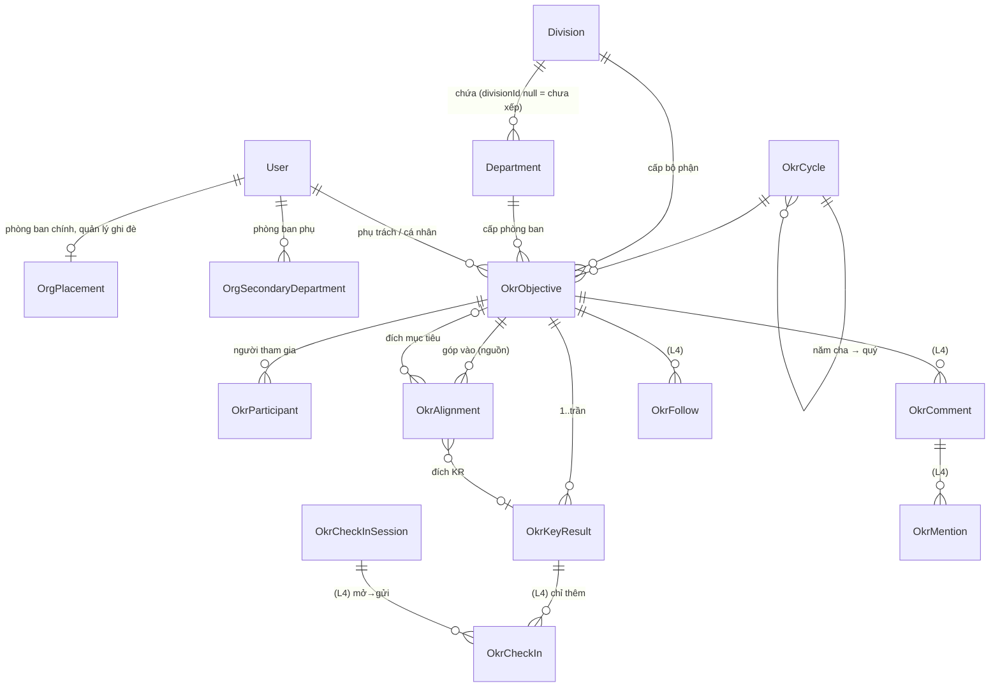

# 07 — Bản đồ miền OKR, nhìn bằng mắt người sẽ gắn AI

Viết 2026-09-26. Chỉ đọc, không sửa mã.

**Nguồn đã đọc**

- Bản chụp `onehub` ở `scratchpad/onehub`. Đã đọc:
  - `docs/plan/lo-trinh-okr.md` (toàn bộ), `docs/plan/lo-trinh-zalo.md` (toàn bộ);
  - `CONTEXT.md`, các mục OKR, Bộ phận, Phòng ban, Trưởng đơn vị, vai «chỉ OKR», Phạm vi dữ liệu, Trợ lý AI, Nhắc buổi sáng, Bot Zalo;
  - `packages/db/prisma/schema.prisma`, khối OKR, cây tổ chức, `AgentTask`, `AppSetting`;
  - `packages/validation/src/okr-*.ts`, `vai-workspace.ts`;
  - `apps/api/src/okr/*`, `apps/api/src/trpc/middlewares/*`;
  - `apps/app/app/(app)/[slug]/okr/**`, `settings/okr/**`, `tong-quan-chi-okr.tsx`;
  - `apps/app/app/eve/v1/[...path]/route.ts`;
  - `apps/agent/agent/{agent.ts, channels/*, lib/nhac-ke-hoach.ts, lib/tra-loi-nhac.ts, lib/zalo-lenh.ts, lib/session-purpose.ts, hooks/audit.ts, skills/*}`;
  - `apps/agent/test/kenh-chi-okr.spec.ts`, `apps/app/test/eve-cau-noi-chi-okr.spec.ts`;
  - `docs/agent.md`;
  - hồ sơ `_acceptance/{dat-okr-trong-crm, vai-chi-okr}/(opportunity.md, contract.md)` và `_acceptance/ban-mau-okr/design-pass.md`;
  - bản mẫu `apps/app/app/proto/_modules/ban-mau-okr/*`.
- Cây làm việc lượt 4 `.claude/worktrees/cap-nhat-tuan-okr`, chỉ đọc:
  - `_acceptance/cap-nhat-tuan-okr/(contract.md, opportunity.md, evidence-report.md, decisions.jsonl)`;
  - `git diff --stat origin/onehub...HEAD`: 109 tệp, +16.767 dòng;
  - diff của `schema.prisma`, `docs/agent.md`, `docs/api.md`, `onboarding-nhac.ts`, `nhac-ke-hoach.ts` (validation), `okr-vet.ts`;
  - các tệp mới `okr-cap-nhat.ts`, `okr-trao-doi.ts`, `packages/db/src/okr-nhac.ts`, `okr-cap-nhat.service.ts`, `okr.router.ts`, `objective-sheet.tsx`, `thanh-tab.tsx`;
  - bản thiết kế `docs/superpowers/specs/2026-09-25-cap-nhat-tuan-okr-design.md` (mục 5).

**Mức tin**

- **cao / đã đọc mã**: thấy trực tiếp trong mã hoặc tài liệu của kho. Có ghi đường dẫn.
- **cao / đã đọc hồ sơ**: thấy trong hợp đồng, lộ trình hay sổ quyết định nhưng chưa có mã, hoặc mã chưa lên `onehub`.
- **suy luận**: do tôi rút ra, không có câu nào trong nguồn nói thẳng.

Báo cáo này không khẳng định gì về sản phẩm bên ngoài. Tên Perdoo, Weekdone, Lattice chỉ xuất hiện vì hồ sơ của kho dẫn chúng làm «chân ngành», và tôi không kiểm chứng.

---

## 0. Tóm tắt một màn

1. **Trạng thái miền OKR (26/09)**
   - Đã lên `onehub` ngày 25/09: lượt 1 cây tổ chức (#120 · #128 · #136), lượt 2 vai «chỉ OKR» (#129), lượt 3 đặt OKR (#140).
   - Lượt 4 «cập nhật tuần + nhắc + bình luận» đã dựng xong trong cây làm việc riêng (`status: implemented`). Lượt chấm S4 thứ nhất REJECT 4/29 phép đo (E16, E18, E21, E29); đã có commit sửa, đang chờ chấm lại. **Chưa lên `onehub`.** Nguồn: `evidence-report.md`, `git log` của cây đó. Mức tin: cao / đã đọc mã.
   - Lượt 5–10 chưa mở.
2. **Hôm nay AI chưa chạm OKR ở chỗ nào.**
   - `apps/agent/agent/tools/` có 27 công cụ, không công cụ nào đọc bảng OKR.
   - Nhắc buổi sáng, kể cả phần OKR của lượt 4, đi làn «direct», dựng tin bằng mã, không gọi model.
   - Bot Zalo đọc lệnh «xong n» bằng regex.
   - Người mang vai «chỉ OKR» bị chặn khỏi trợ lý AI ở hai lớp, và cả hai lớp đều có phép đo đỏ được.

   Mức tin: cao / đã đọc mã.
3. **Quyền đọc OKR hôm nay rất rộng; quyền ghi thì hẹp.**
   - Đọc: mọi thành viên, kể cả vai «chỉ OKR», đọc được mọi mục tiêu, kể cả mục tiêu nháp (AC-6 lượt 3; `okr.service.ts` `byUnit`/`objective` không lọc theo người xem).
   - Ghi: đi theo trưởng đơn vị, người phụ trách KR và quản trị.
   - Lượt 8 mới có «mức hiển thị giới hạn».
   - Hệ quả: công cụ AI phải đọc qua lớp service có quyền, không đọc thẳng DB, thì khi lượt 8 thêm giới hạn AI mới tự theo (suy luận).
4. **Dữ liệu theo từng mức sẵn sàng**
   - Đủ ngay từ lượt 3 cho AI «viết lại / kiểm chất lượng / gợi ý căn chỉnh»: tên, «vì sao lúc này», kiểu KR, số, cây căn chỉnh, cây tổ chức.
   - «Tóm tắt tuần», «cảnh báo rủi ro», «hỏi đáp tiến độ» chỉ có đất khi lượt 4 lên. Lượt 4 thêm chuỗi lần cập nhật gồm giá trị, mức tự tin và ghi chú một dòng, cùng bình luận.
   - «Gợi ý đích theo xu hướng» (DO-06) cần lịch sử số: lượt 4 cho chuỗi tuần do người ghi, lượt 6 cho bản chụp hằng ngày.
   - «Học từ kỳ trước» cần điểm và bài học của lượt 7.
5. **Ranh giới sản phẩm đã chốt**
   - Máy không ghi số, không chọn mức tự tin thay người (NG-05; từ điển «Mức tự tin»).
   - Kiểm chất lượng thì hỏi, không chặn lưu.
   - Không nối lương thưởng (NG-01).
   - Không xếp hạng người (NG-07); họp tuần đi theo KR, không liệt kê người chưa cập nhật.
   - Không phân rã KR cấp trên xuống cấp dưới (NG-06).
   - Lượt 9 không soạn trọn bộ OKR cho cả đội.
6. **Cửa mở lượt 9**
   - Chủ kho phải trả lời «nội dung OKR có được gửi tới nhà cung cấp model đang dùng không» và đưa ra con số trần chi tiêu tháng.
   - Kho hiện chưa có cột trần chi tiêu. Chi phí từng bước của eve có được lưu vào `AgentEvent.data` (`hooks/audit.ts` đọc `usage.costUsd`), nhưng chưa có sổ cộng dồn theo tháng. Mức tin: cao / đã đọc mã.
7. **Cửa mở lượt 10 là số đo.** Lượt 10 chỉ mở khi số đo của lượt 4 cho thấy nhắc → cập nhật trễ quá một ngày làm việc, hoặc một lần cập nhật quá 2 phút. Không có bằng chứng đó thì lượt 10 lùi.
   - Zalo không có nút, nên trên Zalo là trả lời bằng chữ.
   - Slack cần URL tương tác, khoá ký và quyền mới (T3).

---

## 1. Mô hình dữ liệu OKR

### 1.1 Sơ đồ quan hệ

Phần đánh dấu `(L4)` mới có trong cây lượt 4, chưa lên `onehub`.



- `OkrTrail` (vết) và `OkrProgramConfig` (cấu hình chương trình, có phiên bản) đứng riêng, không có khoá ngoại.
- Mọi bảng OKR là một khối liền ở cuối `schema.prisma`. Migration chỉ thêm, không sửa bảng của hãng.
- Nguồn: `packages/db/prisma/schema.prisma` dòng 1946–2088, và diff lượt 4. Mức tin: cao / đã đọc mã.

### 1.2 Từng thực thể và điều AI cần biết

| Thực thể | Trường chính | Luật đã khoá trong mã | Ghi chú cho người gắn AI |
|---|---|---|---|
| **Chu kỳ** `OkrCycle` | `kind`: năm hoặc quý · `parentId` (quý phải có năm cha) · `startsOn` và `endsOn` (kiểu date, giờ VN) · `phase` · `breakStartsOn/EndsOn` (khoảng nghỉ như Tết) · `updateWeekday` 1–7, mặc định thứ Hai | Pha chỉ đi tới: lập kế hoạch → đang chạy → chấm điểm → đã đóng. Chỉ hai pha đầu ghi được (`PHA_GHI_DUOC`). Quý nằm trọn trong năm, không chồng ngày quý khác. Chỉ quản trị mở chu kỳ và đổi pha | «Chu kỳ hiện tại» có hàm sẵn `chonChuKyHienTai` (`apps/api/src/okr/tien-do.ts`). Pha là tín hiệu tự nhiên để bật hay tắt tính năng AI: viết và kiểm ở pha lập kế hoạch, tóm tắt ở pha đang chạy, chấm ở pha chấm điểm |
| **Cấu hình chương trình** `OkrProgramConfig` | `version` (duy nhất, tăng dần) · `objectiveCap` và `krCap` 1–50, mặc định 5/5 · `capMode`: cảnh báo hoặc chặn · `scoreScale`: 0-1 hoặc 0-100 · `weightsOn` · `personalOn` (mặc định tắt) · `createdById` | Mỗi lần lưu thêm một dòng, dòng cũ giữ nguyên. Chỉ quản trị đổi | AI kiểm chất lượng phải đọc trần và thang từ đây, không cứng trong prompt. Thang chấm đổi được, nên «0,7 là tốt» chỉ đúng với thang 0-1 |
| **Mục tiêu** `OkrObjective` | `level`: onehub, bộ phận, phòng ban hoặc cá nhân, kèm đúng một mã đơn vị · `ownerUserId` · `kind`: cam kết hoặc tham vọng · `status`: nháp, công bố hoặc đã bỏ · `title` 3–200 ký tự · `whyNow` ≤ 500 («vì sao lúc này») · `publishedAt`, `droppedAt` · `participants` | Công bố cần ít nhất một KR. Công bố thì khoá khởi điểm mọi KR. «Bỏ» giữ KR và căn chỉnh. Vượt trần: cảnh báo hay chặn theo cấu hình | `title` và `whyNow` là hai ô chữ duy nhất ở cấp mục tiêu: nguyên liệu cho AI-01 (viết lại) và AI-03 (kiểm). Mục tiêu tham vọng không bao giờ hiện «trượt» |
| **KR** `OkrKeyResult` | `title` 3–200 · `kind` (sáu kiểu) · `ownerUserId` (đúng một) · `startValue`, `targetValue`, `currentValue` kiểu Decimal(18,4) · `unit` ≤ 24, chữ tự do · `dueOn` · `weight` 0–10 · `source`: `tay`, `crm` hoặc `api` (hôm nay chỉ `tay`) · `startLockedAt` | `kiemSoTheoKieu`: «tăng tới» cần đích lớn hơn khởi điểm; «giảm xuống» cần đích nhỏ hơn; «phần trăm» cần đích trong 0–100. Từ lượt 4: KR của mục tiêu đã công bố ở chu kỳ đang chạy chỉ đổi `currentValue` qua lần cập nhật (AC-16), và KR đã có lần cập nhật thì không xoá được | Tiền là «tăng tới» với đơn vị tiền, không có kiểu tiền riêng. Kiểm «thiếu khởi điểm / đích bằng khởi điểm» của lượt 7 dựa trên các ô này |
| **Căn chỉnh** `OkrAlignment` | `objectiveId` (nguồn) → hoặc `targetObjectiveId`, hoặc `targetKeyResultId` | Chỉ vào cấp cao hơn. Đích phải đã công bố. Cùng chu kỳ hoặc thuộc năm cha. Không trùng. Nhiều–nhiều | `dungCayCanChinh` dựng cây: gốc là mục tiêu cấp OneHub, cộng một nhóm «chưa căn chỉnh». `alignmentTargets` trả sẵn ứng viên hợp lệ, là chỗ AI-05 (gợi ý căn chỉnh) nên chấm điểm lại thay vì tự tìm |
| **Vết** `OkrTrail` | `actorUserId` · `cycleId`, `objectiveId`, `keyResultId` · `action` · `before`/`after` (JSON phẳng, đọc qua `parseOkrVet`) · `note` | Chỉ thêm. Lượt 3 có 13 hành động; lượt 4 thêm 5: cập nhật tuần, bình luận, theo dõi, bỏ theo dõi, chuyển việc. Không đi qua `Activity` của hãng. Vết bình luận không chứa nội dung | Trước lượt 4, lịch sử `currentValue` chỉ nằm rải trong vết `sua-kr` (trước → sau), dùng tạm được nhưng không phải chuỗi thời gian sạch |
| **Cây tổ chức** `Division` ⊃ `Department`, `OrgPlacement`, `OrgSecondaryDepartment` | Tên · thứ tự · `headUserId` · `archivedAt` · phòng ban chính của người · quản lý trực tiếp (suy từ trưởng phòng ban chính, ghi đè được) | Hai cấp cố định dưới gốc OneHub. Một cây dùng chung cho cả CRM. Trưởng là một ô trên đơn vị, không phải vai | `org.tree` trả bộ phận, phòng ban chưa xếp, người kèm quản lý và độ phủ. Đây là trục gom cho «tóm tắt theo đơn vị» |
| **(L4) Phiên cập nhật** `OkrCheckInSession` | `userId` · `entry` (nguồn vào: `nhac`, `viec-cua-toi`, `tab`, `sheet`) · `openedAt` · `submittedAt` · `seconds` | Máy chủ tính số giây, máy khách không tự khai. Mỗi phiên gửi một lần | Là nguồn số đo cho cửa mở lượt 10 (thời gian cập nhật, độ trễ từ nhắc) |
| **(L4) Lần cập nhật** `OkrCheckIn` | `keyResultId` · `sessionId` · `weekStart` (thứ Hai, giờ VN) · `value` · `confidence`: cao, vừa hoặc thấp · `note` ≤ 200 · `authorUserId` · `ownerUserId` (người phụ trách lúc ghi) · `onBehalf` · `channel` (hôm nay chỉ `web`) · `createdAt` | Chỉ thêm, không có thủ tục sửa hay xoá. Gửi lại trong tuần thì thêm dòng mới. Một lô có một mục hỏng thì từ chối cả lô | **Nguyên liệu chính của AI-04, AI-06, AI-07 và DO-06.** `channel` đã chừa chỗ cho `zalo`/`slack` của lượt 10. `onBehalf` phân biệt ghi hộ. Ghi chú chỉ một dòng, nên tóm tắt ngắn, dễ kiểm |
| **(L4) Bình luận, nhắc tên, theo dõi** `OkrComment`, `OkrMention`, `OkrFollow` | Bình luận thuộc một mục tiêu, gắn được một KR của chính mục tiêu đó · `body` ≤ 2.000 · tối đa 20 người được nhắc · theo dõi bật/tắt | Không sửa hay xoá bình luận. Người được nhắc phải là thành viên đang hoạt động | Là chữ tự do dài nhất trong miền, cũng là nguồn tốt nhất cho «điều đáng bàn». Có thể chứa tên đối tác do người gõ vào (xem mục 6.4) |
| **`AgentTask`** (dùng chung, không riêng OKR) | `kind` · `reason` · `payload` Json · `priority` · `budget` · `attempts` · `dueAt` · `leasedUntil` · `sessionId` · `outcome` · `subject` · chỉ có ba cột nối `contactId`, `companyId`, `dealId` | Chỉ mục riêng phần `(kind, subject)` chỉ cho `nhac-ke-hoach`: mỗi người một hàng mỗi ngày | Không có cột mục tiêu hay đơn vị. Việc AI cho OKR (tóm tắt theo đơn vị) sẽ phải mang đơn vị và chu kỳ trong `subject`/`payload`, theo cách nhắc buổi sáng đang làm (suy luận) |

**Sáu kiểu KR và công thức tiến độ** (`packages/validation/src/okr-kr.ts`, `tienDoKr`). Mức tin: cao / đã đọc mã.

| Kiểu | Mã | Tiến độ (0–100) |
|---|---|---|
| tăng tới | `tang-toi` | (hiện − khởi) / (đích − khởi) |
| giảm xuống | `giam-xuong` | (khởi − hiện) / (khởi − đích) |
| giữ trên | `giu-tren` | 100 nếu hiện ≥ đích, không thì 0 |
| giữ dưới | `giu-duoi` | 100 nếu hiện ≤ đích, không thì 0 |
| mốc | `moc` | 100 nếu hiện ≥ 1 (lượt 4 buộc chỉ nhận 0 hoặc 1) |
| phần trăm | `phan-tram` | giá trị hiện tại, kẹp trong 0–100 |

**Dẫn xuất có sẵn.** Không nên để model tự tính những số này.

- `tienDoMucTieu`: trung bình tiến độ KR, có hoặc không có trọng số theo cấu hình.
- `kyVongTheoNgay`: vạch «lẽ ra đã tới đây», đi thẳng từ ngày công bố tới cuối kỳ, trừ khoảng nghỉ.
- `tinhTrang` với ngưỡng `NGUONG_TINH_TRANG = {thamVong: 0.7, cham: 0.85, truot: 0.5}` tính trên tỷ lệ tiến độ / kỳ vọng.
  - Mục tiêu cam kết: từ 0,85 là «đúng nhịp», từ 0,5 là «chậm nhịp», thấp hơn là «trượt».
  - Mục tiêu tham vọng: từ 0,7 là «đúng nhịp», thấp hơn là «chậm nhịp».
  - Chưa công bố thì «chưa có kỳ vọng».
- `docSoOkr`: đọc số kiểu Việt Nam, như «1.234,5».
- `okr-nhac.ts` (L4): KR «im» = số ngày theo giờ VN từ lần cập nhật gần nhất, không có thì từ ngày công bố.

Nguồn: `packages/validation/src/okr-muc-tieu.ts`, `apps/api/src/okr/tien-do.ts`, `packages/db/src/okr-nhac.ts` (L4). Mức tin: cao / đã đọc mã.

**Hai chữ mà từ điển tách riêng, AI không được trộn.**

- **Tình trạng** (đúng nhịp, chậm nhịp, trượt) do máy tính từ số và vạch kỳ vọng.
- **Mức tự tin** (cao, vừa, thấp) do người chọn. Máy không chọn thay.
- Lúc hai thứ lệch nhau là lúc đáng bàn (`CONTEXT.md`, mục «Mức tự tin»). Đây chính là tín hiệu của AI-06 (cảnh báo rủi ro).

---

## 2. Quyền

### 2.1 Vai workspace × phạm vi dữ liệu

`packages/validation/src/vai-workspace.ts`. Mức tin: cao / đã đọc mã.

| Vai | Phạm vi đọc được |
|---|---|
| `owner`, `admin`, `member` | Cả bốn: đối tác · tổ chức · OKR · chung |
| `okr` (vai «chỉ OKR») | OKR · tổ chức · chung. **Không có đối tác** |

- Mỗi router khai phạm vi qua middleware: `PhamViOkrMiddleware`, `PhamViDoiTacMiddleware` và các middleware cùng loại.
- Router không khai thì vai `okr` bị chặn (chặn-mặc-định, AC-4 của `vai-chi-okr`).
- Nhật ký mỗi lời gọi tRPC mang `role` và `phamVi`.
- Phạm vi «đối tác» gồm cả tác nhân và hội thoại (`CONTEXT.md`, «Phạm vi dữ liệu»). Vì thế trợ lý AI hiện tại thuộc phạm vi đối tác.

### 2.2 Quyền theo bản ghi OKR

`apps/api/src/okr/okr-access.service.ts`, `okr.service.ts`, hợp đồng lượt 3 AC-6 và lượt 4 AC-3/AC-12. Mức tin: cao / đã đọc mã (lượt 3), cao / đã đọc hồ sơ và mã chưa lên `onehub` (lượt 4).

| Việc | Ai được |
|---|---|
| Mở chu kỳ, đổi pha, ghi cấu hình chương trình | Quản trị chương trình (`canManageSettings`: owner hoặc admin). Không sửa nội dung OKR thay người |
| Sửa, công bố, bỏ mục tiêu cấp **OneHub** | Quản trị workspace (không có «trưởng OneHub») |
| … cấp **bộ phận** | Trưởng bộ phận đó |
| … cấp **phòng ban** | Trưởng phòng ban đó, hoặc trưởng bộ phận chứa nó |
| … cấp **cá nhân** (khi chương trình bật) | Chính người đó, trưởng phòng ban chính của họ, hoặc trưởng bộ phận chứa phòng ban đó |
| Sửa KR (tên, đích, đơn vị…) | Người phụ trách KR, hoặc người sửa được đơn vị của mục tiêu |
| Nhập từ bảng tính | Người sửa được đơn vị; quản trị nhập được cho mọi đơn vị |
| **(L4)** Gửi lần cập nhật | Người phụ trách KR. Ghi hộ (`onBehalf`): trưởng đơn vị của mục tiêu, hoặc quản trị với mục tiêu cấp OneHub. **Người phụ trách một KR khác cùng mục tiêu thì không** |
| **(L4)** Bình luận, nhắc tên, theo dõi | Mọi thành viên, kể cả vai «chỉ OKR» |
| **(L4)** Chuyển OKR khi người nghỉ | Chỉ quản trị |
| **Đọc** mục tiêu, KR, căn chỉnh, vết | **Mọi thành viên, mọi vai, mọi mục tiêu, kể cả nháp.** `byUnit` và `objective` không lọc theo người xem. Mức hiển thị giới hạn là việc của lượt 8 |

Mỗi mục tiêu trả về đã có sẵn ba cờ theo người xem: `canEdit`, `canEditKr[]` và `laCuaToi` trên từng KR. Một công cụ AI dựa vào ba cờ này biết người hỏi được sửa gì, không phải suy lại quyền.

Trưởng là một ô trên đơn vị, không phải vai: làm trưởng không cho thêm quyền quản trị CRM nào (`CONTEXT.md`, «Trưởng đơn vị»).

### 2.3 Trợ lý AI với vai «chỉ OKR»: hiện bị chặn hoàn toàn

Mức tin: cao / đã đọc mã và phép đo.

| Lớp | Chặn thế nào | Phép đo |
|---|---|---|
| Đường nối trong app `apps/app/app/eve/v1/[...path]/route.ts` | Đòi `docDuocPhamVi(role, "doi-tac")`. Vai `okr` nhận 403 với thông điệp phạm vi, và **không lời gọi nào được chuyển sang agent** | `apps/app/test/eve-cau-noi-chi-okr.spec.ts` |
| Kênh xác thực của agent `apps/agent/agent/channels/eve.ts`, `repFromCrm` | Đọc lại vai từ DB. Token cầu nối hợp lệ nhưng chủ token mang vai `okr` thì trả null, tức không xác thực | `apps/agent/test/kenh-chi-okr.spec.ts` |
| Màn | Proxy chuyển `/chat` về trang «ngoài phạm vi». Rail của vai này có ba mục: Tổng quan · Mục tiêu · Cài đặt | AC-5, AC-9 của `vai-chi-okr` và AC-12 của lượt 3 |
| Bot Zalo | «xong n» của vai `okr` trả `khong-quyen` (`tra-loi-nhac.ts` `coQuyen`) | Hồ sơ `tra-loi-tin-nhac` |
| Từ điển | Mục «Trợ lý AI» ghi rằng nó thuộc phạm vi dữ liệu đối tác và vai «chỉ OKR» không gọi được | `CONTEXT.md` |

**Vai «chỉ OKR» vẫn được:**

- Nhận nhắc buổi sáng qua Zalo hoặc Slack khi lượt 4 lên. `viecCanNhac` lọc theo mọi dòng `member`, không loại vai `okr` (`onboarding-nhac.ts`, cây lượt 4). Tin dựng bằng mã, không có model.
- Tự nối Zalo, tự chọn kênh nhắc.
- Tạo khoá API cho chính mình rồi gọi REST `/okr/*`. Router OKR khai `restMeta` cho mọi thủ tục, và khoá đi qua đúng ma trận phạm vi và quyền bản ghi (AC-2 `vai-chi-okr`).

Cần lưu ý ba điều:

1. **Lộ trình lượt 2 viết khác bản đã làm.** Lộ trình ghi: «công cụ đọc dữ liệu CRM của tác nhân kiểm cùng phạm vi». Bản đã làm chặn trọn trợ lý AI, là lựa chọn chặt hơn. Muốn mở AI OKR cho vai này, phải đổi cả hai lớp trên, cộng mục «Trợ lý AI» trong từ điển.
2. **Agent chỉ có một, và luật dữ liệu của nó viết cho trợ lý đối tác.** Skill `skills/data-boundaries.md` và mục «What may be read» trong `docs/agent.md` nói agent đọc được mọi thứ. Luật đó hợp với trợ lý đối tác nhưng sai với phiên OKR của vai `okr`. Phiên OKR cần bộ công cụ và hướng dẫn riêng, không mang công cụ đối tác (suy luận). Hiện `SESSION_PURPOSES` có ba giá trị `builder`, `team-agent`, `research` (`lib/session-purpose.ts`): đó là chỗ cắm một mục đích mới.
3. **Việc chạy nền không mang danh tính người.** Kênh nội bộ `channels/crm.ts` chạy dưới principal `eve:app` (`vai-chi-okr` contract, mục Out of scope). Một việc «tóm tắt đơn vị» chạy qua `AgentTask` vì vậy không đọc theo quyền một người.
   - Hôm nay chưa sao, vì mọi người đọc được mọi OKR.
   - Khi lượt 8 thêm mức hiển thị giới hạn, việc tóm tắt phải tự lọc theo người nhận (suy luận).

---

## 3. Bề mặt UI nơi AI có thể xuất hiện

Cột «Có từ» dùng các ký hiệu sau:

- **L3**: đã lên `onehub`.
- **L4**: có trong cây lượt 4, chưa lên `onehub`.
- **L5 trở đi**: chưa có mã.

Ở cột «Chỗ AI hợp»:

- Mã AI-0x lấy theo mục 7.
- Các phần in nghiêng là suy luận của tôi, không có trong lộ trình.

| Bề mặt | Đường dẫn và tệp | Có từ | Trên màn có gì | Chỗ AI hợp |
|---|---|---|---|---|
| Hộp thoại mục tiêu (tạo/sửa) | `okr/hop-thoai-muc-tieu.tsx` | L3 | Cấp, đơn vị, tên, loại (cam kết hay tham vọng), phụ trách, tham gia, «vì sao lúc này» | AI-01 viết lại khi người bấm; AI-03 kiểm (luật trước ở lượt 7, model sau ở lượt 9), hỏi không chặn; *hiện câu cũ cạnh câu mới, nhận từng dòng* |
| Hộp thoại KR | `okr/hop-thoai-kr.tsx` | L3; L4 khoá ô «Hiện tại» khi đang chạy | Tên, kiểu, khởi điểm, đích, hiện tại, đơn vị, hạn, trọng số, phụ trách | AI-02 viết lại hoặc gợi ý KR đo được; AI-03 (phát hiện KR là việc làm, thiếu khởi điểm, đích bằng khởi điểm, thiếu đối trọng); DO-06 gợi ý đích so với xu hướng (cần lịch sử) |
| Hộp thoại căn chỉnh | `okr/hop-thoai-can-chinh.tsx`, thủ tục `alignmentTargets` | L3 | Danh sách đích hợp lệ | AI-05 xếp hạng hay gợi ý đích căn chỉnh *trong tập ứng viên mà máy chủ đã lọc* |
| Nhập từ bảng tính | `okr/hop-thoai-nhap.tsx` | L3 | Bảng bảy cột, xem trước, báo dòng hỏng | *AI-03 chạy trên cả lô lúc xem trước; ứng viên mạnh vì tuần 26/10 các phòng ban nhập OKR quý 4 vội* |
| Sheet mục tiêu (khung bản ghi) | `components/crm/record-sheet/objective-sheet.tsx` | Tab KR · Căn chỉnh · Vết từ L3; tab «Trao đổi» và nút «Cập nhật» trên dòng KR từ L4 | Số, tiến độ, vết trước → sau, bình luận | *Tab trợ lý cho mục tiêu, như tab Agent đang có trên sheet cá nhân, công ty, thoả thuận* (`AgentPanel`); AI-07 hỏi đáp theo bản ghi. Sheet mục tiêu hiện chưa có tab Agent |
| Tab «Của tôi» | `/okr`, `okr/cua-toi.tsx`; khối «Việc của tôi» (L4) | L3 / L4 | Mục tiêu tôi phụ trách hay tham gia, KR của tôi, việc OKR hôm nay | *Tóm tắt «tuần này bạn cần…»* — nên dựng từ `viecCuaToi`, không bịa |
| **Màn «Cập nhật tuần của tôi»** | `/okr/cap-nhat-tuan`, `okr/cap-nhat-tuan/cap-nhat-tuan.tsx` | L4 | Mỗi KR: giá trị điền sẵn, «Tuần trước: …» cho mức tự tin, ba nút tự tin, ô ghi chú một dòng; gửi theo lô | **Ranh NG-05: AI không điền số, không chọn mức tự tin.** *Được làm: gợi ý câu ghi chú khi người bấm, hỏi lại khi số và mức tự tin lệch nhau.* Ngưỡng lượt 4 là trung vị dưới 60 giây một lần cập nhật, nên AI không được làm chậm màn |
| Tổng quan — vai đầy đủ | `dashboard-summary.tsx`, thẻ `ViecOkrCuaToi` | L4 | Thẻ việc OKR, chỉ hiện khi người đó dính OKR | *Một dòng tóm tắt* |
| Tổng quan — vai «chỉ OKR» | `tong-quan-chi-okr.tsx` | L2/L4 | Thẻ việc OKR luôn hiện, hai nút: khu Mục tiêu, Nhắc buổi sáng | Bề mặt duy nhất vai này có ngoài khu OKR. *Chỗ đặt cửa vào trợ lý OKR riêng cho vai này* |
| Theo đơn vị + cây căn chỉnh | `/okr/theo-don-vi`, `theo-don-vi.tsx`, `cay-don-vi.tsx`, `cay-can-chinh.tsx` | L3 | Cây đơn vị, thẻ mục tiêu kèm bảng KR, cây căn chỉnh toàn công ty, nhóm «chưa căn chỉnh» | AI-04 tóm tắt tuần của đơn vị, câu nào cũng dẫn về lần cập nhật gốc; AI-05 cho nhóm «chưa căn chỉnh» |
| Toàn cảnh | `/okr/toan-canh` | Hiện chỉ là chỗ đứng «mở ở lượt 5»; màn thật ở L5 | Theo bản mẫu: bảng đơn vị có tiến độ, phân bố mức tự tin, «cập nhật tuần này n/N», cột **«Đáng bàn»**; heatmap đơn vị × tuần (tỷ lệ KR tự tin cao) | Trong bản mẫu, cột «Đáng bàn» là câu luật («2 KR tự tin tụt tuần này», «1 KR im 14 ngày», «Ghi chú mới: …»). *AI-04/AI-06 có thể viết phần diễn giải, nhưng luật chọn cái gì đáng bàn vẫn ở mã* |
| Bảng họp tuần | Lượt 5 (XEM-0x) | L5 | Xếp theo KR: tự tin tụt, KR im, ghi chú mới. **Không liệt kê người chưa cập nhật** | AI-04 bản tóm tắt trước họp; AI-06 cảnh báo. Ngưỡng lượt 5: một trưởng đơn vị chạy xong họp tuần chỉ trên màn này |
| Sức khoẻ chương trình (quản trị) | Lượt 5 (QT-04) | L5 | Đếm người chưa có kênh nhắc, độ phủ cập nhật | *Ít cần AI; số đếm là đủ* |
| Rà giữa kỳ, chấm cuối kỳ, nhìn lại, mang sang | Lượt 7 | L7 | Máy gợi ý điểm từ số chốt, người chỉnh kèm lý do; ô «điều học được» mỗi mục tiêu; màn ghi «không phải đánh giá nhân sự» | *Tóm tắt bài học, gợi ý mục tiêu mang sang.* **Không chấm người.** Gợi ý điểm của lượt 7 là tính bằng luật, không phải AI |
| Cài đặt › Chương trình OKR | `settings/okr/*` | L3 | Chu kỳ, cấu hình | Chỗ tự nhiên cho *công tắc AI và trần chi tiêu tháng* (lượt 9) |
| Thành viên › Chuyển OKR… | `settings/members/chuyen-okr-dialog.tsx` | L4 | Xem trước số KR và mục tiêu, rồi chuyển | Không cần AI |
| Khung hội thoại `/chat` | App hiện có | Có | Trợ lý đối tác | AI-07 hỏi đáp OKR. **Vai «chỉ OKR» bị chặn ở đây** (mục 2.3) |
| Tin nhắc Zalo và Slack | Ngoài app | Có (kế hoạch), L4 (OKR) | Mục 4 | NH-06 (lượt 10); AI-06 cảnh báo tới trưởng đơn vị; AI-07 hỏi đáp qua Zalo (gộp Zalo vòng 4) |
| Bản tin tuần vào kênh Slack của đơn vị | Lượt 8 | L8 | — | *Đích giao tự nhiên của AI-04* |

Luật chung cho mọi bề mặt, lấy từ `AGENTS.md`, `docs/design.md` và hợp đồng lượt 3–4. Mức tin: cao / đã đọc hồ sơ.

- **Giao diện:**
  - Mỗi màn có trạng thái rỗng · đang tải · lỗi.
  - Chạy tốt ở 390 và 1440.
  - Tên người, tên mục tiêu và KR mang `translate="no"`.
  - Chỉ dùng component của `packages/ui`.
- **Máy chủ và máy khách:** màn đọc cờ do máy chủ tính (như `hienTaiQuaCapNhat`), không tự suy. Nút AI nên theo cùng lối: máy chủ quyết nút có hiện hay không, dựa vào khoá và trần.
- **Khi thiếu khoá:** nút AI biến mất, không báo lỗi (lượt 9 và `capabilities.ts`).

---

## 4. Kênh nhắc: đang nối thế nào

### 4.1 Đường đi của một tin nhắc buổi sáng

Nguồn: `apps/agent/agent/schedules/dispatch.ts`, `lib/nhac-ke-hoach.ts`, `packages/db/src/onboarding-nhac.ts`, `kenh-thong-bao.ts`, `docs/agent.md`, diff lượt 4. Mức tin: cao / đã đọc mã.

```
cron "* * * * *" (apps/agent, schedules/dispatch.ts — lịch duy nhất)
 ├─ lenLichNhac(): sau 08:30 giờ VN (NHAC.gio), gọi viecCanNhac(db, {now})
 │     → AgentTask kind "nhac-ke-hoach", subject "user:<id>:<YYYY-MM-DD>"
 │       (chỉ mục riêng phần: 1 hàng/người/ngày), priority nhac = 60,
 │       payload {muc: [mã từng việc]}
 └─ drainAll(): "nhac-ke-hoach" thuộc DIRECT_KINDS → làn direct, KHÔNG phiên eve,
       KHÔNG model
       chayNhac(): tính lại viecCanNhac(userId) → kenhSeDungCua() chọn kênh
         ├─ Zalo:  có Bot Token + zaloBotName + ZaloLink của người
         │         → dungTin(…, "tron", ZALO.tranKyTu = 2.000) → guiZalo
         └─ Slack: có tài khoản Slack OAuth của workspace + SlackMemberMatch
                   → sendSlackMessage (DM)
       → payload.daGui (đúng các dòng đã vào tin sau khi cắt), kenh, lechKenh;
         outcome "da-gui:<n>" | "khong-slack" | "khong-khop" | "khong-viec"
```

- **Ưu tiên kênh:** mỗi người chọn `AUTO`, `ZALO` hoặc `SLACK` (`NotificationPreference`). Chọn Slack mà Slack không dùng được thì rơi về Zalo; `lechKenh` ghi lại chuyện lệch.
- **Trần mỗi tin:** tối đa 10 việc (`NHAC.tran`) và 2.000 ký tự với Zalo. Lượt 4 áp các trần này **chung cho cả tin**, không có trần riêng cho OKR.
- **Luật một tin mỗi sáng:** việc OKR đi chung tin với việc kế hoạch 30 ngày, không có tin thứ hai (lộ trình lượt 4; giả định 1 ở Cổng Đáng lượt 4). Báo «được nhắc tên» cũng chờ tin sáng hôm sau; báo tức thì để lượt 10.

### 4.2 Việc OKR trong tin (lượt 4)

Nguồn: `packages/db/src/okr-nhac.ts`, `OKR_NHAC = {imNgay: 14, imNgayTruong: 21, suKienGio: 24}`. Mức tin: cao / đã đọc mã (chưa lên `onehub`).

Luật chung cho năm loại việc dưới đây:

- **Thứ tự trong tin:** «Cập nhật tuần» đứng đầu, rồi bốn loại việc kế hoạch, rồi bốn loại OKR còn lại.
- **Câu chào:** tin có việc OKR mở bằng «Chào X, sáng nay có N việc cần bạn để ý.». Tin chỉ có việc kế hoạch giữ câu chào cũ.
- **Cùng một hàm cho tin và thẻ:** thẻ «việc của tôi» và thủ tục `okr.viecCuaToi` đọc cùng `viecCanNhac` với tin nhắc, nên tin và thẻ luôn nói cùng một điều.

| Loại | Ai nhận | Khi nào | Dẫn tới |
|---|---|---|---|
| `okr-cap-nhat` | Người phụ trách | Từ ngày cập nhật của chu kỳ tới hết Chủ nhật, còn KR chưa cập nhật trong tuần. Tin lặp mỗi sáng tới khi xong | `/okr/cap-nhat-tuan?tu=nhac` |
| `okr-kr-im` | Người phụ trách: KR im từ 14 ngày. Trưởng phòng ban (không có thì trưởng bộ phận): KR im từ 21 ngày | Mỗi sáng | Sheet mục tiêu |
| `okr-duoc-giao` | Người vừa được giao KR hay mục tiêu | Trong 24 giờ qua | Sheet mục tiêu |
| `okr-nhac-ten` | Người được nhắc tên | Trong 24 giờ qua | Sheet mục tiêu |
| `okr-theo-doi` | Người theo dõi mục tiêu | Có cập nhật hay bình luận mới trong 24 giờ qua | Sheet mục tiêu |

### 4.3 Chiều vào: người trả lời lại bot

| Kênh | Hôm nay | Giới hạn nền tảng | Sau lượt 10 |
|---|---|---|---|
| **Zalo** | Webhook `POST /eve/v1/zalo` (`channels/zalo.ts`, header `X-Bot-Api-Secret-Token`). Việc bot làm: nối mã, nhận ra người đã nối, gửi thử, và «xong n». Việc «xong n» đọc bằng regex (`zalo-lenh.ts`), chỉ đánh dấu **bước kế hoạch 30 ngày**: số trỏ vào dòng OKR rơi vào nhánh «không phải bước», và vai `okr` nhận `khong-quyen` | Không có nút bấm; chỉ chữ trơn tối đa 2.000 ký tự; webhook và `getUpdates` loại trừ nhau; nhóm Zalo còn là bản thử (Beta). Nguồn: `lo-trinh-zalo.md` mục 1, đọc tài liệu Zalo ngày 23/09 | Sửa số hay mức tự tin bằng trả lời chữ (NH-06, cùng nền với «xong n»). Hỏi CRM trong Zalo (Zalo vòng 4, đề xuất gộp vào AI-07) |
| **Slack** | Chỉ gửi tin riêng. **Chưa có đường nhận tin vào** | Có nút | Tin có nút chọn mức tự tin và sửa số. Cần URL tương tác, khoá ký và quyền mới, nên là T3 |
| **Trong app** | Thẻ «việc của tôi» ở ba chỗ, màn cập nhật | — | — |

**Bốn điều kiện mở Zalo vòng 4**, «hỏi CRM qua Zalo». Đây cũng là điều kiện của AI-07 nếu gộp hai việc (`lo-trinh-zalo.md` vòng 4):

1. Chủ kho quyết câu trả lời có được mang tên khách hay giá trị thoả thuận lên máy chủ Zalo không.
2. Có trần chi tiêu AI.
3. Webhook chạy ở production.
4. Liên kết Zalo tự gỡ khi người rời workspace.

**Cảnh báo cho người gắn AI.** «Bot Zalo» trong từ điển hôm nay bị cấm gọi là «trợ lý», vì nó không trò chuyện. Mở hỏi đáp qua Zalo thì phải sửa mục từ điển đó, như `lo-trinh-zalo.md` đã ghi.

---

## 5. Dữ liệu cho AI: có ngay, và chỉ có sau lượt 6 hay 7

Cột «Mức tin» ở đây nói dữ liệu đã có thật trong mã hay mới nằm trên kế hoạch.

| Dữ liệu | Có từ | AI dùng được cho | Mức tin |
|---|---|---|---|
| Chu kỳ, pha, khoảng nghỉ, ngày cập nhật | L3 (`onehub`) | Chọn ngữ cảnh kỳ; tắt/bật tính năng theo pha | cao / đã đọc mã |
| Cấu hình chương trình có phiên bản (trần, thang, trọng số, OKR cá nhân) | L3 | Luật cho AI-03 | cao / đã đọc mã |
| Tên mục tiêu, loại, «vì sao lúc này», cấp, đơn vị, phụ trách, tham gia, trạng thái | L3 | AI-01, AI-03, AI-05 | cao / đã đọc mã |
| KR: kiểu, khởi điểm, đích, hiện tại, đơn vị, hạn, trọng số, người phụ trách | L3 | AI-02, AI-03 | cao / đã đọc mã |
| Căn chỉnh, cây căn chỉnh, ứng viên hợp lệ, nhóm «chưa căn chỉnh» | L3 | AI-05 | cao / đã đọc mã |
| Vết trước → sau của mọi thao tác | L3 | Giải thích «vì sao đổi»; chuỗi `currentValue` dùng tạm trước khi lượt 4 lên | cao / đã đọc mã |
| Cây tổ chức: trưởng, phòng ban chính, quản lý | L1 | Gom theo đơn vị; ai nhận cảnh báo | cao / đã đọc mã |
| Tiến độ, vạch kỳ vọng, tình trạng (hàm thuần) | L3 | Mọi AI: đưa model con số đã tính, không để model tự tính | cao / đã đọc mã |
| **Chuỗi lần cập nhật hằng tuần**: giá trị, mức tự tin, ghi chú, ghi hộ, kênh | **L4** | AI-04 tóm tắt, AI-06 rủi ro, AI-07 hỏi đáp, DO-06 xu hướng (từ số người ghi) | cao / đã đọc mã, chưa lên `onehub` |
| Bình luận, nhắc tên, theo dõi | L4 | AI-04 «điều đáng bàn», AI-07 | như trên |
| Thời gian mở → gửi, nguồn vào (nhắc, thẻ, tab, sheet) | L4 | Số đo cửa mở lượt 10; đánh giá AI có làm chậm cập nhật không | như trên |
| Tin nhắc đã gửi (`AgentTask.payload.daGui` có mã OKR), kết quả, kênh | L4 | Đo độ trễ nhắc → cập nhật (cửa mở lượt 10) | như trên |
| Toàn cảnh, heatmap, xếp «đáng bàn» bằng luật | L5 | Đầu vào có cấu trúc cho AI-04/AI-06 | cao / đã đọc hồ sơ (chưa có mã) |
| **Số tự chảy từ CRM**: danh mục chỉ số cố định (thoả thuận chốt, thoả thuận mới, cuộc gọi chiến dịch hẹn được, bước 30 ngày đúng hạn, bậc ghi danh, form, email), **bản chụp hằng ngày không đổi**, bấm vào ra bản ghi, KR nhận số qua khoá API và Google Sheets | **L6** | DO-06 trên chuỗi ngày dày hơn; «vì sao số đổi» | cao / đã đọc hồ sơ |
| Nguồn số đổi giữa kỳ để lại vết; số máy hiện cạnh số tay | L6 | Giải thích lệch số | cao / đã đọc hồ sơ |
| **Rà giữa kỳ, điểm cuối kỳ** (máy gợi ý từ số chốt, người chỉnh kèm lý do), **ô «điều học được»**, mang sang, kỳ khoá và xuất được, **kiểm chất lượng bằng luật** (AI-03 phần luật) | **L7** | Lớp luật đứng trước AI-03 phần model; học từ kỳ trước; gợi ý đích dựa trên lịch sử nhiều kỳ | cao / đã đọc hồ sơ |
| Việc và sáng kiến gắn vào KR (kể cả chiến dịch, kế hoạch 30 ngày), bằng chứng cho KR mốc, ghi nhận, mẫu OKR theo loại đơn vị, mức hiển thị giới hạn, bản tin Slack của đơn vị | L8 | Ngữ cảnh cho AI-02 (mẫu); đích giao của AI-04 (bản tin) | cao / đã đọc hồ sơ |

**Ba điểm dễ vấp** (suy luận):

- **Trước lượt 4, «tiến độ theo thời gian» gần như không có.** `currentValue` chỉ là một con số và đổi qua hộp thoại KR. Lịch sử chỉ nằm trong vết `sua-kr`. AI-04, AI-06 và DO-06 làm trước lượt 4 là làm trên cát.
- **Ranh dữ liệu của lượt 6.**
  - Danh mục chỉ số lấy từ dữ liệu đối tác: thoả thuận, chiến dịch, kế hoạch 30 ngày.
  - «Bấm vào ra bản ghi» trỏ thẳng vào phạm vi đối tác.
  - Hệ quả: một trợ lý OKR phục vụ vai «chỉ OKR» được đọc **con số của KR**, không được đọc **danh sách bản ghi đằng sau**. Phải đặt ranh này trong bộ công cụ, không trông vào prompt.
- **Ranh dữ liệu của lượt 8.** Việc gắn KR có thể là một chiến dịch hay một kế hoạch 30 ngày, tức cũng là dữ liệu đối tác.

---

## 6. Ràng buộc sản phẩm đã chốt, ảnh hưởng AI

| # | Ràng buộc | Nguồn | Hệ quả cho AI |
|---|---|---|---|
| 6.1 | **NG-05: máy không ghi số hay mức tự tin thay người** | Lộ trình mục 9; lượt 9 «Ngoài phạm vi»; từ điển «Mức tự tin»: «Người chọn; máy không chọn thay» | AI không có công cụ ghi lần cập nhật. Tin Zalo hay Slack sửa số ở lượt 10 là **người** gõ; AI chỉ hiểu câu và hỏi xác nhận (suy luận). Số tự chảy từ CRM (lượt 6) cũng «không phải cập nhật tuần»: mức tự tin và ghi chú vẫn do người ghi |
| 6.2 | **NG-01: không nối điểm OKR vào lương, thưởng, xếp hạng**; điểm cuối kỳ «không phải đánh giá nhân sự» | Lộ trình mục 9; từ điển «Điểm cuối kỳ» | AI không nhận xét hiệu suất của người, không so người với người |
| 6.3 | **NG-07: không bảng xếp hạng người**; họp tuần «theo KR, không liệt kê người chưa cập nhật» | Lộ trình lượt 5 và mục 9; hợp đồng lượt 4, Out of scope | Tóm tắt và cảnh báo nói về KR và đơn vị, không nêu danh sách người chậm |
| 6.4 | **Vai «chỉ OKR» không thấy dữ liệu đối tác, kể cả qua trợ lý AI** | Từ điển; lượt 2; AC-6 `vai-chi-okr` | Trợ lý OKR cho vai này phải có bộ công cụ riêng, không có công cụ đối tác, và có phép đo cho từng đường vào như lượt 2 (suy luận). Chữ tự do trong OKR (bình luận, ghi chú, tên KR) có thể nhắc tên đối tác do người gõ. Đó là dữ liệu OKR, vai «chỉ OKR» đã đọc được trên màn. Cần một câu chốt ở Cổng Đáng lượt 9 để khỏi tranh cãi (suy luận) |
| 6.5 | **«Hỏi, không chặn lưu»** khi kiểm chất lượng | Lộ trình lượt 7 | AI-03 phần model cũng phải là gợi ý bên cạnh, không phải cổng chặn |
| 6.6 | **Gợi ý thì người nhận từng dòng.** Hiện câu cũ cạnh câu mới; gợi ý bị bác thì không mời lại; đếm tỷ lệ nhận nguyên văn, sửa, bác | Lộ trình lượt 9 | Cần nơi lưu gợi ý và quyết định của người: một bảng mới, hoặc vết OKR thêm hành động (suy luận) |
| 6.7 | **Tóm tắt phải dẫn nguồn và được kiểm số.** Câu nào cũng dẫn về lần cập nhật gốc; máy kiểm lại mọi con số trong câu, lệch thì bỏ câu; chạy qua hàng `AgentTask`, gom theo đơn vị, không một phiên cho mỗi KR | Lộ trình lượt 9 | Mô hình «trích dẫn + kiểm hậu» là yêu cầu cứng. Hợp với mục «Evidence, not confidence» của `docs/agent.md` |
| 6.8 | **Điều kiện mở lượt 9** | Lộ trình lượt 9 và mục 10: «chờ trần chi tiêu AI» | Có hai câu phải trả lời: nội dung OKR có được gửi tới nhà cung cấp model không, và trần chi tiêu tháng là bao nhiêu. Chú ý: `docs/agent.md` chỉ cấm đưa chữ của khách vào **truy vấn gửi bên thứ ba** (tìm web); nó chưa nói gì về chuyện đưa dữ liệu vào model. Model hiện chọn bằng một hàng `AppSetting`; mặc định biên dịch là `zai/glm-5.2-fast`, bối cảnh phiên điều phối ghi hàng hiện chọn là `google/gemini-3.7-flash`. Mọi lời gọi đi qua Vercel AI Gateway |
| 6.9 | **Thiếu khoá thì nút AI biến mất, không ném lỗi**; có trần chi tiêu tháng cho workspace | Lộ trình lượt 9; `AGENTS.md`; `capabilities.ts` | Cần một nguồn sự thật «AI OKR bật không» để màn hỏi máy chủ (suy luận) |
| 6.10 | **Không phân rã, không soạn trọn bộ** (NG-06; lượt 9 không soạn trọn bộ OKR cho cả đội) | Lộ trình mục 9 và lượt 9 | AI-02/AI-05 không được sinh mục tiêu cấp dưới bằng cách chép KR cấp trên |
| 6.11 | **Không trình dựng truy vấn tự do** (NG-04): «con số đổi nghĩa mà không ai hay» | Lộ trình mục 9 | Hỏi đáp AI-07 nên trả các con số có định nghĩa cố định (tiến độ, tình trạng, chỉ số trong danh mục), không để model tự cộng trừ (suy luận) |
| 6.12 | **Một tin buổi sáng**; không tin thứ hai; báo tức thì để lượt 10 | Từ điển «Nhắc buổi sáng»; hợp đồng lượt 4 | Cảnh báo AI-06 phải chen vào tin hiện có (trần 10 việc, 2.000 ký tự), hoặc có quyết định mới ở lượt 10 |
| 6.13 | **Lượt sau đứng trên dữ liệu thật của lượt trước.** «Không tóm tắt khi chưa có lần cập nhật»; lượt 10 chỉ mở khi có số đo | Lộ trình mục 2 và lượt 10 | Không làm AI-04/06/07 trước khi lượt 4 lên và có vài tuần dữ liệu thật |
| 6.14 | **Trí khôn sống ở `apps/agent`.** API chỉ ghi hàng `AgentTask`; parse ở biên bằng Zod; một `.env` | `AGENTS.md`; `docs/api.md` | Không đặt model vào `apps/api/src/okr`. Khuôn gợi ý và tóm tắt nằm ở `packages/validation/src/okr-*.ts` |
| 6.15 | **Chữ trên màn theo từ điển.** «Cập nhật tuần», không dùng «check-in»; «Mức tự tin»; «Trợ lý AI» luôn viết đủ | `CONTEXT.md` | Câu AI sinh ra cũng phải theo từ điển (suy luận) |

---

## 7. Các mã AI-0x, DO-06 và mã liên quan

Bản phạm vi 78 mã nằm ở trang riêng tư của chủ kho; kho **không có định nghĩa từng mã**. Lộ trình chỉ nói lượt nào phủ những mã nào, kèm câu ý định của lượt. Vì thế:

- Nghĩa của AI-03, AI-07 và các mã NG là **đã thấy trong nguồn**.
- Nghĩa từng mã còn lại là **suy luận** từ thứ tự câu ý định và họ mã.

| Mã | Lượt | Nghĩa | Căn cứ | Mức tin |
|---|---|---|---|---|
| **AI-01** | 9 | Viết lại câu **mục tiêu** cho sắc hơn khi người bấm; hiện câu cũ cạnh câu mới | Ý định lượt 9: «viết lại câu mục tiêu hay KR khi người bấm»; câu giao «giúp tôi viết cho sắc» | suy luận (việc thì có trong nguồn; mã nào ứng với việc nào là đoán) |
| **AI-02** | 9 | Viết lại hay gợi ý **KR** (đo kết quả, không đo việc) | Như trên | suy luận |
| **AI-03** | 7 (luật) + 9 (model) | **Kiểm chất lượng khi đặt.** Lượt 7 bằng luật: động từ chỉ việc làm, thiếu khởi điểm, đích bằng khởi điểm, thiếu đối trọng; hỏi, không chặn lưu. Lượt 9: kiểm bằng model **sau** lớp luật | Lộ trình lượt 7 «AI-03 (kiểm bằng luật)» và lượt 9 «AI-03 (AI)» | cao / đã đọc hồ sơ |
| **AI-04** | 9 | **Tóm tắt cập nhật tuần của đơn vị**; câu nào cũng dẫn về lần cập nhật gốc; kiểm số, lệch thì bỏ câu; gom theo đơn vị qua `AgentTask` | Ý định lượt 9 | suy luận (việc chắc, mã là đoán) |
| **AI-05** | 9 | **Gợi ý căn chỉnh** | Ý định lượt 9 | suy luận |
| **DO-06** | 9 | **Gợi ý đích so với xu hướng.** Thuộc họ DO (tự đo, DO-01…05 ở lượt 6), nên nhiều khả năng dựa trên chuỗi số | Ý định lượt 9 «gợi ý đích so với xu hướng»; họ mã DO | suy luận |
| **NH-06** | 10 | Tin nhắc có nút: chọn mức tự tin và sửa số ngay trong Slack; trên Zalo là trả lời bằng chữ | Lộ trình lượt 10; `lo-trinh-zalo.md` vòng 3 «nền cho vế sửa số ngay trong Zalo… (NH-06)» | cao / đã đọc hồ sơ |
| **AI-06** | 10 | **Cảnh báo rủi ro** tới trưởng đơn vị khi tiến độ và mức tự tin lệch khỏi vạch kỳ vọng. **Phát hiện bằng luật trên dữ liệu; phần diễn giải qua trợ lý** | Lộ trình lượt 10 «Trong phạm vi» | cao cho việc, suy luận cho mã (thứ tự ý định lượt 10: NH-06, rồi cảnh báo, rồi hỏi đáp) |
| **AI-07** | 10 | **Hỏi đáp trên OKR trong trợ lý chat, theo quyền người hỏi.** Đề xuất gộp với Zalo vòng 4 «hỏi CRM qua Zalo» | `lo-trinh-zalo.md` dòng 277 nêu đúng mã này và nghĩa này | cao / đã đọc hồ sơ |
| NG-01 | Chưa làm | Nối điểm OKR vào lương, thưởng, xếp hạng | Lộ trình mục 9 | cao |
| NG-04 | Chưa làm | Trình dựng truy vấn tự do | Lộ trình mục 9 | cao |
| NG-05 | Chưa làm | Máy ghi số hay mức tự tin thay người | Lộ trình mục 9 | cao |
| NG-06 | Chưa làm | Nút phân rã KR cấp trên thành mục tiêu cấp dưới | Lộ trình mục 9 | cao |
| NG-07 | Chưa làm | Bảng xếp hạng người, huy hiệu, điểm đổi quà | Lộ trình mục 9 | cao |

**Việc cần làm trước Cổng Đáng lượt 9.** Xin chủ kho bảng định nghĩa AI-01…07 và DO-06 từ bản phạm vi riêng tư, rồi chép vào hồ sơ, để khỏi dựa vào đoán ở trên. Việc này rẻ và đảo được.

**Điều kiện mở hai lượt AI**

- **Lượt 9 (R3, dự kiến 23/11 → 18/12):**
  - Hạng T2, đứng trên lượt 4 và lượt 7.
  - Cần câu trả lời về việc gửi dữ liệu OKR tới nhà cung cấp model, và con số trần chi tiêu tháng.
- **Lượt 10:**
  - Hạng T3, đứng trên lượt 4 và lượt 9.
  - Cần số đo lượt 4: nhắc → cập nhật trễ quá một ngày làm việc, hoặc một lần cập nhật quá 2 phút.
  - Không có số đo đó thì lượt 10 lùi.

---

## 8. Khoảng trống: kho chưa có mà kiến trúc AI OKR sẽ cần

Mức tin: cao / đã đọc mã với phần «chưa có»; suy luận với phần «cần».

1. **Không công cụ agent nào đọc OKR.** Sẽ cần một bộ công cụ chỉ đọc, ví dụ: đọc mục tiêu, danh sách theo đơn vị, lần cập nhật của KR, việc của tôi. Bộ này phải đọc qua cùng quyền với API. Agent không được import `apps/api` (`docs/agent.md`), nên logic quyền `OkrAccessService` phải chuyển xuống một gói dùng chung trong `packages/db` hoặc tương đương. Nếu không, agent phải gọi REST bằng danh tính người.
2. **Cầu nối và kênh agent chặn theo phạm vi «đối tác».** Chưa có đường cho phiên chỉ-OKR.
3. **Chưa có mục đích phiên «okr»** (`SESSION_PURPOSES`), chưa có skill OKR trong `apps/agent/agent/skills/`, và preamble chưa có loại bản ghi «objective».
   - Loại bản ghi thứ tư cần: một mục `sessionPreamble`, một lệnh đọc, một dòng `TOOL_VERBS` và một mục `COPY` (`docs/agent.md` mục Preambles).
   - Tab Agent (`AgentPanel`) chưa có trên sheet mục tiêu.
4. **Không có trần chi tiêu, không có sổ chi tiêu tháng.**
   - `AppSetting` không có cột nào cho trần.
   - Token và `costUsd` của từng bước có lưu trong `AgentEvent.data`, nhưng chưa có hàm cộng theo tháng hay theo tính năng.
   - Giới hạn duy nhất là theo phiên: `maxInputTokensPerSession: 500_000`, `maxOutputTokensPerSession: 50_000` (`apps/agent/agent/agent.ts`).
5. **Chưa có nơi lưu gợi ý AI và quyết định nhận, sửa hay bác** mà lượt 9 đòi đếm.
6. **`AgentTask` không có cột cho mục tiêu, đơn vị hay chu kỳ.** Việc AI theo đơn vị phải mang những thứ này trong `subject`/`payload`, cần khuôn Zod và chỉ mục riêng như nhắc buổi sáng đang có.
7. **Không có embedding hay vector store** trong `schema.prisma` và `apps/agent`. Knowledge OKR ở quy mô một công ty đọc thẳng bằng SQL có cấu trúc là đủ; chưa thấy lý do cần RAG cho miền này (suy luận).
8. **Kênh vào cho lần cập nhật chỉ có `web`.** Lượt 10 thêm `zalo`/`slack`, và cần xác minh danh tính người gửi qua `ZaloLink` hoặc `SlackMemberMatch`.
9. **Chưa có quyết định về ranh dữ liệu gửi ra ngoài.** Cả lượt 9 lẫn Zalo vòng 4 đang chờ đúng câu này.

---

## 9. Điểm mở rộng đã có trong kho, dùng lại được cho AI OKR

| Tên | Ở đâu | Cho phép gì | Giới hạn |
|---|---|---|---|
| Hàng việc `AgentTask` + lịch dispatch mỗi phút | `packages/db/prisma/schema.prisma` (`AgentTask`), `apps/agent/agent/schedules/dispatch.ts`, `packages/db/src/agent-tasks.ts` | API hay lịch ghi một hàng; agent xử lý ở làn «direct» (không model) hoặc làn «research» (một phiên eve mỗi hàng, tối đa 12 hàng mỗi nhịp). `subject` + chỉ mục riêng phần giữ «mỗi đơn vị một hàng mỗi tuần» | Không có cột OKR; làn research tốn một phiên mỗi hàng; phiên chạy dưới `eve:app`, không mang quyền người |
| Hàm việc cần nhắc `viecCanNhac` / `viecOkrCanNhac` | `packages/db/src/onboarding-nhac.ts`, `packages/db/src/okr-nhac.ts` (L4) | Một hàm cho cả tin nhắc lẫn thẻ trong app. Thêm một loại việc (ví dụ cảnh báo AI-06) là thêm một nhánh hợp, và `mucNhac` là hợp Zod theo `loai` | Trần 10 việc và 2.000 ký tự mỗi tin; luật một tin mỗi sáng; chưa lên `onehub` |
| Chọn kênh và gửi tin | `packages/db/src/kenh-thong-bao.ts`, `apps/agent/agent/lib/nhac-ke-hoach.ts`, `lib/zalo-api.ts`, `sendSlackMessage` | Gửi tin riêng tới đúng người qua Zalo hoặc Slack theo lựa chọn của họ | Zalo chỉ chữ trơn; Slack chưa có đường nhận tin vào |
| Webhook Zalo + bộ đọc lệnh chữ | `apps/agent/agent/channels/zalo.ts`, `lib/zalo-nhan.ts`, `lib/zalo-lenh.ts`, `lib/tra-loi-nhac.ts` | Nhận tin người gõ, đọc lệnh xác định, ghi theo luật được-cả-hoặc-không. Nền cho NH-06 trên Zalo và AI-07 qua Zalo | Hôm nay chỉ đánh dấu bước kế hoạch; vai `okr` bị từ chối |
| Cầu nối app → agent có danh tính người | `apps/app/app/eve/v1/[...path]/route.ts`, `apps/agent/agent/channels/eve.ts` (`repFromCrm`) | Phiên trò chuyện mang principal người dùng; cầu nối mang theo bản ghi đang mở | Chặn theo phạm vi «đối tác»; chỉ nhận ba loại bản ghi (cá nhân, công ty, thoả thuận) |
| Mục đích phiên | `apps/agent/agent/lib/session-purpose.ts` (`SESSION_PURPOSES`) | Thêm một mục đích «okr» để gắn bộ công cụ, hướng dẫn và quyền riêng | Hôm nay ba giá trị; mục đích lạ rơi về «research» |
| Skill của agent | `apps/agent/agent/skills/*.md` | Thêm skill OKR, ví dụ «viết KR đo kết quả» hay «đọc tình trạng và mức tự tin» | Skill `data-boundaries.md` nói agent đọc mọi thứ, trái với phiên của vai «chỉ OKR» |
| Chọn model bằng hàng `AppSetting` | `packages/db/src/settings.ts`, `apps/agent/agent/lib/model.ts` | Đổi model không cần triển khai lại; phiên đang mở giữ model cũ | Một model cho mọi mục đích; chưa có model riêng cho từng tính năng; chưa có trần |
| Lớp «có khoá thì có tính năng» | `apps/agent/agent/lib/capabilities.ts` | Thiếu khoá thì tính năng biến mất, không ném lỗi; khai trong hướng dẫn phiên | Chỉ biết khoá của nhà cung cấp dữ liệu, chưa biết trần hay công tắc AI OKR |
| Quyền OKR theo bản ghi | `apps/api/src/okr/okr-access.service.ts` | `suaDuocDonVi`, `assertSuaKr`; cờ `canEdit`/`canEditKr`/`laCuaToi` trả sẵn theo người xem | Sống trong `apps/api`, agent không import được |
| REST `/okr/*` + khoá API theo người | `apps/api/src/okr/okr.router.ts` (`restMeta`), `vai-chi-okr` AC-2 | Công cụ AI bên ngoài (MCP, script) gọi OKR bằng khoá của đúng người, qua cùng phạm vi và quyền | Vai «chỉ OKR» tạo được khoá, nên đây là một đường vào phải đo khi mở AI |
| Hàm thuần tiến độ, kỳ vọng, tình trạng, cây căn chỉnh | `packages/validation/src/okr-kr.ts`, `okr-muc-tieu.ts`, `apps/api/src/okr/tien-do.ts`, `can-chinh.ts` | Máy tính số, model chỉ viết lời; kiểm hậu con số trong câu tóm tắt | `tien-do.ts` và `can-chinh.ts` nằm trong `apps/api`, cần dời xuống gói dùng chung nếu agent dùng |
| Vết OKR chỉ thêm | `OkrTrail`, `packages/validation/src/okr-vet.ts` (`HANH_DONG_VET`) | Ghi vết cho mỗi gợi ý AI được nhận, sửa hay bác, cùng một dòng thời gian | Thêm hành động là sửa hằng có chủ ý; vết không chứa chữ bình luận |
| Bảng lần cập nhật có kênh, nguồn vào, số giây | `OkrCheckIn`, `OkrCheckInSession` (L4) | Đo tác động của AI lên thời gian cập nhật và tỷ lệ cập nhật; `channel` chừa chỗ cho Zalo/Slack | Chưa lên `onehub`; `KENH_CAP_NHAT` hôm nay chỉ `web` |
| Sự kiện agent đã lưu kèm usage | `apps/agent/agent/hooks/audit.ts` → `AgentEvent.data` | Cộng token và `costUsd` theo phiên, rồi theo tháng, làm nền cho trần chi tiêu | Chưa có hàm cộng, chưa có cột trần |
