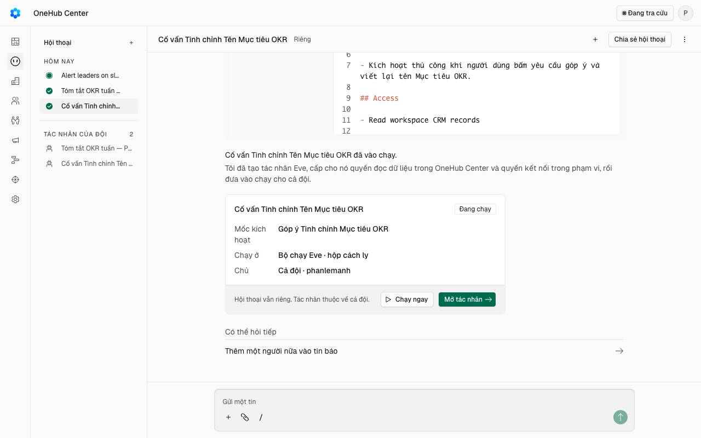
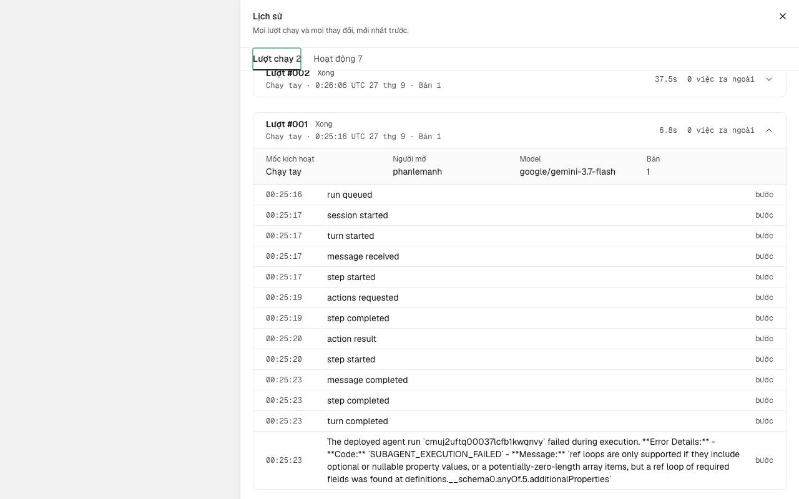
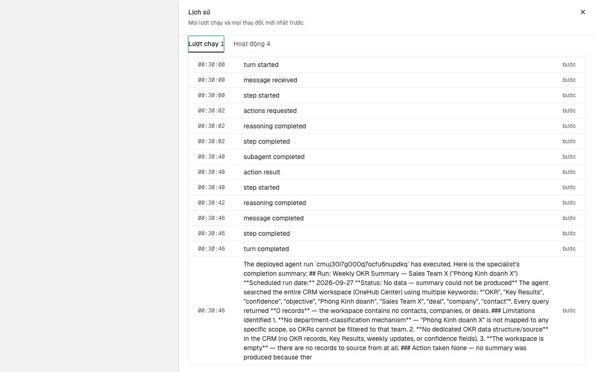
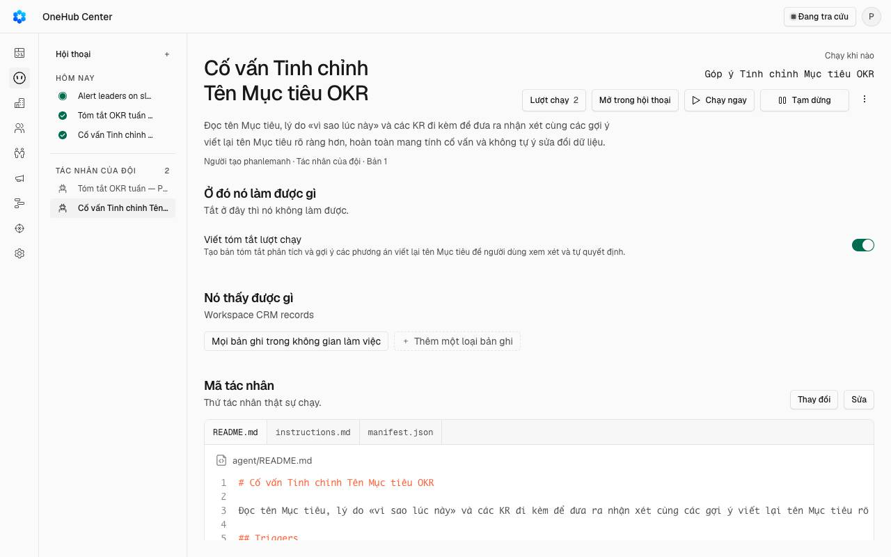
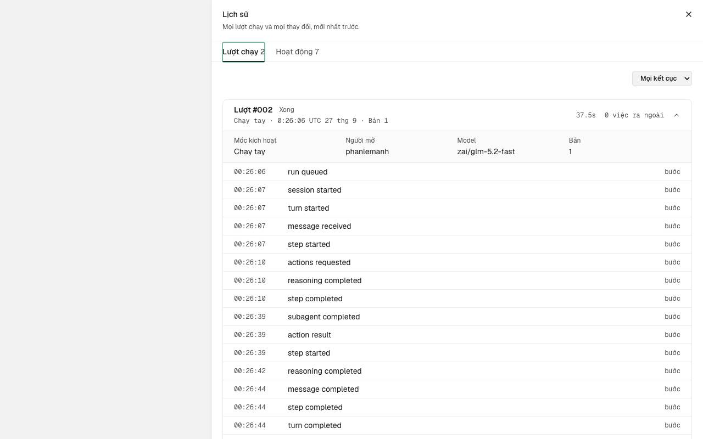
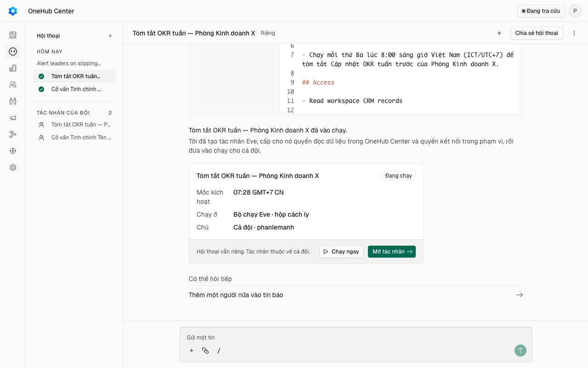
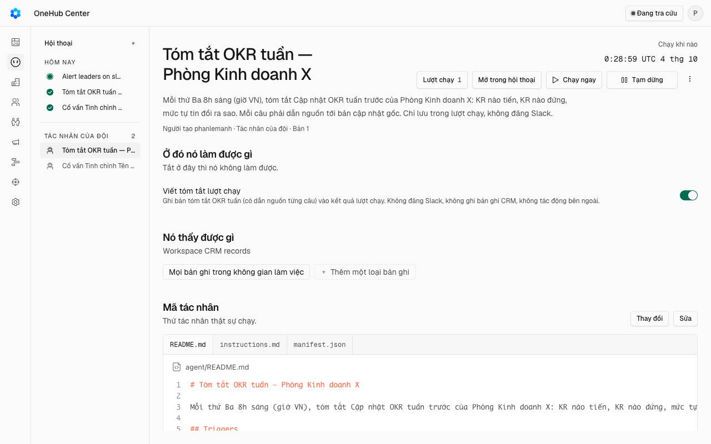

# Tác nhân hiện nay có dựng được Trợ lý OKR không

Viết 2026-09-27. Đo trên bản `onehub` đang chạy, bằng cách dựng thật ba Tác nhân
trên máy local. Số trong ngoặc vuông như **[M3]** trỏ tới bằng chứng trong mã ở
Phụ lục A, cuối bài.

## Trả lời ngắn

**Không.** Tác nhân hôm nay không làm được việc nào trong ba việc của kế hoạch.

Có ba lý do, và chỉ một lý do cũng đủ chặn:

1. **Tác nhân không đọc được OKR.** Nó chỉ thấy liên hệ, công ty và thoả thuận.
   Kho thử có sẵn một Mục tiêu, vậy mà Tác nhân vẫn báo «không có bản ghi OKR nào».
2. **Thiếu đường vào và đường ra mà kế hoạch cần.**
   - Bấm «Chạy ngay» không gửi kèm được Mục tiêu đang mở.
   - Sửa OKR không sinh ra sự kiện nào để Tác nhân bắt.
   - Kết quả chỉ ra được ba chỗ: một bản tóm tắt trong lịch sử lượt chạy, một ghi
     chú hay việc trên bản ghi đối tác, hoặc một tin Slack.
   - Không có chỗ để người nhận, sửa hay bác một đề xuất.
3. **Trên production, mọi lượt chạy Tác nhân đang hỏng mà vẫn hiện «Xong».**
   Production đang dùng model Gemini 3.8 Flash. Với Gemini, Tác nhân hỏng ngay từ
   bước đầu tiên, nhưng lịch sử vẫn ghi «Xong». Tôi chạy lại với đúng model này trên
   máy local và thấy hỏng y hệt.

## Đã thử gì

Ba Tác nhân, theo ba việc của kế hoạch. Mọi thứ chạy trên máy local, với một kho dữ
liệu riêng chứa một Mục tiêu, một KR và một Cập nhật tuần giả. Không nối Slack. Tiền
gọi model tối đa $0,67, dưới trần $1.

### Việc 1 · «Góp ý viết lại một Mục tiêu khi tôi bấm»

- **Bộ dựng hiểu:** hứa sẽ «đọc tên Mục tiêu, câu vì sao lúc này và các KR». Không
  cảnh báo gì.
- **Bản khai:** chạy tay; được xem mọi liên hệ, công ty, thoả thuận; kết quả là một
  bản tóm tắt.
- **Đưa vào chạy:** qua.
- **Chạy thử với Gemini:** hỏng ngay, lịch sử vẫn ghi «Xong».
- **Chạy thử với GLM:** «không có bản ghi OKR nào, không làm gì». Mất 37 giây.

### Việc 2 · «Mỗi sáng thứ Ba tóm tắt Cập nhật tuần của phòng X, câu nào cũng dẫn nguồn»

- **Bộ dựng hiểu:** đúng lịch, và tự đổi 8 giờ sáng thứ Ba giờ Việt Nam ra giờ quốc
  tế đúng. Vẫn hứa đọc được Cập nhật tuần.
- **Bản khai:** theo lịch, mỗi 7 ngày; được xem mọi liên hệ, công ty, thoả thuận;
  kết quả là một bản tóm tắt.
- **Đưa vào chạy:** qua.
- **Chạy thử theo lịch** (tôi dời giờ hẹn về hiện tại để lịch bật ngay):
  - kết quả: «không có dữ liệu»;
  - Tác nhân còn kết luận sai rằng kho trống, trong khi kho có 52 liên hệ, 18 công ty
    và 27 thoả thuận;
  - bản tóm tắt viết bằng tiếng Anh.
- **Giờ hiện trên màn không thống nhất:** màn Tác nhân hiện giờ quốc tế (UTC), thẻ
  trong hội thoại hiện giờ Việt Nam.

### Việc 3 · «Báo trưởng đơn vị khi KR trượt so với vạch kỳ vọng»

- **Bộ dựng hiểu:** lần này nhận ra kho không có KR, không có Mức tự tin, không có
  trưởng đơn vị. Nó hỏi lại dữ liệu nằm đâu, và hỏi bằng tiếng Anh.
- **Bản khai:** không có.
- **Mở lại hội thoại đang chờ trả lời thì màn sập**, nên người dùng không trả lời
  được nữa.
- **Trả lời vòng qua màn:** hệ thống nhận câu trả lời, nhưng bộ dựng không đi tiếp
  trong 10 phút. Tôi không kết luận phần này là lỗi sản phẩm.

### Hai điều rút ra

- **Bộ dựng hứa điều Tác nhân không làm được.** Người dựng chỉ biết là không được khi
  đọc kết quả lượt chạy đầu tiên [M1].
- **«Xong» không có nghĩa là đã làm.** Một Tác nhân chỉ có việc «viết tóm tắt» thì
  hỏng kiểu gì cũng ra «Xong» [M2].

## Bảng 1 · Năng lực

| Tác nhân làm được | Bằng chứng |
|---|---|
| Chạy tay, chạy theo lịch, chạy khi có sự kiện | [M3], việc 1 và 2 |
| Lịch dạng «từ giờ này, cứ mỗi N phút một lần», ngắn nhất 1 phút | [M4], việc 2 |
| Sáu sự kiện: tạo công ty, tạo liên hệ, tạo thoả thuận, đổi giai đoạn, mở lại, đóng thoả thuận | [M5] |
| Ba hành động: ghi chú hoặc việc trên một bản ghi đối tác; tóm tắt lượt chạy; một tin Slack tới đúng một kênh hay một người | [M6] |
| Phạm vi dữ liệu: vài bản ghi chọn sẵn, hoặc toàn bộ; thêm Gmail, Lịch Google, Slack nếu đã nối | [M7] |
| Đọc liên hệ, công ty, thoả thuận: tìm theo chữ, rồi đọc lịch sử một bản ghi, kể cả thư | [M8] |
| Mỗi Tác nhân chỉ một lượt chạy dở; bấm thêm khi đang chạy thì bị từ chối | [M9] |
| Không làm một việc hai lần khi phải chạy lại | [M10] |
| Người vai «chỉ OKR» không vào được khu Tác nhân | [M11] |
| Bộ dựng có hỏi lại khi thiếu dữ liệu | việc 3 |
| Có trần số chữ model đọc và viết mỗi lượt; lượt quá 20 phút bị đánh hỏng | [M12] |

## Bảng 2 · Giới hạn

Mọi chỗ trong bảng đều nằm trong mã của hãng. Vì thế cột cuối ghi cái giá nếu OneHub
tự vá, thay vì gửi bản vá lên hãng.

| Giới hạn | Người dùng gặp gì | Vá được? | Phí tự vá |
|---|---|---|---|
| **Hỏng với model Gemini** — model đang dùng trên production [M13] | Mọi Tác nhân dựng trên production đều không làm gì mà vẫn hiện «Xong» | Được, sửa một dòng | Thấp nếu gửi hãng |
| **Hỏng vẫn hiện «Xong»** [M2] | Không phân biệt được «đã làm» với «hỏng ngay» | Được | Thấp nếu gửi hãng |
| **Không đọc được OKR** [M14] | Mọi việc OKR trả «không có dữ liệu», hoặc kết luận sai | Được, nhưng là tính năng mới | Cao |
| **Bấm chạy không gửi kèm được bản ghi** [M15] | Không có «bấm trên Mục tiêu này» | Được | Trung bình |
| **Không có sự kiện OKR** [M5] | Không có «khi KR trượt» | Được | Trung bình tới cao |
| **Sự kiện không lọc được** [M16] | Thoả thuận nào đổi giai đoạn cũng mở một lượt chạy đầy đủ, kể cả khi không có gì để làm | Được | Trung bình |
| **Lịch không có múi giờ** [M4] | Màn Tác nhân hiện giờ quốc tế, thẻ hội thoại hiện giờ Việt Nam | Được | Thấp |
| **Chỉ tìm được theo chữ** [M8] | Tác nhân kết luận sai «kho trống» | Được | Trung bình |
| **Chạy bằng tên người dựng** [M17] | Người dựng bị hạ vai hay nghỉ việc, Tác nhân vẫn chạy bằng tên họ, và ghi chú mang tên họ | Được | Thấp tới trung bình |
| **Lối rò Slack** [M18] | Tác nhân gửi được dữ liệu thoả thuận, kể cả thư, tới kênh có người vai «chỉ OKR», hoặc nhắn thẳng một người vai đó | Được | Trung bình; đây là lượt «Vá lối rò Slack» của kế hoạch |
| **Sửa là chạy ngay, không cần duyệt lại** [M19] | Chỉ bản đầu tiên phải qua bước Đưa vào chạy | Được | Thấp |
| **Người dựng tự duyệt; ai trong khối kinh doanh cũng chạy được Tác nhân của người khác** [M9] | Không có người duyệt thứ hai | Được | Thấp |
| **Tiền ghi thiếu** [M20] | Sổ chỉ ghi 21–46% tiền thật của một lượt. Tiền dựng Tác nhân không ghi ở đâu. Màn không hiện tiền | Được | Thấp |
| **Không có trần tiền** | Một Tác nhân gắn sự kiện có thể tiêu không giới hạn khi nhập dữ liệu hàng loạt | Được | Trung bình |
| **Không có ZDR** [M21] | Dữ liệu gửi tới nhà cung cấp model theo chính sách lưu mặc định của họ | Được | Thấp |
| **Mỗi lượt tốn hai phiên model** [M22] | Mỗi lượt tốn thêm $0,007–0,018 cho bước chuyển tiếp, như N0 đã đo | Không, nếu giữ khung | — |
| **Không có luồng đề xuất → nhận, sửa, bác** [M23] | Máy chỉ ghi thẳng hoặc báo; người không có chỗ nhận hay bác | Không, trong khung này | — |
| **Kết quả khó đọc** [M24] | Màn lịch sử chỉ hiện tên các bước, cộng bản tóm tắt cắt ở 1.000 ký tự, bằng tiếng Anh | Được | Thấp |
| **Màn sập khi mở lại hội thoại đang chờ trả lời** [M25] | Rời trang rồi quay lại thì không trả lời được câu hỏi của bộ dựng | Được | Thấp nếu gửi hãng |

## Bảng 3 · So với kế hoạch

«Có» nghĩa là Tác nhân hôm nay làm được mà không phải sửa mã.

### 9a · Nền Trợ lý OKR

| Bàn giao | Có? | Vì sao |
|---|---|---|
| Trợ lý riêng với bốn chốt | Không | Tác nhân chạy theo lời dặn tự do của người dựng, và model lấy từ cài đặt chung |
| Sổ chi phí cho mọi phiên | Không | Chỉ ghi 21–46% |
| Trần $9 kiểm trước khi chạy | Không | Không có trần nào |
| Chỗ lưu đề xuất, tóm tắt, phản hồi | Không | Chỉ có lịch sử lượt chạy |
| Bật tắt theo việc và đơn vị | Không | Tác nhân không biết đơn vị là gì |
| Chi tiêu theo việc; báo ở 80% và 100% | Không | Tiền ghi thiếu và không hiện ra |
| Kiểm cách ly bằng mã | Không | — |

### 9b · Góp ý khi bấm

| Bàn giao | Có? | Vì sao |
|---|---|---|
| Nút góp ý trên Mục tiêu và KR | Không | Nút chạy chỉ nằm ở màn Tác nhân, và không gửi kèm được bản ghi |
| Đề xuất viết lại, câu cũ cạnh câu mới | Không | Không đọc được Mục tiêu |
| Nhận, sửa, bác từng dòng | Không | Không có luồng đề xuất |
| Câu hỏi chất lượng; đề xuất Căn chỉnh | Không | Không đọc được OKR |
| Dòng xu hướng tính bằng mã | Không | — |
| Trả lời trong 8 giây (p50) | Không | Hai lượt đo mất 37 và 46 giây, mà kết quả vẫn rỗng |

### 9c · Tóm tắt tuần

| Bàn giao | Có? | Vì sao |
|---|---|---|
| Chạy mỗi tuần | **Một phần** | Lịch chạy đúng giờ, nhưng không đọc được Cập nhật tuần |
| Khối tóm tắt ở bảng họp tuần; câu nào cũng bấm ra được bản gốc | Không | Kết quả nằm ở lịch sử Tác nhân, không ở khu OKR |
| Nút «hữu ích / không» | Không | — |
| Mỗi người xem chỉ thấy phần mình được xem | Không | Mọi thành viên khối kinh doanh đọc cùng một bản |
| Một dòng trong nhắc buổi sáng | Không | Tác nhân không ghi được vào nhắc buổi sáng |

### Lượt 10 · OKR trong chat

| Bàn giao | Có? | Vì sao |
|---|---|---|
| Báo trưởng đơn vị khi KR lệch vạch kỳ vọng; nghỉ 14 ngày giữa hai lần báo | Không | Không có sự kiện OKR, không đọc được KR (việc 3) |
| Chọn Mức tự tin, sửa số ngay trong Slack | Không | Tin Slack của Tác nhân chỉ đi một chiều |
| Hỏi đáp OKR theo quyền của người hỏi | Không | Tác nhân chạy bằng tên người dựng, không có người hỏi |
| Vai «chỉ OKR» hỏi được về OKR | Không | Vai này không vào được khu Tác nhân |
| Trần số câu mỗi người mỗi ngày | Không | Không có trần nào |

### Các luật của kế hoạch

| Luật | Tác nhân hiện nay |
|---|---|
| Chỉ gửi tới nhà cung cấp có ZDR | **Không giữ.** Không có cờ ZDR. Đọc cài đặt model mà hỏng thì rơi về GLM |
| Vai «chỉ OKR» an toàn | **Ngược lại.** Họ không dùng được Tác nhân, nhưng Tác nhân của người khác gửi được dữ liệu đối tác tới họ qua Slack |
| Máy không ghi vào OKR | **Giữ**, nhưng chỉ vì không có đường nào để ghi |
| Mọi con số máy viết được mã kiểm lại | **Không giữ.** Chữ của model đi thẳng ra kết quả |
| Trần $9 | **Không giữ.** Không có trần, và tiền ghi thiếu |
| Không thêm tin nhắn | **Không giữ.** Người dựng tự khai tin Slack, mỗi lượt một tin, không có luật gộp hay nghỉ |

## Lý do loại phương án C còn đúng không

**Còn đúng, và mạnh hơn.** Tôi kiểm từng khẳng định về mã của ba giám khảo với mã
thật: không khẳng định nào sai.

- Chạy bằng tên người dựng: **đúng** cho lượt theo lịch và theo sự kiện. Lượt bấm tay
  chạy bằng tên người bấm.
- Mỗi Tác nhân một lượt đang chạy: **đúng**.
- Lối rò Slack: **đúng, và rộng hơn đã tả**. Nhắn thẳng một người vai «chỉ OKR» cũng
  được.
- Phạm vi «toàn bộ» trả hết dữ liệu; thành viên nào cũng bấm chạy được: **đúng**.
- Sổ chi phí không thấy phần tác tử con: **đúng**, và nay đã có số đo: 21–46%.
- Chạy nền không dừng chờ người duyệt: **đúng**.
- Không có ZDR; đọc model hỏng thì rơi về GLM: **đúng**.
- Khu Tác nhân thành một đường đọc thứ hai: **đúng**. Mọi thành viên đọc được dữ liệu
  thô của lượt chạy qua API.
- Điều chỉnh một câu: sửa «chạy tự động» (`isAutomated`) không chạm tới phần Tác
  nhân chạy việc. Phần này không có thao tác ghi nhạy cảm nào để chặn.

Giám khảo còn sót bốn điều, và cả bốn đều bất lợi cho C:

1. Với model đang dùng trên production, khung Tác nhân hỏng hoàn toàn và giấu lỗi.
2. Bấm chạy không gửi kèm được Mục tiêu. Việc chính của 9b đã cần thêm một hợp đồng
   mới, ngoài 13 chỗ sửa C đã đếm.
3. Sửa Tác nhân thì bản mới chạy ngay. Vì thế bước «Đưa vào chạy theo đơn vị» của C
   không phải cổng duyệt bền.
4. Bộ dựng hứa đọc thứ không có. Một khung để người dùng tự ghép lời dặn sẽ lặp lại
   đúng lỗi đó với OKR.

## Lối rò Slack và chạy bằng tên người dựng

Cả hai điều N0 và thiết kế đã nêu **vẫn đúng**.

- **Lối rò Slack** [M18]: một người khối kinh doanh dựng Tác nhân với phạm vi toàn
  bộ, cho nó đọc thoả thuận và thư, rồi đăng vào `#general`, nơi có nhân viên vai
  «chỉ OKR». Hoặc nhắn thẳng cho một người vai đó. Rồi người đó tự Đưa vào chạy.
- **Chạy bằng tên người dựng** [M17]: lượt nền chạy bằng người tạo Tác nhân, và không
  kiểm lại vai của họ lúc chạy.

Việc vá riêng đã có chip từ 26/09, nhưng chưa có PR. Lượt vá cần thêm hai điều:

- **Sửa chỗ «chạy tự động» không đóng được lối nào.** Phải lọc người nhận Slack theo
  vai, cả lúc dựng lẫn lúc chạy, và kiểm lại vai người tạo mỗi lần chạy.
- **Vá cùng lúc với lỗi Gemini.** Hôm nay lối rò chưa xảy ra chỉ vì production chưa có
  Tác nhân nào, và mọi lượt đều hỏng trước khi kịp đăng. Vá lỗi Gemini trước là mở
  lại lối rò.

## Có nên đổi kế hoạch không

**Giữ nguyên phương án A.** Không phần nào của khung Tác nhân rút ngắn được 9a, 9b,
9c hay lượt 10. Những gì kế hoạch định dùng lại là nếp chung của cả kho, không riêng
Tác nhân: hàng đợi việc, nhịp chạy mỗi phút, ghi sổ trước khi làm.

Bốn điều nên thêm vào phạm vi 9a, rút ra từ lần thử này:

1. **Trợ lý OKR không được dùng kiểu dữ liệu mà Gemini từ chối**, và cần một phép
   kiểm ghim lại điều đó. Đây chính là lỗi đang làm hỏng Tác nhân.
2. **Production dùng Gemini 3.8 Flash, không phải bản 3.7 mà N0 đã đo.** Cần đo lại
   giá và tỷ lệ cache trước Cổng Phạm vi của 9a.
3. **Việc hỏng phải hiện là hỏng.** Tác nhân cho thấy hậu quả thật của điều N0 đã
   thấy («gốc không hỏng khi con hỏng»). Cần thêm phép kiểm cho ca trợ lý hỏng ngay ở
   bước đầu.
4. **Khi trợ lý chạy xong, lượt chạy mang theo số chữ model đã dùng.** Sổ chi phí đối
   soát được thêm từ đó. Ca hỏng vẫn cần cách ghi riêng, như N0 đã chốt.

## Phụ lục A · Bằng chứng trong mã

Đường dẫn tính từ gốc kho, ở commit `f2acca7f`.

| # | Chỗ trong mã |
|---|---|
| M1 | `apps/agent/agent/subagents/agent_builder/instructions.md:23-42` — cấm bịa sự kiện và hành động, không cấm hứa đọc dữ liệu không có |
| M2 | `apps/agent/agent/lib/run-runtime.ts:784-817`, gọi từ `apps/agent/agent/channels/crm.ts:171-195` |
| M3 | `packages/validation/src/agent-manifest.ts:58-77`; `apps/agent/agent/schedules/dispatch.ts:17`; `apps/agent/agent/lib/custom-agent-dispatch.ts:213-375` |
| M4 | `agent-manifest.ts:49-52`; `apps/agent/agent/lib/builder-runtime.ts:590-598`; `custom-agent-dispatch.ts:927-934` |
| M5 | `packages/db/src/crm-events.ts:1-40`; các chỗ phát sự kiện: `apps/api/src/agent/agent-trigger.service.ts:215-240`, không có ở `apps/api/src/okr` |
| M6 | `agent-manifest.ts:4-8, 26-47`; `apps/agent/agent/lib/agent-actions.ts:6-10` |
| M7 | `agent-manifest.ts:79-94`; `builder-runtime.ts:493-547` |
| M8 | `apps/agent/agent/subagents/agent_runner/tools/query_crm.ts:9-13`; `run-runtime.ts:165-229` |
| M9 | `custom-agent-dispatch.ts:377-409`; `apps/api/src/agent/agent-runs.service.ts:148-204, 242`; `apps/api/src/agent/agent-access.service.ts:68-72` |
| M10 | `run-runtime.ts:262, 398, 494-571` |
| M11 | `apps/app/lib/pham-vi-man.ts:12-20, 70-77`; `apps/api/src/agent/agents.router.ts:46`; `apps/agent/agent/lib/thanh-vien-principal.ts:21` |
| M12 | `apps/agent/agent/agent.ts:20-24`; `agent_runner/agent.ts:39-43`; `agent_builder/agent.ts:36-40`; `apps/agent/agent/lib/dispatch-config.ts:27` |
| M13 | `apps/agent/agent/subagents/agent_runner/tools/finish_run.ts:11` — kiểu `z.json()` đệ quy; Gateway trả lỗi 400 «ref loops…». Còn nguyên ở `upstream/main` |
| M14 | `agent-manifest.ts:79-83`; tìm chữ `okr` trong `apps/agent/agent/subagents/` không ra kết quả |
| M15 | `apps/api/src/agent/agents.contracts.ts:77-79` |
| M16 | `custom-agent-dispatch.ts:309-326` |
| M17 | `custom-agent-dispatch.ts:498-511`; `run-runtime.ts:330` |
| M18 | Lúc dựng: `builder-runtime.ts:667-680` (danh sách người nhận không lọc vai). Lúc chạy: `run-runtime.ts:1024-1056` (không kiểm ai ở trong kênh) |
| M19 | `apps/api/src/agent/agent-definitions.service.ts:284-321` |
| M20 | `apps/agent/agent/hooks/audit.ts:157-178`; `agent_runner` không có hook. Đo: lượt ghi $0,017 trên khoảng $0,083 thật; lượt khác ghi $0,036 trên khoảng $0,078 thật |
| M21 | Tìm `zeroDataRetention`, `providerOptions` trong `apps/` và `packages/`: không có. Model rơi về GLM khi đọc hỏng: `apps/agent/agent/lib/model.ts:9-27` |
| M22 | `custom-agent-dispatch.ts:500-516`; `apps/agent/agent/instructions/task.ts:31-34` |
| M23 | `custom-agent-dispatch.ts:515` (chạy ở chế độ `task`); công cụ hỏi lại bị tắt ở `agent_runner/tools/ask_question.ts` |
| M24 | `audit.ts:180-188`; API trả dữ liệu thô của 200 sự kiện: `agent-runs.service.ts:45-93` |
| M25 | `packages/ui/src/components/questionnaire.tsx`, lỗi «Maximum update depth exceeded» |

## Phụ lục B · Cách thử, tiền, dọn dẹp

- **Môi trường:** worktree riêng, kho dữ liệu riêng `crm_tac_nhan_do`, ba máy chủ
  local ở cổng 3000, 3001 và 2000. Dữ liệu OKR giả gồm một Mục tiêu, một KR và một
  Cập nhật tuần.
- **Model:**
  - việc 2 và 3 dùng model mặc định GLM 5.2 Fast;
  - việc 1 dựng bằng Gemini 3.7 Flash, rồi chạy lần lượt với Gemini 3.7, GLM và
    Gemini 3.8.
  - Để đổi model giữa các lượt, tôi sửa thẳng trong kho dữ liệu. Người dùng không làm
    được thao tác này.
- **Lịch của việc 2:** tôi dời giờ hẹn về hiện tại để lịch bật ngay. Vì thế các ảnh
  của việc 2 hiện lần chạy kế tiếp vào Chủ nhật.
- **Tiền model:** khoá AI Gateway ghi tăng $0,67. Khoá dùng chung với các cây khác nên
  đây là con số trên. Các phần đo được:
  - dựng một Tác nhân: khoảng $0,07 (Gemini) và $0,21 (GLM);
  - một lượt chạy: khoảng $0,08 (GLM) và $0,01 (Gemini, hỏng ngay).
- **Slack:** không nối, không đăng gì. Hành động Slack ghi là «không thử».
- **Production:** chỉ xem, bằng phiên đăng nhập sẵn trong trình duyệt.
  - Màn Tác nhân: cùng khung với bản local, đội chưa có Tác nhân nào.
  - Cài đặt › Chung: đọc tên model, không bấm gì.
- **Dọn dẹp:** đã tắt máy chủ, xoá kho dữ liệu riêng cùng bản mẫu của nó, và xoá dữ
  liệu phiên của Tác nhân trên máy.

## Phụ lục C · Ảnh

Chụp ở máy local, giao diện sáng, 1280×800. Bốn ảnh đã chèn ở trên; dưới đây là bốn
ảnh còn lại.

