# Đội tiếp thị chạy trọn một chiến dịch tuyển đối tác trong CRM — bản thiết kế

Ngày 2026-09-04 · hồ sơ `_acceptance/tiep-thi-tuyen-doi-tac/` · hạng rủi ro T3 (chạm lược đồ dữ liệu)

## Tóm tắt

Đội tiếp thị OneHub sẽ làm trọn bốn bước trong CRM mà không xuất ra bảng tính:
**làm giàu** (cá nhân từ sàn nhatot vào CRM kèm sản lượng, địa bàn, chứng chỉ),
**phân khúc** (một góc nhìn đã lưu trên màn cá nhân), **nhắm** (một chiến dịch
chọn phân khúc đó, kênh gọi điện, một lời chào), **tiếp cận và đo** (ghi kết
quả từng cuộc gọi; trang chiến dịch đặt tỷ lệ trả lời của phân khúc cạnh tỷ lệ
toàn tập).

Ba điều lật so với đề xuất trong hồ sơ cơ hội, vì bằng chứng thực địa cùng ngày:

| Hồ sơ cơ hội đề xuất | Bản này chọn | Vì sao |
|---|---|---|
| Làn **công ty** | Làn **cá nhân** | Nguồn duy nhất có sản lượng là trang cá nhân của môi giới; owner đã khai pháp lý sạch cho số công khai và danh bạ có đồng ý |
| Nguồn để mở | **nhatot.com** trước, batdongsan sau | Thẻ nhatot có tổng tin đăng; hồ sơ có «tin mới 30 ngày», huy hiệu chứng chỉ, và dữ liệu nhúng mang tên người theo giấy phép. batdongsan không có sản lượng ở cả thẻ lẫn hồ sơ |
| Phân khúc là một vật mới | Phân khúc = **góc nhìn đã lưu** có sẵn | Màn cá nhân đã lọc được theo trường tuỳ chỉnh và đã lưu góc nhìn dùng chung; không viết bộ lọc mới |

## 1. Bối cảnh và người dùng

Từ hồ sơ cơ hội (Cổng Đáng ký 2026-09-04): OneHub đang chạy; chưa có CRM cho
việc thu hút và giữ đối tác. Người dùng của vòng này là **đội tiếp thị
OneHub** — nội bộ, nhưng vẫn là người dùng cuối có ngưỡng đo. Timebox năm ngày
công: một nguồn, một trục phân khúc, một kênh, một chiến dịch, phần đo bắt buộc.

## 2. Bằng chứng thực địa 2026-09-04

Soi bằng trình duyệt thật, không đoán:

| Trường | nhatot — thẻ danh bạ | nhatot — trang hồ sơ | batdongsan — tab công ty |
|---|---|---|---|
| Tên chuyên trang / công ty | có | có | có |
| Tên người theo giấy phép | — | có, trong dữ liệu nhúng (`brokerLicense.name`) | — |
| Huy hiệu chứng chỉ môi giới | có (2/11 thẻ mẫu) | có | — |
| Tổng tin đang đăng | có («Xem 436 tin đăng»; trung vị mẫu 122) | — | **không** |
| Tin mới 30 ngày | — | có («164 tin mới · Trong 30 ngày») | **không** |
| Địa bàn (quận, thành phố) | có | có (`area_name`, `region_name`) | có, qua danh sách «lĩnh vực» |
| Là tin công ty | — | có (`company_ad`) | hiển nhiên (tab riêng) |
| Số điện thoại | ẩn sau nút «Liên hệ» | ẩn (`phone: ""`, lộ khi bấm «Gọi») | **hiện thẳng** |
| Website, email | — | — | có |
| Đánh giá, người theo dõi | có | có | — |

Tệp khai báo cho máy quét của nhatot: `Allow: /`, không cấm hai lớp đường dẫn
này, và công bố sơ đồ site (`sitemap-index.xml`). Danh bạ phân trang phía trình
duyệt (bấm sang trang không đổi địa chỉ) — nên bộ cào **gieo địa chỉ hồ sơ từ
sơ đồ site**, không lật danh bạ.

## 3. Kiến trúc — bốn khối, một chiều

```mermaid
flowchart LR
  A["Bộ cào<br/>tools/listing-crawl (Python)"] -- "lô JSON<br/>POST /internal/listings/ingest" --> B["Cổng tiếp nhận<br/>apps/api/src/listings"]
  B -- "upsert" --> C["Cá nhân + 9 trường tuỳ chỉnh<br/>nguồn = sàn"]
  C -- "lọc + lưu góc nhìn dùng chung" --> D["Phân khúc<br/>= SavedView (CONTACT)"]
  D -- "chọn" --> E["Chiến dịch<br/>Campaign"]
  E -- "ghi kết quả cuộc gọi" --> F["Lượt gọi CampaignTouch<br/>+ hoạt động CALL"]
  F -- "đếm theo cá nhân riêng biệt" --> G["Số đo trên trang chiến dịch<br/>phân khúc cạnh toàn tập"]
```



Luật của kho được giữ ở đâu:

- **Trí khôn không ở API.** Cổng tiếp nhận chỉ ghi điều sàn nói; không chấm
  điểm, không khớp mờ, không xếp hàng việc nghiên cứu. Mức sản lượng (cao ·
  vừa · thấp · ngủ) do bộ cào tính từ ngưỡng trong tệp cấu hình của nó.
- **Bộ cào nằm ngoài API và ngoài tác nhân**, vì thu thập là việc tay chân và
  tác nhân chạy trong hộp cát không mạng. Nó nói chuyện với CRM qua **một cổng
  HTTP nội bộ**, không ghi thẳng cơ sở dữ liệu — để lược đồ được kiểm ở biên
  (`@crm/validation/listing-ingest`) và bí mật cơ sở dữ liệu không rời máy chủ.
- **Một `.env` ở gốc.** Thêm `LISTING_INGEST_SECRET` (tuỳ chọn; vắng → cổng
  trả 503, không mở). Khai ở `.env.example` và `env.validation.ts`.
- **Giao diện chỉ dùng `@crm/ui`.** Hai màn mới ghép từ `DataTable`,
  `StatCard`, `Sheet`, `Select`, `Badge`, `Button`, `Empty`.

## 4. Dữ liệu

### 4.1 Bảng mới (một migration)

```
enum CampaignChannel { PHONE }
enum CampaignStatus  { DRAFT RUNNING FINISHED }
enum TouchOutcome    { NO_ANSWER ANSWERED MEETING DECLINED WRONG_NUMBER }
RecordSource        += LISTING

model Campaign {
  id, name, channel, status @default(DRAFT), script String?
  savedViewId → SavedView (onDelete: Restrict)
  ownerId → User? (SetNull), createdById → User
  startedAt?, finishedAt?, createdAt, updatedAt
  touches CampaignTouch[]
  @@index([status, createdAt])
}

model CampaignTouch {
  id, campaignId → Campaign (Cascade), contactId → Contact (Cascade)
  activityId @unique → Activity (Cascade)
  outcome TouchOutcome, note String?, createdById → User, createdAt
  @@index([campaignId, contactId]) @@index([contactId])
}
```

Vì sao lượt gọi là **bảng riêng** chứ không phải cột trên `Activity`: kết quả
cần cột có kiểu để đếm, và `Activity` là bảng dùng chung không nên mang cột chỉ
một tính năng dùng. Vì sao vẫn tạo **hoạt động CALL**: dòng thời gian của cá
nhân phải thấy cuộc gọi, không cần vẽ thêm gì. Hai bản ghi trong một lần ghi
không tách rời. Nội dung hoạt động: tiêu đề «<nhãn kết quả> · <tên chiến dịch>»
(nhãn lấy từ kho chuỗi `campaignMessages`), thân = ghi chú nếu có, `occurredAt`
= lúc bấm.

Vì sao `savedViewId` là **Restrict**: xoá góc nhìn đang có chiến dịch dùng là
làm chiến dịch mất phân khúc; API từ chối và nêu tên chiến dịch.

### 4.2 Chín trường tuỳ chỉnh trên cá nhân — cổng tiếp nhận tự dựng, một lần

Khoá cố định (ASCII), nhãn tiếng Việt, `agentFilled: false` cho cả chín — máy
không được điền hay đè, chúng đến từ sàn.

| Khoá | Nhãn | Kiểu | Bảng | Lọc | Từ đâu |
|---|---|---|---|---|---|
| `san_luong` | Sản lượng | SELECT: Cao · Vừa · Thấp · Ngủ | ✓ | ✓ | bộ cào tính từ tin mới 30 ngày |
| `tin_dang` | Tin đang đăng | NUMBER | ✓ | | thẻ danh bạ |
| `tin_moi_30_ngay` | Tin mới 30 ngày | NUMBER | ✓ | | trang hồ sơ |
| `dia_ban` | Địa bàn | TEXT (quận, cách nhau bằng dấu phẩy) | ✓ | | thẻ + hồ sơ |
| `hinh_thai` | Hình thái | SELECT: Công ty · Cá nhân | | ✓ | `company_ad` + tên |
| `chung_chi` | Chứng chỉ | SELECT: Có · Không | | ✓ | huy hiệu / `brokerLicense` |
| `ten_chuyen_trang` | Tên chuyên trang | TEXT | ✓ | | thẻ |
| `trang_nhatot` | Trang nhatot | URL | | | địa chỉ hồ sơ — **khoá khớp** |
| `san_cap_nhat_luc` | Sàn cập nhật lúc | DATE | | | mốc lượt cào |

Khoá khớp: một cá nhân từ sàn = một giá trị `trang_nhatot`. Tiếp nhận tìm
`FieldValue` theo `(fieldId của trang_nhatot, text = url)` → có thì cập nhật,
không thì tạo. Không cần cột mới trên `Contact`; `FieldValue` đã có chỉ mục
`[fieldId, text]`.

Cột chuẩn của `Contact` được điền: `firstName` = tên người theo giấy phép nếu
có, không thì tên chuyên trang; `phone` khi mục mang số — **mục vắng số thì giữ
nguyên số đang có** (lộ số có trần nên một người có số ở lượt này có thể vắng
số ở lượt sau, và số đang gọi dở không được biến mất); `source = LISTING`;
`enrichmentStatus = SKIPPED`; `ownerId` trống. **Không gọi
`AgentTriggerService.contactCreated`** — không xếp hàng việc `identify` cho
người từ sàn (không có email để tra, và tra là tốn tiền).

Ngưỡng mức sản lượng (trong `tools/listing-crawl/config.toml`, người đổi được):
Cao ≥ 60 tin mới 30 ngày · Vừa 20–59 · Thấp 1–19 · Ngủ 0. **Chưa có căn cứ
phân phối** — lượt cào thật đầu tiên in ra tứ phân vị để owner chỉnh trước khi
mở chiến dịch đầu (AC-15).

## 5. Cổng tiếp nhận

`POST /internal/listings/ingest` · `Authorization: Bearer <LISTING_INGEST_SECRET>`
· `@AllowAnonymous()` như hai cổng nội bộ đang có · khoá vắng → 503, sai → 403.

Lược đồ ở `packages/validation/src/listing-ingest.ts` (nhập theo đường con
`@crm/validation/listing-ingest`), Zod, mô tả đúng thứ bộ cào phát:

```
{ source: "nhatot", crawledAt: ISO, items: [{
    url, shopName, personName?, isCompany, hasLicense,
    districts: string[], city: string|null,
    listingsTotal: int ≥ 0, listingsNew30d: int ≥ 0,
    tier: "cao"|"vua"|"thap"|"ngu", phone?: string
}] (1..500) }
```

Cả lô đỗ hoặc cả lô trượt (400 gọi tên mục và trường sai) — đúng luật «phân
tích ở biên, lỗi phải kêu». Trả về `{ created, updated }`. Mỗi mục là một giao
dịch nhỏ (upsert cá nhân + ghi chín giá trị) để một lô 500 không giữ khoá lâu.
Ghi log một dòng mỗi lô theo luật `docs/api.md` — không log thân yêu cầu.

Module mới `apps/api/src/listings/` (`listings.module.ts`, `listings.controller.ts`,
`listing-ingest.service.ts`, `listings-config.ts` cho hằng `maxItems`). Không
nằm trong đường T3 của API; migration mới là thứ đặt hạng T3.

## 6. Bộ cào — `tools/listing-crawl/`

Python 3.12+, `crawl4ai==0.9.2` ghim, `lxml`; venv riêng, **không** vào
turborepo. Bài học từ xưởng `~/dev/crawl` (ghim `transformers<5`, chạy từ đúng
thư mục, đọc `r.markdown` chứ đừng tin `r.success` với PDF) chép vào
`tools/listing-crawl/README.md`.

Ba lượt, mỗi lượt là một lệnh riêng để chạy lại từng phần:

1. **Gieo** — đọc `sitemap-index.xml` của nhatot, lọc địa chỉ `/moi-gioi-*`.
   Không lật danh bạ (phân trang phía trình duyệt).
2. **Hồ sơ** — mỗi địa chỉ: một lần tải, đọc `__NEXT_DATA__` (tên giấy phép,
   `company_ad`, vùng, đánh giá) và DOM («N tin mới · Trong 30 ngày», tổng tin,
   địa bàn, huy hiệu). Bóc bằng khuôn CSS/JSON cố định trong
   `schemas/nhatot-profile.json`; **không gọi mô hình ngôn ngữ ở vòng chạy** —
   khuôn được sinh một lần và chỉ sửa khi sàn đổi giao diện.
3. **Lộ số** — chỉ cho hồ sơ mức Cao, tối đa `phone_reveal_cap` (mặc định 200)
   một lượt; bấm «Gọi» bằng `js_code` của SDK. Bước này tách riêng vì nó là
   bước đắt nhất và nhạy nhất; không lộ số của người không định gọi.

Đầu ra: một lô JSON đúng lược đồ; `--dry-run` ghi ra tệp thay vì gửi;
`--limit N` cho lượt thử; `--fixtures` chạy trên mẫu đã lưu thay vì mạng. Bộ
cào tự kiểm lô bằng `schemas/listing-ingest.schema.json` — tệp này **sinh từ
lược đồ Zod** bằng `packages/validation/scripts/listing-ingest-schema.ts`, và
một bài kiểm so bản commit với bản sinh lại (lệch là đỏ), nên không có bản
chép tay nào giữa Python và TypeScript. Tuân thủ `robots.txt` bật (`check_robots_txt=True`).
Kiểm thử: mẫu HTML/JSON đã lưu và **rút gọn, bỏ dữ liệu cá nhân thật** trong
`tests/fixtures/`, mỗi phép đo có cặp lành/phá (mục 10).

## 7. Chiến dịch — API và luật

Router `campaigns` (tRPC, `AuthMiddleware`), service trong `apps/api/src/campaigns/`:

| Thủ tục | Làm gì | Từ chối khi |
|---|---|---|
| `campaigns.list` | danh sách + số đã gọi / trả lời | |
| `campaigns.byId` | chi tiết + số đo (mục 7.1) | |
| `campaigns.create` | tên, góc nhìn (phải là CONTACT và người này thấy được), lời chào | góc nhìn không phải cá nhân |
| `campaigns.start` / `finish` | DRAFT→RUNNING / RUNNING→FINISHED, ghi mốc | sai trạng thái (FINISHED không quay lại) |
| `campaigns.members` | thành viên = kết quả bộ lọc của góc nhìn **tính lúc gọi** + kết quả gần nhất của mỗi người trong chiến dịch này; có phân trang và lọc «chưa gọi» | |
| `campaigns.touch` | ghi một lượt gọi: tạo `CampaignTouch` + `Activity CALL` trong một giao dịch | chiến dịch không RUNNING |
| `savedViews.delete` (sửa) | | góc nhìn đang có chiến dịch dùng — nêu tên |

Thành viên tính **động** (góc nhìn sống), không chụp ảnh lúc bắt đầu: người
dùng muốn danh sách tự cập nhật khi sàn cập nhật; số đo chỉ đếm trên lượt gọi
nên danh sách trôi không làm sai tỷ lệ. Ai trong workspace cũng tạo và ghi
được — cùng luật «mọi thứ cộng thêm mở cho mọi thành viên» của kho.

### 7.1 Số đo

Đếm trên **cá nhân riêng biệt** (một người gọi ba lần vẫn là một):

- thành viên = số kết quả bộ lọc hiện tại
- đã gọi = số cá nhân có ≥ 1 lượt gọi trong chiến dịch
- trả lời = số cá nhân có ≥ 1 lượt kết quả ∈ {ANSWERED, MEETING}
- hẹn gặp = số cá nhân có ≥ 1 lượt MEETING
- tỷ lệ trả lời = trả lời / đã gọi · tỷ lệ hẹn = hẹn gặp / đã gọi
- **đối chứng** = cùng bốn số tính trên **mọi chiến dịch khác**, không tính
  chính nó — trang chiến dịch đặt hai hàng cạnh nhau. Tính cả chính nó thì với
  một chiến dịch tỷ số luôn bằng 1 (phản biện context sạch P0). Chưa có chiến
  dịch nào khác → hàng đối chứng hiện «chưa có đối chứng», không hiện số.
  Ngưỡng «phân khúc ≥ 2× đối chứng» của hồ sơ Cổng Đáng đọc từ hai hàng này
  tại phiên nghiệm thu, và chỉ đọc được khi có ≥ 2 chiến dịch trên phân khúc
  khác nhau.

## 8. Đặc tả UX

<!-- <<<UX-SPEC-TEMPLATE -->
## Đặc tả UX

### 1. Luồng

- Suôn sẻ: thanh bên «Chiến dịch» → danh sách → «Chiến dịch mới» (tên · chọn góc nhìn cá nhân · lời chào) → trang chiến dịch (nháp) → «Bắt đầu» → bảng thành viên, mỗi dòng có số điện thoại (`tel:`) và năm nút kết quả → bấm một kết quả → dòng đổi «kết quả gần nhất», số đo cập nhật → «Kết thúc» (điểm ra: danh sách chiến dịch)
- Biên: chưa có góc nhìn cá nhân nào dùng chung → hộp tạo nói thẳng và dẫn sang màn cá nhân để lọc và lưu · phân khúc rỗng → trang chiến dịch nói «không ai khớp bộ lọc» kèm liên kết mở góc nhìn · cá nhân chưa có số → cột số điện thoại hiện «chưa có số», nút kết quả vẫn bấm được (gọi bằng đường khác)
- Lỗi & quay lại: ghi kết quả thất bại → thông báo nổi nêu lý do máy chủ trả (tiếng Anh, vòng ④ chưa dịch) và dòng giữ nguyên · bấm «Bắt đầu» trên chiến dịch đã kết thúc → nút không hiện

### 2. Kiểm kê màn

| Màn | MỘT việc của màn | Vào từ / ra tới |
|---|---|---|
| Danh sách chiến dịch | chọn chiến dịch để mở hoặc tạo mới | thanh bên / trang chiến dịch |
| Hộp tạo chiến dịch | đặt tên, chọn phân khúc, viết lời chào | nút «Chiến dịch mới» / trang chiến dịch vừa tạo |
| Trang chiến dịch | gọi theo danh sách và ghi kết quả, đọc số đo | danh sách / danh sách (sau Kết thúc), hồ sơ cá nhân (bấm tên) |

### 3. Bảng trạng thái

<!-- <<<UX-STATE-TABLE -->
| Trạng thái | Màn | Hiển thị gì | Người làm gì tiếp |
|---|---|---|---|
| ST-danh-sach-loading | Danh sách chiến dịch | khung xương bảng + «Đang tải…» | chờ |
| ST-danh-sach-empty | Danh sách chiến dịch | «Chưa có chiến dịch nào. Lọc màn Cá nhân, lưu góc nhìn dùng chung, rồi tạo chiến dịch đầu tiên.» + nút Chiến dịch mới | tạo mới |
| ST-tao-khong-goc-nhin | Hộp tạo chiến dịch | ô chọn phân khúc trống + câu «Chưa có góc nhìn cá nhân dùng chung» + liên kết «Mở màn Cá nhân» | sang màn cá nhân |
| ST-tao-dang-luu | Hộp tạo chiến dịch | nút «Tạo chiến dịch» có vòng xoay, ô khoá | chờ |
| ST-chien-dich-nhap | Trang chiến dịch | huy hiệu «Nháp», nút Bắt đầu, bảng thành viên chỉ đọc (không nút kết quả) | bắt đầu |
| ST-chien-dich-dang-chay | Trang chiến dịch | huy hiệu «Đang chạy», nút Kết thúc, năm nút kết quả mỗi dòng, bộ lọc «Chưa gọi» | gọi và ghi |
| ST-chien-dich-ket-thuc | Trang chiến dịch | huy hiệu «Đã kết thúc», mốc kết thúc, bảng chỉ đọc, số đo | đọc số |
| ST-thanh-vien-rong | Trang chiến dịch | «Không ai khớp bộ lọc của góc nhìn này» + liên kết mở góc nhìn | sửa góc nhìn |
| ST-thanh-vien-chua-so | Trang chiến dịch, một dòng | ô số điện thoại «Chưa có số» xám | ghi kết quả nếu gọi đường khác |
| ST-ghi-ket-qua-dang-luu | Trang chiến dịch, một dòng | năm nút khoá, vòng xoay trên nút vừa bấm | chờ |
| ST-ghi-ket-qua-loi | Trang chiến dịch | thông báo nổi có thông điệp máy chủ, dòng giữ nguyên | bấm lại |
| ST-so-do-chua-goi | Trang chiến dịch, dải số | đã gọi 0 · tỷ lệ «—» (không chia cho 0) | gọi |
<!-- UX-STATE-TABLE>>> -->

### 4. Hành vi

- Tên chiến dịch 1–120 ký tự; lời chào ≤ 2000 ký tự, giữ xuống dòng.
- Ô chọn phân khúc chỉ liệt góc nhìn thực thể cá nhân mà người này thấy (của mình hoặc dùng chung), kèm số kết quả hiện tại của từng góc nhìn.
- Bấm kết quả là một lần bấm, không hộp xác nhận — ghi sai thì ghi lại, lượt mới đè «kết quả gần nhất» nhưng lượt cũ vẫn còn trong dòng thời gian.
- Bảng thành viên phân trang 50; địa chỉ trang mang trang và bộ lọc «chưa gọi» (nuqs).
- Số đo là số nguyên và tỷ lệ phần trăm định dạng theo vùng (`Intl`), cột số dùng `tabular-nums`.
- Tên chuyên trang, địa bàn, số điện thoại là dữ liệu từ sàn: không dịch, phần tử mang `translate="no"`; giá trị tiếng Anh trong dữ liệu tự khai `lang="en"` như AC-7 vòng nhãn.
- Điểm 768px: bảng cuộn ngang trong khung, tiêu đề cắt có dấu ba chấm và chữ đầy đủ tới trình đọc màn hình (kế thừa AC-10 vòng nhãn).

### 5. Xuất xứ component

| Component | Nấc (dùng / ghép / mở rộng / tạo) | Vì sao (1 dòng) |
|---|---|---|
| `DataTable` (@crm/ui) | dùng | bảng thành viên và danh sách chiến dịch cùng khuôn ba màn hiện có |
| `StatCard` (@crm/ui) | dùng | dải số đo hai hàng |
| `Sheet` + `Field` + `Select` + `Textarea` | ghép | hộp tạo chiến dịch, cùng khuôn `create-contact-sheet` |
| `Badge` | dùng | trạng thái chiến dịch |
| `ButtonGroup` | dùng | năm nút kết quả trên một dòng |
| `Empty` | dùng | ba trạng thái rỗng |
| `PageShell` (app) | dùng | khung trang như deals/page.tsx |

### 6. Khuôn IA đã chọn + căn cứ

Khuôn IA: danh-sách-chi-tiết (master-detail)
Căn cứ: hai khuôn khả dĩ — danh-sách-chi-tiết và bảng-điều-khiển. Chọn danh-sách-chi-tiết vì việc chính của người dùng là *gọi theo danh sách* (bảng là mặt làm việc), số đo chỉ là dải trên đầu; và ba màn cá nhân/công ty/thoả thuận của kho đều theo khuôn này nên người không phải học khuôn mới. Đối chiếu ngoài: Apollo.io (Sequences: danh sách → trạng thái từng người) và HubSpot Sales Hub (Sequences) cùng đặt danh sách người làm mặt chính, số tổng ở trên [NGÀNH: Apollo.io, HubSpot Sales Hub].
<!-- UX-SPEC-TEMPLATE>>> -->

## 9. Đường đo — ngưỡng của hồ sơ Cổng Đáng đo bằng gì

| Thước (hồ sơ Cổng Đáng) | Số từ đâu | Bảo đảm bởi |
|---|---|---|
| ≥ 3 chiến dịch chạy trọn trong 4 tuần | `Campaign` FINISHED có ≥ 1 lượt gọi, `startedAt` trong cửa sổ | AC-7, AC-8, AC-16 |
| Phân khúc ≥ 2× tỷ lệ trả lời đối chứng | hàng «chiến dịch» và hàng «đối chứng = chiến dịch khác» trên trang chiến dịch; cần ≥ 2 chiến dịch trên phân khúc khác nhau mới đọc được | AC-10 |
| Đội không xuất bảng tính | không đo được trong sản phẩm — hỏi đội tại phiên nghiệm thu | — |
| Đường nền trước khi bật | **bỏ, có tên**: hoạt động Gọi hiện có không mang kết quả nên không ra tỷ lệ trả lời; đối chứng từ chiến dịch khác thay thế | entry `d-20260904T130000Z-duongnen` |

Bản đầu của mục này còn một dòng «≥ 60% cuộc gọi từ danh sách» — đó là ngưỡng
của ô cũ `biet-goi-ai-truoc`, không có trong hồ sơ Cổng Đáng hiện hành; phản
biện context sạch bắt được và dòng đã bỏ.

## 10. Kiểm thử và bằng chứng

Mỗi phép đo mới có **cặp lành/phá trên cùng một mẫu** (luật khai sinh phép đo):

- Tiếp nhận (`apps/api/test/listing-ingest.integration.spec.ts`): lô lành → tạo đúng; lô sửa số → cập nhật không tạo; khoá sai/vắng; lô sai lược đồ gọi tên mục; **không** có `AgentTask identify`; chín trường tồn tại và `agentFilled=false`. Chiều đỏ: bỏ dòng kiểm khoá trong bản sao → bài «khoá sai» đỏ với thông điệp nêu 403.
- Chiến dịch (`apps/api/test/campaigns.spec.ts`): vòng đời; ghi kết quả tạo hai bản ghi cùng giao dịch; từ chối ngoài RUNNING; số đo đếm riêng biệt; Restrict góc nhìn. Chiều đỏ: bỏ điều kiện RUNNING → bài «từ chối khi nháp» đỏ.
- Kho chuỗi (`apps/app/test/messages-guard.spec.ts` thêm `campaignMessages`): mọi giá trị tiếng Việt có dấu.
- Bộ cào (`tools/listing-crawl/tests/`): mẫu danh bạ và hồ sơ đã lưu → lô đúng lược đồ và đúng giá trị; mẫu bị xoá số tin → đỏ gọi tên `listingsTotal`.
- Vòng khép kín bộ cào → cổng: emitter chạy trên mẫu (`--fixtures --dry-run`) ra tệp lô, rồi một bài kiểm API đọc đúng tệp đó, đưa qua lược đồ Zod thật và dịch vụ tiếp nhận thật — `created` bằng số mục mẫu. Không có lô nào chỉ sống trong một ngôn ngữ.
- Giao diện (`_acceptance/tiep-thi-tuyen-doi-tac/rang/chien-dich.mjs`): năm chặn — `luong` (tạo với tên chứa mã lượt chạy → bắt đầu → ghi kết quả → tải lại: số hoạt động Gọi của cá nhân tăng đúng 1 và mục mới mang tên chiến dịch), `chu` (mười hai trạng thái khai trước, in đủ mã, thiếu một là thoát mã 2; hai trạng thái rỗng toàn cục đo ở mức đơn vị), `trang-thai` (nháp và kết thúc chỉ đọc; bấm Kết thúc → tải lại thấy đã kết thúc), `be-rong`, `thiet-ke`.
- Sàn thiết kế: `config:executors.design.gate` trên hai màn.
- Phán xét: một lượt cào thật ≤ 50 hồ sơ; người đọc số hồ sơ lấy được, số bị chặn, tỷ lệ có số, tứ phân vị tin mới — quyết có mở chiến dịch đầu không.

## 11. Ngoài phạm vi vòng này

- batdongsan làm nguồn — Later: không có sản lượng; giá trị của nó là tổng đài công ty, mở khi làn công ty mở.
- Tạo/sửa bộ lọc trong trang chiến dịch — Never: màn cá nhân đã làm việc đó.
- Lộ số theo yêu cầu từ CRM (chỉ khi vào chiến dịch) — Later: vòng đầu lộ số cho mức Cao có trần; đường yêu cầu ngược cần một hàng đợi.
- Chỉnh ngưỡng sản lượng trong Cài đặt — Later: vòng đầu ở tệp cấu hình bộ cào.
- Gửi tin nhắn / email hàng loạt — Never ở vòng này: kênh gọi điện, và câu «gửi» pháp lý chưa trả lời.
- Chấm điểm bằng mô hình học máy — Never ở vòng đầu: luật đếm được trước.
- Lịch chạy bộ cào (cron) — Later: vòng đầu chạy tay; lịch là việc vận hành sau khi lượt thật đầu tiên đọc xong.
- Chuyển giao chiến dịch khi nhân sự nghỉ — Later: `ownerId` có sẵn, màn chưa có.
- Nhân viên quan hệ khách hàng ngân hàng và loại đối tác khác — Later: `hinh_thai` là một trường, không khoá vào môi giới.
- Sửa `fieldKeyFromLabel` để khoá từ nhãn tiếng Việt bỏ dấu — park: vòng này dùng khoá cố định nên không cần; đáng làm riêng cho người tự tạo trường.

## 12. Giả định còn mở — trả lời ở S3 hoặc phiên nghiệm thu

- Sơ đồ site của nhatot có liệt `/moi-gioi-*` — nếu không, quay về lật danh bạ bằng SDK (bấm sang trang).
- Lộ số điện thoại bằng bấm «Gọi» gọi một API của sàn; API đó có thể giới hạn tốc độ — trần 200 và ghi số lần bị chặn.
- Phân phối tin mới 30 ngày chưa biết — ngưỡng 60/20/1 là đề xuất; lượt thật đầu in tứ phân vị.
- Chống bot của nhatot với SDK trình duyệt thật — đo bằng số lần bị chặn trong lượt ≤ 50.

## 13. Ngữ cảnh sản phẩm cho lưới quét (chân sản phẩm)

Dựng từ kho, để lần sau khỏi dựng lại (đề nghị owner chép vào `CLAUDE.md` mục `## Product Context`):

- Sản phẩm: CRM nội bộ của OneHub — nền tảng thị trường nhiều bên tài chính và bất động sản `[SUY-TỪ-REPO: CONTEXT.md]`
- Loại hình: công cụ nội bộ; người dùng là nhân viên OneHub (quan hệ đối tác, tiếp thị) `[SUY-TỪ-REPO: CONTEXT.md]`
- Thực thể: công ty · cá nhân · thoả thuận hợp tác · hoạt động · trường tuỳ chỉnh · góc nhìn đã lưu `[SUY-TỪ-REPO: packages/db/prisma/schema.prisma]`
- Bề mặt: web (Next.js), tRPC, tác nhân eve; kênh nhập có: email, lịch, theo dõi web, và nay sàn `[SUY-TỪ-REPO: docs/api.md, docs/agent.md]`
- Thị trường & pháp lý: Việt Nam; dữ liệu cá nhân theo Luật Bảo vệ dữ liệu cá nhân 2025 (⏱ verify-current) — owner khai đã hỏi pháp chế 2026-09-04 cho thu thập số công khai `[SUY-TỪ-REPO: _acceptance/tiep-thi-tuyen-doi-tac/opportunity.md]`
