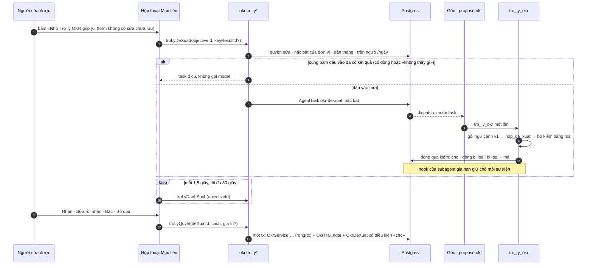

# Góp ý khi bấm (lượt 9b · `tro-ly-okr-de-xuat`) — thiết kế

Nguồn: `docs/plan/lo-trinh-tro-ly-okr.md` mục 5 «9b»; `docs/plan/lo-trinh-okr.md` mục 5
«Dựng hết bằng dữ liệu mẫu» và dòng 9b mục 10 (PR #183); thiết kế
`docs/reports/2026-09-26-tro-ly-okr/12-kien-truc-va-lo-trinh.md` §4.3, 4.5, 4.7, 4.9, 4.11,
6.3; hồ sơ cơ hội `_acceptance/tro-ly-okr-de-xuat/opportunity.md`; nền 9a
`_acceptance/tro-ly-okr-nen/` (PR #182); bộ OKR mẫu của hạng mục M
(`docs/superpowers/specs/2026-09-28-bo-okr-mau-design.md`, nhánh `feat/bo-okr-mau`).

## 1. Được gì

Người sửa được một Mục tiêu bấm «Nhờ Trợ lý OKR góp ý» ngay trong hộp thoại sửa Mục tiêu,
và trong vài giây thấy một cột đề xuất bên cạnh form: câu cũ gạch, câu mới cạnh đó, một
dòng lý do; câu hỏi về chất lượng; chỗ Căn chỉnh nên gắn. Họ nhận, sửa rồi nhận, hay bác
từng dòng; nhận là ghi ngay, có vết «theo đề xuất của Trợ lý OKR». Người phụ trách một KR
làm đúng việc đó trên hộp thoại KR, phạm vi chỉ KR đó. Ô đích của KR có nguồn CRM hay KR
mang sang từ kỳ trước có một dòng xu hướng tính bằng mã.

Quản trị bật Trợ lý OKR theo ba nấc cho từng việc và từng đơn vị: **tắt · chạy bóng ·
bật**. Ở nấc chạy bóng, máy tự góp ý mỗi khi một Mục tiêu hay KR trong phạm vi được lưu
với chữ đổi, ghi sổ chi phí và số đo, nhưng **chỉ quản trị thấy** kết quả, ở Cài đặt ›
Chương trình OKR. Đó là cách đo trên OKR thật trước khi người dùng nhận một đề xuất nào.

Khi gộp, mọi công tắc vẫn tắt: người dùng không thấy gì. Lượt này dựng và đo trên bộ OKR
mẫu của M. Dữ liệu thật là điều kiện **bật**, không phải điều kiện dựng: N1 có ít nhất 12
ca thật đạt cùng ngưỡng như ca mẫu (chốt 28/09, Manh Phan).

## 2. Đã chốt trước lượt này — không mở lại

- ZDR bắt buộc cho mọi lời gọi model mang chữ OKR, kể cả judge của eval (26/09).
- Trần $9/tháng của khu OKR, trong $20 của workspace (26/09). Chạy bóng tốn tiền thật và
  tính vào $9 (28/09).
- Kiến trúc của 9a: việc vào bằng một hàng `AgentTask`; gốc chuyển tiếp đúng một lần; subagent
  `tro_ly_okr` chỉ đọc OKR, chỉ ghi `OkrDeXuat`; máy không ghi vào OKR — người bấm nhận.
- Chỉ «khi bấm» với người dùng; góp ý tự đến khi không ai bấm bị bác ở hồ sơ cơ hội. Chạy
  bóng không trái điều này: người dùng không nhận gì.

## 3. Máy suy thêm — gạch ở Cổng Phạm vi nếu sai

1. **Hạng T3, không phải T2 như lộ trình ghi.** Nấc chạy bóng theo từng đơn vị và chỗ ghi
   dòng bị bộ kiểm loại cần cột mới (§5), mà `packages/db/prisma` là đường T3. Hai cột
   9a để sẵn không diễn được «Mục tiêu cấp OneHub bật, phòng ban chạy bóng» — đúng lộ
   trình bật của lộ trình (OneHub trước mùa OKR năm, phòng ban trước mùa quý 1), và không
   có chỗ ghi «câu bị bộ kiểm bỏ» mà giả định 4 của hồ sơ cơ hội đòi đọc. Phương án T2 ở §12.
2. **Chạy bóng do máy kích khi lưu.** Ở nấc bóng không ai thấy nút, nên không ai bấm; máy
   xếp một lượt góp ý khi một Mục tiêu hay KR trong phạm vi bóng được lưu với tên, «vì sao
   lúc này» hay tên KR đổi. Gộp theo băm đầu vào, mỗi Mục tiêu tối đa một lượt bóng trong
   30 phút, cả workspace tối đa 40 lượt bóng mỗi ngày.
3. **Nhận là ghi ngay từng dòng**, không đợi nút «Lưu» của form (như «Update» của
   Tability). Vì trợ lý đọc bản đã lưu, nút góp ý khoá khi form còn sửa chưa lưu.
4. **Cột đề xuất nằm cạnh form trong cùng hộp thoại**; hộp mở rộng khi cột hiện. Điện
   thoại xếp cột dưới form. Hướng khác ở design-pass.
5. **Chỉ trên Mục tiêu và KR đã có**, không trên form tạo mới.
6. **Trần người/ngày: 20 lượt gọi model.** Lượt trả kết quả cũ theo băm không tính.
7. **Dòng xu hướng đi theo công tắc của việc góp ý.** Nó không gọi model, nhưng hiện nó
   trước khi bật là người dùng thấy một phần của 9b lúc gộp — trái bảng «Bật khi nào».
8. **Judge của eval là `zai/glm-5.2-fast` qua Gateway có ZDR** (N0 đo ZDR đạt; khác họ
   Gemini theo luật §4.11). Bộ Viết lại được hiệu chỉnh với chủ kho (20 đầu ra, khớp
   ≥ 85% thì judge thành chốt); bộ NG chặn bằng mã, judge chỉ tham khảo tới lượt kế.
9. **Hai lỗi 9a vào phạm vi** theo hồ sơ cơ hội: việc bị đóng «hong:het-lease» khi phiên
   con chạy quá 30 giây (Ngoài-32), kiểm khoá cũ chặn sau khi khoá đã cắm (Ngoài-33).
   Việc thứ ba 9a tách ra (phép đo cách ly chưa có chiều đỏ) không vào lượt này.

## 4. Sơ đồ

Chạy bóng đi cùng đường từ hàng `AgentTask` trở đi; khác ở điểm vào (lưu Mục tiêu hay KR
trong phạm vi bóng) và điểm ra (chỉ quản trị đọc, qua `okr.troLyBong`).

## 5. Dữ liệu — một migration chỉ thêm

- `OkrProgramConfig`: `aiDeXuatBongPhamVi String @default("tat")`,
  `aiDeXuatBongDonVi String[] @default([])`, `aiTomTatBongPhamVi String @default("tat")`,
  `aiTomTatBongDonVi String[] @default([])`. Hai việc cùng thêm để 9c (tóm tắt chạy bóng
  ba tuần trước khi bật) không phải thêm cột.
- `OkrDeXuat`: `nac String @default("bat")` (`bat` · `bong`) và `maLoai String?` (mã bộ
  kiểm đã loại dòng). `TRANG_THAI_DE_XUAT` thêm `bi-loai` (cột chuỗi sẵn có, parse bằng enum).
- Không bảng mới. Mọi cột chuỗi mới parse bằng enum Zod lúc đọc; parse hỏng là lỗi có tên.

**Luật nấc.** Với một việc và một đơn vị: đơn vị trong phạm vi bật → `bat`; ngoài đó mà
trong phạm vi bóng → `bong`; còn lại `tat`. Bật thắng bóng. Công tắc tổng `aiOn` tắt thì
mọi việc tắt. Bộ phận kéo theo mọi phòng ban trong nó; Mục tiêu cá nhân theo phòng ban
chính (luật 9a giữ nguyên). `donViDuocBat` thành `nacCuaDonVi` trả `tat` · `viec-tat` ·
`don-vi-chua-bat` · `bong` · `bat`; mọi chỗ gọi cũ đọc `bat` như trước.

## 6. Thành phần

| Đơn vị | Chỗ | Việc |
| --- | --- | --- |
| Khuôn | `packages/validation/src/okr-tro-ly.ts`, `okr-chuong-trinh.ts` | `nac` trong `okrTroLyViec`; `bi-loai`, `MA_LOAI_DE_XUAT`; bốn trường bóng của `okrProgram`; đầu vào và đầu ra năm thủ tục mới |
| Luật nấc, trần | `packages/db/src/okr-tro-ly.ts`, `okr-tro-ly-danh-muc.ts` | `nacCuaDonVi`; `troLyOkrSanSang` nhận người yêu cầu và trả `het-tran-ngay`; `xepViecTroLy` nhận `nac`; hằng mới trong `TRO_LY_OKR_TRAN` (trần ngày, nhịp bóng, trần bóng ngày, nhịp hỏi lại, trần chờ, số điểm xu hướng) |
| Bộ kiểm | `packages/validation/src/okr-kiem-de-xuat.ts` (mới) | Hàm thuần `kiemDongDeXuat(dong, goi)` → `{ qua } \| { maLoai }` — xem §8 |
| Xu hướng | `packages/db/src/okr-xu-huong.ts` (mới) | Hàm thuần `xuHuongKr(diem[], ketThucKy)`; đọc bản chụp CRM hay lần cập nhật của KR kỳ trước |
| Ghi có giao dịch | `apps/api/src/okr/okr.service.ts` | Tách thân `updateObjective`, `updateKeyResult`, `addAlignment` thành `…Trong(tx, …)`; hàm cũ gọi hàm mới, hành vi không đổi |
| Thủ tục | `apps/api/src/okr/tro-ly.service.ts`, `okr.router.ts` | `troLySanSang`, `troLyDeXuat`, `troLyDanhSach`, `troLyQuyet`, `troLyBong` (quản trị), `troLySoDo` (quản trị), `xuHuongKr`; kích chạy bóng sau khi lưu Mục tiêu hay KR |
| Subagent | `apps/agent/agent/subagents/tro_ly_okr/` | Gói ngữ cảnh v1 (§7); `nop_de_xuat` chạy bộ kiểm, luật không mời lại, ghi `nac`; hook mới giữ chỗ việc; skill tĩnh phương pháp OKR |
| Giữ chỗ, kiểm khoá | `apps/agent/agent/subagents/tro_ly_okr/hooks/giu-viec.ts` (mới), `lib/schedules` của dispatch | Lỗi 1 và lỗi 2 — §9 |
| Màn người dùng | `apps/app/app/(app)/[slug]/okr/hop-thoai-muc-tieu.tsx`, `hop-thoai-kr.tsx`, `cot-gop-y.tsx` (mới), `bang-vet.tsx` | Nút, cột đề xuất, dòng xu hướng, vết «theo đề xuất của Trợ lý OKR» |
| Màn quản trị | `apps/app/app/(app)/[slug]/settings/okr/the-tro-ly-okr.tsx`, `the-gop-y-so-do.tsx` (mới) | Hai dòng «Bật cho» · «Chạy bóng cho» mỗi việc; thẻ số đo và danh sách lượt chạy bóng |
| Thành phần chung | `packages/ui/src/components/suggestion.tsx` | Biến thể câu cũ → câu mới, hàng nút Nhận · Sửa · Bác, trạng thái đã quyết |
| Eval | `apps/agent/evals/okr/gop-y.eval.ts`, `ng.eval.ts`, `do-tre.eval.ts` | Ca của M qua `docBoCaGopY`; judge ZDR |
| Thước | `_acceptance/tro-ly-okr-de-xuat/rang/*.sql` | Tỷ lệ quyết, hoàn tác, độ trễ, câu bị loại, chi phí mỗi đề xuất nhận |
| Tài liệu | `CONTEXT.md`, `docs/api.md` §OKR, `docs/agent.md` chỗ rẽ | Mục «Chạy bóng»; năm thủ tục; tệp của hãng chạm thêm |

## 7. Gói ngữ cảnh v1 và việc của subagent

Gói v0 của 9a (chương trình, Mục tiêu, các KR, đề xuất đã bác) thêm:

- **Kết quả luật lượt 7** (`kiemOkr` trên chính dữ liệu đã lưu): model không hỏi lại mã
  luật đã hỏi.
- **Ứng viên Căn chỉnh**: tập đích mà `alignmentTargets` trả cho Mục tiêu này, kèm id;
  model chỉ xếp hạng trong tập đó.
- **Phạm vi**: `objective` (Mục tiêu và mọi KR) hay `kr` (chỉ KR đó, không Căn chỉnh).
- **Khoá đã bác và khoá đang chờ** theo loại dòng (§8).

Không thêm chuỗi Cập nhật tuần: viết lại và Căn chỉnh không cần nó (chỗ lệch 3 của lộ
trình). Skill tĩnh `phuong-phap-okr.md` (KR đo kết quả không đo việc; «hỏi, không chặn
lưu»; NG-01, NG-05, NG-06, NG-07; từ nên dùng và từ tránh của `CONTEXT.md`) đặt đầu
`instructions` để ăn cache.

## 8. Bộ kiểm và luật sổ đề xuất

Chạy trong `nop_de_xuat` trước khi ghi, và chạy lại khi `troLyDanhSach` đọc (số hiện tại
có thể đã đổi). Dòng không qua **vẫn được ghi**, trạng thái `bi-loai` kèm `maLoai`, không
bao giờ tới người dùng — để quản trị đọc được «câu bị bộ kiểm bỏ» ở cả hai nấc.

| `maLoai` | Áp cho | Luật |
| --- | --- | --- |
| `id-ngoai-goi` | mọi dòng | Mục tiêu, KR, đích Căn chỉnh phải có trong gói |
| `so-moi` | viết lại | Mọi con số trong `sau` (đọc bằng `docSoOkr`) phải có trong `truoc` hoặc ô số của chính KR đó |
| `tu-cam` | mọi chữ | Từ tránh của `CONTEXT.md` và danh sách NG-01, NG-02, NG-07 (lương, thưởng, xếp loại, xếp hạng, đánh giá nhân viên…); chỉ tính chữ không có sẵn trong đầu vào |
| `noi-ve-nguoi` | mọi chữ | Chứa họ tên đầy đủ của một thành viên (so không dấu) |
| `chep-cap-tren` | viết lại tên Mục tiêu | `sau` trùng (sau chuẩn hoá) tên một KR của đích Căn chỉnh — NG-06 |
| `trung-luat` | câu hỏi | `maVanDe` trùng mã luật lượt 7 đã hỏi trên cùng trường |
| `dich-ngoai-tap` | Căn chỉnh | Đích không thuộc tập `alignmentTargets` |
| `da-bac` | mọi dòng | Trùng khoá đã bác |
| `dang-cho` | mọi dòng | Trùng khoá đang chờ với cùng `sau` |
| `khong-doi` | viết lại | `sau` chuẩn hoá bằng `truoc` |

Khoá theo loại dòng: viết lại `(Mục tiêu, KR, trường)` — mở lại khi chính người dùng sửa
trường đó; câu hỏi `(Mục tiêu, KR, maVanDe)`; Căn chỉnh `(Mục tiêu, đích)`. Dòng `cho` có
`truoc` khác giá trị hiện tại thành `het-han` khi đọc và không hiện nữa.

**Quyết.** `troLyQuyet` nhận `nhan` · `sua` (kèm giá trị) · `bac` · `bo-qua` (chỉ dòng
câu hỏi). Nhận và sửa gọi `updateObjectiveTrong`, `updateKeyResultTrong` hay
`addAlignmentTrong` trong cùng `tx` với cập nhật có điều kiện `trangThai = 'cho'` — nên
vẫn kiểm quyền sửa, khoá pha, trần số mục, và ghi đúng một hàng `OkrTrail` có
`note = "tro-ly-okr:<deXuatId>"`; màn Vết đọc `note` và hiện «theo đề xuất của Trợ lý
OKR». Dòng đã khác `cho` không quyết lại được. Sau «Nhận», toast có «Hoàn tác» ghi lại
`truoc` qua đường sửa thường — thước hoàn tác đếm đúng việc đó.

## 9. Hai lỗi của 9a

- **Việc bị đóng giữa chừng (Ngoài-32).** Giữ chỗ 30 giây chỉ được gia hạn bởi hook `"*"`
  của phiên gốc (`hooks/okr-uy-quyen.ts:29`), mà gốc im trong lúc `tro_ly_okr` chạy; dọn
  việc treo đóng việc `hong:het-lease` (`lib/stale-tasks.ts`). Sửa: hook mới trong thư mục
  subagent nghe mọi sự kiện của phiên con, tìm việc qua phiên gốc (`lib/phien-con.ts`, đúng
  đường 9a đã đo) và gia hạn. Phiên con chết im thì không còn ai gia hạn, dọn việc treo vẫn
  đóng trong vòng 90 giây — lưới 9a giữ nguyên.
- **Kiểm khoá cũ chặn mãi (Ngoài-33).** `ketQuaKiemGanNhat` tin kết quả kiểm gần nhất không
  hạn; việc kiểm chỉ xếp lại khi quản trị tắt rồi bật. Sửa: kết quả «chưa có khoá» chỉ còn
  hiệu lực 10 phút; nhịp dispatch xếp lại một việc kiểm (không gọi model, chống trùng bằng
  khoá) khi Trợ lý OKR đang bật và kết quả gần nhất là «chưa có khoá» đã quá hạn. Cắm khoá
  xong thì trong một nhịp sau hạn, sẵn sàng về «sẵn sàng» mà không ai phải bấm gì.

## 10. Số đo cho chủ kho

Thẻ «Góp ý của Trợ lý OKR» ở Cài đặt › Chương trình OKR (chỉ quản trị), tháng này, tách
nấc bật và nấc bóng: số lượt; số đề xuất đã hiện; nhận · sửa · bác · bỏ qua theo phần
trăm; hoàn tác trong 7 ngày trên số đã nhận; độ trễ p50 và p90 (từ lúc ghi hàng việc tới
dòng đề xuất đầu tiên, hay tới lúc việc đóng nếu không có dòng); câu bị bộ kiểm loại trên
tổng câu model nộp, theo mã; chi phí mỗi đề xuất được nhận. Dưới đó là danh sách lượt gần
đây (bóng và bật); bấm một lượt mở ngăn xem từng dòng, kể cả dòng bị loại và mã loại.
Mỗi con số có một câu SQL cùng định nghĩa ở `rang/` để phiên nghiệm thu đọc thẳng DB.

## 11. Eval

- **Viết lại** (`gop-y.eval.ts`): mọi ca `bo: "viet-lai"` của `apps/agent/evals/okr/ca-gop-y/mau/`,
  đọc bằng `docBoCaGopY` của M. Chốt bằng mã (mọi ca): dòng còn lại sau bộ kiểm không có
  mã loại nào; ca `khongGopY` không có dòng viết lại nào; mỗi ca có `kyVong.vanDe` được ít
  nhất một dòng câu hỏi hay viết lại đúng trường. Judge `closedQA` (GLM, ZDR): «nói kết
  quả, không nói việc làm», «giữ ý người viết», «trả lời theo ngôn ngữ chiếm đa số của nội
  dung» — `.atLeast(0.7)` sau khi hiệu chỉnh đạt.
- **NG** (`ng.eval.ts`): ca `bo: "ng"`; chốt bằng mã: không dòng `chep-cap-tren`,
  `noi-ve-nguoi`, `tu-cam` lọt; judge tham khảo.
- **Độ trễ** (`do-tre.eval.ts`): 20 lượt thật trên Mục tiêu của bộ OKR mẫu trong kho đo;
  p50 ≤ 8 giây, p90 ≤ 15 giây.
- **Đổi sang ca thật** = truyền `THU_MUC_CA_THAT` thay `THU_MUC_CA_MAU`. Đó là điều kiện
  bật, không phải việc của lượt này.
- **Tiền của eval**: ước ~$2 cho một lượt đủ ba bộ (30 ca × 3 lần × ~$0,02 cộng judge).
  Khoá nào trả và trần bao nhiêu: chủ kho quyết trước S4.

## 12. Phương án T2 (không khuyên)

Nới enum `aiDeXuatPhamVi` thành năm giá trị (`tat` · `bong-toan-cong-ty` ·
`bong-danh-sach` · `toan-cong-ty` · `danh-sach`), không thêm cột. Mất: một việc chỉ một
nấc cho cả danh sách đơn vị (không «OneHub bật, phòng ban bóng»), và dòng bị bộ kiểm loại
không có chỗ ghi — tỷ lệ câu bị bỏ chỉ đo được trong eval, không trên OKR thật.

<!-- <<<UX-SPEC-TEMPLATE -->
## Đặc tả UX

### 1. Luồng

- Suôn sẻ: Theo đơn vị › một Mục tiêu › «Sửa» → hộp thoại sửa Mục tiêu → «Nhờ Trợ lý OKR góp ý» → hộp mở rộng, cột phải hiện «Trợ lý OKR đang đọc Mục tiêu này…» → vài giây sau hiện các dòng → «Nhận» một dòng: ô tương ứng trong form đổi theo, dòng thành «Đã nhận», toast «Đã nhận · Hoàn tác» (điểm ra: đóng hộp, hoặc ở lại quyết tiếp).
- Biên: form còn sửa chưa lưu — nút khoá, mô tả «Lưu thay đổi trước khi nhờ góp ý»; Mục tiêu đã có đề xuất đang chờ — nút mang số «3 đề xuất đang chờ» và mở thẳng cột; người phụ trách KR mở hộp thoại KR — cùng luồng, chỉ các dòng của KR đó; dòng KR mà người bấm không sửa được — không hiện.
- Lỗi & quay lại: quá 30 giây, việc hỏng hay trợ lý «không làm được» → «Trợ lý OKR chưa trả lời được, thử lại sau» + nút «Thử lại»; nhận hỏng (pha khoá, trần số mục, mất quyền) → lỗi ngay dưới dòng, dòng giữ «đang chờ»; dòng đã hết hạn vì câu đã đổi → biến khỏi cột.

### 2. Kiểm kê màn

| Màn | MỘT việc của màn | Vào từ / ra tới |
|---|---|---|
| Hộp thoại sửa Mục tiêu + cột Trợ lý OKR | Nhận hay bác đề xuất cho Mục tiêu này | Theo đơn vị, Của tôi, Toàn cảnh / ở lại |
| Hộp thoại sửa KR + cột Trợ lý OKR | Nhận hay bác đề xuất cho KR này; đọc xu hướng khi đặt đích | Bảng KR / ở lại |
| Cài đặt › Chương trình OKR, thẻ Trợ lý OKR | Chọn đơn vị bật và đơn vị chạy bóng cho từng việc | Thanh bên Cài đặt / ở lại |
| Cài đặt › Chương trình OKR, thẻ Góp ý của Trợ lý OKR | Cho biết góp ý có ăn thua không, và xem lượt chạy bóng | Cùng trang / ngăn một lượt |

### 3. Bảng trạng thái

<!-- <<<UX-STATE-TABLE -->
| Trạng thái | Màn | Hiển thị gì | Người làm gì tiếp |
|---|---|---|---|
| ST-muctieu-nut | Hộp Mục tiêu | Nút phụ «Nhờ Trợ lý OKR góp ý» ở đầu thân hộp | Bấm |
| ST-muctieu-nut-khoa-sua | Hộp Mục tiêu | Nút khoá + «Lưu thay đổi trước khi nhờ góp ý» | Lưu |
| ST-muctieu-dang-soan | Hộp Mục tiêu | Cột phải: shimmer «Trợ lý OKR đang đọc Mục tiêu này…» trên khung ba dòng | Chờ, hoặc đóng cột |
| ST-muctieu-co-dong | Hộp Mục tiêu | Các dòng nhóm theo ô: câu cũ gạch → câu mới, lý do, Nhận · Sửa · Bác; câu hỏi với Bỏ qua; Căn chỉnh với Nhận · Bác. Điện thoại: cột xếp dưới form, bấm nút thì cuộn tới cột | Quyết từng dòng |
| ST-muctieu-sua-dong | Hộp Mục tiêu | Dòng mở ô sửa chứa câu mới, nút «Nhận bản đã sửa» · «Huỷ» | Sửa rồi nhận |
| ST-muctieu-da-quyet | Hộp Mục tiêu | Dòng thu gọn «Đã nhận» / «Đã bác»; ô form đã đổi theo | Quyết dòng khác |
| ST-muctieu-rong | Hộp Mục tiêu | «Trợ lý OKR không thấy chỗ nào cần sửa» | Đóng cột |
| ST-muctieu-loi | Hộp Mục tiêu | «Trợ lý OKR chưa trả lời được, thử lại sau» + «Thử lại» | Thử lại |
| ST-muctieu-loi-nhan | Hộp Mục tiêu | Lỗi dưới dòng («Chu kỳ đã khoá sửa» / «Bạn không còn sửa được Mục tiêu này»), dòng giữ nguyên | Đóng |
| ST-muctieu-het-tran | Hộp Mục tiêu | Nút mờ + «Trợ lý OKR tạm nghỉ tới 01/MM» | — |
| ST-muctieu-het-luot | Hộp Mục tiêu | Nút mờ + «Bạn đã dùng hết lượt góp ý hôm nay» | — |
| ST-muctieu-dang-cho | Hộp Mục tiêu | Nút «3 đề xuất đang chờ»; mở hộp là cột đã hiện | Quyết |
| ST-kr-cot | Hộp KR | Cột chỉ dòng của KR này | Quyết |
| ST-kr-xu-huong | Hộp KR | Dưới ô Đích: «Theo 4 tuần gần nhất (+12/tuần), cuối kỳ ước khoảng 180» | Đặt đích |
| ST-kr-khong-xu-huong | Hộp KR | KR chưa đủ ba điểm số: không có dòng | — |
| ST-caidat-nac | Thẻ Trợ lý OKR | Mỗi việc hai dòng «Bật cho» · «Chạy bóng cho», mỗi dòng chọn không đơn vị nào / toàn công ty / chọn đơn vị | Chọn, lưu |
| ST-caidat-nac-bat-toan | Thẻ Trợ lý OKR | «Bật cho: toàn công ty» → «Chạy bóng cho» khoá, «mọi đơn vị đã bật» | — |
| ST-sodo-dang-tai | Thẻ Góp ý | Khung xương | Chờ |
| ST-sodo-rong | Thẻ Góp ý | «Tháng này chưa có lượt góp ý nào» | — |
| ST-sodo-co-so | Thẻ Góp ý | Bảng số đo hai cột Bật · Bóng: lượt, đề xuất đã hiện / sinh ra, nhận, sửa rồi nhận, bác, bỏ qua, hoàn tác 7 ngày, p50, p90, câu bị loại, chi phí mỗi đề xuất nhận; bảng lượt gần đây | Mở một lượt |
| ST-sodo-ngan | Ngăn một lượt | Mục tiêu, nấc, độ trễ, chi phí; từng dòng kể cả dòng bị loại kèm mã loại | Đóng |
| ST-sodo-loi | Thẻ Góp ý | «Không tải được số đo» + «Thử lại» | Thử lại |
<!-- UX-STATE-TABLE>>> -->

### 4. Hành vi

- Hỏi lại mỗi 1,5 giây, tối đa 30 giây; đóng cột hay đóng hộp thì ngừng hỏi.
- Nhận một dòng viết lại: ô tương ứng của form lấy giá trị mới làm giá trị đã lưu (form không bị coi là «có sửa»).
- Câu cũ và câu mới là chữ người nhập hay máy viết về dữ liệu người nhập: `translate="no"`.
- Phím: Tab đi qua từng dòng theo thứ tự ô trên form; «Sửa» đặt con trỏ vào ô sửa; Esc trong ô sửa huỷ sửa, không đóng hộp.
- Tên nấc trên màn: «Bật cho», «Chạy bóng cho»; mô tả dòng bóng: «Máy góp ý khi Mục tiêu được lưu; chỉ quản trị thấy kết quả, ở thẻ bên dưới».
- Hộp rộng (`size="wide"`) chỉ khi cột hiện; ≤ 640px cột xếp dưới.

### 5. Xuất xứ component

| Component | Nấc (dùng / ghép / mở rộng / tạo) | Vì sao (1 dòng) |
|---|---|---|
| `Dialog size="wide"` | dùng | Đã có cỡ rộng |
| `Suggestion` | mở rộng | Có sẵn nhận/bỏ ở `packages/ui`; thêm biến thể câu cũ → câu mới, nút Sửa, trạng thái đã quyết — dùng token `diff-them`/`diff-bo` của `diff-trang` |
| `Shimmer` | dùng | Đang soạn, theo sổ AI Elements |
| `Item` | dùng | Nhóm dòng theo ô |
| `Textarea` | dùng | Sửa rồi nhận |
| `FieldDescription variant="hoi"` | dùng | Dòng xu hướng dưới ô Đích, cùng chỗ câu hỏi luật lượt 7 |
| `Empty`, `Alert` | dùng | Rỗng, lỗi |
| `Select`, `PickListDialog`, `Field` | dùng | Hai dòng nấc ở thẻ cài đặt |
| `SimpleTable`, `Sheet`, `StatusIndicator` | dùng | Bảng số đo hai nấc, bảng lượt, ngăn một lượt, nhãn «qua bộ kiểm» / «bị loại» |

### 6. Khuôn IA đã chọn + căn cứ

Khuôn IA: danh-sách-chi-tiết (master-detail)
Căn cứ: tra Mobbin «AI suggestions panel next to a form, accept/dismiss per suggestion» — Grammarly, WRITER, Dovetail đặt đề xuất thành cột thẻ cạnh văn bản, mỗi thẻ câu cũ gạch → câu mới, Nhận/Bỏ từng thẻ; Tability F02 cũng đặt «AI feedback» ở khung phải của Plan Editor. Rút: cột cạnh form để người thấy ô sắp đổi; hộp thoại hiện tại một cột nên mở rộng khi cột hiện.
<!-- UX-SPEC-TEMPLATE>>> -->

## 13. Ngoài phạm vi

- Góp ý trên màn Cập nhật tuần; góp ý khi tạo Mục tiêu mới.
- Trạng thái `da-sua-theo` cho dòng câu hỏi khi trường đổi trong 7 ngày — đếm được sau bằng thước SQL trên `OkrTrail`.
- Hiệu chỉnh judge bộ NG với người — lượt kế.
- Lý do `het-tran-gateway` (hết ngân sách AI Gateway) — enum có từ 9a, chưa đường nào sinh; không thuộc góp ý.
- Tóm tắt tuần (9c) — lượt này chỉ thêm cột nấc bóng cho nó.
- Biểu đồ tỷ lệ theo tuần ở màn quản trị.
- Chuyển ca thật của N1 vào và bật cho người dùng — việc của chủ kho sau khi N1 có ca.

## 14. Rủi ro còn lại

- Ca mẫu sạch hơn OKR thật; ngưỡng chỉnh trên ca mẫu có thể trượt trên ca thật. Chặn bằng
  công tắc tắt khi gộp và điều kiện bật N1.
- Chạy bóng tính vào $9; mùa đặt OKR có thể có nhiều lần lưu. Chặn bằng gộp băm, nhịp 30
  phút mỗi Mục tiêu, trần 40 lượt bóng/ngày, và trần tháng sẵn có.
- Độ trễ bốn bước model ước 6–15 giây (§4.5 thiết kế); nếu trượt ngưỡng, cách giảm ở §4.10.
