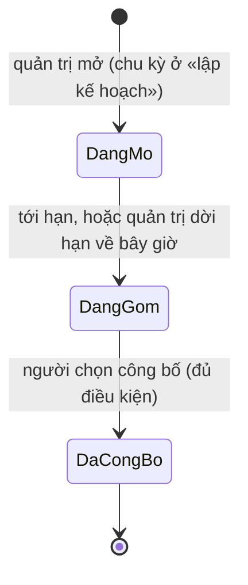

# Hỏi ý mục tiêu — thiết kế (hạng mục 11 lộ trình OKR)

Hồ sơ: `_acceptance/dot-hoi-y-tuong-okr/` · Hạng T3 · Ngoài 78 mã của bản phạm vi ·
Cổng Đáng ký 2026-09-29 (Manh Phan): build, dựng xong trước 2026-11-28, đo 2026-12-14.
Sơ đồ cách hoạt động: `_acceptance/dot-hoi-y-tuong-okr/figures/cach-hoat-dong.html`.

Đọc trước khi viết: `docs/api.md` (tRPC, cây tổ chức, OKR), `docs/agent.md` (Nhắc
buổi sáng, Trợ lý OKR 9a), `docs/design.md`, `docs/proto.md`, `CONTEXT.md` (OKR, Chu
kỳ, Mục tiêu, Vai «chỉ OKR», Phạm vi dữ liệu, Trợ lý OKR, Đề xuất); skill chuẩn giao
diện của kho (`web-design-guidelines`); quét độ phủ ở `coverage-scan.md`.

## 1. Hiểu việc

- **Kết quả:** trước mỗi kỳ đặt OKR, cả công ty trả lời một câu «nếu là CEO, mục tiêu
  nào quan trọng cho kỳ tới» trong CRM; người gom xếp ý thành chủ đề; người chọn (CEO)
  kết luận từng chủ đề và tự viết lý do; chủ đề được chọn thành bản nháp mục tiêu cấp
  OneHub; ai góp cũng thấy ý mình đi đâu và vì sao. Lần đầu chạy cho OKR năm 2027,
  mở cùng mùa đặt OKR 2026-12-07.
- **Chủ kho đã chốt (Cổng Đáng và brainstorm 2026-09-29):** hỏi trước rồi CEO chọn
  (không đảo); ghi tên đầy đủ, đồng nghiệp thấy ý không thấy tên; nút «tôi cũng nghĩ
  vậy», số đếm chỉ người gom thấy; độ phủ theo đơn vị dạng heatmap, đích 100%, nhắc
  người chưa góp, không thưởng phạt; ô «ý lạ»; CEO viết trước và niêm phong, lộ khi
  công bố; mỗi chủ đề phải có kết luận và lý do CEO tự viết, thiếu thì không công bố;
  máy chỉ đính bằng chứng, không điền sẵn lý do; thẻ mồi là 3–5 con số CEO công bố;
  hỏi một tầm mỗi lần; kho ý «để sau» ai cũng đọc được.
- **Máy giả định (gom về Coverage, gạch ở Cổng Phạm vi):** «người chọn» là một người
  quản trị được chỉ định khi mở, không phải vai mới; người chọn chưa niêm phong thì
  không đọc được ý; «đổi» trong «giữ, đổi, thêm» được đo bằng nối tay từng chủ đề
  chọn với một câu viết trước; tin đóng vòng sống trên màn Hỏi ý, nhắc chỉ trỏ tới đó.
- **Không làm ở lượt này:** Trợ lý OKR đề xuất nhóm chủ đề (tách lượt 11b, mục 9);
  góp qua Slack hay Zalo (lượt 10); hỏi ý riêng của một đơn vị.

**Tên sản phẩm là «Hỏi ý mục tiêu», không phải «đợt hỏi».** `CONTEXT.md` đã dành chữ
«đợt» cho chiến dịch (mục Chu kỳ, dòng _Avoid_). Slug hồ sơ giữ nguyên vì là mã máy.

## 2. Ba cách đã cân nhắc cho người chọn và chỗ niêm phong

| Cách | Thế nào | Được | Mất |
|---|---|---|---|
| **A — Người chọn là một quản trị, chỉ định khi mở (chọn)** | Ô «Người chọn» trong sheet mở hỏi ý, chỉ liệt kê owner/admin. Người đó viết trước, kết luận, công bố | Chủ đề chọn thành mục tiêu cấp OneHub — mà chỉ quản trị sửa được cấp đó; không thêm vai workspace | CEO phải là quản trị trong CRM |
| B — Vai «CEO» mới trong workspace | Vai thứ năm | Nói thẳng ai là CEO | Đổi `WORKSPACE_ROLES`, `docDuocPhamVi`, mọi phép đo vai; T3 chồng T3 cho một người |
| C — Quản trị nào cũng chọn được | Không chỉ định | Không thêm trường | Không ai chịu bản viết trước; ai công bố cũng được |

Niêm phong: bản viết trước là một hàng riêng chỉ ghi một lần, không sửa. **Người
chọn chỉ đọc được ý của người khác sau khi niêm phong, hoặc sau khi khai «không viết
trước»** — không có luật này thì CEO đọc ý rồi mới viết, bản niêm phong mất nghĩa.
Không ai khác đọc được bản viết trước — quản trị cũng không — tới khi công bố.

## 3. Vòng đời một lần hỏi ý

- **Đồng hồ tiêm được.** `OkrHoiYService` nhận `now` qua một nhà cung cấp đồng hồ (như
  `OkrCapNhatService` lượt 4) và ghi tường minh mọi mốc (`createdAt` của ý và lượt đồng
  ý, `congBoLuc`, `OkrHoiYHieu.luc`) — không dùng giá trị mặc định của cơ sở dữ liệu, để
  phép đo gieo được hai ngày hay mốc 8 ngày qua thủ tục thật. Ngày giờ Việt Nam của một
  mốc là ngày của (mốc + 7 giờ) theo UTC, một hàm `ngayVN` dùng chung.
- Trạng thái suy, không lưu: `da-cong-bo` khi có `congBoLuc`; `dang-gom` khi bây giờ
  ≥ `hanLuc`; còn lại `dang-mo`. Một hàm thuần `trangThaiHoiY(hoiY, now)` trong
  `@crm/validation/okr-hoi-y`, màn và máy chủ cùng dùng.
- Một chu kỳ có nhiều nhất một lần hỏi ý (`cycleId @unique`). Mọi kiểu chu kỳ (năm,
  quý) — Cổng Giá trị đọc tỉ lệ góp lại ở lần hỏi ý quý 2/2027.
- Chu kỳ phải ở pha `lap-ke-hoach` lúc mở và lúc công bố (công bố tạo bản nháp mục
  tiêu, mà ghi mục tiêu chỉ được ở `lap-ke-hoach` và `dang-chay`). Ngược lại,
  `setCyclePhase` từ chối đưa chu kỳ rời `lap-ke-hoach` khi chu kỳ có lần hỏi ý chưa
  công bố — chỗ duy nhất lượt này chạm một thủ tục có sẵn.

## 4. Dữ liệu — sáu bảng mới, khối liền cuối `schema.prisma`

`migration` chỉ `CREATE TABLE`, `CREATE INDEX` trên bảng mới, `ADD CONSTRAINT` trên
bảng mới. Không cột mới trên bảng có sẵn: nối chủ đề ↔ mục tiêu là cột trên bảng mới.

| Bảng | Cột chính | Khoá ngoại |
|---|---|---|
| `OkrHoiY` | `cycleId @unique`, `cauHoi` (10–300), `loiMo` (0–1000), `soLieu Json` (1–5 `{ nhan, giaTri, ghiChu }`), `hanLuc`, `nguoiChonUserId`, `taoBoiUserId`, `congBoLuc?`, `createdAt`, `updatedAt` | chu kỳ, `user`: RESTRICT |
| `OkrHoiYBanTruoc` | `hoiYId @unique`, `cau String[]` (3–5 câu, hoặc trống khi `boQua`), `boQua Boolean`, `vietBoiUserId`, `niemPhongLuc` | hỏi ý, `user`: RESTRICT |
| `OkrY` | `hoiYId`, `tacGiaUserId`, `noiDung` (10–300), `viSao` (0–500), `doBangGi` (0–200), `chuDeId?`, `ganLuc?` (lúc gắn vào chủ đề — mốc «vào chủ đề» của hành trình), `createdAt`, `updatedAt` | hỏi ý, `user`: RESTRICT · chủ đề: SET NULL |
| `OkrYDongY` | `yId`, `userId` — khoá chính ghép, `createdAt` | ý: CASCADE · `user`: RESTRICT |
| `OkrChuDe` | `hoiYId`, `loai` (`chu-de` · `y-la`), `ten` (2–120), `ketLuan?` (`chon` · `de-sau` · `khong-lam` · `da-co`), `lyDo` (0–1000), `cauMucTieu` (0–200), `noiBanTruoc String?` (`cau-1`…`cau-5` hoặc `moi`), `objectiveId? @unique`, `viTri`, `createdAt` | hỏi ý: RESTRICT · mục tiêu: RESTRICT |
| `OkrHoiYHieu` | `hoiYId`, `userId` — khoá chính ghép, `luc` | hỏi ý, `user`: RESTRICT |

- `soLieu` parse ở biên bằng `@crm/validation/okr-hoi-y` (`soLieuHoiY`): 1–5 dòng,
  `nhan` 2–60, `giaTri` 1–40, `ghiChu` 0–120. Không `Record<string, unknown>` ở đâu.
- Loại chủ đề, kết luận, trạng thái là Zod enum trong `@crm/validation/okr-hoi-y`,
  lưu chuỗi — như mọi danh mục OKR.
- Trần và câu chữ vào `OKR_HOI_Y` (`apps/api/src/okr/okr-hoi-y.config.ts`): trần ý
  mỗi người (3), số con số (1–5), hạn tối thiểu và tối đa (24 giờ · 7 ngày), độ dài
  các ô, số câu trích (2), cửa sổ «tôi hiểu» của đường đo (7 ngày).
- «Ý lạ» là một chủ đề `loai: y-la` chứa đúng một ý, tên là 120 ký tự đầu của ý. Nhờ
  vậy luật «mọi chủ đề có kết luận và lý do» phủ luôn ý lạ, và người góp ý lạ cũng
  nhận lý do.

## 5. Quyền — trong một service, không suy ở màn

| Thao tác | Ai | Khi |
|---|---|---|
| Mở hỏi ý | quản trị (`canManageSettings`) | chu kỳ `lap-ke-hoach`, chưa có hỏi ý |
| Sửa hạn, lời mở, con số | quản trị | `dang-mo`; hạn mới từ bây giờ tới 7 ngày sau lúc mở — đặt bằng bây giờ là đóng sớm; câu hỏi khoá khi đã có ý đầu tiên |
| Đổi người chọn | quản trị | `dang-mo` hoặc `dang-gom`, chưa công bố; khi đã niêm phong thì chỉ khi người chọn hiện tại không còn là owner/admin (bị hạ vai hay đã rời) — bản viết trước giữ nguyên, của người cũ, và kết quả ghi rõ ai viết; vết `doi-nguoi-chon` |
| Góp, sửa, gỡ ý của mình | mọi thành viên — cả vai «chỉ OKR» — trừ người chọn | `dang-mo`; 1–3 ý mỗi người |
| «Tôi cũng nghĩ vậy» | mọi thành viên trừ tác giả ý đó | `dang-mo` |
| Đọc ý của người khác | mọi thành viên, **không kèm tên, không kèm số đồng ý**; quản trị và người chọn: kèm tên và số — người chọn chỉ sau khi niêm phong hoặc khai không viết trước | mọi trạng thái |
| Niêm phong hoặc khai không viết trước | người chọn | `dang-mo`, một lần |
| Đọc bản viết trước | người chọn | trước công bố; sau công bố: mọi thành viên |
| Tạo, đổi tên, gỡ chủ đề (rỗng); gắn ý vào chủ đề hay «ý lạ» | quản trị và người chọn | `dang-gom` |
| Kết luận, lý do, câu mục tiêu, nối câu viết trước | chỉ người chọn | `dang-gom` |
| Công bố | chỉ người chọn | `dang-gom`, đủ điều kiện mục 6 |
| «Tôi hiểu vì sao» | người đã góp ít nhất một ý | `da-cong-bo`, một lần |

- Người chọn phải còn là owner/admin ở mọi lần ghi; bị hạ vai hay rời thì mọi ghi của
  người đó bị từ chối và quản trị đổi người chọn — đây là lối ra duy nhất, vì chu kỳ
  không rời được «lập kế hoạch» khi còn lần hỏi ý chưa công bố.
- Màn hỏi cờ `quyen` từ API (`moDuoc`, `gopDuoc`, `gomDuoc`, `chonDuoc`,
  `congBoDuoc`, `lyDoChuaCongBo[]`), không tự suy.
- Router `okr` giữ `PhamViOkrMiddleware`: vai «chỉ OKR» với tới mọi thủ tục mới.
  `apps/api/test/vai-chi-okr.spec.ts` thêm đúng danh sách thủ tục mới, có chủ ý.
- Không có dữ liệu đối tác nào trong sáu bảng. Chữ người gõ là của người đó; từ điển
  nói rõ ý ai cũng đọc.

## 6. Công bố — một giao dịch

Điều kiện, mỗi cái một câu lỗi riêng (trả về trong `lyDoChuaCongBo[]` để màn liệt kê
trước khi bấm):

1. Người chọn đã niêm phong hoặc khai không viết trước.
2. Không còn ý nào chưa gắn chủ đề.
3. Không còn chủ đề rỗng.
4. Mọi chủ đề có kết luận và lý do 10–1000 ký tự.
5. Mọi chủ đề «chọn» có câu mục tiêu qua cùng khuôn tên mục tiêu (`mucTieuInput.shape.title`),
   và khai rõ nối với câu viết trước nào hay «không có trong bản viết trước» (`moi`) —
   trừ khi người chọn đã khai không viết trước. Chưa khai là một điều thiếu riêng: để
   trống mà tính là «thêm» thì thước lệch sẵn về phía đạt.
6. Ít nhất một chủ đề «chọn»; tổng mục tiêu cấp OneHub của chu kỳ sau khi thêm không
   vượt `objectiveCap` khi chương trình ở chế độ chặn (chế độ cảnh báo: công bố được,
   trả cảnh báo như tạo tay).
7. Chu kỳ còn ở `lap-ke-hoach`.

Qua thì trong một giao dịch, khoá hàng `OkrHoiY` `FOR UPDATE`: mỗi chủ đề «chọn» sinh
một mục tiêu nháp cấp OneHub qua cùng đường tạo mục tiêu (người phụ trách = người
chọn, `title` = câu mục tiêu, `whyNow` = lý do của người chọn, loại `cam-ket`), nối
`OkrChuDe.objectiveId`, đặt `congBoLuc`; vết `tao` cho mỗi mục tiêu với
`after.tuHoiY`, và một vết `cong-bo-hoi-y`. Công bố lần hai → từ chối.

Kết quả hiện cho mọi người: mỗi câu của bản viết trước là **giữ nguyên** (có chủ đề
chọn nối tới nó, câu mục tiêu trùng chữ sau khi bỏ khoảng trắng thừa và không phân
biệt hoa thường), **đổi** (nối tới nó nhưng câu mục tiêu khác chữ — màn in cả hai câu)
hay **bỏ** (không chủ đề chọn nào nối tới); mỗi chủ đề chọn khai `moi` là **thêm**.
Thước «đổi hoặc thêm» của Cổng Đáng là `doi + them`.

## 7. API — router `okr` (phạm vi OKR), service `OkrHoiYService`

- Đọc: `hoiY({ cycleId })` → `{ hoiY, trangThai, nguoiChon, cuaToi: { y[], daHieu }, y[]
  (tên và số đồng ý theo mục 5), chuDe[] (dang-gom: quản trị và người chọn; da-cong-bo:
  mọi người, kèm kết luận, lý do, ý không tên, bằng chứng «N người ở M đơn vị» và hai
  câu trích), banTruoc (theo mục 5), ketQua (sau công bố), quyen }`;
  `hoiYDoPhu({ hoiYId })` → hàng gốc, bộ phận, phòng ban, chưa xếp × cột mỗi ngày giờ
  Việt Nam từ ngày mở tới ngày hạn, giá trị là phần trăm thành viên còn hiệu lực của
  đơn vị (theo phòng ban chính; trừ người chọn) đã góp ít nhất một ý tới hết ngày đó.
  `hoiYDoPhu` chạy số truy vấn cố định dù bao nhiêu đơn vị.
- `hoiYNhan({ cycleId })` → `{ coHoiY, trangThai, canGop, soChuDeChuaKetLuan }` — thủ tục
  đọc nhẹ cho huy hiệu của tab «Hỏi ý» (layout khu OKR gọi nó mỗi trang): `canGop` đúng khi
  người xem còn góp được và chưa góp ý nào lúc đang mở; `soChuDeChuaKetLuan` chỉ trả cho
  người chọn lúc đang gom, người khác nhận `null`. Không trả tên, không trả nội dung.
- **Thứ tự ý của người khác xáo cố định theo người xem.** `hoiY` trả `y[]` của người
  khác theo một hoán vị suy từ băm `(hoiYId, userId người xem)` — cùng người gọi lại thì
  cùng thứ tự, hai người khác nhau thì khác thứ tự, không phụ thuộc thứ tự tạo hay số
  đồng ý. Để ý đứng đầu không được bấm «Tôi cũng nghĩ vậy» chỉ vì đứng đầu (rà soát UX
  2026-09-29, phát hiện 7). Màn hiện 10 ý đầu rồi «Hiện thêm N ý»; `y[]` trả đủ, cắt ở màn.
  Quản trị và người chọn ở màn gom xem theo thứ tự tạo.
- Ghi: `moHoiY`, `suaHoiY`, `gopY`, `suaY`, `goY`, `dongY({ yId, bat })`, `niemPhong({
  cau[] } | { boQua: true })`, `taoChuDe`, `suaChuDe`, `goChuDe`, `ganY({ yIds[],
  chuDeId } | { yIds[], yLa: true })`, `ketLuanChuDe`, `congBo`, `hieuViSao`.
- Vết (`HANH_DONG_VET` thêm): `mo-hoi-y`, `sua-hoi-y`, `doi-nguoi-chon`, `niem-phong`,
  `cong-bo-hoi-y`.
  Vết mức chu kỳ (`objectiveId` null). Ý, đồng ý, gom, kết luận là dữ liệu góp của
  người, không phải bản ghi OKR — không để vết, cùng luật với Đề xuất. Vết
  `niem-phong` không mang nội dung câu, chỉ `{ soCau, boQua }`.
- `bun run trpc:generate`, commit `generated/server.ts`.

## 8. Nhắc — hai loại mục mới trong nhắc buổi sáng

Thêm vào `viecOkr` (`@crm/db/okr-nhac`), sinh trong `viecOkrCanNhac`, theo đúng đường
lượt 4 — không tin thứ hai, không kênh mới:

- `{ loai: "okr-hoi-y-gop", hoiYId }` — mỗi thành viên còn hiệu lực chưa góp ý nào,
  khi lần hỏi ý đang mở; trừ người chọn. Tin: «Công ty đang hỏi ý cho mục tiêu <chu
  kỳ> — hạn <ngày giờ>». Đường mở `<APP_URL>/<slug>/okr/hoi-y`.
- `{ loai: "okr-hoi-y-cong-bo", hoiYId }` — mỗi người đã góp, còn là thành viên, khi
  `congBoLuc` rơi trong cửa sổ sự kiện. Tin: «Mục tiêu <chu kỳ> đã công bố — xem ý của
  bạn đi đâu».

Sửa đủ các chỗ lượt 4 kê: `viecOkr`, `KHOA_MUC_OKR`, `THU_TU_NHAC`, `mucNhac`,
`noiDungOkr`, `duongMo`, `ICON_VIEC`. «Việc của bạn» hiện hai loại này cho người
chưa nối Zalo hay Slack. Tin đóng vòng lâu dài sống trên màn Hỏi ý (khối «Ý của
bạn»), không trong một hộp tin — kho chưa có hộp tin, và dựng một cái là việc khác.

## 9. Trợ lý OKR — tách sang lượt 11b

Cổng Đáng nói «Trợ lý OKR gợi ý nhóm khi AI bật; tắt AI vẫn gom tay được». Máy khuyên
tách phần máy đề xuất nhóm sang lượt 11b, vì bốn thứ chưa có: việc thứ ba của Trợ lý
OKR (`VIEC_TRO_LY` chỉ có `de-xuat`, `tom-tat-tuan`) kèm cột phạm vi và `migration`;
một bảng đề xuất riêng (`OkrDeXuat` buộc có mục tiêu, ý thì không); màn nhận hay bác
đề xuất — lượt 9b còn chưa dựng cái đầu tiên; một phép đo chất lượng nhóm. Lượt này
dựng đường gom tay, mà Cổng Đáng đòi phải chạy khi tắt AI. 11b đứng trên 9b. Quyết ở
Cổng Phạm vi.

## 10. Bộ OKR mẫu

`apps/api/scripts/okr-mau/cong-ty.json` thêm: một chu kỳ năm kế tiếp ở
`lap-ke-hoach`; một lần hỏi ý trên chu kỳ đó ở `dang-gom` — người chọn
`le-hai-dang` (quản trị mẫu) đã niêm phong bốn câu; khoảng 30 ý của khoảng 25 người
mẫu ở đủ ba bộ phận, có người mang vai «chỉ OKR»; 12 lượt «tôi cũng nghĩ vậy»; bốn
chủ đề (hai đã kết luận), một ý lạ, năm ý chưa gom. `--xoa` xoá sạch hàng của sáu
bảng mới; nạp lại không nhân đôi; `lamSachOkr` và vân tay thêm sáu bảng.

## 11. Đường đo

`_acceptance/dot-hoi-y-tuong-okr/rang/ty-le-hoi-y.sql` (chỉ SELECT và SET;
`SET okr.hoi_y = '<id>'`, tuỳ `SET okr.hoi_y_truoc = '<id>'`):

Mọi mẫu số tính theo thành viên **còn hiệu lực lúc chạy câu đo** — kho không giữ lịch
sử ngày rời, gỡ thành viên là xoá hàng `member`. Người chọn không vào mẫu số nào.

- `gop / thanhVien` — người góp ít nhất một ý còn là thành viên, trên thành viên còn
  hiệu lực (ngưỡng SỐNG ≥ 80%, CHẾT < 50%).
- `hieu7 / gop` — người đã góp (còn là thành viên) bấm «Tôi hiểu vì sao» trong khoảng
  `[congBoLuc, congBoLuc + 7 × 24 giờ)` (SỐNG ≥ 60%, CHẾT < 30%).
- `doi + them` — số câu viết trước được giữ mà đổi chữ, cộng số chủ đề chọn khai «không
  có trong bản viết trước» (SỐNG ≥ 1).
- `gopLai / gopTruoc` — người đã góp lần trước, còn là thành viên, và góp lần này, trên
  người đã góp lần trước còn là thành viên (Cổng Giá trị lần quý 2/2027: SỐNG ≥ 70%,
  CHẾT < 40%).
- Đọc kèm: số ý, số ý lạ, số chủ đề theo kết luận, số lượt đồng ý.

<!-- <<<UX-SPEC-TEMPLATE -->
## Đặc tả UX

### 1. Luồng

- Suôn sẻ (thành viên): nhắc buổi sáng hay tab «Hỏi ý» trong khu OKR → đọc lời mở và
  thẻ con số → gõ một ý, «vì sao», «đo bằng gì» → «Gửi» → ý hiện trong khối «Ý của
  bạn»; đọc ý người khác, bấm «Tôi cũng nghĩ vậy» (điểm ra: đóng tab).
- Suôn sẻ (quản trị): tab «Hỏi ý» trống → «Mở hỏi ý» → sheet: chu kỳ, câu hỏi, lời
  mở, con số, hạn, người chọn → «Mở» → trang ở trạng thái đang mở, heatmap độ phủ.
- Suôn sẻ (người chọn): trang đang mở, khối «Bản viết trước» → gõ 3–5 câu → «Niêm
  phong» (hộp thoại xác nhận) → danh sách ý hiện. Sau hạn: gom cùng quản trị → kết
  luận từng chủ đề, khai nối câu viết trước hay «mới» → thanh «Công bố» liệt điều còn thiếu → đủ thì «Công bố» (xác
  nhận) → trang kết quả, bản nháp mục tiêu mở được từ từng chủ đề.
- Suôn sẻ (người góp, sau công bố): nhắc «đã công bố» → khối «Ý của bạn» → kết luận
  và lý do của từng ý → «Tôi hiểu vì sao».
- Biên: chưa có lần hỏi ý nào; chu kỳ không ở «lập kế hoạch»; người chọn chưa niêm
  phong (danh sách ý khoá kèm một dòng lý do); đã góp đủ 3 ý (ô soạn ẩn, dòng «đã đủ
  ba ý»); hết hạn (ô soạn thành một dòng «đã hết hạn góp, đang chờ công bố»); vai
  «chỉ OKR» — cùng trang như thành viên.
- Lỗi & quay lại: lưu hỏng → ô giữ chữ đã gõ, lỗi dưới ô; tải hỏng → Empty lỗi kèm
  «Thử lại»; công bố bị từ chối vì điều kiện đổi giữa chừng → thanh công bố cập nhật
  danh sách thiếu.

### 2. Kiểm kê màn

| Màn | MỘT việc của màn | Vào từ / ra tới |
|---|---|---|
| Tab «Hỏi ý» — đang mở | góp ý cho mục tiêu kỳ tới | thanh tab OKR, nhắc / ở lại |
| Sheet «Mở hỏi ý» | mở một lần hỏi ý cho một chu kỳ | nút trên tab trống / tab đang mở |
| Tab «Hỏi ý» — gom và chọn | xếp ý thành chủ đề và kết luận từng chủ đề | tab sau hạn (quản trị, người chọn) / công bố |
| Tab «Hỏi ý» — kết quả | cho biết ý của tôi đi đâu, vì sao | nhắc «đã công bố», tab / khung mục tiêu nháp |

### 3. Bảng trạng thái

<!-- <<<UX-STATE-TABLE -->
| Trạng thái | Màn | Hiển thị gì | Người làm gì tiếp |
|---|---|---|---|
| ST-hoiy-dang-tai | Tab Hỏi ý | Skeleton khối lời mở, ô soạn, danh sách | chờ |
| ST-hoiy-loi | Tab Hỏi ý | Empty lỗi «Không tải được lần hỏi ý» + «Thử lại» | thử lại |
| ST-hoiy-trong-quan-tri | Tab Hỏi ý | Empty «Chưa hỏi ý cho kỳ này» + «Mở hỏi ý» | mở hỏi ý |
| ST-hoiy-trong-thanh-vien | Tab Hỏi ý | Empty «Chưa có lần hỏi ý nào cho kỳ này» | chờ |
| ST-mo-sheet | Sheet Mở hỏi ý | Chu kỳ, câu hỏi mặc định, lời mở, 1–5 dòng con số, hạn, người chọn; «Mở» tắt khi chưa hợp lệ | mở / huỷ |
| ST-gop-chua-gop | Tab đang mở | Dải pha, câu hỏi, lời mở gập, thẻ con số, ô soạn trong màn đầu, 10 ý người khác không tên xáo theo người xem + «Hiện thêm», heatmap | gửi ý |
| ST-gop-da-gop | Tab đang mở | Khối «Ý của bạn» (sửa, gỡ), ô soạn còn khi < 3 ý, nút «Tôi cũng nghĩ vậy» đã bật trên ý đã chọn | góp thêm / đóng |
| ST-gop-het-han | Tab đang gom (thành viên) | «Đã hết hạn góp — đang chờ công bố», ý của bạn chỉ đọc | chờ |
| ST-viet-truoc | Tab đang mở (người chọn) | Khối «Bản viết trước» 3–5 ô; danh sách ý khoá «Niêm phong trước khi đọc ý» | niêm phong / khai không viết trước |
| ST-gom | Tab đang gom (quản trị) | Dải pha, «Ý chưa gom» (tên người, số đồng ý, ô chọn, menu «…»), thanh chọn nhiều khi đã chọn, thẻ chủ đề | gom |
| ST-chon-chua-du | Tab đang gom (người chọn) | Dòng đếm chủ đề đã kết luận; mỗi thẻ chủ đề: bằng chứng, kết luận, lý do, câu mục tiêu, nối câu; bản viết trước dính bên cạnh; thanh công bố liệt điều thiếu thành liên kết, «Công bố» tắt | kết luận |
| ST-chon-du | Tab đang gom (người chọn) | Thanh công bố «Sẵn sàng — 4 mục tiêu nháp sẽ được tạo», «Công bố» bật | công bố |
| ST-ket-qua | Tab đã công bố | Dải pha ở «Đã công bố»; khối «Ý của bạn» với kết luận, lý do đủ không cắt, «Tôi hiểu vì sao»; bản viết trước giữ nguyên · đổi · thêm · bỏ; chủ đề đã chọn trỏ mục tiêu nháp; kho ý | bấm hiểu / mở mục tiêu |
| ST-ket-qua-da-hieu | Tab đã công bố | Như trên, nút thành dòng «Bạn đã xác nhận hiểu» | đóng |
<!-- UX-STATE-TABLE>>> -->

### 4. Hành vi

- Ý 10–300 ký tự, «vì sao» ≤ 500, «đo bằng gì» ≤ 200, đếm ký tự dưới ô; tối đa 3 ý mỗi
  người; câu viết trước 10–200 ký tự, 3–5 câu; lý do 10–1000.
- Hạn in theo giờ Việt Nam kèm «còn N giờ»; hạn tối thiểu 24 giờ, tối đa 7 ngày.
- Niêm phong, khai không viết trước, công bố, gỡ ý, gỡ chủ đề: `ConfirmDialog`; niêm
  phong nói rõ «không sửa được sau khi niêm phong».
- Gom không kéo-thả, theo bố cục `wishlist-1` của ReUI: mỗi ý có ô chọn và menu «…»
  (các chủ đề, «Ý lạ», «Chủ đề mới…»); thanh «N ý đã chọn · Đưa vào chủ đề… · Bỏ chọn»
  thay hàng tiêu đề danh sách, chỉ hiện khi đã chọn ít nhất một ý.
- Dải pha dưới tiêu đề ở mọi trạng thái có lần hỏi ý: `timeline` ngang của ReUI theo
  `c-timeline-12` — bốn mốc Mở · Hạn · Gom · Công bố, ngày giờ trên mỗi mốc, mốc đã qua
  có dấu tích, mốc hiện tại gắn «Bây giờ»; một hàng ở 390.
- Mỗi ý trong «Ý của bạn đi đâu» có hành trình dọc theo `c-timeline-3`: Bạn góp → Vào
  chủ đề → Người chọn kết luận kèm lý do đủ → Thành mục tiêu nháp (khi chọn).
- Tab «Hỏi ý» của thanh tab khu OKR (bố cục `navbar-1`) mang huy hiệu khi có việc cho
  người xem: «Mới» khi `canGop`; số khi `soChuDeChuaKetLuan` > 0; không có việc thì không
  huy hiệu. Ô chọn chu kỳ cùng hàng tab ở ≥ md.
- Màn kết luận ở ≥ lg: ba cột — mục lục chủ đề (`scrollspy` của ReUI theo
  `c-scrollspy-1`, dấu đã/chưa kết luận, sáng mục đang đọc, bấm để nhảy) · các thẻ chủ đề
  · bản viết trước dính. Dưới lg giữ thanh công bố liệt điều thiếu.
- Thẻ con số dùng `StatCard` của kho: nhãn, số, chênh lệch có mũi tên, ghi chú.
- Trạng thái góp ở 390: câu hỏi → lời mở gập ba dòng kèm «Đọc thêm» (`Collapsible`) →
  thẻ con số lưới hai cột → ô soạn; ô soạn nằm trong màn hình đầu (390 × 812).
- Màn kết luận: dòng đếm «N/M chủ đề đã kết luận» ở đầu; thanh công bố liệt từng điều
  thiếu thành liên kết nhảy tới đúng thẻ chủ đề; bản viết trước dính khi cuộn ở ≥ lg.
- Lý do của người chọn không bao giờ bị cắt (khối «Ý của bạn», kho ý); câu trích theo
  bố cục `review-3` của ReUI, dựng bằng `Item`.
- Thanh tab khu OKR (năm tab từ lượt này) cuộn ngang ở khổ hẹp và tự cuộn tab đang
  đứng vào khung nhìn — sửa ở `thanh-tab.tsx` thật, không chỉ bản mẫu.
- Sheet «Mở hỏi ý» mở trên URL; «Huỷ» bên trái bọc `SheetClose`.
- Chữ người nhập (ý, vì sao, đo bằng gì, câu viết trước, tên chủ đề, lý do, lời mở,
  con số) mang `translate="no"`.
- Khổ 390: một cột, thanh công bố dính đáy, không cuộn ngang.

### 5. Xuất xứ component

| Component | Nấc (dùng / ghép / mở rộng / tạo) | Vì sao (1 dòng) |
|---|---|---|
| `Card`, `CardHeader`, `CardContent` | dùng | lời mở, thẻ chủ đề, khối bản viết trước |
| `Item`, `ItemActions` | dùng | mỗi ý là một đối tượng có hành động |
| `Field`, `Textarea`, `Input`, `FieldDescription`, `FieldError` | ghép | ô soạn ý, sheet mở, lý do |
| `Toggle` | dùng | «Tôi cũng nghĩ vậy» |
| `ToggleGroup` | dùng | kết luận bốn giá trị |
| `DropdownMenu`, `Checkbox` | ghép | «Đưa vào chủ đề…», chọn nhiều ý |
| `Heatmap` | mở rộng | thêm prop chú giải để không in câu về KR — biến thể trong `packages/ui` |
| `SaveBar` | mở rộng | biến thể nhận danh sách điều thiếu, mỗi dòng là liên kết tới thẻ, vai `status` thay `alert` — `packages/ui` |
| `timeline` (ReUI, miễn phí) | cài vào `packages/ui` | dải pha ngang (`c-timeline-12`), hành trình của một ý (`c-timeline-3`) — `docs/reui.md` đã xếp «Dùng» |
| `scrollspy` (ReUI, miễn phí) | cài vào `packages/ui` | mục lục chủ đề ở màn kết luận ≥ lg (`c-scrollspy-1`) |
| `StatCard` | dùng | thẻ con số |
| `Tabs` + `Badge` | ghép | huy hiệu trên tab «Hỏi ý» (bố cục `navbar-1`) |
| `Collapsible` | dùng | lời mở gập ba dòng |
| `Tabs` (thanh tab OKR) | ghép | vùng cuộn ngang, cuộn tab đang đứng vào khung nhìn |
| `Sheet` | dùng | mở hỏi ý |
| `Empty`, `Skeleton` | dùng | ba trạng thái |
| `ConfirmDialog` | dùng | niêm phong, công bố, gỡ |
| `Badge` | dùng | giữ nguyên · đổi · thêm · bỏ, kết luận |

Bậc dừng: 3 — hai thành phần miễn phí của ReUI (`timeline`, `scrollspy`) cài vào
`packages/ui` theo bốn chỗ sửa của `docs/reui.md`; hai biến thể (`Heatmap`, `SaveBar`) ở
bậc 5; biến thể `StepList` ngang đã bỏ vì `timeline` thay. Rà soát ReUI lần hai ở
`ra-soat-reui.md` (block Timeline, Navbar, kho ví dụ; mục đã bác kèm lý do). Chữ
người nhập dài (ý, lý do, câu trích) ra đoạn văn trong `ItemContent` vì `ItemTitle` và
`ItemDescription` cắt dòng; lời giải thích không đặt ở `CardDescription` vì nó ẩn dưới
640px — hai chỗ này dùng cách có sẵn, không làm biến thể ở lượt này. Đã tra ReUI
(rà soát UX 2026-09-29, `ra-soat-ux.md`): bố cục `wishlist-1` cho gom và `review-3` cho
câu trích (block Pro — bậc 4, bản vẽ, dựng lại bằng thành phần kho); `c-timeline-12`
không dùng vì `StepList` tĩnh đã đủ; kanban không dùng — số chủ đề không giới hạn, kéo
thả khó trên 390 và cho bàn phím; không có mẫu thanh dính đáy liệt điều thiếu.

### 6. Khuôn IA đã chọn + căn cứ

Khuôn IA: một-cột-cuộn
Căn cứ: mỗi trạng thái của lần hỏi ý có một việc chính cho người đang xem, và các
khối đọc từ trên xuống theo đúng thứ tự vòng (lời mở → góp → ý người khác → độ phủ;
sau hạn: ý chưa gom → chủ đề → công bố). Hai khuôn khả dĩ khác đã so: danh-sách-chi-tiết
(chủ đề trái, ý phải) chật ở 390 và chia đôi màn của người chỉ góp một ý; kanban kéo
thả đã bác ở mục Hành vi. [NGÀNH: Microsoft Employee Ideas — trang chiến dịch một cột:
lời mở, ô gửi ý, danh sách ý có bình chọn]
<!-- UX-SPEC-TEMPLATE>>> -->

## 12. Rủi ro

| Rủi ro | Giảm |
|---|---|
| CEO đọc ý rồi mới viết trước | người chọn chưa niêm phong thì máy chủ không trả ý; ma trận quyền có chiều đỏ |
| Bản viết trước lộ trước công bố | một hàm đọc bản viết trước; phép đo quét mọi phản hồi của mọi vai trừ người chọn |
| Đích 100% sinh ý rác | giả định #4 của Cổng Đáng; đường đo đếm ý lạ và «đã có» |
| Heatmap thành bảng xếp hạng người | chỉ theo đơn vị; không màn nào liệt tên người chưa góp |
| Chạm nhắc buổi sáng cùng 9c | hai loại mục mới, không đổi luật cửa sổ |
| Quản trị chuyển chu kỳ sang «đang chạy» trước khi công bố | `setCyclePhase` từ chối rời «lập kế hoạch» khi chu kỳ có lần hỏi ý chưa công bố, câu lỗi nêu tên lần hỏi ý — chu kỳ không có đường lùi pha |
| `migration` lệch mốc khi gộp `onehub` | đặt mốc sau migration mới nhất lúc viết mã; lượt trước đã phải dời |
