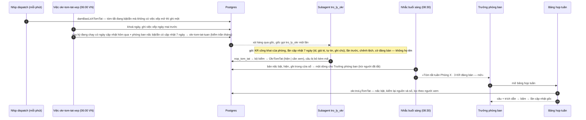

# Tóm tắt tuần (lượt 9c · `tro-ly-okr-tom-tat`) — thiết kế

Nguồn: `docs/plan/lo-trinh-tro-ly-okr.md` mục 5 «9c»; `docs/plan/lo-trinh-okr.md` mục 5
«Dựng hết bằng dữ liệu mẫu» và dòng 9c mục 10; thiết kế
`docs/reports/2026-09-26-tro-ly-okr/12-kien-truc-va-lo-trinh.md` §4.3, 4.6, 4.7, 4.9, 4.11,
4.12, 6.3; hồ sơ cơ hội `_acceptance/tro-ly-okr-tom-tat/opportunity.md`; nền 9a
`_acceptance/tro-ly-okr-nen/` (#182) và 9b `_acceptance/tro-ly-okr-de-xuat/` (#207, #212); bộ
OKR mẫu `docs/superpowers/specs/2026-09-28-bo-okr-mau-design.md` (#186).

## 1. Được gì

Sáng hôm sau ngày cập nhật của chu kỳ (mặc định thứ Hai, nên sáng thứ Ba), Trưởng phòng ban
và thành viên mở Theo đơn vị › phòng mình › Họp tuần và thấy, ở đầu bảng, một khối
**Tóm tắt tuần của Trợ lý OKR**: dòng «Trợ lý OKR tóm tắt từ N lần cập nhật», rồi vài câu.
Cuối mỗi câu có một nhãn trích dẫn; bấm vào là thấy đúng lần Cập nhật tuần câu đó dựa vào —
KR nào, ngày nào, giá trị, mức tự tin, ghi chú — và một lối «Xem diễn biến KR». Dưới khối là
hai nút «Hữu ích» · «Không hữu ích».

Mọi con số trong câu đã được mã so với lần cập nhật được dẫn trước khi ghi, và so lại lúc
hiện. Câu lệch số, chỉ sai chiều, dẫn nguồn ngoài phòng, nêu họ tên hay dùng từ cấm thì bị
bỏ; bỏ quá 30% số câu thì cả bản bị giữ lại, không hiện cho ai, chỉ quản trị chương trình
thấy ở màn Sức khoẻ.

Trưởng phòng ban nhận thêm một dòng trong nhắc buổi sáng hôm đó — chữ do luật viết, số do
luật đếm: «Tóm tắt tuần Phòng Kinh doanh · 3 KR đáng bàn — mở». Họ tắt được riêng dòng này
ở trang Nhắc buổi sáng mà không tắt nhắc.

Quản trị bật việc «Tóm tắt tuần» theo ba nấc cho từng đơn vị, như góp ý của 9b. Ở **chế độ
ẩn**, máy vẫn tóm tắt mỗi tuần, ghi sổ chi phí và số đo, nhưng chỉ quản trị chương trình
thấy kết quả. Khi gộp, mọi công tắc tắt. Lượt này dựng và đo trên bộ OKR mẫu; bật khi ba
tuần chế độ ẩn trên Cập nhật tuần thật đạt ngưỡng ký — câu bị bỏ ≤ 10%, không số lệch lọt qua
(chốt 28/09, Manh Phan).

## 2. Đã chốt trước lượt này — không mở lại

- ZDR bắt buộc cho mọi lời gọi model mang chữ OKR, kể cả judge của eval (26/09).
- Trần tháng của Trợ lý OKR ở Cài đặt, mặc định 9 US$; chế độ ẩn tính vào trần (28/09).
- Kiến trúc 9a: việc vào bằng một hàng `AgentTask`; gốc chuyển tiếp đúng một lần; subagent
  `tro_ly_okr` chỉ đọc OKR và chỉ ghi bảng đầu ra; về gốc chỉ có mã.
- Chạy qua hàng `AgentTask`, gom theo đơn vị (một phiên mỗi phòng ban mỗi tuần, không một
  phiên mỗi KR); câu nào cũng dẫn về lần cập nhật gốc; máy kiểm lại mọi con số.
- Luật «đáng bàn» (`lyDoCua`) dời ra gói dùng chung.
- Chữ sản phẩm là «chế độ ẩn».
- Lượt 10 cùng chạm nhắc buổi sáng và chờ 9c gộp.

## 3. Máy suy thêm — gạch ở Cổng Phạm vi nếu sai

1. **Hạng T2, không migration.** 9a đã tạo `OkrTomTat`, `OkrTomTatPhanHoi`,
   `NotificationPreference.dongTroLyOkr`; 9b đã tạo hai cột chế độ ẩn của việc tóm tắt. Nấc
   của một bản và các câu bị bỏ ghi trong cột Json `cau` (khuôn ở §5), không thêm cột.
2. **Lịch: một việc xếp mỗi ngày lúc 06:00 giờ VN, tự đặt ngày kế bằng `dueAt`.** Việc
   `okr-tom-tat-xep` (làn trực tiếp, không gọi model) nhìn mọi chu kỳ đang chạy có ngày cập
   nhật là **hôm qua**, và với mỗi phòng ban ở nấc bật hay ẩn có ít nhất một Cập nhật tuần
   trong 7 ngày trước giờ chạy, ghi đúng một việc `okr-tom-tat-tuan`. Một chuỗi mỗi ngày thay
   cho một chuỗi mỗi chu kỳ: chu kỳ năm và quý chồng nhau, mỗi chu kỳ một ngày cập nhật riêng,
   và chu kỳ mới tự vào lịch không cần ai đặt. Việc kế được ghi **trước** mọi việc khác của
   lượt, trong cùng khoá; nhịp dispatch còn gọi `damBaoLichTomTat` (khuôn `xepKiemLaiKhoa` của
   9b) để nối lại chuỗi khi việc tóm tắt đang bật mà không còn việc xếp nào mở. 06:00 là hằng
   ở `OKR_TOM_TAT`, xong trước 08:30 của nhắc buổi sáng.
3. **Chỉ phòng ban.** Tóm tắt gom theo phòng ban đúng câu giao. Bộ phận, OneHub và Mục tiêu
   cá nhân không có khối tóm tắt (tóm tắt cấp bộ phận là hạng mục T).
4. **Gói chỉ chứa Mục tiêu công khai** của phòng ban, cùng luật «số gộp» mà bảng họp tuần đã
   dùng (`boGioiHan`). Một bản dùng chung cho mọi người đọc chỉ chứa thứ mọi người đọc đều
   thấy (§4.7 thiết kế); lọc theo người xem lúc hiện vẫn chạy.
5. **Một lần nộp.** Subagent gọi `nop_tom_tat` một lần; khuôn hỏng thì eve trả lỗi đầu vào để
   model sửa (lời gọi chưa tính là nộp); câu trượt bộ kiểm bị bỏ, không mời nộp lại.
6. **Trích dẫn là thẻ bấm được.** Thành phần `inline-citation` của AI Elements (sổ
   `docs/chat-ui.md`: Adopted) cài vào `packages/ui` bằng CLI; mở thêm cách mở bằng bấm, vì
   thẻ di chuột không mở trên điện thoại. Thẻ hiện lần cập nhật gốc và lối «Xem diễn biến KR»
   (`useMoDienBien` sẵn có). Không thêm tham số URL tô một tuần trong Diễn biến.
7. **Dòng báo chỉ tới Trưởng phòng ban** của phòng có bản tóm tắt nấc bật, trạng thái hiện,
   ghi trong cửa sổ sự kiện của tin sáng đó. Số «KR đáng bàn» đếm bằng `lyDoCua`, bỏ những KR
   đã có dòng «KR im» trong cùng tin. Tối đa hai dòng báo AI mỗi tin, đứng sau việc của người,
   bị cắt trước tiên; dòng tóm tắt đứng một mình đủ để gửi tin. Công tắc tắt dòng ở trang
   Nhắc buổi sáng chỉ hiện với người đang là Trưởng phòng ban.
8. **Bản «cần xem» không hiện ở đâu cho người dùng**, kể cả dòng báo. Quản trị chương trình
   thấy mọi bản của tuần — cả hai nấc, mọi trạng thái — ở một khối mới trên màn Sức khoẻ
   chương trình, mở một bản thì thấy cả câu bị bỏ và mã bỏ.
9. **Chốt bằng mã, judge tham khảo.** Eval Tóm tắt chạy model thật trên bộ mẫu; chốt là mã:
   không số lệch, câu bị bỏ ≤ 10% cả bộ, mọi KR «tụt» được một câu còn lại dẫn tới, không họ
   tên. Judge `zai/glm-5.2-fast` có ZDR chấm «câu đúng ý nguồn» và chỉ báo điểm; hiệu chỉnh
   judge với chủ kho (20 đầu ra) dời tới trước khi bật, trên ca thật.
10. **Sổ chi phí của phiên con đọc loại việc từ hàng việc**, không từ thuộc tính phiên:
    phiên con không thừa kế thuộc tính (đo ở 9a), nên hôm nay bước của subagent trong một
    lượt tóm tắt sẽ bị ghi nhầm vào nhóm «góp ý».

## 4. Sơ đồ

## 5. Dữ liệu — không migration

- `OkrTomTat.cau` (Json) theo khuôn mới `noiDungTomTat` ở
  `packages/validation/src/okr-tom-tat.ts`, parse ngay lúc đọc:
  `{ nac: "an" | "bat", cau: cauTomTat[], bo: { vanBan, nguon, maBo }[] }`. Bảng chưa có hàng
  nào (chưa đường nào ghi), nên đổi khuôn không cần chuyển dữ liệu.
- `OkrTomTat.trangThai` là enum Zod `TRANG_THAI_TOM_TAT = ["hien", "can-xem"]`.
  `soCauBo` = số phần tử `bo`.
- Payload `okr-tom-tat-tuan` thêm `nac` (mặc định `"bat"`, như `de-xuat` của 9b).
- Mã bỏ câu `MA_BO_CAU = ["nguon-ngoai-goi", "so-lech", "sai-chieu", "noi-ve-nguoi",
  "tu-cam", "trung-cau"]`.
- `OkrTomTatPhanHoi`: một hàng mỗi người mỗi bản (khoá duy nhất có sẵn); bấm lại đổi giá trị.
- `NotificationPreference.dongTroLyOkr`: đọc khi dựng tin, ghi từ trang Nhắc buổi sáng; thiếu
  hàng là bật.

## 6. Thành phần

| Nơi | Thành phần | Việc |
|---|---|---|
| `packages/db/src/okr-hop-tuan.ts` | dời nguyên `apps/api/src/okr/hop-tuan.ts` | `lyDoCua`, `xepHopTuan`, `soTuanCuaNhom` và kiểu; `OKR_XEM.thoiGian` nó cần đi theo thành hằng của mô-đun; API nhập lại từ gói |
| `packages/validation/src/okr-tom-tat.ts` | khuôn, mã bỏ, trạng thái | một nguồn cho agent, API, màn |
| `packages/validation/src/okr-kiem-tom-tat.ts` | `kiemCauTomTat(cau, goi)` thuần | bộ kiểm dùng chung lúc nộp và lúc hiện; dùng lại `trichSo` của 9b |
| `packages/db/src/okr-tom-tat.ts` | `dungGoiTomTat`, `docTomTatChoNguoiXem`, `viecTomTatCanNhac` | đọc gói, đọc bản cho màn, sinh dòng nhắc |
| `apps/agent/agent/lib/okr/lich-tom-tat.ts` | `chayXepTomTat`, `damBaoLichTomTat` | việc xếp và nối chuỗi |
| `apps/agent/agent/subagents/tro_ly_okr/` | nhánh `tom-tat-tuan` ở chỉ dẫn động; tool `nop_tom_tat`; câu chỉ dẫn tóm tắt | một subagent, hai việc |
| `apps/agent/agent/lib/okr/nop-tom-tat.ts` | kiểm và ghi `OkrTomTat` | như `nop-de-xuat.ts` |
| `apps/agent/agent/lib/tin-nhac.ts`, `nhac-ke-hoach.ts` | loại nhắc `okr-tom-tat`, trần hai dòng AI | dòng báo |
| `apps/api/src/okr/tro-ly.service.ts`, `okr.router.ts` | `troLyTomTat`, `troLyTomTatPhanHoi`, `troLyTomTatQuanTri` | màn đọc; quản trị |
| API tuỳ chọn thông báo | ghi `dongTroLyOkr` | công tắc tắt dòng |
| `apps/app/.../okr/khoi-tom-tat.tsx` | khối tóm tắt trên bảng họp tuần | màn |
| `apps/app/.../toan-canh/suc-khoe/tom-tat-quan-tri.tsx` | khối quản trị | màn |
| `packages/ui/src/components/ai-elements/inline-citation.tsx` | cài bằng CLI, thêm cách mở bằng bấm | trích dẫn |

Ba thủ tục mới của `okr.router`:

- `troLyTomTat({ cycleId, departmentId })` — mọi thành viên. Nấc của phòng ban phải là `bat`,
  không thì trả `null`. Trả bản `hien` mới nhất của phòng trong 8 ngày gần nhất, sau khi: bỏ
  câu có nguồn đã mất hay người xem không xem được; chạy lại `kiemCauTomTat`. Kèm dữ liệu từng
  nguồn (KR, ngày, giá trị, tự tin, ghi chú) để thẻ trích dẫn vẽ không phải hỏi thêm; kèm
  trạng thái `dangSoan` khi việc của tuần đang chạy; kèm `chuaCapNhat` khi tuần chưa có Cập
  nhật tuần nào; kèm phản hồi của chính người xem.
- `troLyTomTatPhanHoi({ tomTatId, huuIch })` — người xem được bản đó.
- `troLyTomTatQuanTri({ cycleId })` — quản trị chương trình (như `sucKhoe`): mọi bản của tuần
  gần nhất, cả hai nấc, câu còn lại và câu bị bỏ kèm mã, số phản hồi.

## 7. Gói ngữ cảnh và việc của subagent

Gói (JSON trong `<du-lieu-okr>`, như 9b): tên phòng ban; tuần; với mỗi KR thuộc Mục tiêu
công khai đã công bố của phòng trong chu kỳ: id, tên KR, tên Mục tiêu, kiểu KR, khởi điểm,
đích, tiến độ do mã tính, cờ đáng bàn (`lyDoCua`), và các lần cập nhật trong 7 ngày (id,
ngày, giá trị, mức tự tin, ghi chú) cùng lần cập nhật ngay trước đó, chênh lệch giá trị và
chênh mức tự tin do mã tính. Không họ tên, không người phụ trách.

Chỉ dẫn: viết tối đa 6 câu tiếng Việt (theo ngôn ngữ chiếm đa số của ghi chú), câu đầu nói
chung tuần của phòng, các câu sau đi theo KR đáng bàn trước; mỗi câu dẫn 1–4 id lần cập nhật
trong gói; không nêu người; không đoán nguyên nhân ngoài ghi chú; «Act at once» — câu trả lời
đầu tiên là lời gọi `nop_tom_tat` (bài học 9a).

## 8. Bộ kiểm câu tóm tắt

Hàm thuần, chạy trong `nop_tom_tat` trước khi ghi và trong `troLyTomTat` lúc hiện. Mỗi câu
qua lần lượt; trượt luật đầu tiên thì bỏ với mã đó.

| Mã | Luật |
|---|---|
| `nguon-ngoai-goi` | mọi id nguồn phải là một lần cập nhật trong gói |
| `so-lech` | mọi số trong câu (chữ số, dấu phẩy thập phân kiểu Việt, `%`, nghìn/triệu/tỷ, số viết bằng chữ — `trichSo`) phải bằng một giá trị của nguồn được dẫn, lần trước của KR đó, khởi điểm, đích, tiến độ, chênh lệch do mã tính, hoặc ngày dd/mm của nguồn |
| `sai-chieu` | chữ chỉ chiều (tăng, lên, vượt / giảm, xuống, tụt) phải có một chênh lệch cùng dấu — giá trị hoặc mức tự tin — ở KR được dẫn |
| `noi-ve-nguoi` | họ tên đầy đủ một thành viên, so không dấu (danh sách tên chỉ ở bộ kiểm, không ở gói) |
| `tu-cam` | từ cấm của `TRO_LY_OKR_TRAN.tuCam` không có sẵn trong đầu vào |
| `trung-cau` | câu trùng nguyên văn câu trước |

Giữ lại: `bo / (cau + bo) > 30%`, hoặc không còn câu nào, thì bản thành `can-xem`.

## 9. Số đo cho chủ kho

Thước là câu SQL và script ở `_acceptance/tro-ly-okr-tom-tat/rang/`, tách nấc bật và ẩn:

- câu bị bỏ % theo mã và theo tuần (`cau-bi-bo.sql`);
- số lệch lọt qua — bộ trích số độc lập với bộ kiểm, chạy trên mọi câu `cau` từng ghi
  (`so-lech-lot.mjs`);
- mở bảng họp tuần trong ngày nhận dòng báo (`mo-sau-nhac.sql`, đọc `payload.daGui` của tin
  nhắc và vết `mo-hop-tuan`);
- hữu ích % (`huu-ich.sql`);
- tắt dòng báo % trên số Trưởng phòng ban (`tat-dong.sql`);
- chi phí tóm tắt tháng (`chi-phi-tom-tat.sql`, nhóm `okr.tom-tat` của sổ chi phí).

## 10. Eval

- **Số** — test thuần của bộ kiểm, bảng ca viết trước: mỗi mã một ca đỏ và một ca lành cùng
  dựng cảnh, cộng các dạng số khó (1,5; 12%; 3 triệu; «mười hai»; ngày 13/10).
- **Tóm tắt** — `apps/agent/evals/okr/tom-tat.eval.ts` qua bộ khung
  `rang/eval-tom-tat.mjs`: kho dùng-một-lần, `okr:mau` ở hai mốc ngày, chạy việc xếp, xả
  hàng bằng model thật có ZDR, đọc `OkrTomTat` của mọi phòng ban. Chốt bằng mã như §3 mục 9.
  Judge tham khảo, khai ZDR (bài tĩnh E23 của 9b quét mọi `*.eval.ts`).

## 11. Rủi ro còn lại

- Ghi chú thật lộn xộn hơn ghi chú mẫu; tỷ lệ câu bị bỏ có thể cao hơn trên thật. Chặn bằng
  chế độ ẩn ba tuần trước khi bật.
- Luật «sai-chieu» có thể bỏ câu đúng khi một câu dẫn hai KR đi ngược nhau; chấp nhận ở lượt
  này (bỏ nhầm thì thấy ở số đo câu bị bỏ theo mã).
- Việc xếp chạy mỗi ngày; nếu tác tử tắt qua 06:00 thì tóm tắt đến muộn, dòng báo dời sang
  tin sáng hôm sau (tóm tắt ghi sau mốc 08:30 thuộc cửa sổ hôm sau).

<!-- <<<UX-SPEC-TEMPLATE -->
## Đặc tả UX

### 1. Luồng

- Suôn sẻ: tin nhắc buổi sáng «Tóm tắt tuần Phòng X · 3 KR đáng bàn — mở» (hoặc OKR › Theo đơn vị › Phòng X › Họp tuần) → khối Tóm tắt tuần ở đầu bảng → bấm nhãn trích dẫn cuối một câu → thẻ nhỏ hiện lần cập nhật gốc → «Xem diễn biến KR» mở ngăn Mục tiêu ở tab Diễn biến của KR đó (điểm ra: ngăn, hoặc ở lại bảng); bấm «Hữu ích» / «Không hữu ích».
- Biên: tuần chưa có Cập nhật tuần nào; mọi câu bị lọc vì người xem không xem được nguồn; tóm tắt đang soạn; phòng ban không ở nấc bật hay đơn vị không phải phòng ban — không có khối; bản bị giữ lại — không có khối.
- Lỗi & quay lại: tải tóm tắt hỏng → «Không tải được tóm tắt tuần» + «Thử lại», bảng đáng bàn bên dưới vẫn hiện; gửi phản hồi hỏng → nút về trạng thái cũ, toast lỗi.

### 2. Kiểm kê màn

| Màn | MỘT việc của màn | Vào từ / ra tới |
|---|---|---|
| Bảng họp tuần + khối Tóm tắt tuần | Đọc tuần của phòng trong một đoạn, lần ra nguồn từng câu | Tin nhắc, Theo đơn vị / ngăn Mục tiêu tab Diễn biến |
| Thẻ trích dẫn | Cho thấy đúng lần cập nhật câu dựa vào | Nhãn trích dẫn / Diễn biến KR |
| Sức khoẻ chương trình, khối Tóm tắt tuần của Trợ lý OKR | Cho quản trị biết tóm tắt tuần này ra sao, kể cả bản bị giữ và bản chế độ ẩn | Toàn cảnh › Sức khoẻ / ngăn một bản |
| Nhắc buổi sáng (trang), dòng Tóm tắt tuần | Tắt hay bật dòng báo tóm tắt | Thanh bên / ở lại |

### 3. Bảng trạng thái

<!-- <<<UX-STATE-TABLE -->
| Trạng thái | Màn | Hiển thị gì | Người làm gì tiếp |
|---|---|---|---|
| ST-tomtat-dang-tai | Bảng họp tuần | Khung xương ba dòng trong khối | Chờ |
| ST-tomtat-co-cau | Bảng họp tuần | Tiêu đề «Tóm tắt tuần của Trợ lý OKR», dòng «Trợ lý OKR tóm tắt từ N lần cập nhật · tuần dd/mm», 1–6 câu mỗi câu một nhãn trích dẫn, hai nút phản hồi | Đọc, bấm nhãn, phản hồi |
| ST-tomtat-trich-dan | Bảng họp tuần | Thẻ nhỏ: KR, Mục tiêu, ngày, giá trị, mức tự tin, ghi chú; nhiều nguồn thì lật trang «1/3»; lối «Xem diễn biến KR» | Mở diễn biến, đóng |
| ST-tomtat-dang-soan | Bảng họp tuần | Shimmer «Trợ lý OKR đang tóm tắt tuần này…» | Chờ, tải lại |
| ST-tomtat-chua-cap-nhat | Bảng họp tuần | «Tuần này chưa có Cập nhật tuần nào» | — |
| ST-tomtat-loc-het | Bảng họp tuần | «Không có câu nào bạn xem được trong tóm tắt tuần này» | — |
| ST-tomtat-da-phan-hoi | Bảng họp tuần | Nút đã chọn giữ trạng thái nhấn, «Cảm ơn, đã ghi» | Đổi ý |
| ST-tomtat-loi | Bảng họp tuần | «Không tải được tóm tắt tuần» + «Thử lại» | Thử lại |
| ST-suckhoe-tomtat-co | Sức khoẻ | Bảng theo phòng ban: nấc (Bật/Ẩn), trạng thái (Đã hiện / Qua bộ kiểm, chỉ quản trị thấy / Giữ lại / Không làm được / Đang soạn / Chưa có cập nhật), số câu, câu bị bỏ, hữu ích/không | Mở một bản |
| ST-suckhoe-tomtat-rong | Sức khoẻ | «Tuần này chưa có tóm tắt nào» | — |
| ST-suckhoe-tomtat-ngan | Ngăn một bản | Câu còn lại kèm nguồn; câu bị bỏ gạch, kèm lý do bỏ | Đóng |
| ST-nhac-dong-tomtat | Nhắc buổi sáng | `Field` ngang: «Dòng Tóm tắt tuần của Trợ lý OKR» + mô tả «Mỗi tuần một dòng, khi phòng bạn có tóm tắt mới» + công tắc | Tắt / bật |
<!-- UX-STATE-TABLE>>> -->

### 4. Hành vi

- Câu tóm tắt và ghi chú trong thẻ trích dẫn là chữ máy viết về dữ liệu người nhập hay chữ người nhập: `translate="no"`.
- Nhãn trích dẫn là nút: bấm, Enter hay Space mở thẻ; Esc đóng; di chuột trên máy tính cũng mở. Ở 390 thẻ rộng tối đa bằng khối, không tràn ngang.
- Đang soạn: hỏi lại mỗi 5 giây, tối đa 2 phút; rời bảng thì ngừng.
- Nút phản hồi: một chạm, bấm nút kia là đổi ý; không có ô chữ.
- Khối nằm trên hàng «Đáng bàn tuần này», dưới thẻ đơn vị; không có ở bộ phận, OneHub, người.

### 5. Xuất xứ component

| Component | Nấc (dùng / ghép / mở rộng / tạo) | Vì sao (1 dòng) |
|---|---|---|
| `InlineCitation` (AI Elements) | mở rộng | Sổ `docs/chat-ui.md` ghi Adopted cho trích dẫn; thêm mở bằng bấm cho điện thoại |
| `Card` | dùng | Hộp của khối tóm tắt |
| `Shimmer` | dùng | Đang soạn, theo §4.12 thiết kế |
| `ToggleGroup` | dùng | Hai nút phản hồi — giữ trạng thái đã chọn, bấm nút kia là đổi ý |
| `Empty`, `Alert` | dùng | Chưa cập nhật, lọc hết, lỗi |
| `SimpleTable`, `Sheet`, `StatusIndicator`, `Badge` | dùng | Khối quản trị và ngăn một bản |
| `Field orientation="horizontal"`, `Switch`, `FieldDescription` | dùng | Công tắc tắt dòng báo |

### 6. Khuôn IA đã chọn + căn cứ

Khuôn IA: bảng-điều-khiển (dashboard-first)
Căn cứ: khối tóm tắt là một ô đầu của bảng họp tuần đã có (lượt 5), không thêm màn; luồng hiển nhiên nên không tra mẫu — WorkBoard đặt «AI memo» ở đầu trang họp (thiết kế §2.2 mục 3), cùng vị trí.
<!-- UX-SPEC-TEMPLATE>>> -->

## 12. Ngoài phạm vi

- Tóm tắt cấp bộ phận, OneHub, Mục tiêu cá nhân.
- Hiệu chỉnh judge Tóm tắt với chủ kho — trước khi bật, trên ca thật.
- Tham số URL tô đúng tuần trong Diễn biến KR.
- Nộp lại khi câu trượt bộ kiểm.
- Gửi tóm tắt vào kênh Slack của đơn vị; chữ model trong tin Zalo hay Slack.
- Cảnh báo KR trượt (lượt 10).
- Bật cho người dùng — việc của chủ kho sau ba tuần chế độ ẩn trên dữ liệu thật.
