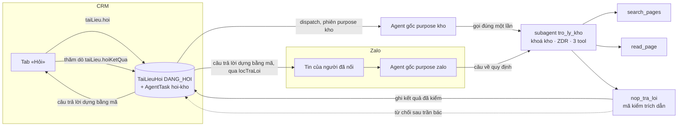

# Trợ lý AI đọc Kho tài liệu — thiết kế (lượt 4 `tro-ly-doc-kho`)

Viết 2026-10-01. Lượt 4 của `docs/plan/lo-trinh-kho-tai-lieu.md`. Sau lượt này nhân viên nói
được: «Tôi hỏi bằng lời thường, trong CRM hay qua Zalo, được trả lời có trích trang và phiên
bản; không biết thì nói không biết.»

Vật liệu: lộ trình mục 2, 4 «Lượt 4», 5, 6, 8; `kho-tai-lieu-nghien-cuu.md` mục 4.1, 5.4,
7.1–7.6, 9.1–9.4; `kho-tai-lieu-viet-nam-va-do-luong.md` mục 12.1–12.9; `kho-tai-lieu-bo-vang.md`;
`Notes` ba hợp đồng `kho-tai-lieu`, `may-soan-de-xuat`, `tim-va-dieu-huong-kho`; `docs/agent.md`
(Model, Zalo, «What may leave», «Khi nào thêm mã, tool, skill, subagent», máy soạn lượt 2);
`docs/api.md` (Intelligence, Kho tài liệu); `docs/chat-ui.md`; `docs/design.md`; `docs/proto.md`;
eve `subagents.mdx`, `tools/overview.mdx`; bản mẫu `/proto/kho-tai-lieu` trạng thái
`ST-tac-nhan-tra-loi`, `ST-tac-nhan-tu-choi` (`apps/app/app/proto/_modules/kho-tai-lieu/man-hoi.tsx`).

## Bốn lựa chọn chủ kho chốt trong phiên (2026-10-01)

1. Hỏi trong CRM ở **tab «Hỏi» của Kho tài liệu**, không ở tab Agent của khung bản ghi.
2. Qua Zalo, **trợ lý AI tự nhận ra** câu hỏi về quy định, chính sách, quy trình, biểu mẫu và
   chuyển cho trợ lý đọc kho; người hỏi không phải gõ lệnh.
3. **Thêm ô đặt «Xác minh đến ngày»** cho chủ trang và quản trị trong lượt này. Hôm nay cột
   `TaiLieuTrang.xacMinhDen` không có đường ghi nào ngoài test, nên cảnh báo quá hạn sẽ không
   bao giờ bật nếu không có ô này.
4. **Chỉ lưu chữ của câu chưa trả lời được và câu bị báo sai.** Câu đã trả lời chỉ để lại số
   đo và trang, phiên bản được trích.

## Kiến trúc

Ba cách đã cân: (A) `subagent` riêng; (B) hai `tool` gắn thẳng vào agent gốc; (C) gọi model
ngoài phiên eve. Chọn A.

- B dùng khoá chung, không ZDR, và `tool` lộ ra mọi phiên nghiên cứu đối tác — trái yêu cầu
  «dùng khoá AI thứ hai của lượt 2» của lộ trình.
- C không nối được Zalo, đặt trí khôn ngoài khung agent.
- A khớp luật 2 của `docs/agent.md`: ranh giới khác về **trần tiền** (khoá riêng của kho) và
  **nơi gửi** (ZDR như máy soạn), nên là một `subagent` khác. Tiền lệ: `may_soan`, `tro_ly_okr`.



### Ranh giới `tro_ly_kho`

- Ba `tool` sống: `search_pages`, `read_page`, `nop_tra_loi`. Mọi `tool` dựng sẵn bị
  `disableTool()`; sandbox `deny-all`; không `web_fetch`, không `web_search`, không `agent`.
- Model dựng như `modelMaySoan` (`lib/tai-lieu-model.ts`): khoá `KHO_TAI_LIEU_AI_GATEWAY_API_KEY`
  nếu có, không thì khoá chung, nhãn `rieng`/`chung` vào sổ; mọi lời gọi qua `ganZdr`. Không
  đọc model từ `AppSetting` (luật 2). Cấu hình ở `TAI_LIEU_AGENT.hoi` cạnh `soan` trong
  `lib/tai-lieu-config.ts`.
- **Hàng hỏi có trước mọi bước của phiên con.** Hook `session.started` của `tro_ly_kho` giải
  `hoiId` một lần, trước lời gọi model đầu tiên, và ghi vào trạng thái phiên con:
  - phiên gốc `purpose: "kho"` (CRM): `hoiId` lấy từ token `kho:<hoiId>` của phiên gốc; hàng đã
    có từ `taiLieu.hoi`;
  - phiên gốc `purpose: "zalo"`: hook tạo hàng `TaiLieuHoi` kênh `ZALO` `DANG_HOI` nối với
    `zaloHoiId` của câu Zalo đang hỏi (thuộc tính phiên gốc), một hàng cho mỗi `zaloHoiId`
    (`@unique`), lần gọi thứ hai trong cùng câu dùng lại hàng đó;
  - phiên gốc khác hay không giải được: hook ném, phiên con hỏng, không tool nào chạy.
  Nhờ đó lỗi 402 ở bước model đầu tiên vẫn có đúng một hàng để đóng `LOI het-tran`.
- **Quyền nằm trong từng tool** (bài học 26/09: eve bỏ tool động khi replay). Mỗi `execute` tự
  kiểm phiên là phiên con của `tro_ly_kho` và `hoiId` trong trạng thái phiên con trỏ một hàng
  đang `DANG_HOI`; sai thì ném.
- **Agent gốc không thấy chữ trang.** `outputSchema` của `tro_ly_kho` chỉ là `{ hoiId, ketQua }`.
  Câu trả lời người nhận được dựng bằng mã từ hàng `TaiLieuHoi` đã kiểm, không từ chữ của agent
  gốc. Nhờ đó nội dung kho chỉ đi tới nhà cung cấp qua lời gọi mang ZDR, và không chữ nào chưa
  qua kiểm tới tay người hỏi.
- Sổ chi phí riêng (luật 8): hook `step.completed` của `tro_ly_kho` ghi token, giá theo
  `TAI_LIEU_AGENT.bangGia`, nhãn khoá vào chính hàng `TaiLieuHoi` và vào sổ chi phí AI chung
  với tính năng mới `tai-lieu.tro-ly` (`packages/db/src/ai-chi-phi-danh-muc.ts`).

### `search_pages(query)` và `read_page(slug)`

- **Một hàm tìm cho cả API và agent.** SQL của `TaiLieuTimService.tim` (lượt 3) chuyển xuống
  `packages/db/src/tai-lieu-tim.ts` (`timTrangDangDung`), API gọi lại nó; agent gọi cùng hàm.
  Câu truy vấn dựng bằng `dungTruyVan` (`@crm/validation/tai-lieu-tim`). Chỉ trang có
  `banDangDungId`; chữ bản đề xuất không bao giờ vào `timKiem` (ghi lúc duyệt).
- `search_pages` trả tối đa `TAI_LIEU_AGENT.hoi.soKetQua` dòng `{slug, ten, phienBan, doanTrich}`.
- `read_page(slug)` trả bản đang dùng: `{slug, ten, phienBan, duyetLuc, xacMinhDen, quaHan,
  noiDung}`, chữ trang đặt giữa `<<<TRANG-BAT-DAU>>>` và `<<<TRANG-HET>>>`, xoá mọi dấu `<<<…>>>`
  có sẵn trong trang (như máy soạn — chữ trang là dữ liệu, không phải chỉ thị; nghiên cứu 9.1).
  Slug không có hay chưa có bản đang dùng: cùng một kết quả `khong-co`.
- Trang lưu trữ: `TaiLieuTrang` chưa có trạng thái lưu trữ (lượt 3b `lich-su-va-luu-tru-trang`
  chưa mở). Hàm tìm và đọc là một chỗ duy nhất, nên lượt 3b chỉ thêm điều kiện ở đó.

### `nop_tra_loi` — trích dẫn do máy chủ kiểm

Đầu vào (khuôn phẳng, không đệ quy — luật 6):

```
{ loai: "tra-loi", cau: [{ chu, trich: [{ slug, phienBan, doan }] }] }
{ loai: "khong-biet" }
```

Kiểm bằng mã (`packages/validation/src/tai-lieu-hoi.ts`, hàm thuần `kiemTraLoi`), đọc bản
đang dùng tại lúc nộp:

1. Mỗi `cau` có ít nhất một `trich`; tối đa `TAI_LIEU_AGENT.hoi.tranCau` câu.
2. `phienBan` phải bằng số của bản đang dùng hiện tại của `slug`. Bản được duyệt mới giữa lúc
   đọc và lúc nộp → bác, nêu số mới.
3. `chuanNfc(doan).trim()` phải là chuỗi con của `chuanNfc(noiDung)` của đúng bản đó, dài ít
   nhất `TAI_LIEU_AGENT.hoi.trichToiThieu` ký tự.
4. Mọi con số trong `chu` phải có mặt **trọn vẹn, có biên** trong một `doan` của **chính câu
   đó** (luật 1: con số model viết phải được mã kiểm). «20» không khớp trong «2026», «1,2»
   không khớp trong «1,25», số chỉ có trong đoạn của câu khác không tính. Dùng lại bộ tách và
   so có biên của `kiemBanMay` (`tai-lieu-so`, đã vá ở lượt 2 sau finding may-soan-de-xuat#F1).
   Hệ quả cố ý: lượt này trợ lý không làm phép tính trên số trích.

Sai thì `tool` ném lỗi nêu đúng câu, đoạn hay số sai (tiền lệ `nop_ban_de_xuat`). Tới
`TAI_LIEU_AGENT.hoi.tranBac` lần bác, hàng đóng `TU_CHOI` với lý do `trich-truot` và tool bảo
dừng. `khong-biet` đóng `TU_CHOI` lý do `khong-co-trang`.

**Câu từ chối do mã viết, không do model**: hằng `TAI_LIEU_HOI.tuChoi` — «Chưa có trang đã
duyệt nào trả lời câu này. Mình không đoán.» — kèm tối đa ba «trang gần nhất» lấy từ lần
`search_pages` đầu của phiên (không có thì không kèm). Câu hỏi vào hàng «chưa trả lời được».

**Cảnh báo quá hạn xác minh** do mã thêm: trang được trích có `xacMinhDen` trước đầu ngày hôm
nay giờ Việt Nam → dòng «Trang <tên> đã quá hạn xác minh từ <ngày>; hỏi chủ trang <tên> trước
khi làm theo.» Ngày tính bằng hàm của tab Sức khoẻ lượt 3, không viết lần hai.

### Ghi «Xác minh đến ngày»

Thủ tục `taiLieu.datXacMinh({ slug, den: Date | null })`. Chỉ chủ trang và quản trị (`owner`,
`admin`); người khác `FORBIDDEN`, trang không thấy được `NOT_FOUND`. Không đi qua bản đề xuất:
đây là cam kết của chủ trang về trang, không phải nội dung trang (chốt «duyệt mọi thay đổi»
2026-09-26 áp cho nội dung). Ghi một `TaiLieuSuKien` loại `XAC_MINH`. Màn đọc hiện «Xác minh
đến <ngày>» hoặc nhãn «Quá hạn xác minh», và nút «Đặt hạn xác minh» cho người có quyền.

### Bảng mới (lý do hạng T3)

`packages/db/prisma` có hai bảng mới, nên lượt từ T2 (lộ trình) thành **T3**: thêm Cổng 1.5.
Lộ trình viết T2 khi chưa biết «bảng việc» không tồn tại: `Activity` kiểu `TASK` không có người
được giao và bắt buộc gắn công ty, liên hệ, thoả thuận hay kế hoạch; `OkrViecKr` bắt buộc KR.

- `TaiLieuHoi` — nhật ký hỏi: `nguoiHoiId`, `kenh` (`CRM` | `ZALO`), `zaloHoiId? @unique`, `cauHoi?`
  (chữ NFC; xoá khi `TRA_LOI`, giữ khi `TU_CHOI`), `trangThai` (`DANG_HOI` · `TRA_LOI` ·
  `TU_CHOI` · `LOI`), `lyDo?` (`khong-co-trang` · `trich-truot` · `het-tran` · `loi-model` ·
  `qua-han`), `traLoi Json?` (câu và trích đã kiểm, khuôn ở `@crm/validation/tai-lieu-hoi`, đọc
  lại bằng parse), `ganNhat Json?` (slug), `hoiLuc`, `xongLuc?`, `tokenVao?`, `tokenRa?`,
  `chiPhiUsd?`, `nhanKhoa?`, `xuLyLuc?`, `xuLyBoiId?` (cho hàng chưa trả lời được).
- `TaiLieuBaoSai` — việc cho chủ trang: `hoiId`, `trangId`, `phienBan`, `nguoiBaoId`, `cauHoi`,
  `ghiChu?`, `trangThai` (`MO` · `DA_XU_LY`), `ketLuan?` (`SAI` · `DUNG`), `xuLyLuc?`, `xuLyBoiId?`;
  `@@unique([hoiId, nguoiBaoId, trangId])`.
- `migration` mang mốc lớn hơn mọi mốc trên `origin/onehub` (hôm nay `20261009010000`),
  kiểm lại ngay trước khi mở PR.

### Luồng CRM — tab «Hỏi»

1. `taiLieu.hoi({ cauHoi })` (phạm vi chung, nhưng vai `okr` bị chặn — xem ngoài phạm vi):
   kiểm trần, ghi `TaiLieuHoi` `DANG_HOI` và một `AgentTask` loại `hoi-kho` trong một giao
   dịch, gọi `AgentTriggerService.poke()`. API không quyết gì (`docs/api.md`).
2. `apps/agent` nhận việc ở làn trực tiếp, mở phiên `purpose: "kho"` qua kênh crm với token
   `kho:<hoiId>` (khuôn `guiMaySoan`); chỉ dẫn gốc nhánh `kho`: gọi `tro_ly_kho` đúng một lần,
   chuyển nguyên câu.
3. Trình duyệt thăm dò `taiLieu.hoiKetQua({ hoiId })` tới khi hàng rời `DANG_HOI`, hiện câu
   trả lời dựng bằng mã. Không dùng `/eve/v1`: không cần stream, và cửa đó chặn ngoài phạm vi
   đối tác.
4. Hàng `DANG_HOI` quá `TAI_LIEU_AGENT.hoi.hanTraLoiMs` đóng `LOI` lý do `qua-han` ở nhịp
   dispatch (khuôn `dongHoiQuaHan` của Zalo).

Mỗi câu một lượt, không ngữ cảnh hội thoại: kho trả lời theo trang, câu sau không dựa vào câu
trước. Lịch sử trên màn chỉ sống trong phiên trình duyệt, vì chữ câu đã trả lời không được lưu.

### Luồng Zalo

- `hoiTacTu` giữ nguyên cổng: người đã nối, vai, ba trần, một câu một lúc. Phiên Zalo của agent
  gốc thấy `tro_ly_kho` như một tool đọc (khai trong `ZALO.hoi.congCu.doc`).
- Chỉ dẫn Zalo (`lib/zalo-chi-dan.ts`) thêm: câu về quy định, chính sách, quy trình, biểu mẫu
  của OneHub thì chuyển `tro_ly_kho`; không tự trả lời những câu đó từ hiểu biết chung.
- Khi `tro_ly_kho` được gọi trong phiên Zalo, hook `session.started` của nó tạo hàng
  `TaiLieuHoi` kênh `ZALO` nối với `zaloHoiId` (mục Ranh giới); `nop_tra_loi` ghi kết quả vào
  đúng hàng đó, và `message.completed` của `channels/zalo.ts` thấy câu Zalo có hàng kho thì gửi
  câu trả lời dựng bằng mã từ hàng đó (qua `locTraLoi`), thay cho chữ agent gốc viết. Trích dẫn ở Zalo là chữ thường:
  tên trang, «phiên bản N», đoạn trong «…».
- Luật «không lưu chữ tin nhắn» của `docs/agent.md` mục Zalo sửa đúng một ngoại lệ: câu Zalo bị
  từ chối được lưu ở `TaiLieuHoi.cauHoi` (lựa chọn 4).

### Báo sai và hàng chưa trả lời được

- Dưới mỗi câu trả lời ở tab «Hỏi»: nút «Báo sai» mở hộp có ô ghi chú tuỳ chọn.
  `taiLieu.baoSai({ hoiId, cauHoi, ghiChu? })`: chỉ người đã hỏi, chỉ hàng `TRA_LOI`; tạo một
  `TaiLieuBaoSai` cho mỗi trang được trích, lưu chữ câu hỏi (lựa chọn 4). Báo lại lần hai trả
  về bản đã có.
- Tab «Sức khoẻ» thêm hai danh sách: «Bị báo sai» (chủ trang thấy việc của trang mình, quản
  trị thấy hết) và «Câu chưa trả lời được» (quản trị thấy hết; chủ trang thấy câu có trang
  gần nhất của mình). Không hiện tên người hỏi. Mỗi dòng có nút «Đã xử lý».
- Đóng một việc «báo sai» bắt chủ trang chọn kết luận: «Trợ lý trả lời sai» hay «Trợ lý trả
  lời đúng theo trang». Cột `ketLuan` (`SAI` · `DUNG`) trên `TaiLieuBaoSai` là số cho ngưỡng
  CHẾT «báo sai được chủ trang xác nhận» của `opportunity.md`.

### Lỗi và hết tiền

AI Gateway từng chết dưới một giây vì hết trần tháng hoặc số dư 0 (402). Phiên con hỏng hay
xong mà chưa nộp → hook đóng hàng `LOI` (luật 7: theo `isError` của `action.result`), lý do
`het-tran` khi lỗi nhận ra là ngân sách, tín dụng hay 402, còn lại `loi-model`. Người hỏi nhận
câu cố định nêu rõ «Trợ lý AI tạm dừng vì hết hạn mức tháng» hoặc «chưa trả lời được lúc
này», không bao giờ im. Hàng `LOI` không tính vào tỉ lệ trả lời có trích.

### Trần

Zalo giữ ba trần của `ZALO.hoi.tran`. Tab «Hỏi» có trần riêng ở `TAI_LIEU_AGENT.hoi.tran`:
mỗi người mỗi ngày và cả xưởng mỗi tháng (giờ Việt Nam), đếm trên `TaiLieuHoi` kênh `CRM`; số
đề xuất 20 và 600, chủ kho chỉnh ở Cổng Phạm vi. Vượt trần: câu cố định, không mở phiên.

### Đo bốn số

`demHoiKho(tu, den)` (`packages/db/src/tai-lieu-hoi.ts`) trả `{ traLoi, tuChoi, loi, tiLe }`
với `tiLe = traLoi / (traLoi + tuChoi)`; `demBaoSai(tu, den)` trả `{ tong, daXuLy, xacNhanSai }` từ
`TaiLieuBaoSai`. Tỉ lệ chuyển câu ở Zalo đo bằng bộ câu đo của AC-15 (lượt hỏi qua agent gốc
`purpose zalo`), không bằng bảng: câu không được chuyển thì không có hàng nào. Script
`_acceptance/tro-ly-doc-kho/rang/nguong.ts` in hai số này cho phiên nghiệm thu.

<!-- <<<UX-SPEC-TEMPLATE -->
## Đặc tả UX

### 1. Luồng

- Suôn sẻ: Kho tài liệu → tab «Hỏi» → gõ câu, Enter → «Trợ lý AI đang đọc kho…» → câu trả lời,
  dưới mỗi ý là trích dẫn (tên trang · phiên bản · ngày duyệt · đoạn nguyên văn), tên trang
  mở màn đọc (điểm ra: màn đọc trang, hoặc hỏi tiếp).
- Biên: không trang nào trả lời được → câu từ chối cố định + «Trang gần nhất»; trang được trích
  quá hạn xác minh → dòng cảnh báo trên câu trả lời; kho rỗng → từ chối như trên; vượt trần →
  câu báo trần, ô nhập khoá tới ngày mai.
- Lỗi & quay lại: hết hạn mức hay model lỗi → câu cố định có nút «Hỏi lại»; gửi
  `taiLieu.hoi` lỗi mạng → ô nhập giữ nguyên chữ, hiện lỗi có nút «Thử lại».

### 2. Kiểm kê màn

| Màn | MỘT việc của màn | Vào từ / ra tới |
|---|---|---|
| Tab «Hỏi» của Kho | Hỏi kho và đọc câu trả lời có trích | Thanh tab Kho / màn đọc trang |
| Hộp «Báo sai» | Báo một câu trả lời sai cho chủ trang | Nút dưới câu trả lời / về tab «Hỏi» |
| Màn đọc trang (sửa) | Thêm dòng xác minh và nút đặt hạn | Danh sách, tìm, trích dẫn / tab «Hỏi» |
| Tab «Sức khoẻ» (sửa) | Thêm «Bị báo sai», «Câu chưa trả lời được» | Thanh tab Kho / màn đọc trang |

### 3. Bảng trạng thái

<!-- <<<UX-STATE-TABLE -->
| Trạng thái | Màn | Hiển thị gì | Người làm gì tiếp |
|---|---|---|---|
| ST-hoi-trong | Tab «Hỏi» | «Hỏi về quy định, chính sách, quy trình hay biểu mẫu của OneHub.» + ba gợi ý câu | Gõ câu hay bấm gợi ý |
| ST-hoi-dang-doc | Tab «Hỏi» | «Trợ lý AI đang đọc kho…» (`ThinkingIndicator`) | Chờ |
| ST-hoi-tra-loi | Tab «Hỏi» | Câu trả lời, trích dẫn dưới từng ý, nút «Báo sai» | Mở trang, báo sai, hỏi tiếp |
| ST-hoi-qua-han | Tab «Hỏi» | Như trên + Alert «Trang … đã quá hạn xác minh từ …» | Hỏi chủ trang |
| ST-hoi-tu-choi | Tab «Hỏi» | Câu từ chối cố định + «Trang gần nhất» + «Câu hỏi đã vào hàng chưa trả lời được» | Mở trang gần nhất |
| ST-hoi-loi | Tab «Hỏi» | «Trợ lý AI tạm dừng vì hết hạn mức tháng.» hoặc «Chưa trả lời được lúc này.» + «Hỏi lại» | Hỏi lại |
| ST-hoi-tran | Tab «Hỏi» | «Hôm nay bạn đã hỏi đủ <n> câu. Hỏi lại từ ngày mai.» | Đọc trang trực tiếp |
| ST-bao-sai-mo | Hộp «Báo sai» | Ô ghi chú tuỳ chọn, «Gửi cho chủ trang», «Huỷ» | Gửi hoặc huỷ |
| ST-bao-sai-da-gui | Tab «Hỏi» | Nút thành «Đã báo sai» (khoá) | — |
| ST-doc-xac-minh | Màn đọc | «Xác minh đến 20/12/2026» hoặc nhãn «Quá hạn xác minh»; «Đặt hạn xác minh» cho chủ trang, quản trị | Đặt hạn |
| ST-suc-khoe-bao-sai | Tab «Sức khoẻ» | Danh sách «Bị báo sai»: trang, phiên bản, câu hỏi, ghi chú, «Đã xử lý» | Sửa trang, đánh dấu đã xử lý |
| ST-suc-khoe-chua-tra-loi | Tab «Sức khoẻ» | Danh sách «Câu chưa trả lời được»: câu, trang gần nhất, «Đã xử lý» | Viết trang, đánh dấu đã xử lý |
<!-- UX-STATE-TABLE>>> -->

### 4. Hành vi

- Ô hỏi: 2–500 ký tự sau trim; Enter gửi, Shift+Enter xuống dòng; đang chờ thì khoá gửi.
- Câu hỏi và đoạn trích là dữ liệu người nhập, mang `translate="no"`.
- Focus về ô hỏi sau mỗi câu trả lời; câu trả lời mới đọc bằng vùng `aria-live="polite"`.
- 390: trích dẫn xuống dòng, không cuộn ngang.

### 5. Xuất xứ component

| Component | Nấc (dùng / ghép / mở rộng / tạo) | Vì sao (1 dòng) |
|---|---|---|
| `Conversation`, `Message`, `MessageContent` (AI Elements) | dùng | Đã trong cây; `docs/chat-ui.md` Rule 3 |
| `PromptInput` (AI Elements) | dùng — kéo bằng CLI | Ô soạn là việc của `PromptInput`, «fetch first» |
| `InlineCitation` / `Sources` (AI Elements) | dùng — kéo bằng CLI | Trích dẫn là việc đã giao cho họ AI Elements; phải nối vào màn trong cùng thay đổi (cổng mồ côi) |
| `Suggestion` (AI Elements) | dùng — kéo bằng CLI | Ba câu gợi ý ở trạng thái trống |
| `ThinkingIndicator` | dùng | Trạng thái chờ theo `docs/chat-ui.md` |
| `Alert`, `Dialog` + `DialogClose`, `Textarea`, `Badge`, `Item` | dùng | `packages/ui` có sẵn |
| Ô chọn ngày (`Calendar` + `Popover`) | dùng | `packages/ui` có sẵn |

### 6. Khuôn IA đã chọn + căn cứ

Khuôn IA: hội-thoại
Căn cứ: lượt hỏi–đáp có trích là đúng khuôn hội thoại; bản mẫu `ST-tac-nhan-tra-loi` đã dựng
theo khuôn này; nghiên cứu mục 5.4 dẫn Intercom Fin, Slite Ask, GitBook đặt câu trả lời có
nguồn dưới từng ý. Một khuôn hiển nhiên, không tra thêm.
<!-- UX-SPEC-TEMPLATE>>> -->

Chuẩn UI nội của kho (`feature_loop.ui_standards_skill: web-design-guidelines`) chạy ở
design-pass trên bản mẫu.

## Ngoài phạm vi

- Vai «chỉ OKR» hỏi kho: cửa `/eve/v1` và `repFromCrm` chặn vai này khỏi trợ lý AI (từ điển:
  «vai chỉ OKR không gọi được nó»). Tab «Hỏi» chặn vai `okr` bằng cùng luật; mở ra là việc riêng.
- «Báo sai» qua Zalo.
- Hội thoại nhiều lượt có ngữ cảnh; phép tính trên số trích (vd «1,2% của 3 tỷ»).
- Trang lưu trữ (lượt 3b), hiệu lực theo ngày, trang bị thay thế (S4, S5 của bộ vàng).
- Bộ vàng 470 mục, mồi rò rỉ, tiêm lệnh, G1–G10 (lộ trình mục 2 đã bỏ).
- Nhắc chủ trang qua Zalo hay email về báo sai và câu chưa trả lời được.
- Vector, `pg_trgm`, xếp hạng lại.

## Rủi ro

| Rủi ro | Giảm |
|---|---|
| Agent gốc ở Zalo không chuyển câu quy định cho trợ lý kho, tự trả lời | Chỉ dẫn; một eval judgment trên mẫu câu; người hỏi thấy câu không có trích |
| Model chép đoạn sai khoảng trắng nên bị bác liên tục | Thông điệp bác nêu đoạn sai; trần bác rồi từ chối cố định |
| Tiền | Khoá riêng có trần tháng ở Gateway; trần CRM và Zalo; sổ chi phí riêng |
| Trang dài vượt ngữ cảnh | `read_page` cắt ở `TAI_LIEU_AGENT.hoi.docToiDa` ký tự và nói đã cắt |
