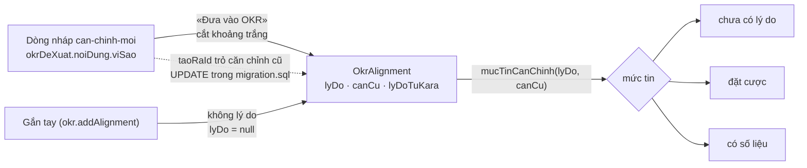

# Lý do căn chỉnh từ Soạn OKR — thiết kế

Hồ sơ: `_acceptance/ly-do-can-chinh-tu-soan/` · Hạng T3 (`packages/db/prisma`) · Đợt `sau-14-10`, làn P5, hàng L1.

## Vấn đề

Ở Soạn OKR, Kara viết `viSao` cho mỗi dòng căn chỉnh nháp. «Đưa vào OKR» (`apps/api/src/okr/soan-dua-vao.ts`) chỉ chép
`targetObjectiveId`/`targetKeyResultId` sang `OkrAlignment`; câu lý do kẹt ở `okrDeXuat.noiDung`. `OkrAlignment` không
có cột để giữ nó, nên L2–L4 (hiện lý do trên sheet, trên cây, gắn tay có lý do) không có gì để đọc.

## Quyết định đã chốt

- Lý do KHÔNG bắt buộc (anh, 08/10 18:55). Không có đường nào từ chối lưu căn chỉnh vì thiếu lý do.
- Ba mức tin, theo bản vẽ: chưa có lý do · đặt cược (có lý do, không căn cứ) · có số liệu (có căn cứ).

## Cách làm

1. **Ba cột trên `OkrAlignment`:** `lyDo String?`, `canCu String?` và `lyDoTuKara Boolean @default(false)`. Một
   `migration` chỉ thêm. `canCu` để trống ở hàng này — Kara chưa soạn căn cứ; L4 dạy Kara điền nó. Thêm luôn ở đây để L4
   không phải mở thêm một vòng T3. `lyDoTuKara` là dấu Kara của `docs/ai-ux.md` §3: giữ tới khi một người sửa lý do (L4).
2. **Đưa vào mang lý do:** trong `soan-dua-vao.ts`, `addAlignmentTrong` nhận thêm `lyDo` = `viSao` của dòng đã cắt
   khoảng trắng và `lyDoTuKara = true`; chuỗi rỗng sau khi cắt thành `lyDo = null`, `lyDoTuKara = false`.
   `addAlignmentTrong` lưu ba trường khi được truyền, mặc định `null`/`null`/`false` — đường gắn tay hiện có không đổi
   chữ ký và vẫn lưu được không lý do.
3. **Điền lại căn chỉnh cũ:** câu `UPDATE` trong cùng `migration.sql` đặt `lyDo = btrim(okrDeXuat.noiDung->>'viSao')`
   và `lyDoTuKara = true` cho các căn chỉnh có dòng `okrDeXuat` loại `can-chinh-moi` với `taoRaId` trỏ tới nó, `lyDo` đang
   `NULL`, và `btrim(viSao) <> ''`. Căn chỉnh không có dòng đề xuất, hay có mà `viSao` chỉ khoảng trắng, giữ `NULL`.
4. **Đọc ra:** `noiGopOutput` (khuôn căn chỉnh nằm trong `mucTieuOutput.alignments`) thêm bốn trường: `lyDo`, `canCu`,
   `lyDoTuKara`, và `mucTin` ∈ `chua-co-ly-do | dat-cuoc | co-so-lieu`, suy bằng một hàm thuần
   `mucTinCanChinh(lyDo, canCu)` trong `apps/api/src/okr/can-chinh.ts`. Không lưu mức tin: nó suy từ hai cột, lưu thì
   hai sự thật có thể lệch.
5. **Trần độ dài:** `lyDo` theo trần `TRO_LY_OKR_TRAN.chu.viSao` (cùng trần của bản nháp); `canCu` một hằng mới trong
   `apps/api/src/okr/okr-config.ts` (`OKR.canChinh.tranCanCu`). Hàng này chưa có đường ghi `canCu`, nên trần chỉ khai ở
   config để L4 dùng.

## Quyền xem không đổi

Căn chỉnh chỉ đi ra trong khuôn trả của chính mục tiêu nguồn (`okr.service.ts`, `alignments` của `mucTieuOutput`), nên
lý do đi theo đúng quyền xem của mục tiêu nguồn. Không mở đường đọc mới. AC-6 đo rằng người không xem được mục tiêu nguồn
không nhận chữ lý do ở bất kỳ đường đọc OKR nào.

## Đặc tả UX

Bỏ — hàng này không có màn mới (xem sổ quyết định). Màn hiện lý do là L2/L3.

## Rủi ro

- Ba tệp kiểm dom dựng `noiGopOutput` giả (`khung-okr-truoc-r1`, `tro-ly-okr-vet`, `muc-tieu-va-kr`) phải thêm bốn
  trường mới — khai trong ranh giới.
- `viSao` rỗng chỉ tồn tại ở dữ liệu cũ: bộ ghi nháp hiện tại (`dongCanChinhMoi`) cắt khoảng trắng rồi đòi ít nhất một
  ký tự; bản đọc `noiDungSoan` vẫn nhận chuỗi bất kỳ. AC-2 bảo vệ đường đọc đó.
- Đường đo ngưỡng là một câu SQL commit sẵn (`rang/do-nguong.sql`), có eval chạy nó trên dữ liệu gieo — người đo trên
  production chạy đúng câu đó, không tự viết lúc đo.
- Mốc `migration` lấy theo giờ thật lúc viết, kiểm `origin/onehub` ngay trước khi đẩy (luật mốc trùng giữa nhánh).
- P1 đang làm K2b trên `soan/**` và có thể chạm `soan-dua-vao.ts`: mã của hàng này viết sau K2b (ràng buộc của S3).

## Hình: lý do đi đâu

