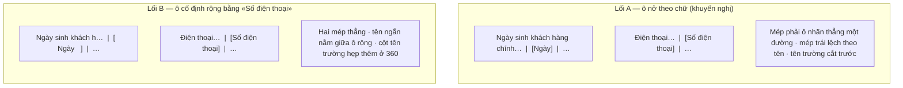

# Chữ màn tiếng Việt, không tràn — thiết kế

Hàng NM4 của `docs/plan/lo-trinh-okr.json` (dãy P4, đợt r2). Câu giao: «Breadcrumb đọc tiếng Việt với trình đọc
màn hình; mô tả kiểu trường ở Cài đặt › Trường không tràn ở khổ 360». Hai tồn đọng loại hành vi ghi ở
`docs/plan/phan-loai-do-kiem-cheo.md` mục «Đáng ghi tồn đọng» (F25, #355).

## Hiện trạng đo 13/10 (trên `onehub` 481547ec2)

- `packages/ui/src/components/breadcrumb.tsx:11`: `<nav aria-label="breadcrumb">` là chuỗi tiếng Anh cứng. Mọi
  màn có breadcrumb đi qua thành phần này (`apps/app/components/cai-dat-breadcrumb.tsx` — chiến dịch, Đọc trang,
  Sửa trang, Duyệt đề xuất, Kết nối; `okr/toan-canh/suc-khoe/suc-khoe.tsx`). Người dùng trình đọc màn hình nghe
  «breadcrumb» ở giao diện tiếng Việt.
- `apps/app/components/crm/fields/fields-list.tsx:346-351`: mỗi hàng trường có một nhãn kiểu `Badge
  variant="mono" className="w-18 shrink-0 justify-center"` (rộng cố định 72 px) mà chữ là
  `fieldTypeLabel(...)` — câu mô tả dài viết cho ô chọn kiểu ở trình sửa («Chọn — một trong danh sách cố
  định», «Người — một người trong không gian làm việc», «Select — one of a fixed list»…). Chữ dài hơn ô nên
  tràn khoảng 70 px ở khổ 360, cả hai ngôn ngữ. Cùng hàm còn dùng ở dòng gợi ý trường (`fields-list.tsx:235`,
  chữ phụ tự cắt `truncate`) và ô chọn kiểu ở trình sửa (`field-editor.tsx:265`).

## Phương án

1. **Nhãn trợ năng breadcrumb theo ngôn ngữ.** `Breadcrumb` của `packages/ui` đọc nhãn từ `messages` của
   `packages/ui` (`breadcrumb.nhan`: vi «Vị trí trang», en «Breadcrumb») qua `useMessages`, như `KhungXuong`
   đọc «Đang tải…». Thành phần thành `"use client"`; người gọi truyền `aria-label` riêng thì thắng (prop đi sau
   giá trị mặc định). Chữ tiếng Việt: «đường dẫn» đã là thuật ngữ trong `CONTEXT.md` (một URL kèm ghi chú), nên
   không dùng; «Vị trí trang» là chữ thường ai cũng hiểu theo luật «Ngôn ngữ sản phẩm» của `CLAUDE.md`.
2. **Nhãn kiểu ngắn ở danh sách trường.** Thêm bảng chữ `fields.typeNgan` (vi/en, mười kiểu) vào
   `apps/app/lib/messages/crm.ts` — chỉ thêm dòng — và hàm `fieldTypeNgan` cạnh `fieldTypeLabel`. Nhãn ở hàng
   trường dùng tên ngắn («Chọn», «Người», «Số điện thoại»…); ô ở trình sửa và dòng gợi ý giữ câu mô tả dài,
   vì ở đó có chỗ và câu dài giúp người chọn kiểu. Ô nhãn đổi `w-18` thành `min-w-18` để tên dài nhất («Số
   điện thoại») vẫn vừa: ô không bao giờ hẹp hơn hôm nay, các hàng vẫn thẳng cột với tên ngắn, tên dài nở ra
   và nhãn tên trường bên trái tự cắt (`truncate`) như cũ.

Bảng tên ngắn (đề xuất — người chốt ở Cổng Phạm vi, Hỏi-1):

| Kiểu | vi | en |
|---|---|---|
| `TEXT` | Chữ | Text |
| `LONG_TEXT` | Chữ dài | Long text |
| `NUMBER` | Số | Number |
| `DATE` | Ngày | Date |
| `CHECKBOX` | Ô đánh dấu | Checkbox |
| `SELECT` | Chọn | Select |
| `USER` | Người | User |
| `URL` | URL | URL |
| `EMAIL` | Email | Email |
| `PHONE` | Số điện thoại | Phone |

Thẳng cột: hàng là `[nút tên + tóm tắt, co giãn] [ô nhãn kiểu] [nút «…»]`, nút «…» rộng cố định, nên mép phải
mọi ô nhãn kiểu luôn thẳng một đường dù ô nở theo chữ; mép trái lệch theo tên dài. Lối thay: ô cố định rộng
bằng tên dài nhất — hai mép đều thẳng nhưng tên ngắn nằm giữa ô rộng và cột tên trường hẹp thêm ở 360.

Phương án loại: (a) giữ câu dài và cho ô xuống dòng — hàng cao lệch nhau, mất nhịp danh sách; (b) cắt chữ bằng
`truncate` — người dùng đọc «Chọn — một tr…», vẫn là chữ không trọn; (c) tách tên ngắn bằng cách cắt chuỗi ở
dấu «—» — sửa câu mô tả là vỡ ngầm, trái luật «phân tích ở biên».

<!-- <<<UX-SPEC-TEMPLATE -->
## Đặc tả UX

### 1. Luồng

- Suôn sẻ: Cài đặt › Trường → chọn thẻ Công ty/Cá nhân/Thoả thuận → đọc danh sách trường, mỗi hàng một nhãn
  kiểu ngắn → bấm hàng để mở trình sửa, ô «Kiểu» vẫn đọc câu mô tả đầy đủ (điểm ra: trình sửa).
- Biên: danh sách chưa có trường nào (không nhãn kiểu nào); tên trường rất dài (nhãn tên cắt, nhãn kiểu nguyên).
- Lỗi & quay lại: không có luồng lỗi mới; khung lỗi và chờ tải của danh sách giữ nguyên.
- Trình đọc màn hình: đến vùng breadcrumb ở bất kỳ màn nào thì nghe «Vị trí trang» (vi) / «Breadcrumb» (en).

### 2. Kiểm kê màn

| Màn | MỘT việc của màn | Vào từ / ra tới |
|---|---|---|
| Cài đặt › Trường | Xem và sắp các trường động của một loại bản ghi | Thanh bên Cài đặt / trình sửa trường |
| Các màn có breadcrumb (chiến dịch, tài liệu, Kết nối, Sức khoẻ OKR) | Không đổi việc — chỉ đổi nhãn trợ năng | Không đổi |

### 3. Bảng trạng thái

<!-- <<<UX-STATE-TABLE -->
| Trạng thái | Màn | Hiển thị gì | Người làm gì tiếp |
|---|---|---|---|
| ST-truong-co-truong | Cài đặt › Trường | Mỗi hàng: tên, tóm tắt, nhãn kiểu ngắn trọn chữ trong ô | Bấm hàng để sửa |
| ST-truong-sua | Trình sửa trường | Ô «Kiểu» đọc câu mô tả đầy đủ của kiểu | Chọn kiểu khác |
<!-- UX-STATE-TABLE>>> -->

### 4. Hành vi

- Khổ 360: nhãn kiểu không tràn ô (độ rộng chữ ≤ độ rộng ô) ở mọi kiểu, vi và en; tên trường cắt trước nhãn.
- Khổ 1280: các nhãn kiểu ngắn thẳng cột (ô tối thiểu 72 px như hôm nay).
- Nhãn trợ năng breadcrumb theo ngôn ngữ giao diện, không theo ngôn ngữ trình duyệt.

### 5. Xuất xứ component

| Component | Nấc (dùng / ghép / mở rộng / tạo) | Vì sao (1 dòng) |
|---|---|---|
| `Breadcrumb` | mở rộng (nhãn theo `messages`) | thành phần chung duy nhất của breadcrumb |
| `Badge variant="mono"` | dùng | ô nhãn kiểu sẵn có, chỉ đổi chữ và độ rộng tối thiểu |

### 6. Khuôn IA đã chọn + căn cứ

Khuôn IA: danh-sách-chi-tiết (master-detail)
Căn cứ: màn đã là danh sách trường mở trình sửa; vòng này không đổi cấu trúc, chỉ đổi chữ trong hàng.
<!-- UX-SPEC-TEMPLATE>>> -->

## Đo

- Bài DOM `packages/ui`: `Breadcrumb` ở vi/en đọc đúng nhãn; người gọi truyền `aria-label` thì thắng.
- Bài quét mã: không còn `aria-label="breadcrumb"` cứng trong `packages/ui/src` và `apps/app`.
- Bài DOM `apps/app`: ma trận mười kiểu × hai ngôn ngữ — nhãn hàng là tên ngắn, ô chọn kiểu của trình sửa là câu dài.
- Bàn đo màn thật (phiên đo, `tien-de`): gieo mười trường mười kiểu qua `fields.create`, chụp Cài đặt › Trường ở
  360 và 1280, vi và en; đo mọi nhãn kiểu `scrollWidth ≤ clientWidth`; đọc `aria-label` của `nav` breadcrumb ở
  chi tiết chiến dịch vi và en. Chiều đỏ trên bản sao trả lại `w-18` và câu dài.

## Ngoài phạm vi

- Nhãn trợ năng tiếng Anh khác trong `packages/ui` (ngoài breadcrumb) — chưa kiểm kê, không thuộc câu giao.
- Câu mô tả dài ở ô chọn kiểu và dòng gợi ý trường — giữ nguyên.
