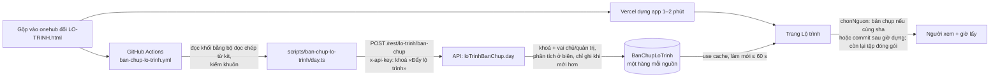

# LT1c — Lộ trình đọc bản chụp

Hàng LT1c của `docs/plan/lo-trinh-okr.json`, đợt `vong-tin-hieu-1410`, phủ mã L1 của
`docs/plan/pham-vi-vong-tin-hieu-1410.md`. Hồ sơ `_acceptance/lo-trinh-doc-ban-chup/`, hạng T3.
Cổng Đáng: build, Manh Phan 14/10.

> «Trưởng phòng ban mở trang Lộ trình và thấy đúng lộ trình mới nhất của nhánh chính, kèm giờ lấy,
> mà trang không phải chờ một bản dựng production»

## Vì sao, và giá trị thật nằm đâu

Trang Lộ trình (LT1) hôm nay đọc `LO-TRINH.html` đóng gói vào bản dựng app. Đo 14/10: từ lúc gộp tới khi
production chạy bản mới mất 1–2 phút, nên với riêng CRM người xem gần như không được gì thêm ngoài
**giờ lấy** và việc trang **không đứng yên khi một bản dựng hỏng**. Giá trị chính là nền:

- **LT3** (lộ trình nhiều sản phẩm): sản phẩm khác không nằm trong bản dựng CRM, chỉ đọc được qua bản chụp.
  Ghi chú LT3: CRM là mục cố định, rơi về tệp đóng gói khi bản chụp hỏng.
- **TH3** (trạng thái tín hiệu): đọc trạng thái tín hiệu từ cùng bản chụp — khối dữ liệu đã mang `tin_hieu`.

Vì thế thiết kế giữ ba tính chất cho LT3: một hàng **mỗi nguồn** (khoá `nguon`, hôm nay chỉ `crm`), người
đẩy thay được (Actions hôm nay, ứng dụng GitHub ở LT3), và rơi về tệp đóng gói là đường bình thường chứ
không phải lỗi.

## Kiến trúc



### 1. Người đẩy — GitHub Actions

- Tệp mới `.github/workflows/ban-chup-lo-trinh.yml` (tệp chung — báo trước trên crm-onehub#375):
  `on.push.branches: [onehub]`, `paths: [LO-TRINH.html]`, cộng `workflow_dispatch`. Chặn kho bằng
  `if: github.repository == 'phanlemanh/crm-onehub'`. `concurrency: ban-chup-lo-trinh`, `cancel-in-progress: false`: lượt đang chạy không bị
  huỷ, nhưng GitHub vẫn huỷ lượt đang CHỜ khi một lượt mới hơn vào hàng — đúng ý, vì lượt mới hơn mang lộ trình
  mới hơn; thứ tự do máy chủ giữ (mục 3), lệnh đo tính lần đổi bị thế chỗ theo lượt kế tiếp (mục 6). Không cần `bun install` cả kho: kịch bản chỉ nhập bộ đọc và khuôn
  zod — nếu phải cài thì `CRM_SKIP_HOOKS=1` như TH1.
- Kịch bản `scripts/ban-chup-lo-trinh/day.ts` (thư mục mới, KHÔNG khớp `scripts/lo-trinh*.mjs` — vùng Mac
  Studio): đọc `LO-TRINH.html` → `docDuLieu` (bộ đọc chép từ kit, chỉ nhập, không sửa) → `phanTichLoTrinh`
  → gửi `{ nguon: "crm", sha, commitLuc, duLieu, canhBao }`, với `sha = GITHUB_SHA`,
  `commitLuc = git log -1 --format=%cI`.
- Mỗi lượt để lại đúng một ghi chú `::notice title=ban-chup-lo-trinh::<nhan|trung|cu-hon|chua-cai>` — lệnh đo đọc
  ghi chú này qua chú thích của check-run, không đoán từ màu lượt.
- Mã thoát: 0 khi máy chủ nhận hoặc trả «cũ hơn, bỏ qua»; 0 kèm `::notice::` khi thiếu `CRM_API_URL` hay
  `CRM_KHOA_DAY_LO_TRINH` (chưa cài — mất một năng lực, không đỏ); 1 khi tệp không đọc được hay máy chủ từ
  chối hoặc không trả lời (lượt Actions đỏ — người thấy).

### 2. Khoá — loại thứ ba của khoá máy, dựng trên TH1

TH1 (`tin-hieu-tu-ve-kho`, PR #404, chưa gộp) đưa `apiKey([...])` thành nhiều cấu hình: khoá mặc định đứng
đầu, khoá chỉ-kéo `keo-tin-hieu` không mở phiên. LT1c thêm cấu hình thứ ba, **sau** khoá mặc định:

- `KHOA_DAY_LO_TRINH = { configId: "day-lo-trinh", quyen: { loTrinh: ["day"] } }`,
  `enableSessionForAPIKeys: false`. Tạo bằng `taoKhoaDayLoTrinh`, kiểm bằng `xacMinhKhoaDayLoTrinh`
  (khuôn `khoa-keo-tin-hieu.ts`).
- Cài đặt › Khoá API: thêm loại «Đẩy lộ trình» vào ô chọn loại khoá TH1 dựng; chỉ chủ/quản trị tạo được
  (403 ở máy chủ, ô khoá kèm dòng lý do ở giao diện — luật «Không đủ quyền» của `docs/settings.md`).
- Router `loTrinhBanChup` (`restMeta("POST", "/lo-trinh/ban-chup")`) mang một middleware chép khuôn
  `KhoaKeoTinHieuMiddleware`: kiểm khoá, đọc lại vai người giữ khoá mỗi lần gọi, chỉ chủ/quản trị.
- Thêm một dòng vào bảng đường đọc khoá của TH1 (`_acceptance/tin-hieu-tu-ve-kho/rang/bang-duong-doc-khoa.json`
  — nếu răng đó đòi).

**Điều kiện mở S3:** TH1 đã gộp onehub (dự kiến lô 12:00Z 14/10). Trước đó S1/S2 chạy được.

### 3. Lưu — bảng dữ liệu, một hàng mỗi nguồn

```prisma
model BanChupLoTrinh {
  nguon     String   @id
  sha       String
  commitLuc DateTime
  layLuc    DateTime
  duLieu    Json
  canhBao   String[]
}
```

- Migration `<mốc UTC lúc tạo>_ban_chup_lo_trinh` (tệp chung — bên gộp sau dời mốc; TB1 và DA3 cũng mang
  migration).
- Ghi: chỉ khi `commitLuc` mới **lớn hơn** hàng đang lưu (một câu `UPDATE … WHERE commitLuc < $moi`, tạo hàng
  nếu chưa có, bắt `P2002` rồi đọc lại). Cùng sha gửi lại → trả `trung`, không đổi gì. Cũ hơn → trả `cu-hon`.
- **Lưu nguyên khối đã qua kiểm** (cả phần trang chưa đọc như `tin_hieu`), không lưu bản đã lột khoá lạ — để
  TH3 đọc tín hiệu từ cùng bản chụp mà không chờ lần đẩy sau. Đọc ra thì phân tích lại ở biên.
- Vòng đời (ba câu của `docs/vong-doi.md`): bản ghi máy, không ai dọn tay — bản mới ghi đè; không có lịch sử;
  không hiện trong danh sách nào.

### 4. Đọc — trang chọn nguồn, không bao giờ lùi

- `apps/app/lib/lo-trinh/doc-ban-chup.ts` (máy chủ): đọc hàng `crm` qua `@crm/db/ban-chup-lo-trinh`, phân tích
  bằng `phanTichLoTrinh`; trong `"use cache"` với nhịp làm mới `LO_TRINH.nhipLamMoiMs` (`cau-hinh.ts`, đề xuất 60 s).
  Không cookie trong vùng cache — bản chụp là dữ liệu chung; lọc theo vai (`choVaiXem`) vẫn chạy sau, cho cả
  hai nguồn.
- `chonNguon(banChup, banDung)` — hàm thuần: dùng bản chụp khi `banChup.sha === VERCEL_GIT_COMMIT_SHA` **hoặc**
  `banChup.commitLuc > dungLuc`; còn lại dùng tệp đóng gói. `dungLuc` là giờ bắt đầu dựng, đóng vào bản dựng
  qua `next.config.ts` (`env.LO_TRINH_DUNG_LUC`). Vì `onehub` đi thẳng (gộp nối tiếp), commit sau giờ bắt đầu
  dựng chắc chắn mới hơn bản đang chạy. Ca mơ hồ (commit trước giờ dựng, khác sha) chọn tệp đóng gói — chậm
  bằng hôm nay, không bao giờ lùi.
- Bản Preview (`VERCEL_ENV=preview`) luôn đọc tệp đóng gói: Preview dùng chung kho dữ liệu với production
  (`docs/production.md`), nên nếu không chặn, bản Preview của một nhánh đổi lộ trình sẽ hiện lộ trình của
  nhánh chính thay cho chính nó.
- Không có bản chụp, kho dữ liệu lỗi, hay hàng lưu không qua khuôn → tệp đóng gói, ghi một dòng cảnh báo.
- Trang gọi đúng một hàm `docDauVaoChoVai(vai, { docBanChup })`: đọc nguồn, chọn nguồn, rồi lọc vai — lọc nằm
  NGOÀI vùng cache, nên vai của người xem đầu không bị giữ cho người sau. Bộ đọc bản chụp tiêm vào được để thử.
- `DauVaoLoTrinh` thêm `nguon: { kieu: "ban-chup" | "ban-dung"; layLuc: string }` cho nhánh `co-du-lieu`.

### 5. Hiện — một dòng giờ lấy

Trang nói lộ trình được lấy lúc nào, theo múi giờ **của trình duyệt** người xem. Máy chủ không biết múi giờ người
xem (production chạy UTC), nên dòng này là thành phần khách nhận giờ ISO và định dạng sau khi hydrat, cùng nếp
`useHomNay` của LT1 (máy chủ không in giờ nào). Chữ chốt ở bản mẫu (S1-D); đề xuất:
«Cập nhật lúc 15:02, 14/10» khi đọc bản chụp và cùng câu kèm «(bản dựng)» khi rơi về tệp đóng gói, để chủ kho
thấy đường đẩy hỏng mà người xem thường không phải hiểu thêm từ nào.

### 6. Đường đo

`scripts/ban-chup-lo-trinh/do-tre.ts --tu <ngày>`: ghép các commit `onehub` (first-parent) đã đổi
`LO-TRINH.html` với các lượt Actions của workflow (`gh run list --json`) → mỗi lần đổi một dòng: trễ = lượt
xong − giờ commit (+ nhịp làm mới cache); cờ khi > 10 phút; cờ khi có khoảng > 1 giờ mà trang đứng ở bản cũ;
dòng kết luận đạt/không đạt theo ngưỡng của Cổng Đáng. Chỉ lượt có ghi chú `nhan`/`trung` (đọc qua
`gh api …/check-runs/<id>/annotations`) là đã đẩy; lượt «chưa cài» xanh nhưng không tính. Lần đổi có lượt bị huỷ
vì lượt mới hơn thế chỗ thì tính trễ theo lượt đẩy kế tiếp. Ngưỡng chết «bản chụp cũ hơn bản đang chạy» không đo trên
production — trang không ghi lại nguồn đã chọn; nó được giữ bằng ma trận AC-6.

## Phương án đã cân

| Chốt | Chọn | Bỏ | Vì sao |
|---|---|---|---|
| Ai lấy bản chụp | Actions đẩy sang CRM | CRM tự kéo từ GitHub | Kéo từ kho riêng tư cần khoá cá nhân — LT3 cấm; đẩy dùng khoá máy của CRM, LT3 thay người đẩy bằng ứng dụng GitHub |
| Lưu ở đâu | Bảng dữ liệu | Kho tệp Vercel Blob | App chưa đọc Blob ở đâu; kho công khai chưa có khoá trên production, kho riêng chỉ có khoá trên API/agent — phải đặt thêm biến và dựng lại; bảng chỉ cần migration, đọc cùng đường app đã dùng |
| Khoá | Loại khoá thứ ba (khuôn TH1) | Bí mật dùng chung kiểu `/internal/*/ingest` | Khoá tạo trong Cài đặt, gỡ được, gắn người giữ; bí mật dùng chung cần đặt biến trên Vercel + dựng lại, và docs/api.md gọi điểm nhận thứ ba là một quyết định riêng |
| Lưu gì | Nguyên khối đã kiểm | Khối đã lột khoá lạ | TH3 cần `tin_hieu` từ cùng bản chụp |
| So độ mới | sha + giờ bắt đầu dựng | Lịch sử sha | Đủ để không bao giờ lùi trên nhánh đi thẳng; lịch sử là bảng thứ hai không ai đọc |

## Ngoài phạm vi

Ứng dụng GitHub, danh bạ và bộ chọn sản phẩm (LT3) · trang đọc `tin_hieu` (TH3) · lịch sử bản chụp · nút «làm
mới» hay màn trạng thái đường đẩy · đẩy trực tiếp vào trang đang mở (tải lại trang là đủ) · sửa bộ đọc hay bộ vẽ
lộ trình của kit.

<!-- <<<UX-SPEC-TEMPLATE -->
## Đặc tả UX

### 1. Luồng

- Suôn sẻ: người xem mở «Lộ trình» → trang hiện bảng như hôm nay, kèm một dòng «Cập nhật lúc <giờ>, <ngày>» → đọc (điểm ra: không đổi so với LT1).
- Biên: chưa có bản chụp (chưa cài khoá) hoặc bản chụp cũ hơn bản đang chạy → cùng trang, dòng giờ lấy ghi giờ dựng và «(bản dựng)».
- Lỗi & quay lại: kho dữ liệu lỗi → không có màn lỗi mới; trang rơi về tệp đóng gói. Tệp đóng gói hỏng → các khung trống của LT1 như cũ.
- Chủ/quản trị: Cài đặt › Khoá API › Tạo khoá → chọn loại «Đẩy lộ trình» → sao chép khoá một lần → dán vào bí mật GitHub.

### 2. Kiểm kê màn

| Màn | MỘT việc của màn | Vào từ / ra tới |
|---|---|---|
| Lộ trình | Cho biết lộ trình hiện tại và nó mới tới đâu | Thanh bên / không đổi |
| Cài đặt › Khoá API (hộp tạo khoá) | Tạo khoá «Đẩy lộ trình» cho GitHub | Nút «Tạo khoá» / về danh sách khoá |

### 3. Bảng trạng thái

<!-- <<<UX-STATE-TABLE -->
| Trạng thái | Màn | Hiển thị gì | Người làm gì tiếp |
|---|---|---|---|
| ST-lo-trinh-ban-chup | Lộ trình | Bảng LT1 + «Cập nhật lúc 15:02, 14/10» (giờ lấy bản chụp) | Đọc |
| ST-lo-trinh-ban-dung | Lộ trình | Bảng LT1 + «Cập nhật lúc 14:50, 14/10 (bản dựng)» | Đọc; chủ kho kiểm đường đẩy |
| ST-lo-trinh-dang-tai | Lộ trình | Khung chờ `KhungCho` của LT1, tiêu đề trang giữ nguyên | Chờ |
| ST-lo-trinh-tep-hong | Lộ trình | Các khung trống của LT1 (tệp vắng, chưa có khối, khối hỏng) — không đổi | Báo nhóm sản phẩm |
| ST-khoa-api-loai-day | Cài đặt › Khoá API | Ô loại có «Đẩy lộ trình»; người không phải chủ/quản trị thấy ô khoá kèm một dòng vì sao | Tạo khoá / hỏi quản trị |
<!-- UX-STATE-TABLE>>> -->

### 4. Hành vi

- Giờ theo múi giờ và ngôn ngữ của người xem (`formatNgayGio`), vi và en; giờ do máy viết nên được dịch, dữ liệu lộ trình không dịch (giữ như LT1).
- Ở 375 px dòng giờ lấy xuống dòng được, không cuộn ngang.

### 5. Xuất xứ component

| Component | Nấc (dùng / ghép / mở rộng / tạo) | Vì sao (1 dòng) |
|---|---|---|
| `PageShell*`, `DataTable` của LT1 | dùng | Trang giữ nguyên khung LT1 |
| Dòng giờ lấy | dùng (chữ phụ có sẵn trong `packages/ui`, chốt ở bản mẫu) | Một câu chữ phụ, không cần thành phần mới |
| Ô chọn loại khoá của TH1 | dùng | Thêm một lựa chọn |

### 6. Khuôn IA đã chọn + căn cứ

Khuôn IA: danh-sách-chi-tiết (master-detail)
Căn cứ: giữ nguyên khuôn của LT1 — việc này chỉ thêm một dòng giờ lấy, không đổi cấu trúc; chỉ một khuôn khả dĩ nên không tra mẫu.
<!-- UX-SPEC-TEMPLATE>>> -->

## Kiểm thử

- API: ma trận khoá (đẩy hợp lệ của chủ/quản trị, khoá mặc định, khoá chỉ-kéo, khoá của người đã bị gỡ, khoá của
  người bị hạ vai, khoá đã thu hồi) × đường (`/rest/lo-trinh/ban-chup`, một thủ tục tRPC khác, cầu REST khác);
  ma trận dữ liệu hỏng; ma trận thứ tự (mới hơn, trùng, cũ hơn, hai lượt chạy đua).
- App: ma trận `chonNguon` viết trước; trang với kho lỗi; lọc theo vai trên bản chụp.
- Kịch bản đẩy: bốn mã thoát, chạy trên tệp `LO-TRINH.html` thật của cây.
- Màn: bản chụp và bản dựng × 1280/375 × vi/en trên kho đo riêng, dữ liệu mẫu vào qua đường ghi thật (gọi chính
  `POST /rest/lo-trinh/ban-chup` bằng khoá tạo trong kho đo).
