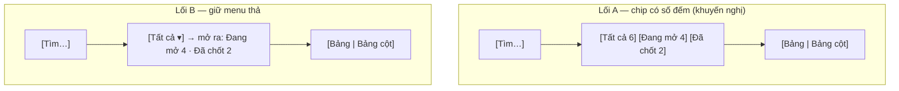
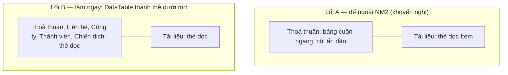
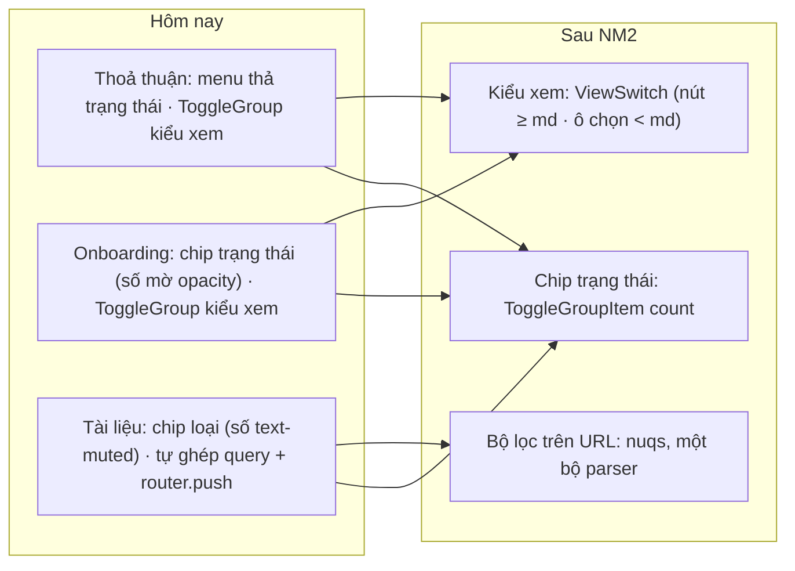

# Lọc và kiểu xem chung — thiết kế

Hàng NM2 của `docs/plan/lo-trinh-okr.json` (dãy P4, đợt r2). Câu giao: «Lọc và chuyển kiểu xem ở mọi danh sách
trông và chạy như nhau, và gửi đường dẫn cho đồng nghiệp là giữ nguyên bộ lọc». Đích là mục «Nếp màn trong app ›
Chip lọc và chuyển kiểu xem» của `docs/design.md`.

## Hiện trạng đo 14/10 (trên `onehub` c1864a3a2)

| Màn | Lọc trạng thái / nhóm | Số đếm trong chip | Chuyển kiểu xem | Giá trị lọc trên đường dẫn |
|---|---|---|---|---|
| Thoả thuận `deals/deals-table.tsx` | menu thả của `DataTable` (prop `tabs`, `data-table.tsx:572-610`) | `FacetCount` `tabular-nums opacity-60` (`data-table.tsx:249`) | `ToggleGroup` tự ghép (`deals-table.tsx:255-275`), khoá khi xem lưu trữ | nuqs (`useTableQuery`) |
| Onboarding `onboarding/danh-muc-cong-cu.tsx` | `ToggleGroup` outline sm (`TrangThaiToggle`) | `` (dòng 71) | `ToggleGroup` tự ghép (`CachXemToggle`, dòng 88-105) | nuqs |
| Tài liệu › Trang `tai-lieu/danh-sach-trang.tsx` | `ToggleGroup` outline sm theo loại trang | `` (dòng 203, 210) | — | **tự ghép** `URLSearchParams` (`danh-sach-loc.ts:17-28`) rồi `router.push` (dòng 112, 126, 194, 221, 346, 354) |
| Tài liệu › Chờ duyệt `tai-lieu/cho-duyet.tsx` | `ToggleGroup` theo nhóm | — | — | **tự ghép**, `router.push` (dòng 76) |
| Việc của tôi `viec/viec-cua-toi.tsx` | `ToggleGroup` outline sm | `` (dòng 83) | `ViewSwitch` | nuqs |
| Lộ trình `components/lo-trinh/trang-lo-trinh.tsx` | `ToggleGroup` | `text-muted-foreground tabular-nums` (dòng 173) | `ViewSwitch` | nuqs |

Ba lệch so với `docs/design.md`: số đếm có màn mờ bằng `opacity-60`, có màn bằng `text-muted-foreground` (luật nói chữ
phụ, không `opacity-*`); Tài liệu tự ghép chuỗi truy vấn (luật nói nuqs); Thoả thuận và Onboarding tự ghép
`ToggleGroup` để chuyển kiểu xem (luật nói `ViewSwitch` — nút trên máy tính, ô chọn trên điện thoại). Đường dẫn của
Tài liệu hôm nay vẫn giữ bộ lọc khi gửi đi, nhưng bằng một bộ ghép chuỗi thứ hai bên cạnh bộ đọc nuqs đã có
(`tai-lieu-search-params.ts`): hai nơi khai cùng một bộ khoá là hai nơi sẽ lệch nhau.

## Phương án

1. **Số đếm là prop của `ToggleGroupItem`** (`packages/ui`). `count?: number` vẽ một `` sau nhãn; `0` vẫn hiện «0», vắng prop thì không vẽ gì; `asChild` bỏ qua
   prop. `FacetCount` và số bộ lọc đang bật trên nút «Bộ lọc» của `DataTable` đổi `opacity-60` thành `text-muted-foreground`
   cho cùng một nếp. Các màn Onboarding, Tài liệu › Trang, Việc của tôi bỏ `` tự đặt, truyền `count`.
2. **Lọc trạng thái là chip** (Hỏi-1). `DataTable` vẽ prop `tabs` thành `ToggleGroup` outline sm, mỗi mục một chip có số
   đếm, thay menu thả. Màn duy nhất dùng `tabs` là Thoả thuận, nên Thoả thuận và Onboarding cùng một điều khiển. Trên
   điện thoại chip nằm trong khối lọc gập sau nút «Bộ lọc» như hôm nay; hàng chip cuộn ngang trong khối của nó nếu hẹp
   hơn ba chip. Thẻ gạch chân (`TabsList variant="line"`) ở OKR và Tài liệu giữ nguyên: đó là trang con, không phải lọc
   (`docs/design.md`, «Thẻ con của trang»).
3. **Chuyển kiểu xem dùng `ViewSwitch`** ở Thoả thuận (bảng / bảng cột) và Onboarding (cách xem, và «Chia cột theo»
   của bảng cột). `docs/design.md` kể «theo đơn vị» là một kiểu xem, nên cách chia cột cũng là kiểu xem: năm lựa chọn
   của nó trên điện thoại thành ô chọn thay vì ba hàng chip. `ViewSwitch` thêm prop `disabled` (khoá cả nút lẫn ô chọn),
   vì Thoả thuận khoá chuyển kiểu xem khi đang xem lưu trữ.
4. **Tài liệu ghi bộ lọc bằng nuqs.** `DanhSach`, `DanhSachTrang` và `ChoDuyet` đọc và ghi bằng
   `useQueryStates(taiLieuParsers)` — cùng bộ parser mà `page.tsx` đã đọc ở máy chủ cho lần dựng đầu. Truy vấn danh
   sách lấy khoá từ giá trị nuqs, nên bấm lọc thì danh sách tải lại ngay trên trang, không qua `router.push` và không
   tải lại trang. Đổi một bộ lọc thì `page` về 1 như hôm nay.
   Đường dẫn của các thẻ trang con dựng bằng `createSerializer(taiLieuParsers)`, nên `thamSo` và `URLSearchParams` tự ghép
   trong `danh-sach-loc.ts` bỏ hẳn. Một bộ khoá, một nơi khai.
5. **Đường dẫn gửi đi mở ra đúng bộ lọc** ở ba màn: dán đường dẫn có `status`/`view` (Thoả thuận), `trangThai`/`cachXem`
   (Onboarding), `loai`/`donVi`/`chuTrang`/`archived`/`page`/`nhomDeXuat` (Tài liệu) vào một phiên mới thì điều khiển hiện đúng giá
   trị và truy vấn danh sách nhận đúng bộ lọc đó. Khoá đường dẫn giữ nguyên tên hôm nay: đường dẫn ai đó đã gửi trước
   vòng này vẫn mở được.

Hỏi-1 — điều khiển lọc trạng thái của Thoả thuận (khổ 1280, hàng trên bảng):

Lối A: Thoả thuận và Onboarding cùng một điều khiển, số đếm thấy ngay; giá: sửa `DataTable` và ghim ba hồ sơ của nó.
Lối B: không sửa `DataTable`; giá: số đếm giấu sau một lần bấm, hai màn vẫn khác nhau.

Hỏi-2 — bảng trên điện thoại (khổ 360):

Phương án loại: (a) giữ menu thả cho Thoả thuận và đổi Onboarding sang menu thả — trái luật «Lọc một danh sách theo vài
giá trị: `ToggleGroup`», và giấu số đếm sau một lần bấm; (b) giữ bộ ghép chuỗi của Tài liệu và chỉ thêm bài kiểm khớp
với parser — vẫn hai nơi khai, chỉ thêm một chốt; (c) cho `ViewSwitch` tự ẩn khi khoá — người dùng mất dấu là có bảng
cột, và mất nhịp hàng điều khiển giữa xem thường và xem lưu trữ.

Không đổi `components/lo-trinh/trang-lo-trinh.tsx`: màn đó đã đúng nếp hiển thị (`text-muted-foreground tabular-nums`,
`ViewSwitch`), và là vùng Lộ trình đang làm ở máy khác (luật 19 của `docs/plan/dot-r2/LUAT-rieng.md`); đổi sang prop
`count` để cho một vòng sau.

<!-- <<<UX-SPEC-TEMPLATE -->
## Đặc tả UX

### 1. Luồng

- Suôn sẻ: mở danh sách (Thoả thuận, Onboarding, Tài liệu) → bấm chip trạng thái hay loại → danh sách lọc, số đếm từng
  chip đứng yên, đường dẫn đổi theo → chép đường dẫn gửi đồng nghiệp → đồng nghiệp mở ra đúng bộ lọc và đúng kiểu xem.
- Biên: chip có số 0 (vẫn bấm được, danh sách rỗng hiện khung «không khớp» sẵn có); xem lưu trữ ở Thoả thuận (chuyển kiểu
  xem bị khoá, bảng thường); đường dẫn mang giá trị lạ (`status=abc`) → parser bỏ qua, về mặc định như hôm nay.
- Lỗi & quay lại: không luồng lỗi mới; nút lùi của trình duyệt đi qua từng lần đổi bộ lọc như hôm nay (nuqs ghi lịch sử
  như `router.push`).
- Trình đọc màn hình: chip đọc «<nhãn> <số>»; `ViewSwitch` đọc nhãn nhóm («Kiểu xem») ở cả nút lẫn ô chọn.

### 2. Kiểm kê màn

| Màn | MỘT việc của màn | Vào từ / ra tới |
|---|---|---|
| Thoả thuận | Tìm và theo dõi thoả thuận theo trạng thái | Thanh bên / thẻ bản ghi |
| Onboarding | Theo dõi kế hoạch onboarding đang chạy và đã đóng | Thanh bên / thẻ kế hoạch |
| Tài liệu › Trang, › Chờ duyệt | Tìm trang tài liệu theo loại, đơn vị, chủ trang; duyệt đề xuất | Thanh bên / Đọc trang, Duyệt đề xuất |
| Việc của tôi | Không đổi việc — chỉ đổi cách vẽ số đếm | Không đổi |

### 3. Bảng trạng thái

<!-- <<<UX-STATE-TABLE -->
| Trạng thái | Màn | Hiển thị gì | Người làm gì tiếp |
|---|---|---|---|
| ST-thoa-thuan-loc | Thoả thuận | Chip Tất cả / Đang mở / Đã chốt, mỗi chip một số đếm chữ phụ («Tất cả» mang tổng); `ViewSwitch` bảng / bảng cột | Bấm chip, đổi kiểu xem |
| ST-thoa-thuan-luu-tru | Thoả thuận (xem lưu trữ) | `ViewSwitch` hiện nhưng khoá, bảng thường | Tắt lưu trữ để đổi kiểu xem |
| ST-onboarding-loc | Onboarding | Chip Đang chạy / Đã đóng có số đếm; `ViewSwitch` cách xem và «Chia cột theo» | Bấm chip, đổi cách xem |
| ST-tai-lieu-loc | Tài liệu › Trang | Chip loại có số đếm, ô chọn đơn vị và chủ trang, nút lưu trữ | Lọc, chép đường dẫn |
| ST-mo-duong-dan | Ba màn trên, phiên mới | Điều khiển hiện đúng giá trị trong đường dẫn, danh sách đã lọc | Làm tiếp như người gửi |
<!-- UX-STATE-TABLE>>> -->

### 4. Hành vi

- Khổ 360: `ViewSwitch` là ô chọn, nút ẩn; chip trạng thái trong khối lọc gập, cuộn ngang trong khối nếu thiếu chỗ; trang
  không cuộn ngang.
- Khổ 1280: `ViewSwitch` là nhóm nút outline sm; chip trạng thái cùng hàng với ô tìm.
- Số đếm: màu chữ phụ (`text-muted-foreground`), độ mờ 1, chữ số đều (`tabular-nums`), ở mọi chip của ba màn.
- Đổi bộ lọc đưa trang về 1; đổi kiểu xem không đổi bộ lọc.
- Bấm lọc ở Tài liệu: danh sách đổi ngay trên trang (truy vấn mới), không tải lại trang.

### 5. Xuất xứ component

| Component | Nấc (dùng / ghép / mở rộng / tạo) | Vì sao (1 dòng) |
|---|---|---|
| `ToggleGroupItem` | mở rộng (prop `count`) | số đếm có một chỗ vẽ duy nhất |
| `ViewSwitch` | mở rộng (prop `disabled`) | Thoả thuận khoá kiểu xem khi xem lưu trữ |
| `DataTable` | mở rộng (`tabs` vẽ thành chip) | màn duy nhất dùng `tabs` là Thoả thuận |
| nuqs `useQueryStates`, `createSerializer` | dùng | kho đã dùng nuqs cho mọi màn danh sách khác |

### 6. Khuôn IA đã chọn + căn cứ

Khuôn IA: danh-sách-lọc (filterable list) — hàng điều khiển trên, danh sách dưới.
Căn cứ: ba màn đã là danh sách lọc; vòng này chỉ đồng nhất điều khiển và nơi giữ giá trị lọc, không đổi cấu trúc màn.
<!-- UX-SPEC-TEMPLATE>>> -->

## Đo

- Bài DOM `packages/ui`: `ToggleGroupItem` có `count` vẽ số đúng nếp; `0` hiện; vắng thì không vẽ; `FacetCount` không còn
  `opacity-*`; `ViewSwitch disabled` khoá cả nút lẫn ô chọn.
- Bài quét mã: trong `apps/app` không `ToggleGroupItem` nào tự đặt số đếm (trừ tệp Lộ trình đã khai); `danh-sach-trang.tsx`,
  `cho-duyet.tsx` không còn `router.push`; `danh-sach-loc.ts` không còn `URLSearchParams`; Thoả thuận và Onboarding không
  tự ghép `ToggleGroup` cho kiểu xem.
- Bài DOM `apps/app`: chip trạng thái của Thoả thuận; `ViewSwitch` của Thoả thuận và Onboarding; Tài liệu ghi bộ lọc qua
  nuqs (bộ thử nuqs ghi lại đường dẫn); ma trận đường dẫn gửi đi ba màn — dựng màn chỉ từ đường dẫn, rồi bấm, lấy đường
  dẫn mới dựng lại, hai trạng thái bằng nhau.
- Bàn đo màn thật (phiên đo, `tien-de`): ba màn ở 360 và 1280, đo màu và độ mờ số đếm, `ViewSwitch` nút/ô chọn, trang
  không cuộn ngang; dán đường dẫn có bộ lọc vào phiên mới và đọc điều khiển.

## Ngoài phạm vi

- Bảng `DataTable` trên điện thoại cuộn ngang (Thoả thuận) hay thành thẻ dọc (Tài liệu) — Hỏi-2, khuyến nghị để một hàng
  riêng.
- Đổi `components/lo-trinh/trang-lo-trinh.tsx` sang prop `count` — vùng Lộ trình của máy khác, màn đã đúng nếp hiển thị.
- Thẻ gạch chân của OKR và Tài liệu — là trang con, đã đúng nếp «Thẻ con của trang».
- Đổi tên khoá đường dẫn — giữ tên hôm nay để đường dẫn cũ còn mở được.
