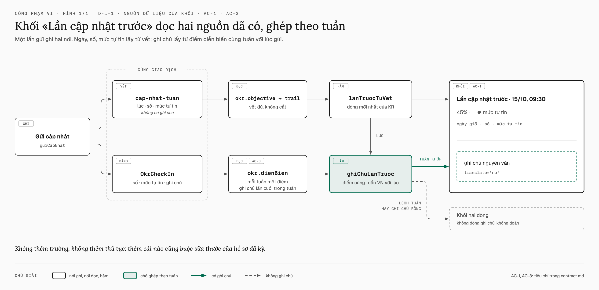

# HT3 · Hộp cập nhật hiện lần trước — thiết kế

Hàng HT3 `hop-cap-nhat-lan-truoc` của đợt cắt Họp tuần `okr-hop-tuan-2210` (bản phạm vi
`docs/plan/pham-vi-okr-hop-tuan-2210.md`, mã H6). Câu giao: «Người phụ trách KR mở hộp cập nhật và thấy lần cập nhật
trước — ngày, số, mức tự tin, ghi chú — cùng câu hỏi gợi ý cho ô ghi chú, trước khi gửi».

## Hiện trạng

Hộp cập nhật KR (`apps/app/app/(app)/[slug]/okr/hop-thoai-cap-nhat-kr.tsx`) mở từ ngăn KR, phiếu mục tiêu và bảng
theo đơn vị qua `useCapNhatKr`. Hộp đã có:

- dưới ô giá trị: «Lần trước 40 khách · đích 100 khách · +5 so với lần trước» (số hiện tại của KR, không phải số của
  lần cập nhật);
- dưới ô mức tự tin: «Lần trước: vừa»;
- đồ thị xem trước (`okr.dienBien`) cho KR số.

Không có ngày của lần trước và không có ghi chú lần trước. Người viết không biết tuần trước mình đã hứa gì.

## Dữ liệu: đọc cái đã có, không thêm thủ tục

- **Ngày, số, mức tự tin** lấy từ vết `cap-nhat-tuan` mới nhất của KR trong `okr.objective.trail` — hàm
  `krCapNhatTuSheet` đã đọc đúng dòng này để lấy `lastAt` và `lastConfidence`. Vết không bị cắt (`findMany` không
  `take`), và mỗi lần cập nhật ghi đúng một dòng vết trong cùng giao dịch với `OkrCheckIn`
  (`okr-cap-nhat.service.ts`), `after = { currentValue, confidence, onBehalf }`.
- **Ghi chú** lấy từ `okr.dienBien`: mỗi tuần một điểm, mang ghi chú của lần cuối trong tuần (`dien-bien.ts`,
  `cuoiTrongTuan`); ghi chú rỗng thành `null`. Hộp đã gọi `dienBien` cho KR số; KR mốc nay cũng gọi (cùng khoá truy
  vấn với ngăn KR nên không thêm lần đọc). Ghi chú chỉ được ghép khi tuần của điểm bằng tuần (giờ VN) của lúc gửi lần
  trước — ghép lệch tuần thì không hiện ghi chú, không đoán. Máy chủ đặt `weekStart = dauTuanVN(now)` với cùng `now`
  làm `submittedAt` (`okr-cap-nhat.service.ts:178`), nên phép ghép phải tính tuần VN đúng như `dauTuanVN` — E3 có ô
  gửi lúc 17:30Z Chủ nhật (00:30 thứ Hai giờ VN).
- **Cả ba chỗ mở** truyền `okr.objective` có `trail` vào `useCapNhatKr().mo`: ngăn KR, phiếu mục tiêu, và bảng theo
  đơn vị (`NutCapNhatDong` đọc `okr.objective` trước khi mở, `theo-don-vi/bang.tsx:258-268`). Vết đến cùng mục tiêu
  trước khi hộp mở, nên không có trạng thái «vết đang tải».

Vì sao không thêm trường: thêm `lanCuoi` bắt buộc vào `dienBienOutput` làm vỡ `dienBienOutput.parse` trong fixture đã ký
của `ngan-kr-mot-cho.dom.tsx`; trường tuỳ chọn mà máy chủ luôn trả là khuôn lỏng hơn cái thật sự lưu, trái luật «parse
at the boundary» của `AGENTS.md`; một thủ tục mới thì hộp gọi `trpc.okr.<mới>` mà `okr-sheet.dom.tsx` (đã ký) giả
`useTRPC` bằng một đối tượng liệt kê từng thủ tục, nên hộp sập trong bài kiểm đó.

Hàm thuần mới ở `apps/app/app/(app)/[slug]/okr/lan-truoc-kr.ts` (không React, bài kiểm API nhập được):

- `lanTruocTuVet(trail, keyResultId)` → `{ luc, giaTri, tuTin } | null` — dòng vết `cap-nhat-tuan` mới nhất, parse
  `currentValue` bằng `soKr`, `confidence` bằng `mucCapNhat.shape.confidence`.
- `ghiChuLanTruoc(diem, luc)` → chuỗi hoặc `null` — điểm có `tuan` bằng tuần VN của `luc`.

## Màn

Khối «Lần cập nhật trước» đứng đầu thân hộp, trên ô giá trị: một `Item variant="outline" size="sm"`.

- Dòng đầu: «Lần cập nhật trước · 15/10, 09:30» (giờ VN).
- Dòng hai: giá trị theo kiểu KR (`giaTri` của `bang-kr.tsx`: số có đơn vị, `45%`, «Xong»/«Chưa xong») · chấm
  `StatusIndicator` tone theo `NGHIA_TU_TIN` kèm nhãn mức tự tin.
- Dòng ba: ghi chú nguyên văn, `translate="no"`, xuống dòng khi dài. Ghi chú rỗng → không có dòng ba.
- KR chưa có lần cập nhật nào → không có khối, không câu trống.
- Chữ phụ dưới ô giá trị trong hộp đổi từ «Lần trước 70 khách · đích …» sang «Hiện tại 70 khách · đích …»: số đó là
  `currentValue` của KR, có thể khác số của lần cập nhật khi KR có nguồn số máy. Trang Cập nhật tuần không đổi.

Ô ghi chú vẫn một dòng, tối đa 200 ký tự («một dòng ghi chú», `CONTEXT.md` mục «Cập nhật tuần»). Dưới ô, chữ phụ
`FieldDescription` nêu ba câu hỏi gợi ý. `OGhiChu` (dùng chung với trang Cập nhật tuần) nhận thêm prop `goiY` tuỳ
chọn; trang Cập nhật tuần không truyền nên không đổi.

<!-- <<<UX-SPEC-TEMPLATE -->
## Đặc tả UX

### 1. Luồng

- Suôn sẻ: ngăn KR / phiếu mục tiêu / bảng theo đơn vị → bấm «Cập nhật» → hộp mở, khối «Lần cập nhật trước» hiện
  ngay → đọc ghi chú cũ → nhập số, chọn mức tự tin, viết ghi chú theo câu gợi ý → «Gửi cập nhật» (điểm ra: hộp đóng,
  ngăn KR làm mới).
- Biên: KR chưa có lần nào (không khối) · lần trước không ghi chú (khối hai dòng) · KR mốc (số là Xong/Chưa xong) ·
  hai lần trong một tuần (lấy lần sau) · lần trước do trưởng đơn vị ghi hộ (vẫn là lần trước).
- Lỗi & quay lại: ghi chú tải hỏng → một câu + «Thử lại» trong khối; ngày, số, mức tự tin vẫn hiện; gửi không bị chặn.

### 2. Kiểm kê màn

| Màn | MỘT việc của màn | Vào từ / ra tới |
|---|---|---|
| Hộp cập nhật KR | ghi lần cập nhật tuần của một KR | ngăn KR, phiếu mục tiêu, bảng theo đơn vị / đóng về chỗ mở |

### 3. Bảng trạng thái

<!-- <<<UX-STATE-TABLE -->
| Trạng thái | Màn | Hiển thị gì | Người làm gì tiếp |
|---|---|---|---|
| ST-hop-cap-nhat-co-lan-truoc | Hộp cập nhật KR | khối: ngày giờ · số · mức tự tin · ghi chú | đọc rồi cập nhật |
| ST-hop-cap-nhat-khong-ghi-chu | Hộp cập nhật KR | khối hai dòng, không dòng ghi chú | cập nhật |
| ST-hop-cap-nhat-chua-co-lan | Hộp cập nhật KR | không khối | cập nhật lần đầu |
| ST-hop-cap-nhat-dang-tai-ghi-chu | Hộp cập nhật KR | khối có ngày, số, mức tự tin; dòng ghi chú là khung xương một dòng | chờ hoặc cập nhật luôn |
| ST-hop-cap-nhat-loi-ghi-chu | Hộp cập nhật KR | «Không tải được ghi chú lần trước.» + nút «Thử lại» | thử lại hoặc cập nhật luôn |
<!-- UX-STATE-TABLE>>> -->

### 4. Hành vi

- Ô ghi chú: một dòng, `maxLength` 200 (`GHI_CHU_TOI_DA`), như cũ; tiêu điểm vẫn ở ô giá trị khi mở hộp.
- Khối không bấm được, không mở thêm gì; ghi chú dài 200 ký tự xuống dòng (`break-words`), không tràn ngang ở 375.
- Ghi chú và tên người nhập mang `translate="no"`.

### 5. Xuất xứ component

| Component | Nấc | Vì sao |
|---|---|---|
| `Item`, `ItemContent`, `ItemTitle`, `ItemDescription` | dùng | hộp nội dung trong `apps/app` là `Item` (bảng «Dấu hiệu vẽ tay» của `docs/design.md`) |
| `StatusIndicator` + `toneTheoNghia(NGHIA_TU_TIN[…])` | dùng | màu mức tự tin theo một bảng, như ô chọn mức tự tin |
| `Skeleton` | dùng | khung xương dòng ghi chú khi đang tải |
| `Button variant="outline" size="sm"` | dùng | nút «Thử lại», như nút «Thử lại» của hộp khi mở lượt hỏng |
| `OGhiChu` | mở rộng | thêm prop `goiY` tuỳ chọn; trang Cập nhật tuần không đổi |

### 6. Khuôn IA đã chọn + căn cứ

Khuôn IA: một-cột-cuộn
Căn cứ: hộp thoại hẹp sẵn có xếp một cột; ở 375 không đặt khối cạnh form được. Tability («Previous check-in» cạnh
form, ba câu gợi ý cho ô phân tích — `vi_sao` của hàng HT3) rút: ghi chú lần trước nằm trước mắt lúc viết, câu gợi ý
ngay ở ô ghi chú. Luồng hiển nhiên, không tra thêm.
<!-- UX-SPEC-TEMPLATE>>> -->

## Ngoài phạm vi

- Trang «Cập nhật tuần của tôi»: không thêm khối lần trước hay câu gợi ý (câu giao nói hộp cập nhật).
- Tên người ghi lần trước và dấu «ghi hộ» trong khối.
- Ô ghi chú nhiều dòng, nâng giới hạn 200 ký tự.
- Bấm khối để mở lịch sử cập nhật.

## Kế hoạch đo

Bài kiểm DOM `apps/app/test/hop-cap-nhat-lan-truoc.dom.tsx` (khung `khung-gop-y-dung-cho`, như VK7), bài kiểm API
`apps/api/test/hop-cap-nhat-lan-truoc.spec.ts` (CSDL thử, ghi qua `moCapNhat`/`guiCapNhat` thật), và một lượt
`ui-check` ở 375 và 1440 trên bộ OKR mẫu.
