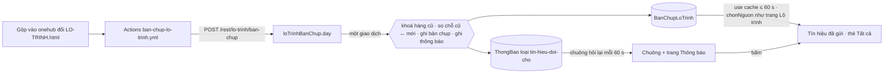

# TH3 — Trạng thái tín hiệu sống

Hàng TH3 của `docs/plan/lo-trinh-okr.json`, đợt `vong-tin-hieu-1410`, phủ mã S1 và S2 của
`docs/plan/pham-vi-vong-tin-hieu-1410.md`. Hồ sơ `_acceptance/trang-thai-tin-hieu-song/`, hạng T2.
Cổng Đáng: build, Phan Le Manh 19/10.

> «Người gửi tín hiệu được báo trong ngày khi tín hiệu của mình đổi chỗ, và mở ra thấy câu dễ hiểu»

## Vì sao

Hai lỗ, một gốc:

- **Trạng thái đi theo bản dựng.** Trang «Tín hiệu đã gửi» và thẻ «Tất cả» đọc `LO-TRINH.html` đóng gói vào bản
  dựng app (`docBanVe` trong `tin-hieu/page.tsx`, `docNenTatCa` trong `lib/tin-hieu/tat-ca.ts`). Đội sản phẩm xếp
  nhóm xong, gộp vào `onehub`, nhưng người gửi chỉ thấy chỗ mới khi bản dựng production kế tiếp chạy xong.
- **Không ai báo.** Người gửi phải tự mở trang để biết tín hiệu đã vào nhóm nào, thành việc nào, đã giao chưa.

LT1c đã dựng nửa đường: mỗi lần `LO-TRINH.html` đổi trên `onehub`, GitHub Actions đẩy nguyên khối dữ liệu sang
CRM (bảng `BanChupLoTrinh`), **giữ cả khoá `tin_hieu`** để TH3 đọc (`docs/api.md`, «Bản chụp lộ trình»). Chỗ của
tín hiệu do bộ kit tính lúc vẽ lại `LO-TRINH.html` (`duongDi` của `scripts/tin-hieu.mjs`) và chỉ sống trong khối
đó — CRM không có cột nào giữ chỗ.

## Kiến trúc

### 1. Chỗ của tín hiệu — một hàm thuần dùng chung

Mới: `packages/validation/src/tin-hieu-cho.ts` (`@crm/validation/tin-hieu-cho`).

- `choTinHieu(duLieu: unknown): KetQuaCho` — phân tích `tin_hieu` bằng `parseDuongTinHieu`, trạng thái hàng bằng
  `docNhomHang`, tên việc từ `lo_trinh[].hang[].cau_giao`; trả `Map<mã, ChoTinHieu>` hay `khong-co` / `hong`.
- `ChoTinHieu = { khoa, hang?, tenNhom?, lyDo?, tenViec? }`, `khoa` thuộc tập đóng
  `cho-gom · le · da-phu · nhom-chua-cat · chan-troi · chua-bat-dau · dang-lam · da-giao · hang-khac` — đúng tập
  khoá `theoKit` của `apps/app/lib/tin-hieu/trang-thai.ts` đang tính, nay dời xuống gói để API và app cùng đọc.
  App giữ phần chữ (`nhan`, `cauSauGom`) theo ngôn ngữ người xem.
- `dauCho(c)` = `khoa` + `hang` + `tenNhom`: hai chỗ khác dấu là hai chỗ người gửi thấy khác nhau (đổi nhóm, đổi
  hàng, hay hàng đổi trạng thái «Đang làm» → «Đã giao»).
- `doiCho(cu, moi)` — danh sách `{ ma, cho }` của mọi mã có trong `moi` mà dấu khác dấu ở `cu`; mã vắng ở `cu`
  được coi là đang ở `cho-gom` (đúng nhãn «Đang xem xét» CRM hiện cho tín hiệu đã lấy về mà chưa có chỗ).

### 2. Đọc — trang tín hiệu đọc cùng nguồn với trang Lộ trình

- Mới `apps/app/lib/tin-hieu/nguon.ts` (máy chủ): đọc hàng `crm` **thô** của `BanChupLoTrinh` (bộ đọc của LT1c lột
  `tin_hieu` qua `phanTichLoTrinh`, nên cần đường đọc thô riêng, cùng `"use cache"` và `LO_TRINH.nhipLamMoiMs`),
  chọn nguồn bằng chính `chonNguon(banChup, banDungHienTai())` của trang Lộ trình, rơi về `docTepLoTrinh()` khi
  `ban-dung`. Không nhân bản luật chọn nguồn.
- `docTrangThaiDu` thôi nhận chuỗi HTML; nhận `duLieu` đã đọc (hay `null` / lý do hỏng), và tính khoá qua
  `choTinHieu`. Hai chỗ gọi (`tin-hieu/page.tsx`, `lib/tin-hieu/tat-ca.ts`) đổi sang `nguon.ts`.
- Bảng `BanVe` giữ bốn ca như nay; ca bản chụp hỏng mà tệp đóng gói đọc được thì dùng tệp đóng gói (như LT1c).

### 3. Báo — lúc CRM nhận bản chụp mới

- Mới `packages/db/src/tin-hieu-doi-cho.ts`: `ghiBanChupVaBaoTinHieu(db, vao, now)` thay `ghiBanChupLoTrinh` ở
  `LoTrinhBanChupService.ghi`. Một `$transaction`: `SELECT … FOR UPDATE` hàng của nguồn → quyết `nhan / trung /
  cu-hon` đúng luật một chiều của LT1c → ghi bản chụp → khi `nhan`, nguồn `crm` và **có hàng cũ**: `doiCho(cũ,
  mới)` → đọc `TinHieu` theo `so` của từng mã → bỏ tín hiệu đã lưu trữ, không có người gửi, người gửi không còn
  là thành viên → `thongBao.createMany({ skipDuplicates: true })`. Ghi thông báo hỏng thì cả giao dịch lùi:
  bản chụp không đổi, thủ tục trả lỗi, lượt Actions đỏ; chạy lại lượt thì cả hai cùng vào.
- **Phần so chỗ không ném vì dữ liệu.** Danh sách tín hiệu vắng hay hỏng ở bản đang lưu hoặc ở bản mới → không
  thông báo nào (không coi bản hỏng là rỗng — nếu coi thì mọi tín hiệu bị báo đổi chỗ cùng lúc), bản chụp hợp lệ
  vẫn được nhận như LT1c, nhật ký ghi một dòng cảnh báo mang mã nguồn và sha. Người nhận lọc bằng một câu đọc
  `TinHieu` nối `member` trong cùng giao dịch, nên khoá ngoại của `ThongBao` luôn đúng. Vì vậy lỗi còn lại của
  phần thông báo chỉ là lỗi kho dữ liệu — lúc đó chính bản chụp cũng không ghi được — và việc ghi chung một giao
  dịch không chặn trang Lộ trình ở ca nào mà LT1c không bị chặn.
- `ghiBanChupLoTrinh` giữ nguyên cho nguồn sản phẩm (LT3, tác nhân ghi) — sản phẩm khác chưa có tín hiệu (L6).
- Thông báo loại mới `tin-hieu-doi-cho` (`@crm/validation/thong-bao`):
  `{ loai, ma, tieuDe, khoa, sha }`, `nguon: "tin-hieu"`, `duongDan: "/tin-hieu"`, `ngayDau = thayNgay =` ngày VN
  của lượt; khoá gộp `tin-hieu-doi-cho:<ma>:<sha>` — mỗi lần đổi một dòng, gửi lại cùng sha không thêm dòng.
- Đây là luật tất định chạy trong giao dịch của máy chủ, cùng nếp `sinhGoiYKeHoach` (DA3b); không có việc phán nào
  nên không `AgentTask`. API lần đầu ghi `ThongBao` — `docs/api.md` mục «Tín hiệu» ghi rõ điều đó.

### 4. Câu

- Chuông và trang Thông báo: vi «Tín hiệu «{tieuDe}» của bạn: {nhan}», en «Your signal «{tieuDe}»: {nhan}».
  `{nhan}` là đúng nhãn trang «Tín hiệu đã gửi» hiện cho cùng khoá (`tinHieuMessages(locale).nhan`), nên chuông
  và trang không nói hai chữ khác nhau. `tieuDe` là chữ người gửi viết: `tenKhongDich` trả nó để dòng mang
  `translate="no"`. Câu không mang mã nội bộ (`crm-N`, sha, chữ «gom»).
- Bấm → `/<slug>/tin-hieu`, nơi dòng của tín hiệu hiện nhãn và câu sau gom đã có (`cauSauGom`).

### 5. Đường đo

`scripts/tin-hieu/do-bao-doi-cho.ts --tu <ngày>` (chỉ đọc): đi các commit first-parent của `onehub` đã đổi
`LO-TRINH.html` từ ngày đó, tính `choTinHieu` cho từng bản, `doiCho` giữa hai bản liền nhau → mỗi lần đổi một dòng
(mã, chỗ mới, giờ commit). Đọc các dòng `ThongBao` loại `tin-hieu-doi-cho` → lần đổi được phủ khi có thông báo cho
mã đó mang sha của commit ấy hoặc của một commit sau trong vòng một ngày (lượt Actions đang chờ bị lượt mới hơn thế
chỗ). Bỏ tín hiệu không có người nhận hợp lệ (cùng luật mục 3). In trễ từng dòng, cờ thiếu và cờ quá một ngày, dòng
kết luận đạt / không đạt theo ngưỡng «mọi lần đổi chỗ trong vòng một ngày».

## Phương án đã cân

| Chốt | Chọn | Bỏ | Vì sao |
|---|---|---|---|
| Phát hiện đổi chỗ ở đâu | Lúc API nhận bản chụp, so với hàng cũ trong cùng giao dịch | Nhịp mỗi phút của tác nhân so bản chụp với «chỗ đã báo» | Bản chụp không giữ lịch sử; tác nhân phải có cột nhớ chỗ đã báo cho từng tín hiệu (migration → T3) hoặc nhớ qua bảng thông báo, mà bảng đó dọn sau 90 ngày |
| Thế nào là đổi chỗ | Nhãn hay nơi người gửi thấy đổi: khoá + hàng + nhóm | Chỉ khi đổi `cho` của kit | «Đang làm» → «Đã giao» là điều người gửi chờ nhất (`CONTEXT.md`, mục Tín hiệu) |
| Ghi thông báo hỏng | Lùi cả bản chụp | Ghi bản chụp, bỏ thông báo | Phần so không ném vì dữ liệu, nên chỉ lỗi kho dữ liệu làm nó hỏng — lỗi đó cũng làm hỏng bản chụp; bỏ thông báo thì lần đổi mất câm |
| Kênh | Chuông trên web | Zalo, Slack | Rẽ kênh là TB2 (N3, N4) |
| Bấm vào | Trang «Tín hiệu đã gửi» | Neo tới đúng dòng | Mỗi người có ít tín hiệu; neo cần cuộn sau khi luồng tải xong |

## Ngoài phạm vi

Zalo, Slack và cài đặt loại × kênh (TB2) · báo khi đội sản phẩm lấy tín hiệu về («Đã nhận» → «Đang xem xét») ·
neo tới đúng dòng · gom nhiều lần đổi thành một thông báo · báo cho quản trị · tín hiệu của sản phẩm khác (L6, LT3)
· sửa bộ vẽ `LO-TRINH.html` hay bộ đọc chép từ kit.

<!-- <<<UX-SPEC-TEMPLATE -->
## Đặc tả UX

### 1. Luồng

- Suôn sẻ: đội sản phẩm gộp một lần xếp chỗ → trong vài phút chuông của người gửi có chấm số → mở chuông thấy
  «Tín hiệu «Không lọc được theo phòng» của bạn: Đã vào nhóm» → bấm → «Tín hiệu đã gửi», dòng đó hiện nhãn và câu
  «Đã vào nhóm «Lọc danh sách», nhóm chưa thành việc.» (điểm ra: trang Tín hiệu đã gửi).
- Biên: nhiều tín hiệu cùng đổi trong một lần gộp → mỗi tín hiệu một dòng thông báo. Tín hiệu đã lưu trữ không
  sinh thông báo; trang vẫn hiện «Đã lưu trữ».
- Lỗi & quay lại: bản chụp chưa có, cũ hơn bản đang chạy hay hỏng → trang hiện chỗ theo bản dựng như hôm nay,
  không có màn lỗi mới, không có thông báo.

### 2. Kiểm kê màn

| Màn | MỘT việc của màn | Vào từ / ra tới |
|---|---|---|
| Chuông và trang Thông báo (có sẵn, TB1) | Báo tín hiệu nào vừa đổi chỗ | Đầu mọi trang / Tín hiệu đã gửi |
| Tín hiệu đã gửi (có sẵn) | Cho biết từng tín hiệu đang ở đâu | Chuông, thanh bên / — |
| Tín hiệu › Tất cả (có sẵn, quản trị) | Cùng chỗ cho mọi tín hiệu | Thẻ con / — |

### 3. Bảng trạng thái

<!-- <<<UX-STATE-TABLE -->
| Trạng thái | Màn | Hiển thị gì | Người làm gì tiếp |
|---|---|---|---|
| ST-chuong-doi-cho | Chuông | Chấm số chưa đọc; dòng «Tín hiệu «…» của bạn: Đã giao» và giờ | Bấm dòng |
| ST-thong-bao-doi-cho | Trang Thông báo | Cùng dòng trong nhóm «Hôm nay» | Bấm dòng |
| ST-tin-hieu-ban-chup | Tín hiệu đã gửi | Nhãn và câu theo bản chụp mới nhất | Đọc |
| ST-tin-hieu-ban-dung | Tín hiệu đã gửi | Nhãn và câu theo bản dựng (bản chụp vắng, cũ hơn, hỏng) — như hôm nay | Đọc |
| ST-tin-hieu-dang-tai | Tín hiệu đã gửi | `KhungChoTinHieu` có sẵn, tiêu đề trang giữ nguyên | Chờ |
<!-- UX-STATE-TABLE>>> -->

### 4. Hành vi

- Tiêu đề tín hiệu là chữ người dùng nhập: không dịch (`translate="no"`), dòng thông báo cắt như các loại khác ở
  375 px, không cuộn ngang. Giờ dùng `Intl` theo locale như các dòng có sẵn.
- Chuông hỏi lại mỗi 60 s (`THONG_BAO.hoiLaiMs`), trang tín hiệu làm mới theo nhịp bản chụp 60 s.

### 5. Xuất xứ component

| Component | Nấc (dùng / ghép / mở rộng / tạo) | Vì sao (1 dòng) |
|---|---|---|
| `ChuongThongBao`, `DongThongBao`, trang Thông báo | dùng | Loại mới chỉ thêm một câu |
| `DanhSachTinHieu`, `BangTatCa`, `StatusIndicator` | dùng | Chỉ đổi nguồn dữ liệu |

### 6. Khuôn IA đã chọn + căn cứ

Khuôn IA: danh-sách-chi-tiết (master-detail)
Căn cứ: không đổi cấu trúc màn nào — thêm một loại dòng vào chuông có sẵn và đổi nguồn của danh sách có sẵn; chỉ
một khuôn khả dĩ nên không tra mẫu.
<!-- UX-SPEC-TEMPLATE>>> -->
